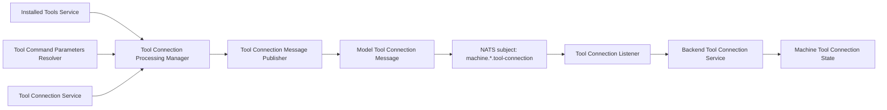
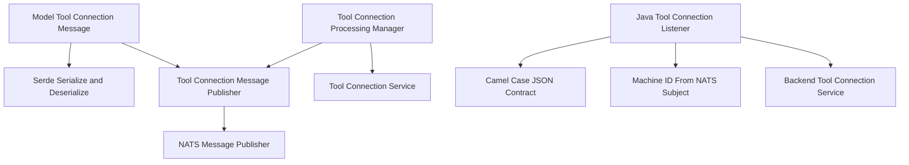
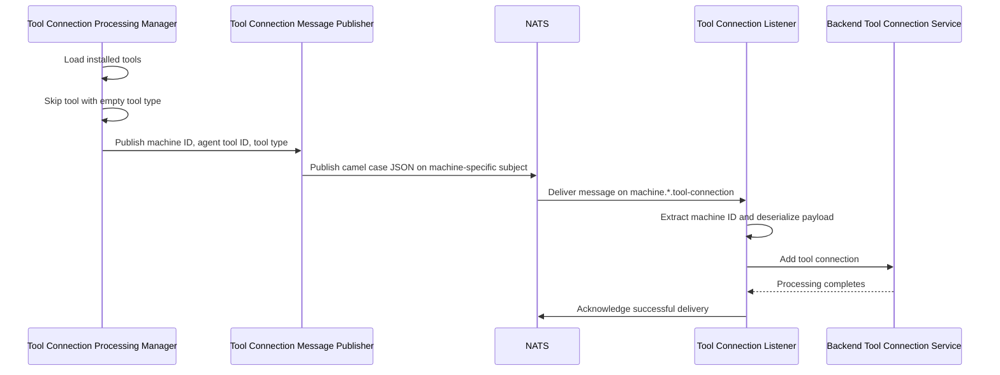
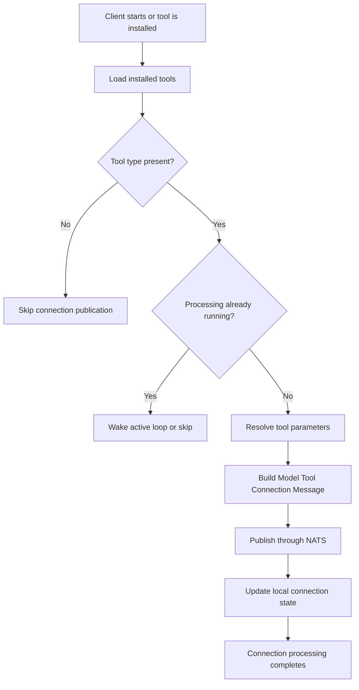

# Model Tool Connection Message

Model Tool Connection Message is the compact, cross-language event payload used by the OpenFrame client to report that a locally installed tool is connected to a machine. It belongs to the Rust `openframe_client` library supplied by OpenFrame OSS Library and is run by this repository’s client deployment. The model establishes the wire-level link between a tool category and the platform-specific tool-agent identifier; the machine identity is carried by the NATS subject rather than by the payload.

The authoritative Rust definition is [`tool_connection_message.rs`](https://github.com/flamingo-stack/openframe-oss-lib/blob/16e7c1cbd9664e7d10ec5ebca7d53c9bd314decf/clients/openframe-client/src/models/tool_connection_message.rs).

## Purpose and Scope

A tool connection must allow the backend to associate an OpenFrame machine with an integrated tool. Model Tool Connection Message contains exactly the two values needed for that association:

| Wire property | Rust field | Meaning |
|---|---|---|
| `toolType` | `tool_type` | Non-empty category of the connected tool. The client-side processing manager skips tools that do not provide a type because the backend rejects an empty value. |
| `agentToolId` | `agent_tool_id` | Identifier assigned to the tool agent that is connected to the machine. |

The Rust structure derives `Serialize` and `Deserialize` and applies Serde’s `camelCase` rename policy. Therefore, the Rust field names are implementation details; JSON producers and consumers exchange `toolType` and `agentToolId`.

```json
{
  "toolType": "example-tool-type",
  "agentToolId": "example-agent-tool-id"
}
```

This model does not include the machine identifier, a timestamp, delivery status, credentials, endpoint information, or a result. Those responsibilities belong to the NATS routing envelope, connection-processing workflow, local connection state, and backend service respectively.

## Architecture

The model is part of the OpenFrame client’s tool-connection path. The Rust client discovers installed tools, resolves their command parameters, and uses the message publisher to serialize and publish the connection event. The Java client service consumes the event and records the machine-to-tool relationship.



### Component Responsibilities

- **Model Tool Connection Message** is a transport DTO. It owns field names and JSON serialization compatibility, but contains no behavior or validation logic.
- **Tool Connection Processing Manager** coordinates connection publication for installed tools. At startup it iterates installed tools; for a newly installed tool it can trigger processing immediately. It prevents simultaneous work for the same tool and can wake an existing processing loop for a prompt re-publication.
- **Tool Connection Message Publisher** builds a machine-specific topic and publishes the model through the client’s NATS publisher. Its public `publish` operation accepts the machine ID separately from `agentToolId` and `toolType`, reinforcing that machine identity is encoded in routing rather than in the body.
- **Tool Connection Service** persists local `ToolConnection` records. A record holds the tool-agent ID, agent-tool ID, and whether it has been published; records are keyed for replacement by tool-agent ID.
- **Tool Connection Listener** in the Java client service subscribes to `machine.*.tool-connection`, extracts the machine ID from the subject, deserializes the two JSON properties, and delegates association to its backend `ToolConnectionService`.

## Dependencies and Boundaries



The model has a deliberately narrow dependency surface: it imports only Serde traits. It must remain compatible with the Java-side `ToolConnectionMessage` consumer from OpenFrame OSS Library because the listener maps the same camel-case properties before invoking backend connection handling.

The broader runtime assembly is supplied by the OpenFrame OSS Library at version `7.0.11` for Maven components and `v0.0.5` for the `openframe_agent_lib` Cargo artifact. This repository deploys the OpenFrame client service alongside the NATS datasource used for message transport.

## Publication and Consumption Flow

The normal connection-reporting process is asynchronous and subject-routed.



### Delivery Semantics

The Java listener uses the `TOOL_CONNECTIONS` stream and the `tool-connection-processor-v2` consumer with the `tool-connection` delivery group. It reads NATS delivery metadata to determine whether the current delivery is the final attempt and passes that information to the backend service.

A message is acknowledged only after backend processing completes successfully. If subject extraction, JSON deserialization, or backend handling throws an exception, the listener leaves the message unacknowledged so NATS can redeliver it. The Rust publisher currently reports a publication error to its caller; its implementation notes that publisher acknowledgement and retry remain future work.

## Processing Lifecycle



On every client start, the processing manager re-resolves and republishes installed tool connections. This supports cases where an agent identifier changed outside the client, such as a tool re-key or backend data reset. A new installation uses the same workflow but requests immediate processing instead of waiting for a later periodic pass.

## Compatibility Requirements

Changes to this model affect an asynchronous integration boundary. Maintain the following invariants:

1. Keep the Serde camel-case policy or preserve the resulting `toolType` and `agentToolId` JSON names explicitly.
2. Treat both fields as required strings at the producer boundary. In particular, do not publish an empty tool type.
3. Do not move machine identity into the body without coordinating a change to the NATS subject contract and the Java listener’s subject-based extraction.
4. Preserve compatibility with persisted local `ToolConnection` state, which tracks publication independently from this payload.
5. Test producer serialization and Java consumer deserialization together when adding fields or changing types. The model itself has no observed direct test references in the indexed organization, so interoperability verification is especially important.

## Operational Notes

For a failed association, inspect these boundaries in order:

1. Confirm the installed tool has a non-empty tool type; otherwise the processing manager intentionally skips it.
2. Confirm the client can publish to the machine-specific NATS tool-connection subject.
3. Confirm the payload uses camel-case `toolType` and `agentToolId` keys.
4. Confirm the listener can derive the machine ID from the subject and then process the payload.
5. Check whether delivery remains unacknowledged, which indicates the listener encountered an error and NATS may redeliver the event.

Model Tool Connection Message is intentionally small. Its value is not local computation, but a stable contract that lets the client and server independently evolve their tool-management workflows while retaining a shared machine-to-tool association event.
