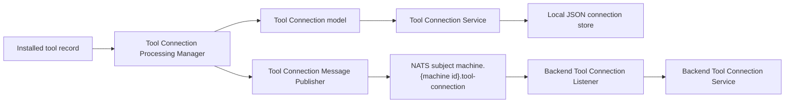
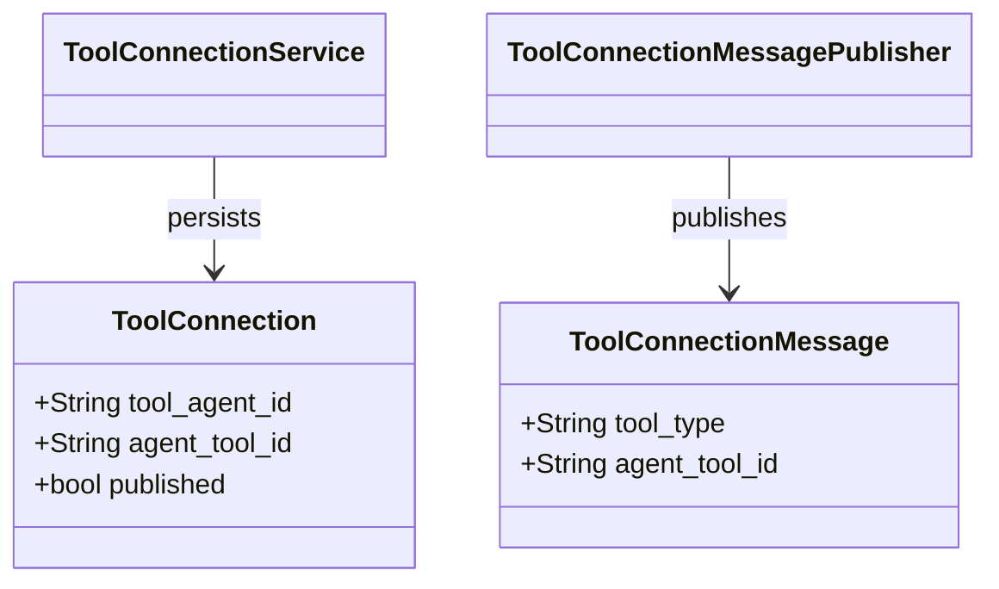
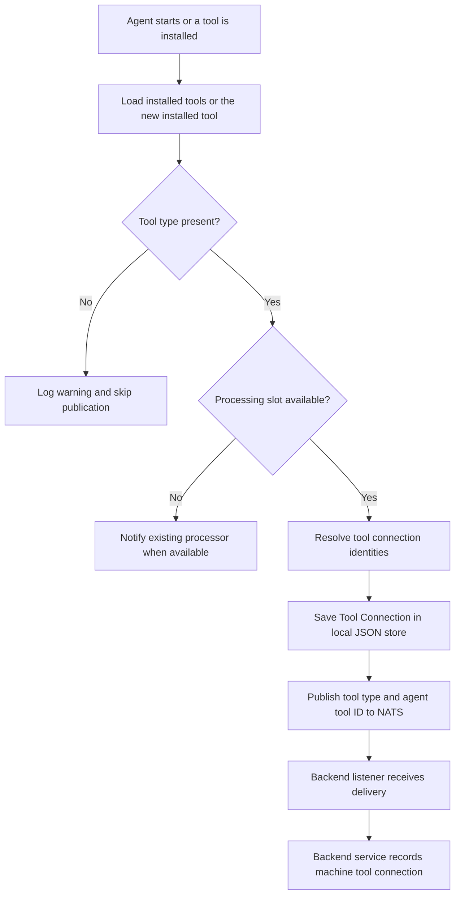
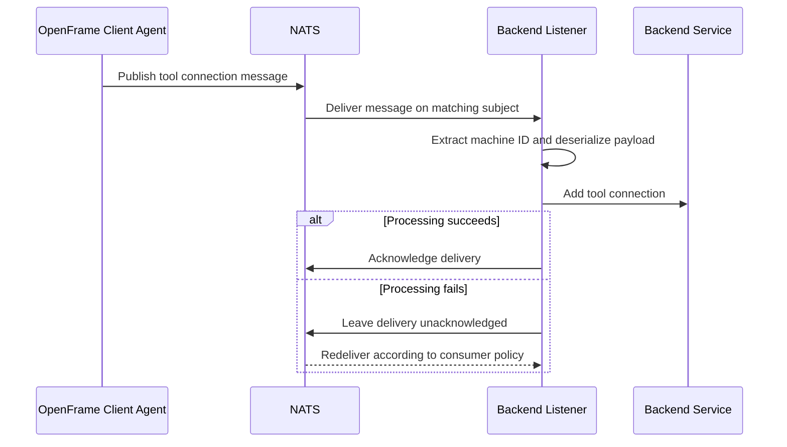

# Model Tool Connection

Model Tool Connection defines the local record used by the OpenFrame Client agent to track the association between an installed integrated tool and its server-side tool-agent identity. It is implemented by the `ToolConnection` Rust type in the OpenFrame OSS Library's `openframe_agent_lib` artifact, version `0.0.5`, which this repository consumes at runtime.

The model is deliberately small: it records the identity supplied by the local installation, the identity assigned to the agent-side tool, and whether that relationship has been published. The surrounding client services persist the record and publish a compact connection notification to NATS so the OpenFrame Client backend can maintain the device-to-tool relationship.

**Source:** [Tool Connection model in OpenFrame OSS Library](https://github.com/flamingo-stack/openframe-oss-lib/blob/7a766f00e4f58b5d89db007b878ac8d6e0c344f4/clients/openframe-client/src/models/tool_connection.rs)

## Purpose and Scope

A tool installation has two identifiers with different responsibilities:

| Field | Meaning | Used for |
|---|---|---|
| `tool_agent_id` | Identifier for the server-side integrated tool-agent record. | Local persistence identity and replacement of a previously saved connection. |
| `agent_tool_id` | Identifier reported by the installed tool agent. | The identity delivered to the backend in the connection message. |
| `published` | Local publication-state flag. | Records whether the connection was successfully published by the agent workflow. |

The type derives `Debug`, `Clone`, `Serialize`, `Deserialize`, `PartialEq`, `Eq`, and `Default`. Consequently, it can be logged during diagnostics, duplicated by asynchronous workflows, encoded to and decoded from persisted JSON, compared in tests or reconciliation logic, and instantiated with default field values.

This model does not contain credentials, connection endpoints, executable paths, or tool configuration. It represents only the identity mapping and its local publication state.

## Architecture

The model belongs to the Rust OpenFrame Client running on a managed endpoint. It is consumed by local persistence and processing services in the same library; the tenant deployment includes the Java OpenFrame Client backend listener that receives the resulting NATS message.

### Component Responsibilities

| Component | Responsibility | Relationship to Model Tool Connection |
|---|---|---|
| `ToolConnection` | Serializable local mapping of tool-agent identity, installed-agent identity, and publication state. | Defines the persisted record. |
| Tool Connection Service | Reads the complete connection list from a JSON file and serializes writes through a mutex. A save replaces an entry having the same `tool_agent_id`, or appends a new entry. | Owns durable local storage for `ToolConnection` records. |
| Tool Connection Processing Manager | Enumerates installed tools at startup and processes newly installed tools. It skips tools with an empty tool type and prevents concurrent processing for the same tool. | Resolves and persists connection state while arranging publication. |
| Tool Connection Message Publisher | Builds a transport message from the machine ID, agent tool ID, and tool type, then publishes it through the NATS publisher. | Sends the externally consumable representation; the persisted `published` flag is not part of the shown wire model. |
| Backend Tool Connection Listener | Consumes messages from the `TOOL_CONNECTIONS` stream using the `machine.*.tool-connection` subject and delegates to the backend service. | Applies the reported mapping to backend state. |

## Data Contracts

The local persistence contract and the wire contract are intentionally distinct.

`ToolConnectionMessage` includes `tool_type` and `agent_tool_id`. The machine identity is carried by the NATS subject constructed by the publisher rather than shown as a payload field. The backend listener extracts the machine ID from the subject, deserializes the payload, obtains the delivery count, and calls its backend Tool Connection Service with the machine ID, tool type, agent tool ID, and whether the delivery is the final attempt.

The local `tool_agent_id` is not shown in the message contract. It is used by the client-side persistence service as the key for replacing an existing connection record.

## Connection Publication Flow

The processing manager supports two entry points:

- `run` loads all installed tools when the agent starts. It deliberately re-resolves and republishes each eligible tool because a tool-agent ID may change outside the local process, such as after a tool re-key or backend data reset.
- `run_new_tool` handles a new installation. If a loop for that tool is already active, it signals that loop for immediate republication instead of creating a concurrent processor.

## Delivery and Acknowledgement Behavior

The publication path uses the NATS message publisher and reports an error if the publish operation fails. The publisher contains a noted future enhancement to wait for an acknowledgement and retry after a failure; therefore callers must continue to treat a successful local publish call and an acknowledged backend update as separate concerns.

On the backend, the listener uses a durable consumer named `tool-connection-processor-v2` and delivery group `tool-connection`. For a successfully handled message it explicitly acknowledges the NATS delivery. If parsing, machine-ID extraction, or backend processing throws an exception, it leaves the message unacknowledged so NATS can redeliver it. The listener passes final-attempt information derived from the NATS delivery count to its service.

## Persistence Semantics

The client-side service loads an array of `ToolConnection` values from its configured JSON file. A read that has no parsed data yields an empty list. When saving, the service acquires its writer mutex, reloads the current list, replaces the record with a matching `tool_agent_id` if one exists, otherwise appends the record, and persists the updated collection.

This makes `tool_agent_id` the local upsert key. Maintainers should preserve that behavior when changing the model: changing its meaning or allowing duplicate tool-agent IDs would alter reconciliation behavior and could leave stale local mappings.

## Operational Considerations

- **Tool type is required for publication.** The manager rejects an installed tool whose tool type is empty because the backend rejects such messages.
- **Startup is a reconciliation point.** Republishing on startup repairs backend mappings that become stale when an external change alters an agent tool ID.
- **Per-tool concurrency is controlled.** The manager tracks running tools and wake signals to prevent duplicate connection processors while still allowing a reinstall to trigger prompt republication.
- **Storage failures matter.** Read and write errors are contextualized by the local connection-file path and should be surfaced in agent diagnostics.
- **Wire compatibility matters.** Adding or renaming fields in the message contract requires compatible changes in the backend listener and its message deserialization.

## Maintenance Checklist

When modifying Model Tool Connection or its workflow:

1. Keep `tool_agent_id` stable as the local persistence replacement key, unless a coordinated migration is introduced.
2. Verify JSON serialization compatibility for existing endpoint state before adding or making fields mandatory.
3. Confirm that an empty tool type remains rejected before a message is published.
4. Preserve per-tool processing exclusion and wake-up behavior to avoid duplicate workers after reinstall events.
5. Test both successful acknowledgement and unacknowledged redelivery behavior through the NATS consumer path.
6. Coordinate any transport-contract change with the backend `TOOL_CONNECTIONS` listener and its service.
