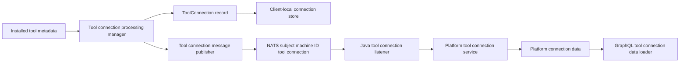
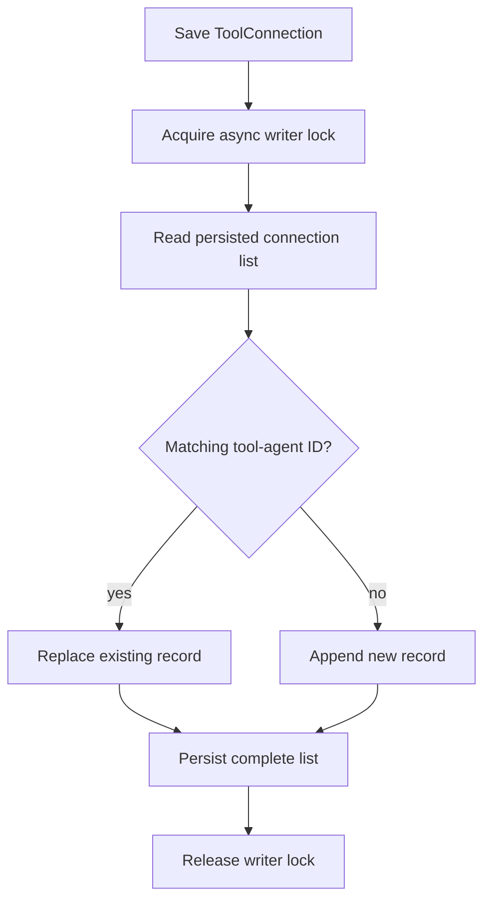
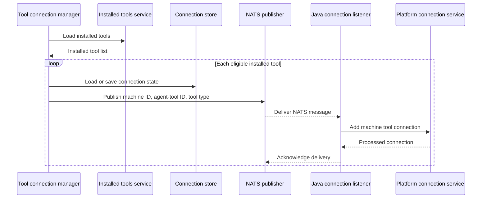
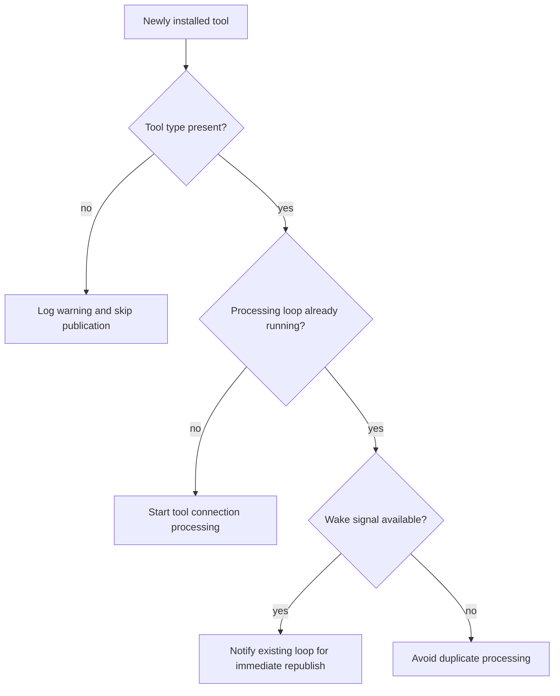

# Model Tool Connection

Model Tool Connection defines the compact, persistent record that associates an installed local tool with the server-side tool-agent identity used by OpenFrame. It is implemented by the Rust `openframe_client` library from OpenFrame OSS Library and runs as part of this repository's OpenFrame client deployment.

The model is deliberately a data contract: it has no methods or validation logic of its own. Its value is in retaining the identity mapping that lets the agent publish a tool-connection event and lets the platform associate that installed tool with the correct managed device.

## Scope and Ownership

The Rust definition is [`ToolConnection`](https://github.com/flamingo-stack/openframe-oss-lib/blob/16e7c1cbd9664e7d10ec5ebca7d53c9bd314decf/clients/openframe-client/src/models/tool_connection.rs). It derives `Debug`, `Clone`, `Serialize`, `Deserialize`, `PartialEq`, `Eq`, and `Default`.

The module is part of the `openframe_client` Cargo artifact, version `0.1.0`, which this repository consumes through OpenFrame OSS Library version `7.0.11`. The record is serialized for local persistence, so its field names form part of the client-side stored-data contract.

```rust
#[derive(Debug, Clone, Serialize, Deserialize, PartialEq, Eq, Default)]
pub struct ToolConnection {
    pub tool_agent_id: String,
    pub agent_tool_id: String,
    pub published: bool,
}
```

## Data Contract

| Field | Type | Meaning | Lifecycle owner |
|---|---|---|---|
| `tool_agent_id` | `String` | Identifies the locally installed tool-agent record. The client-side connection store uses this value as its replacement and deletion key. | Tool installation and update workflow |
| `agent_tool_id` | `String` | Identifies the corresponding platform-side agent-tool association. It is the identifier sent with a connection publication. | Tool-connection processing workflow |
| `published` | `bool` | Records whether the connection has been published successfully. The field supports durable progress tracking across client restarts. | Tool-connection processing workflow |

`Default` creates an empty record with empty string identifiers and `published` set to `false`. Empty identifiers are therefore structurally possible; validation must be supplied by the workflow that creates or publishes a record. In particular, the processing manager rejects installed tools with an empty tool type before it tries to publish a connection.

## Architecture

The model sits between installed-tool metadata, a client-local JSON-backed connection store, and the NATS event path consumed by the Java client service. It is not itself a transport message: the Rust publisher builds a separate `ToolConnectionMessage` containing `tool_type` and `agent_tool_id`.



### Component Responsibilities

| Component | Responsibility | Relationship to Model Tool Connection |
|---|---|---|
| `ToolConnectionProcessingManager` | Scans installed tools at startup and processes newly installed tools. It avoids concurrent processing for the same tool and can wake an existing loop for immediate republishing. | Creates, updates, and uses connection state while coordinating publication. |
| `ToolConnectionService` in the Rust client | Reads and persists the local connection collection. Saves replace an existing entry with the same `tool_agent_id`; deletions use that same key. | Stores `ToolConnection` records durably. |
| `ToolConnectionMessagePublisher` | Builds a per-machine NATS topic and publishes a message containing `agent_tool_id` and `tool_type`. | Sends the platform-facing projection of a connection. |
| `ToolConnectionListener` in the Java client service | Consumes `machine.*.tool-connection` from the `TOOL_CONNECTIONS` stream, extracts the machine identifier from the subject, and delegates to the platform service. | Receives the published representation rather than the full Rust record. |
| Platform `ToolConnectionService` | Validates and stores the platform-side relationship after the listener delivers it. | Materializes the device-visible relationship. |
| `ToolConnectionDataLoader` | Batch-loads connections for machine identifiers for GraphQL resolution. | Exposes persisted platform connections to API execution. |

## Local Persistence Semantics

The Rust client-side service treats `tool_agent_id` as the record identity. A save operation serializes access with an asynchronous mutex, loads the existing collection, replaces a matching entry or appends a new entry, then persists the complete collection. Deletion performs the same serialized read-modify-write sequence and reports whether it removed anything.



The reader uses a JSON read-or-quarantine helper and returns an empty list when no parsed data is available. This allows the client to recover to an empty in-memory connection list when the persistence layer does not provide a parsed collection, while surfacing read failures through the service result.

## Publication and Platform Processing Flow

At client startup, the processing manager loads installed tools. If there are no installed tools, it exits successfully without publishing. For each tool, it requires a non-empty tool type, prevents duplicate concurrent processing for that tool, and processes the connection. The manager deliberately re-resolves and republishes during every start because the server-side agent identifier can change independently, such as after a tool re-key or a database reset.



On the platform side, the listener only acknowledges the NATS message after `addToolConnection` completes. If parsing, machine-ID extraction, or service processing throws an exception, it leaves the message unacknowledged so the messaging system can redeliver it. The listener determines whether the current delivery is the last attempt and passes that fact to the platform service.

## New Tool and Concurrent Processing Behavior

A new installation invokes `run_new_tool`. The manager first checks that the tool has a type. It then attempts to mark the tool as running:

- If no worker currently owns the tool, the manager starts a new processing loop.
- If a worker already owns the tool and a wake signal is registered, the manager notifies that worker so it republishes without waiting for its normal cycle.
- If a worker owns the tool but no wake signal is available, it skips duplicate processing.



## Integration Boundaries

### Rust Client Boundary

Model Tool Connection is implemented in the OpenFrame OSS Library, not in this repository's Java services. The tenant repository packages and deploys the surrounding OpenFrame client service, while the agent library supplies the local record, local connection store, processing manager, and NATS publisher.

The client configuration provides the machine identity used to construct the NATS subject. The published payload intentionally contains the platform-relevant `agent_tool_id` and the installed tool type. It does not expose the local `tool_agent_id` or `published` flag as part of that payload.

### Platform Boundary

The tenant deployment includes the Java OpenFrame client service, which runs the NATS listener. The listener subscribes to the `TOOL_CONNECTIONS` stream using the subject pattern `machine.*.tool-connection`, with the `tool-connection-processor-v2` consumer and the `tool-connection` delivery group. It extracts the machine ID from the message subject, deserializes the payload, records the connection through the platform service, and acknowledges only after successful processing.

The API service's GraphQL `ToolConnectionDataLoader` subsequently asks the platform API `ToolConnectionService` for connections for a batch of machine IDs. This separates asynchronous device reporting from API query resolution.

## Reliability and Maintenance Notes

- **Preserve identifier meaning.** Changing either identifier or changing `tool_agent_id` matching semantics can orphan local records, duplicate persisted entries, or break cleanup during tool removal.
- **Maintain serialization compatibility.** `ToolConnection` is persisted through Serde. Renaming fields or changing their types requires a migration strategy for existing local data.
- **Keep publication and persistence distinct.** The model contains local progress state, while the wire message contains the identifiers the platform needs. Do not assume the wire payload can reconstruct the complete local record.
- **Expect repeated publication.** Startup republishing is intentional to reconcile platform mappings after remote identity changes. Consumers must treat connection updates as safe to process repeatedly.
- **Preserve acknowledgement ordering.** The listener's success-only acknowledgement is the retry boundary. Acknowledge before durable platform processing would lose a connection on failure.
- **Use tool-level concurrency protection.** The processing manager's running-tool and wake-signal coordination prevents overlapping connection workflows for the same tool while allowing a reinstall to request an immediate retry.

## Testing Focus

The provided source declares no tests specifically for the Rust data model. Maintain coverage at the workflow boundaries:

1. Serialize and deserialize a populated record, including `published` values of both `true` and `false`.
2. Verify save replacement uses `tool_agent_id`, rather than `agent_tool_id`, as the identity key.
3. Verify deletion returns `true` only when it removed a matching local record.
4. Verify an empty tool type is not published.
5. Verify a restart republishes eligible installed tools after the platform mapping changes.
6. Verify listener failures leave a NATS message unacknowledged and successful processing acknowledges it.
7. Verify batched API reads return the connections belonging to each requested machine.
