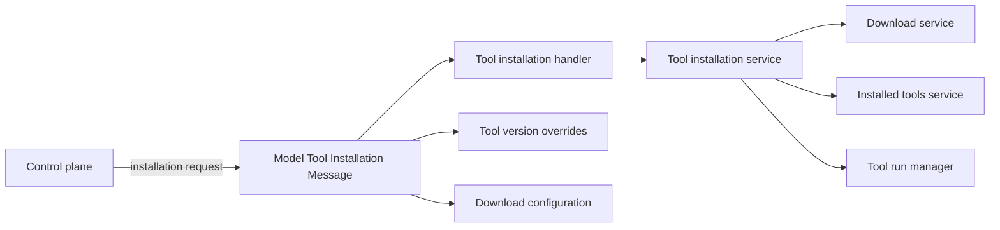
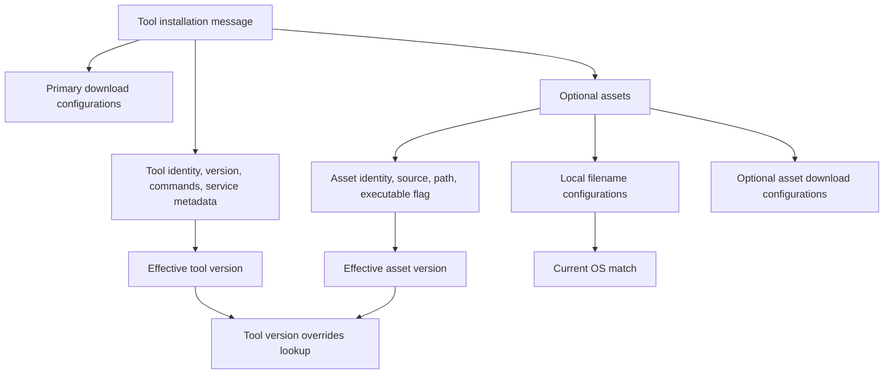
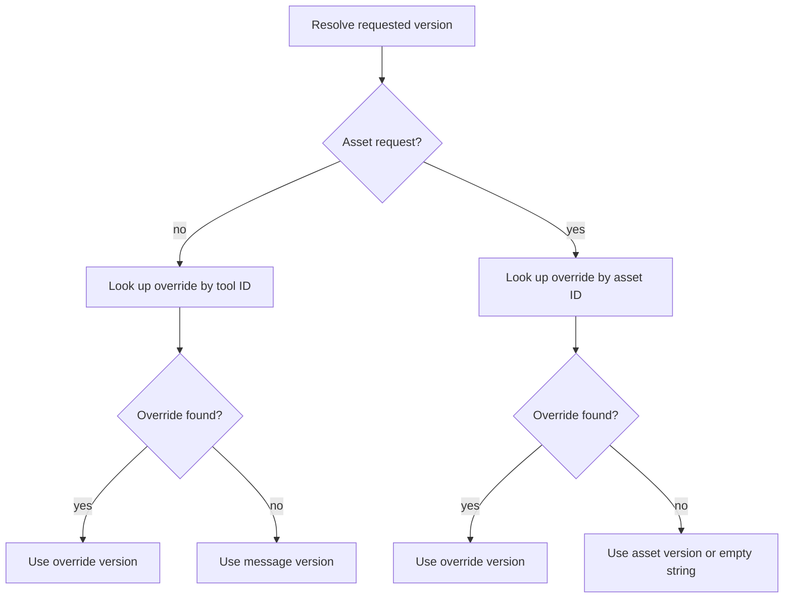
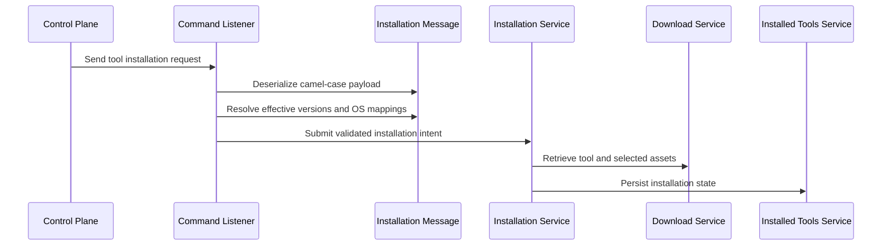

# Model Tool Installation Message

Model Tool Installation Message defines the wire model used by the OpenFrame client to describe an integrated-tool installation. It carries the tool identity, requested version, commands, download alternatives, optional auxiliary assets, and service metadata as a single camel-case JSON payload.

The implementation is supplied by the OpenFrame OSS Library's `openframe_agent_lib` Cargo artifact, which this repository consumes. The authoritative source is [tool installation message source](https://github.com/flamingo-stack/openframe-oss-lib/blob/16e7c1cbd9664e7d10ec5ebca7d53c9bd314decf/clients/openframe-client/src/models/tool_installation_message.rs).

## Responsibilities

The module is intentionally a model layer. It does not download, install, execute, or report on a tool. Instead, it provides these guarantees to the client components that do that work:

- A stable, camel-case serializable contract for a requested tool installation.
- A primary tool record with its command arguments and optional service name.
- Per-platform download configurations for the tool and, when needed, individual assets.
- A source discriminator that distinguishes Tool API assets from GitHub assets.
- OS-specific local filename selection through a case-insensitive platform check.
- A version-resolution boundary: a configured override takes precedence over the message's declared tool or asset version.

## Architecture and Boundaries

The message is received and processed in the Rust OpenFrame client provided by the OpenFrame OSS Library. The broader client contains command listener handlers, tool installation services, download services, installed-tool persistence, and tool run management. Model Tool Installation Message is the shared input contract that keeps those responsibilities separate.



The diagram describes the client architecture represented by the module tree. The message module itself directly imports only the Download Configuration model and Tool Version Overrides lookup; the remaining components are higher-level client collaborators that consume the installation request during an installation workflow.

## Contract Structure

### Tool Installation Message

`ToolInstallationMessage` is the top-level payload. Serde applies `camelCase` naming to its serialized fields.

| Field | Required | Meaning |
|---|---:|---|
| `tool_agent_id` | Yes | Identifier for the integrated-tool agent instance to install. |
| `tool_id` | Yes | Identifier of the tool definition. |
| `tool_type` | Yes | Tool category supplied by the control plane. |
| `version` | Yes | Requested tool version before local overrides are applied. |
| `reinstall` | Yes | Whether the request asks the client to reinstall the tool. |
| `download_configurations` | No, defaults empty | Ordered or otherwise supplied download configuration set for the primary tool. |
| `installation_command_args` | No | Arguments for installation. Omitted from serialized output when absent. |
| `uninstallation_command_args` | No | Arguments for uninstallation. Omitted from serialized output when absent. |
| `run_command_args` | Yes | Arguments for running the installed tool. |
| `tool_agent_id_command_args` | No | Arguments associated with the tool-agent identifier. Omitted when absent. |
| `assets` | No | Optional collection of supplementary assets. Omitted when absent. |
| `service_name` | No | Optional service identifier for service-oriented tools. Omitted when absent. |

A missing `downloadConfigurations` property deserializes as an empty collection. This differs from the optional fields: absent optional command-argument collections and assets become `None` and are not emitted on serialization.

### Asset

`Asset` represents an auxiliary artifact associated with the requested tool. It also serializes field names as camel case.

| Field | Required | Meaning |
|---|---:|---|
| `id` | Yes | Asset identity, also used for asset-level version overrides. |
| `local_filename_configuration` | Yes | Per-OS filename mapping for the asset. |
| `source` | Yes | Asset source: `TOOL_API` or `GITHUB` on the wire. |
| `path` | No | Optional source-relative or logical asset path. |
| `executable` | No, defaults false | Marks whether the asset should be considered executable. |
| `download_configurations` | No | Asset-specific download configuration set. |
| `version` | No | Asset version before applying an override. |

The `path` field is an optional value but does not use a serialization-skip annotation in this module. In contrast, asset download configurations and version are omitted from output when absent.

### Local Filename Configuration

`LocalFilenameConfig` maps a local filename to an operating system label:

| Field | Meaning |
|---|---|
| `filename` | Name to use for the locally materialized asset on the matching platform. |
| `os` | Platform selector compared with the current compiled target. |

`matches_current_os()` recognizes only Windows, macOS, and Linux builds. It performs an ASCII case-insensitive comparison against `windows`, `macos`, or `linux`. An unrecognized compilation target returns `false`; therefore no mapping matches by default on an unsupported target.

### Asset Source

`AssetSource` is an enum with explicit wire values:

| Rust variant | Serialized value | Meaning |
|---|---|---|
| `ToolApi` | `TOOL_API` | Obtain the asset through the Tool API path. |
| `Github` | `GITHUB` | Obtain the asset through the GitHub path. |

Explicit serialization names are significant for compatibility. Do not rename variants or substitute Rust-style names in payloads without coordinating both control-plane and client releases.

## Component Relationships



## Version Resolution

Both the tool and each asset have an original version and an effective version. Effective-version methods consult the central Tool Version Overrides lookup first:

1. For the primary tool, `effective_version()` looks up an override using `tool_id`.
2. If no override exists, it returns the message's `version`.
3. For an asset, `original_version()` returns the supplied `version`, or an empty string when the field is absent.
4. Asset `effective_version()` looks up an override using the asset `id`.
5. If absent, it returns the asset's original version.



This design allows local or centrally configured compatibility overrides without mutating the received message. Callers that need to reproduce the sender's exact declared asset version should use `original_version()` rather than the effective version.

## Installation Request Data Flow

The message model supports a request lifecycle without embedding the lifecycle logic itself.



The source file does not perform validation, network access, filesystem changes, or persistence. Those actions belong to the consuming client services. This is why values such as `tool_type`, paths, and command arguments should be treated as data supplied to a later processing layer rather than semantics enforced by this module.

## Serialization Example

The following illustrative payload shows the on-wire naming and source values. It demonstrates the model shape only; values must be selected by the control plane for the target tool.

```json
{
  "toolAgentId": "agent-123",
  "toolId": "remote-tool",
  "toolType": "remoteAccess",
  "version": "1.2.3",
  "reinstall": false,
  "downloadConfigurations": [],
  "installationCommandArgs": ["install", "silent"],
  "runCommandArgs": ["start"],
  "assets": [
    {
      "id": "helper-binary",
      "localFilenameConfiguration": [
        {
          "filename": "helper.exe",
          "os": "windows"
        }
      ],
      "source": "TOOL_API",
      "path": "helpers/helper.exe",
      "executable": true,
      "version": "1.2.3"
    }
  ],
  "serviceName": "remote-tool-service"
}
```

## Maintenance Guidance

- Preserve field names and explicit enum wire values because this structure crosses the control-plane and endpoint-client boundary.
- Retain `serde(default)` on the primary download configuration collection and executable flag when evolving backward-compatible payload handling.
- Apply a version override only through the existing lookup boundary so tool-level and asset-level behavior remains consistent.
- Add platform support by extending the compile-target branch in `matches_current_os()` and by defining the expected wire label. Unsupported targets currently match no filename mapping.
- Treat absent asset versions deliberately: fallback resolution yields an empty string, not a missing optional value.
- Keep installation execution policies in the client service layer; this module should remain a serializable, cloneable contract model.

## Source and Runtime Context

The Rust source is maintained in the OpenFrame OSS Library and is assembled into this repository's OpenFrame client runtime through the `openframe_agent_lib` dependency. In this repository, the surrounding deployment publishes the OpenFrame client as the `openframe-client` container image. The model therefore participates in endpoint agent behavior even though its source code resides in the shared library.
