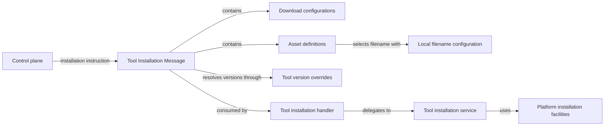
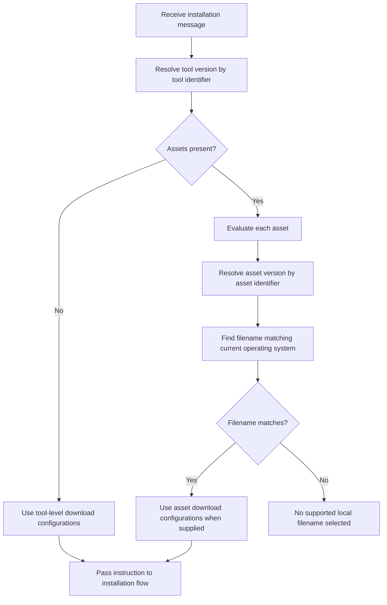
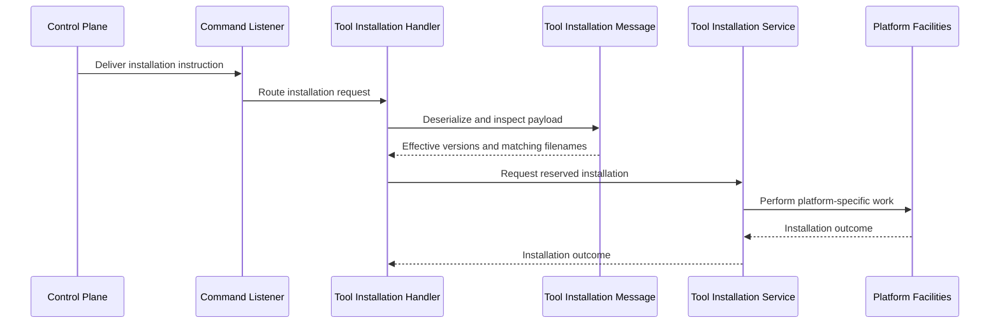

# Model Tool Installation Message

Model Tool Installation Message defines the Rust wire model that tells an OpenFrame Client agent which integrated tool to install or reinstall and how to obtain its files. It is supplied at runtime by the `openframe_agent_lib` crate from OpenFrame OSS Library, version `v0.0.5`, which this repository consumes. The model is serialized and deserialized as JSON with camel-case property names.

The implementation is maintained in [the OpenFrame OSS Library source](https://github.com/flamingo-stack/openframe-oss-lib/blob/7a766f00e4f58b5d89db007b878ac8d6e0c344f4/clients/openframe-client/src/models/tool_installation_message.rs). This module is a contract and selection layer: it does not download, write, launch, or uninstall a tool itself.

## Purpose and Scope

A tool installation instruction combines:

- **Identity and lifecycle intent**: the tool-agent identifier, tool identifier, tool type, requested version, and reinstall flag.
- **Install behavior**: optional installation and uninstallation argument vectors, required run arguments, an optional identifier argument vector, and an optional service name.
- **Download selection**: tool-level download configurations and optional asset-specific download configurations.
- **Asset metadata**: an asset identifier, source, optional path and version, executable marker, and operating-system-specific local filenames.
- **Version resolution**: accessors that replace a supplied version when a local tool-version override exists.

The message deliberately carries argument values as arrays of strings. Consumers can preserve the sender's argument boundaries instead of reconstructing a shell command from one string.

## Contract Types

### Tool Installation Message

`ToolInstallationMessage` is the top-level JSON payload. Its fields are summarized below.

| Field | Required | Purpose |
|---|---:|---|
| `toolAgentId` | Yes | Identifies the managed tool-agent installation target. |
| `toolId` | Yes | Identifies the tool definition. |
| `toolType` | Yes | Describes the tool type for the receiving client. |
| `version` | Yes | Requested tool version before any local override is applied. |
| `reinstall` | Yes | States whether the installation should be treated as a reinstall request. |
| `downloadConfigurations` | No, defaults to an empty list | Tool-level candidate download configurations. |
| `installationCommandArgs` | No | Arguments for installation when the recipient supports them. Omitted from serialized JSON when absent. |
| `uninstallationCommandArgs` | No | Arguments for uninstallation when present. Omitted when absent. |
| `runCommandArgs` | Yes | Arguments used to run the tool. |
| `toolAgentIdCommandArgs` | No | Additional identifier-related arguments. Omitted when absent. |
| `assets` | No | Supplementary asset definitions. Omitted when absent. |
| `serviceName` | No | Service name for a service-oriented tool. Omitted when absent. |

`effective_version()` returns an override registered for `toolId`; if no override is present, it returns `version`. The method borrows a string slice and does not mutate the message, so the original requested value remains available in the model.

### Asset

`Asset` describes an individual file or artifact associated with the tool instruction.

| Field | Required | Purpose |
|---|---:|---|
| `id` | Yes | Asset identifier and key used for asset-level version overrides. |
| `localFilenameConfiguration` | Yes | Candidate local filenames, each scoped to an operating system. |
| `source` | Yes | Declares whether the asset comes from the Tool API or GitHub. |
| `path` | No | Optional source-relative or asset path. |
| `executable` | No, defaults to `false` | Marks the asset as executable. |
| `downloadConfigurations` | No | Asset-specific download configurations. |
| `version` | No | Asset version before any local override. |

`original_version()` returns the asset's supplied version or an empty string when the payload does not include one. `effective_version()` first looks up an override using the asset `id`; it falls back to that original version when no override exists.

### Local Filename Configuration

`LocalFilenameConfig` associates a `filename` with an `os` value. Its `matches_current_os()` helper recognizes only the Rust compile-time targets `windows`, `macos`, and `linux`. Matching ignores ASCII letter case. For another compilation target, the helper returns `false` rather than choosing a filename heuristically.

### Asset Source

`AssetSource` is a closed enum with the following wire values:

| Rust variant | JSON value | Meaning |
|---|---|---|
| `ToolApi` | `TOOL_API` | The artifact is sourced through the Tool API. |
| `Github` | `GITHUB` | The artifact is sourced through GitHub. |

These uppercase values are explicit enum mappings, not the camel-case convention used by the containing structures.

## Component Relationships

The model imports two neighboring client-model concerns: `DownloadConfiguration`, which represents each download option, and the tool-version override lookup. The surrounding OpenFrame Client includes command handling and a tool installation service, while platform-specific facilities perform the actual installation work.



The message model remains independent of network and filesystem APIs. That boundary lets it be deserialized and examined before a handler chooses a download configuration, requests an asset, or invokes platform-specific installation logic.

## Selection and Versioning Flow

The receiving client applies selection at two distinct levels: versions and local filenames. Version overrides are keyed independently: the top-level tool uses `toolId`, whereas each asset uses its own `id`. Therefore, an overridden tool version does not automatically imply that an asset version is overridden, and vice versa.



The module itself provides the version accessors and operating-system predicate shown above. The diagram's download and execution stages belong to the consuming client workflow; this model does not prescribe a fallback policy when an asset lacks a matching filename or a usable download configuration.

## Serialization Rules and Compatibility

The structs derive Serde `Serialize` and `Deserialize`, so the same types form both input and output contract representations. The following details are important when evolving the contract:

1. **Camel-case struct fields.** Rust field names such as `tool_agent_id` are emitted and read as `toolAgentId`.
2. **Default only where declared.** An absent `downloadConfigurations` field on the top-level message becomes an empty list. An absent `executable` field on an asset becomes `false`. Other non-optional fields remain required during deserialization.
3. **Optional values are omitted.** Optional command argument lists, assets, service name, asset download configurations, and asset version are not serialized when `None`.
4. **Enum strings are fixed.** Producers must send `TOOL_API` or `GITHUB` for `source`.
5. **Version values are not normalized here.** The model returns the configured override or the received value; comparison, validation, and acquisition decisions are outside this module.

## Example Payload Shape

The following illustrative shape shows the JSON naming and optionality. Values are placeholders and do not imply a particular deployment configuration.

```json
{
  "toolAgentId": "agent-identifier",
  "toolId": "tool-identifier",
  "toolType": "service",
  "version": "1.2.3",
  "reinstall": false,
  "downloadConfigurations": [],
  "runCommandArgs": ["--run"],
  "assets": [
    {
      "id": "asset-identifier",
      "localFilenameConfiguration": [
        {
          "filename": "tool-binary",
          "os": "linux"
        }
      ],
      "source": "TOOL_API",
      "executable": true,
      "version": "1.2.3"
    }
  ]
}
```

## Installation Interaction

The broader client-side interaction separates receipt, interpretation, and execution. A command listener and its tool installation handler receive the instruction. The handler can use the message's resolved versions and asset metadata while coordinating with the tool installation service. The service owns installation orchestration; this model supplies the typed inputs.



## Maintainer Guidance

- Keep wire-name changes backward compatible. Renaming a serialized field or changing an enum value changes the contract delivered to installed agents.
- Preserve the distinction between a tool identifier and an asset identifier when modifying version override behavior.
- Add a new operating system branch to `matches_current_os()` only when the client has a defined filename and installation strategy for that target.
- Do not infer an executable filename from an unmatched operating-system configuration. The current implementation intentionally reports no match for unsupported targets.
- Treat command-argument vectors as structured values. Converting them to a single shell string in a downstream consumer can change quoting and argument-boundary behavior.
- When adding optional fields, apply explicit serialization behavior deliberately so that absence and empty values retain their intended wire semantics.

## Source Ownership

The runtime implementation belongs to OpenFrame OSS Library and is assembled into this repository's client runtime through the `openframe_agent_lib` dependency. Changes to the model source should be made in the library repository and then consumed through the pinned library version in OpenFrame OSS Tenant.
