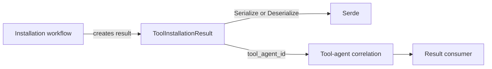
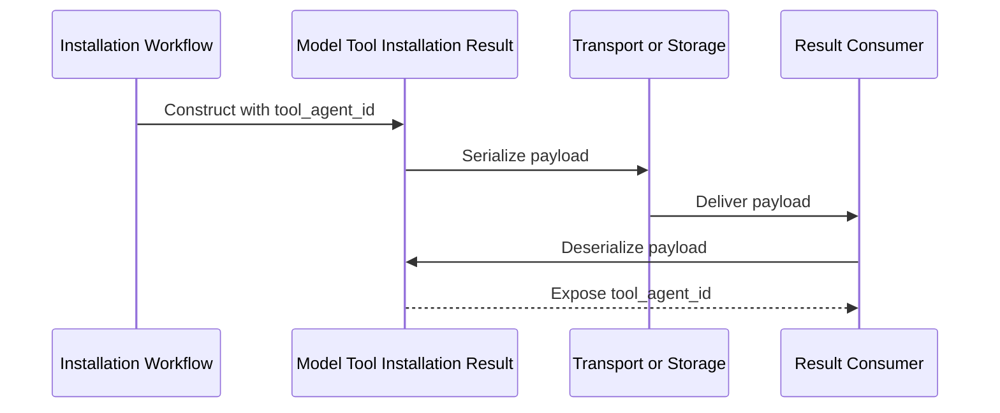

# Model Tool Installation Result

Model Tool Installation Result defines the compact Rust payload used to identify the tool-agent record associated with a tool-installation result. It is implemented by the `ToolInstallationResult` struct in the `openframe_agent_lib` crate, supplied by the OpenFrame OSS Library and run by this repository's OpenFrame client.

The module is intentionally a data contract: it contains no installation logic, transport code, validation, status field, or error detail. Its sole field provides the correlation key needed by an enclosing installation workflow.

**Source:** [tool installation result source](https://github.com/flamingo-stack/openframe-oss-lib/blob/7a766f00e4f58b5d89db007b878ac8d6e0c344f4/clients/openframe-client/src/models/tool_installation_result.rs)

## Contract

The public type is:

| Type | Field | Rust type | Meaning |
|---|---|---|---|
| `ToolInstallationResult` | `tool_agent_id` | `String` | Identifier of the tool-agent record to which this result belongs. |

The struct derives `Debug`, `Serialize`, and `Deserialize` from Serde:

- `Debug` supports diagnostic formatting during development and logging.
- `Serialize` turns a result into a structured wire or persisted representation.
- `Deserialize` reconstructs the result from that representation.

Because the type has no Serde rename attributes, the default serialized field name is `tool_agent_id`. A compatible JSON representation is:

```json
{
  "tool_agent_id": "tool-agent-identifier"
}
```

The identifier is mandatory when deserializing a normal payload because it is a non-optional `String` and has no declared default. The model itself does not constrain the identifier format, establish uniqueness, or verify that the referenced tool agent exists; those concerns belong to the surrounding workflow.

## Architecture

Model Tool Installation Result sits at the boundary between an installation operation and the component that needs to associate that operation with a managed tool agent. The model depends only on Serde traits; it does not invoke the installer, store state, or publish a message by itself.



### Responsibilities and boundaries

| Concern | Owned by Model Tool Installation Result | Owned outside the module |
|---|---|---|
| Correlation identity | Carries `tool_agent_id` | Creates and interprets the identifier |
| Encoding | Enables Serde serialization and deserialization | Chooses the transport or persistence format |
| Installation outcome | Not represented | Determines success, failure, diagnostics, and retry behavior |
| State changes | Not performed | Installs assets and updates tool state |
| Delivery | Not performed | Sends, receives, stores, or acknowledges the enclosing result |

## Data Flow

The following flow shows the model's role without asserting a particular transport. An installation workflow obtains or already knows the relevant tool-agent identifier, constructs the payload, serializes it where needed, and a receiving workflow deserializes the payload to recover the same identifier for correlation.



### Correlation invariant

The value placed in `tool_agent_id` should identify the same logical tool-agent record before and after serialization. Since this module performs no lookup or validation, callers must ensure that they use the identifier expected by their installation orchestration and result-processing paths.

## Integration Context

This model comes from the OpenFrame OSS Library artifact `openframe_agent_lib` version `v0.0.5`, an upstream dependency of OpenFrame OSS Tenant. The containing OpenFrame client has separate modules for installation commands, tool installation messages, installed-tool records, result storage, and outbound result processing. Model Tool Installation Result remains deliberately narrower than those modules: it expresses only the association between an installation result and a tool agent.

The organization code graph reports no direct callers or tests for `ToolInstallationResult` at the indexed revision. That result should be interpreted as an absence of graph-recorded direct references, not as evidence that the model is unused at runtime through serialization, generated code, or future integrations.

## Maintenance Guidance

- Preserve `tool_agent_id` when backward compatibility of serialized payloads matters. Renaming the Rust field or adding a Serde rename changes the external contract unless migration support is added.
- Do not add installation status, error data, timestamps, or asset metadata merely for convenience. Add those only when the owning result protocol requires them, as they alter the payload schema.
- Keep validation in the workflow that understands identifier semantics. This model has no context for checking whether an identifier refers to a valid tool agent.
- When extending the type, ensure both serialization and deserialization compatibility are considered, especially for stored or queued results.
