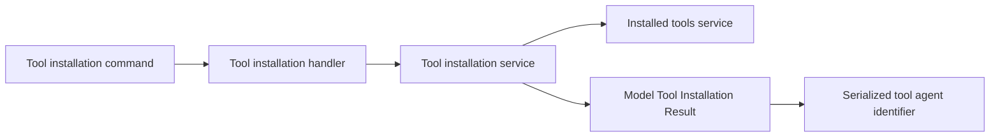
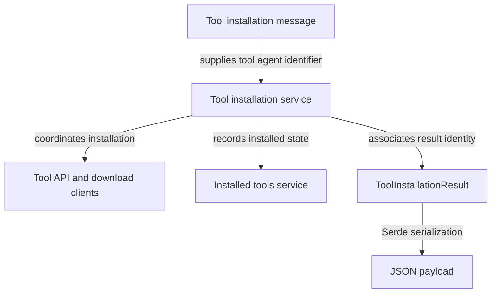
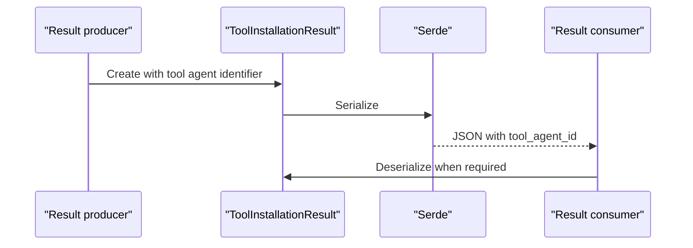
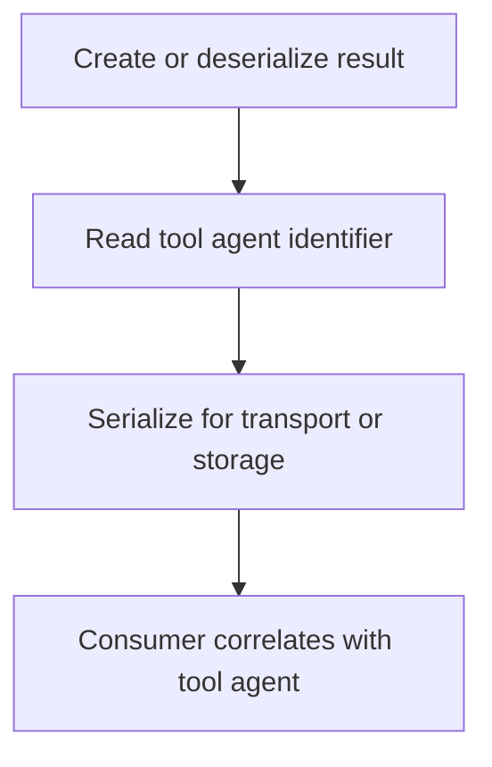

# Model Tool Installation Result

Model Tool Installation Result defines the minimal Rust payload used to identify the tool-agent record associated with a tool installation result. It is implemented by the `ToolInstallationResult` struct in the upstream **OpenFrame OSS Library** crate, `openframe_agent_lib`, which this repository consumes at version `v0.0.5`.

The module contains one serializable model with one field: `tool_agent_id`. It carries identity only; it does not encode success or failure, diagnostics, installed version, timestamps, or artifact metadata. Consumers that need those semantics must obtain them from the surrounding installation workflow or a different message model.

## Source and Ownership

The model is supplied by the OpenFrame OSS Library rather than implemented in this repository. The repository assembles that library into the OpenFrame client runtime.

| Item | Value |
|---|---|
| Crate | `openframe_agent_lib` |
| Type | `ToolInstallationResult` |
| Upstream source | [tool_installation_result.rs](https://github.com/flamingo-stack/openframe-oss-lib/blob/16e7c1cbd9664e7d10ec5ebca7d53c9bd314decf/clients/openframe-client/src/models/tool_installation_result.rs) |
| Serialization | Serde `Serialize` and `Deserialize` |
| Payload field | `tool_agent_id: String` |

## Data Model

`ToolInstallationResult` derives `Debug`, `Serialize`, and `Deserialize`. Serde therefore maps the public Rust field directly to the JSON property `tool_agent_id` unless an enclosing transport applies additional transformation.

```rust
pub struct ToolInstallationResult {
    pub tool_agent_id: String,
}
```

A serialized instance has this shape:

```json
{
  "tool_agent_id": "tool-agent-identifier"
}
```

### Contract Boundaries

| Concern | Responsibility of Model Tool Installation Result |
|---|---|
| Correlation | Identifies the target or completed tool-agent record through `tool_agent_id`. |
| Encoding | Supports serialization and deserialization through Serde. |
| Domain outcome | Not represented by this struct. There is no result-status or error field. |
| Validation | Not performed by the struct itself. An empty or malformed identifier is not rejected at this model boundary. |
| Persistence and delivery | Not implemented by this module. |

## Architecture Context

The model belongs to the Rust OpenFrame client model layer. It sits alongside installation-command and installed-tool models, while the client command handler and installation service provide the execution context. The supplied code establishes those neighboring components, but the available code graph records no direct callers, downstream consumers, or tests for `ToolInstallationResult`; do not infer a concrete publication subject or persistence path from this identity payload alone.



The diagram describes the module's architectural neighborhood: command processing and installation execution are separate responsibilities, while this module contributes only the identifier payload. It does not claim that the result is emitted at a particular point, because that behavior is not present in the supplied model implementation.

## Component Relationships



Related responsibilities are deliberately distinct:

- **Tool installation message** carries installation instructions such as the tool-agent identifier, tool identity, version, assets, commands, and service details.
- **Tool installation service** coordinates downloading, parameter resolution, local directories, process management, installed-tool storage, and connection processing.
- **Installed tools service** stores information about installed tools.
- **Model Tool Installation Result** remains a compact correlation model. It identifies the tool-agent record without duplicating installation command or installed-tool state.

## Data Flow

When an installation workflow needs to represent the associated tool-agent identity as a result payload, it creates or deserializes this model and serializes it at the transport boundary.



The only guaranteed datum in the payload is the identifier. A receiver must treat completion state, error details, and installed version as unavailable unless another contract supplies them.

## Lifecycle and Processing Guidance

The model has no methods and no internal state transitions. Its effective lifecycle is determined by its owner:



For maintainers:

1. Preserve the `tool_agent_id` field name when changing transport contracts, because Serde's default mapping exposes that exact name.
2. Treat the type as a correlation envelope, not an authoritative installation-status record.
3. Add fields only when every relevant producer and consumer can evolve compatibly; the current model is intentionally minimal.
4. Keep validation outside this DTO or introduce explicit validation at a service boundary if identifier constraints become required.

## Operational Considerations

- Logging a `ToolInstallationResult` through its `Debug` implementation exposes the tool-agent identifier. Apply the client logging policy when that identifier is considered sensitive in a deployment.
- Deserialization accepts the string representation required by Serde; the struct itself does not establish semantic identifier validation.
- Because no direct callers or tests are recorded for this type in the available full code graph, changes require end-to-end contract review rather than relying on detected in-organization references alone.

## Scope Summary

Model Tool Installation Result is a library-provided, transport-ready identifier model used in the OpenFrame client domain. Its narrow design helps result-handling code correlate an installation-related payload to a tool-agent record without coupling the payload to the broader download, installation, persistence, or command-processing implementation.
