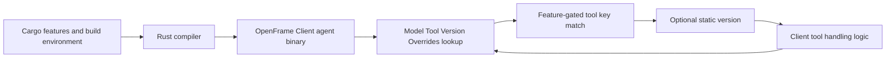
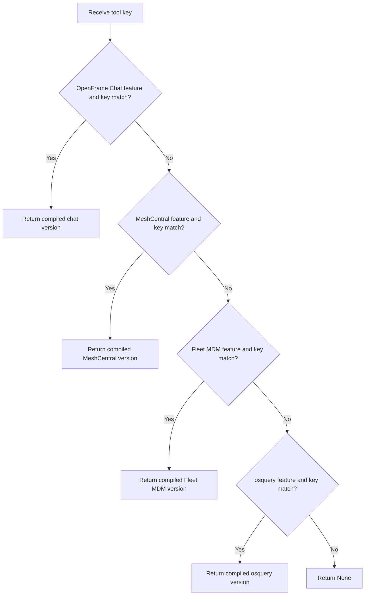
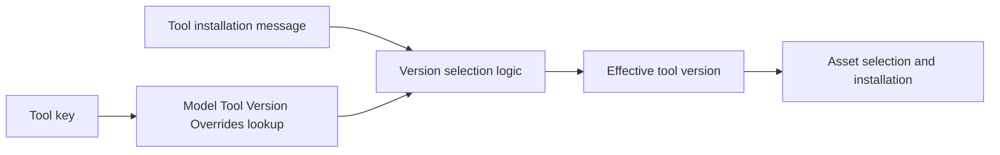

# Model Tool Version Overrides

Model Tool Version Overrides is a small, compile-time resolver in the OpenFrame Client agent library. Given a tool key, it optionally returns the version string baked into the agent binary for selected integrated tools. It lets a build choose pinned tool versions without introducing runtime configuration, file access, network access, or state.

The implementation belongs to the `openframe_agent_lib` Cargo artifact from the OpenFrame OSS Library. OpenFrame OSS Tenant consumes that artifact at version `v0.0.5` for its client runtime. The authoritative implementation is [`tool_version_overrides.rs`](https://github.com/flamingo-stack/openframe-oss-lib/blob/7a766f00e4f58b5d89db007b878ac8d6e0c344f4/clients/openframe-client/src/models/tool_version_overrides.rs).

## Purpose and Contract

`lookup(tool_key)` returns `Option<&'static str>`:

- `Some(version)` means the binary was compiled with a feature that enables an override for the supplied key and with the corresponding build-time environment variable available.
- `None` means the key has no compiled override. Callers retain their normal version-selection behavior.

The returned string has a `static` lifetime because Rust's `env!` macro embeds the value into the compiled program. This module does not parse versions, compare them, download assets, or persist an override.

## Supported Override Matrix

Each match arm is present only when its Cargo feature is enabled. The build must define the matching environment variable when that enabled arm invokes `env!`; otherwise compilation fails rather than producing a partially configured runtime override.

| Tool key | Cargo feature | Build-time environment variable | Returned value when enabled |
| --- | --- | --- | --- |
| OpenFrame Chat tool agent identifier | `openframe-chat-version` | `OPENFRAME_CHAT_VERSION` | The compiled OpenFrame Chat version |
| `meshcentral-server` | `meshcentral-agent-version` | `MESHCENTRAL_AGENT_VERSION` | The compiled MeshCentral agent version |
| `fleetmdm-server` | `fleetmdm-agent-version` | `FLEETMDM_AGENT_VERSION` | The compiled Fleet MDM agent version |
| `osqueryd` | `osquery-version` | `OSQUERY_VERSION` | The compiled osquery version |

The OpenFrame Chat key is intentionally sourced from the client model constant `CHAT_TOOL_AGENT_ID`, while the other recognized keys are string literals. This preserves a single identifier definition for that tool where the broader client model exposes it.

## Architecture

Model Tool Version Overrides is a leaf model utility. It receives a tool key from higher-level client logic, evaluates only feature-compiled match arms, and supplies an optional static version. It has no runtime dependency on a service, datastore, or external API.



### Component Responsibilities

| Component | Responsibility |
| --- | --- |
| Build configuration | Selects which override match arms exist and provides the values consumed by `env!`. |
| `lookup` | Maps a recognized tool key to its feature-gated, compiled version string. |
| Client tool handling logic | Uses the optional result when determining the effective tool version. Its policy outside the override is not implemented by this module. |

## Resolution Flow

The lookup is deterministic for a particular binary. A process cannot turn an override on or off after compilation, and the result depends only on the supplied tool key and the features compiled into that binary.



Feature gating changes the decision tree: when a feature is disabled, Rust excludes its arm entirely. A key that would otherwise be recognized therefore follows the fallback path and returns `None`.

## Integration with Tool Installation Models

Within the OpenFrame Client model layer, tool installation and download configuration components expose concepts such as an original version, effective version, and a version override. Model Tool Version Overrides provides the narrowly scoped lookup input for that broader version-selection path. It does not itself modify a tool installation message or a download configuration.



The diagram describes the responsibility boundary implied by the client model structure. Only the lookup mapping is implemented in this module; orchestration, asset retrieval, and installation belong to surrounding client components.

## Build and Maintenance Considerations

- **Feature and environment-variable pairing:** Adding or enabling a match arm requires both the Cargo feature and its required build environment variable. The `env!` macro makes missing values a build error.
- **Key stability:** The tool key is the resolver's public matching input. Change it only with a coordinated update to the code that supplies tool identifiers.
- **No implicit fallback version:** `None` deliberately communicates that this module has no opinion for the key. It must not be interpreted as an empty version string.
- **Release reproducibility:** Two binaries built with different enabled features or environment-variable values can resolve the same key differently. Record build inputs wherever reproducible client releases are required.
- **Testing focus:** Test recognized key and feature combinations, unrecognized keys, and feature-disabled behavior. Build-level checks should validate every enabled `env!` variable.

## Example Outcome Semantics

The following Rust-style example illustrates consumer handling. It shows the module contract rather than a second implementation of the mapping.

```rust
match lookup(tool_key) {
    Some(version) => use_compiled_override(version),
    None => use_standard_version_selection(),
}
```

A caller must preserve the distinction between a configured override and no override. The resolver intentionally exposes this distinction through `Option` instead of manufacturing a default version.

## Scope Boundaries

Model Tool Version Overrides does not:

- accept user input as version data;
- inspect operating-system compatibility;
- resolve version precedence or semantic-version ordering;
- fetch tool artifacts;
- persist an override; or
- contact OpenFrame services.

Those concerns belong to the client installation, download, update, and version-comparison capabilities that consume model data outside this module.
