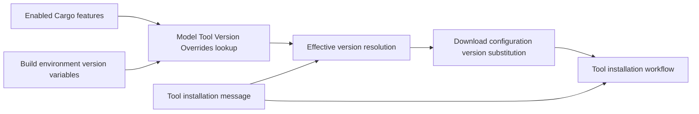
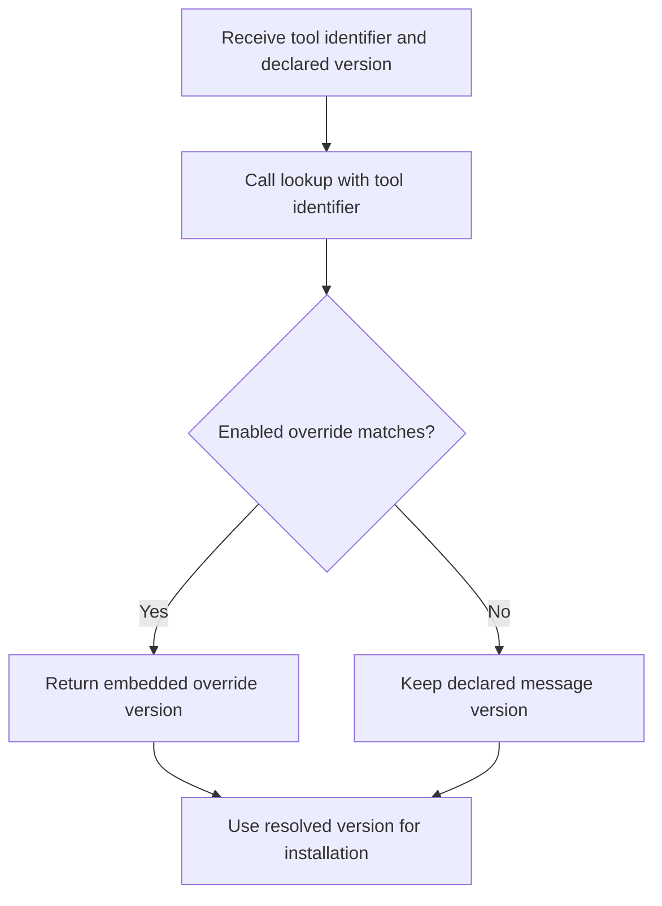
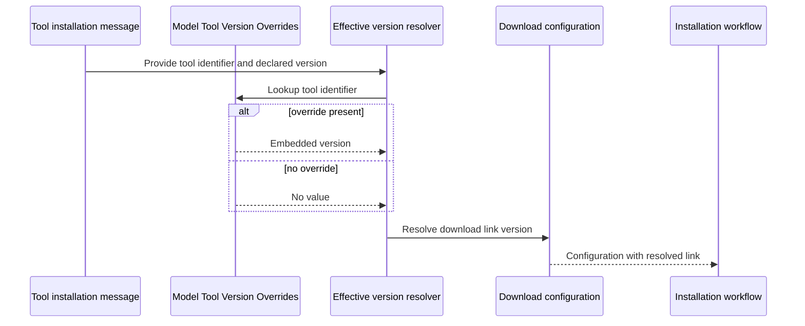

# Model Tool Version Overrides

Model Tool Version Overrides is a compile-time policy adapter in the OpenFrame client agent. It resolves a replacement version for a small, feature-selected set of integrated tools. When no matching override is compiled into the agent, it returns no value and the installation message's declared version remains authoritative.

The implementation is supplied by the `openframe_agent_lib` Cargo dependency from OpenFrame OSS Library version `v0.0.5`. Its source is maintained in [tool version overrides](https://github.com/flamingo-stack/openframe-oss-lib/blob/16e7c1cbd9664e7d10ec5ebca7d53c9bd314decf/clients/openframe-client/src/models/tool_version_overrides.rs).

## Responsibilities and Boundary

The module exposes one function: `lookup(tool_key: &str) -> Option<&'static str>`.

- It compares the supplied tool key with the keys enabled by compile-time feature flags.
- For a selected match, it returns the corresponding version embedded through Rust's `env!` macro.
- For a key without an enabled override, it returns `None`.
- It neither downloads software nor persists configuration; downstream installation logic decides how to use the returned version.

The current lookup table is deliberately narrow:

| Compile-time feature | Tool key | Embedded environment variable |
| --- | --- | --- |
| `openframe-chat-version` | OpenFrame Chat tool agent identifier | `OPENFRAME_CHAT_VERSION` |
| `meshcentral-agent-version` | `meshcentral-server` | `MESHCENTRAL_AGENT_VERSION` |
| `fleetmdm-agent-version` | `fleetmdm-server` | `FLEETMDM_AGENT_VERSION` |
| `osquery-version` | `osqueryd` | `OSQUERY_VERSION` |

Feature-gated match arms do not exist in a build unless their feature is enabled. Conversely, an enabled feature requires its associated environment variable while compiling because `env!` embeds the value into the binary. There is no runtime environment lookup or dynamic override configuration in this module.

## Architecture



Model Tool Version Overrides sits at the model boundary of the Rust client. It provides version selection only; the installation message provides the baseline tool identifier and version, while later layers use the resolved version to prepare an installation artifact.

## Resolution Semantics

The installation-message model invokes `lookup` as part of its effective-version calculation:

```text
resolved version = lookup(tool identifier) when present
resolved version = message version when no override is present
```

This creates a clear precedence rule: a compiled override wins for its exact tool key. All other tools, including keys whose features are not included in the build, retain the version supplied by the tool installation message.



Matching is exact and string-based. For example, the MeshCentral and Fleet MDM entries match their server-key strings, and the osquery entry matches `osqueryd`. A caller cannot obtain an override by providing an alias, partial name, or differently cased key.

## Integration with Installation Resolution

The surrounding client model exposes an `effective_version` operation that asks this module for an override and otherwise returns the installation message's `version`. A download configuration can then clone itself with `with_version_override`, replacing the original version text in its download link when the two versions differ.



The download configuration replaces text only when the declared version is nonempty and differs from the resolved version. If the declared version does not occur in the link, the configuration layer preserves the link and emits a warning. Therefore, a successful lookup selects the intended version but does not by itself guarantee that an artifact URL can be rewritten or downloaded.

## Operational Implications

- **Reproducible agent behavior:** configured versions are compiled into the produced agent, so agents of the same build resolve the same enabled overrides.
- **Build-time configuration:** changing an override requires a rebuild with the relevant feature and environment value; no process restart or remote configuration update can alter it.
- **Safe fallback:** absent features, unmatched keys, and unlisted tools follow the declared version from the incoming message.
- **Compatibility constraint:** override keys must remain aligned with the `tool_id` values emitted in tool installation messages. Renaming a key silently removes the override path for that tool.
- **Artifact compatibility:** version substitution expects the declared version to appear in the selected download link. Maintainers should validate message versions and asset URL patterns together.

## Maintenance Guidance

When introducing or changing an override:

1. Choose the exact tool identifier used by installation messages.
2. Add a feature-gated lookup arm and a dedicated build environment variable.
3. Ensure build pipelines set that variable whenever the feature is enabled.
4. Confirm the declared version can be substituted in the corresponding download link.
5. Test both paths: the feature-enabled exact match and the fallback for unmatched or disabled entries.

Because this module returns a static string borrowed from compile-time configuration, it contains no mutable state, network dependency, or error result. Failures related to absent artifacts or malformed URLs are intentionally handled by the downstream download and installation layers rather than by Model Tool Version Overrides.
