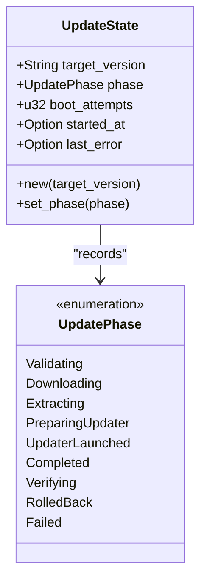
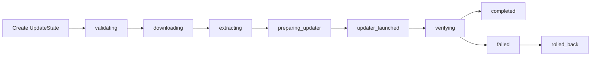
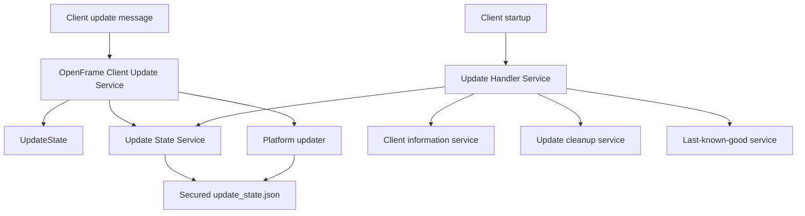
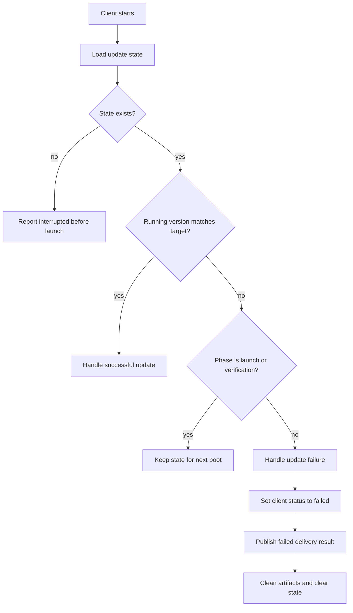

# Model Update State

Model Update State defines the durable, JSON-serializable record used by the OpenFrame endpoint client to track a client-binary update across process termination and later boots. It belongs to the Rust `openframe_agent_lib` supplied by the OpenFrame OSS Library and executed by this repository's client distribution.

The model holds the requested target version, the current update phase, crash-loop accounting, an initial timestamp, and an optional updater-provided failure reason. Its small, stable shape gives startup recovery code enough context to determine whether the process has reached the requested version, must wait for verification, or has failed.

**Source:** [update_state.rs](https://github.com/flamingo-stack/openframe-oss-lib/blob/16e7c1cbd9664e7d10ec5ebca7d53c9bd314decf/clients/openframe-client/src/models/update_state.rs)

## Responsibilities

- Model each recognized phase of an endpoint-client update.
- Initialize an update record with the target version, the `validating` phase, zero boot attempts, and an RFC 3339 UTC start time.
- Preserve compatibility with older state files whose phases precede `updater_launched`.
- Carry failure information written by the updater script.
- Provide a minimal mutation operation for changing the phase while the surrounding services manage persistence and recovery.

The model does not download artifacts, replace the executable, write files, decide rollback policy, or publish update results. Those responsibilities remain in the client update, update state, update handler, cleanup, and last-known-good services that consume this record.

## Data Model

`UpdateState` contains the following serialized fields:

| Field | Type | Serialization behavior | Purpose |
|---|---|---|---|
| `target_version` | string | Required | Canonical version that the client is attempting to run. |
| `phase` | `UpdatePhase` | Required, snake case | The latest known update lifecycle position. |
| `boot_attempts` | unsigned 32-bit integer | Defaults to zero if absent | Counts unresolved post-launch boots for crash-loop protection. |
| `started_at` | optional string | Defaults to absent if omitted | UTC RFC 3339 timestamp assigned when a new record is created. |
| `last_error` | optional string | Defaults to absent if omitted | Failure reason stamped by the updater script. |

The optional and defaulted fields let newer clients read state files that omit them. Conversely, the phase enumeration retains legacy values so an existing state file can still deserialize even though the client no longer saves phases before `updater_launched`.



## Update Phases

The serialized enum uses snake-case names. The first four values are retained for compatibility with older state files; the current client persists state immediately before it launches the updater rather than saving those earlier checkpoints.

| Rust variant | JSON value | Meaning in the recovery model |
|---|---|---|
| `Validating` | `validating` | Legacy pre-launch validation checkpoint. |
| `Downloading` | `downloading` | Legacy artifact download checkpoint. |
| `Extracting` | `extracting` | Legacy archive extraction checkpoint. |
| `PreparingUpdater` | `preparing_updater` | Legacy pre-launch updater preparation checkpoint. |
| `UpdaterLaunched` | `updater_launched` | The updater has been launched and the next boot may need to verify the replacement. |
| `Completed` | `completed` | Update completion was recorded. |
| `Verifying` | `verifying` | The client is awaiting or performing post-launch version verification. |
| `RolledBack` | `rolled_back` | The update reverted to a known-good binary. |
| `Failed` | `failed` | The update did not complete successfully. |

## Construction and Mutation

`UpdateState::new(target_version)` establishes the in-memory record used for a requested update:

1. It retains the supplied target-version string.
2. It sets the phase to `Validating`.
3. It initializes `boot_attempts` to `0`.
4. It records the current UTC time as an RFC 3339 string in `started_at`.
5. It leaves `last_error` unset.

`set_phase(phase)` changes only `phase`. It does not validate transition ordering, alter counters, persist the record, or clear an error. Callers must therefore coordinate lifecycle semantics and durable storage.



The diagram presents the conceptual lifecycle represented by the enum. The current client saves state only at the launch boundary; the earlier nodes remain deserializable historical checkpoints rather than newly persisted stages.

## Runtime Integration

The model is consumed by services in the same OpenFrame client library. The following relationships are based on the client implementation:



### Persistence Boundary

The Update State Service locates the state file at `update_state.json` in the endpoint's secured directory. It serializes `UpdateState` as pretty JSON and writes it using the library's atomic-write utility. The utility creates the parent directory, flushes data before persisting, and atomically replaces the target file. A load returns either a parsed state or no state; the presence of any state is treated as an incomplete update requiring recovery. Clearing recovery state removes the file.

### Update Request Processing

The OpenFrame Client Update Service creates an `UpdateState` after it validates and canonicalizes the requested semantic version. It updates separate client-information bookkeeping to `Updating`, then executes the update. The implementation saves the model once, immediately before the updater launches. If update execution returns an error, it records a failed client-information status and clears stale update state so it cannot be interpreted as an unresolved launch on a later boot.

Before applying a request, the service holds an update guard to prevent concurrent duplicate updates. It marks client updates as pending while it checks for active tool operations or package upgrades. It also skips a request that targets the currently running version and rejects downgrade attempts when the requested version has lower precedence than the last-known-good anchor.

### Startup Recovery and Failure Handling

On startup, the Update Handler Service loads the state record and compares `target_version` with the compiled running version.



When an unresolved record is in `updater_launched` or `verifying` and the executable does not yet report the target version, startup retains the state for a subsequent boot. Other mismatches are handled as failures. Failure handling logs `last_error` when available, otherwise directs operators to the updater transcript in the logs directory; it reports a failed delivery result, cleans update artifacts, prunes updater transcripts, and removes the state file.

For unresolved launch or verification states, boot accounting increments `boot_attempts` on each boot where the target version is still not running. Once the configured crash-loop threshold is reached, the handler treats the update as failed and initiates a reserve rollback path. Boot attempts are not incremented if the current executable already matches the target version.

## Failure and Recovery Semantics

The state file is a recovery signal rather than a permanent history. Its lifecycle is intentionally short:

1. A new update is prepared in memory with version and timing metadata.
2. State is saved at the updater-launch boundary.
3. The updater can add a failure reason to `last_error`.
4. A later boot verifies the running version against `target_version`.
5. Success advances the surrounding services' success flow; failure publishes the outcome, removes staged artifacts, and clears state.
6. Repeated unresolved boots activate crash-loop handling and reserve rollback.

The Last Known Good Service is complementary to Model Update State. After a successful version is promoted, it copies the running executable to a reserve location and atomically saves a version anchor. Model Update State identifies an incomplete operation; the last-known-good anchor supplies the rollback reference and prevents unwanted downgrades.

## Example Serialized Record

The exact phase and optional fields vary by lifecycle point. This example shows a launch-boundary record:

```json
{
  "target_version": "1.2.3",
  "phase": "updater_launched",
  "boot_attempts": 0,
  "started_at": "2026-01-15T10:30:00Z",
  "last_error": null
}
```

## Maintenance Notes

- Treat phase names and field names as persisted compatibility surface. Serde emits phase variants in snake case.
- Add a new phase only with explicit recovery behavior in the update handler. An unrecognized or mismatched phase is routed through failure handling unless it is `updater_launched` or `verifying`.
- Preserve defaults for fields that may be absent from existing state files.
- Do not rely on `set_phase` for validation, persistence, timestamp updates, or error management; it performs only assignment.
- Keep state-file writes atomic because an interrupted write must not leave recovery unable to deserialize the update record.
- Investigate a retained state file alongside the updater transcript and the separate client update status when diagnosing a failed upgrade.
