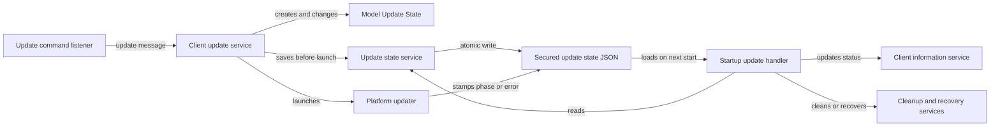
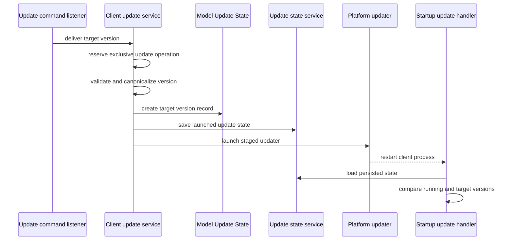
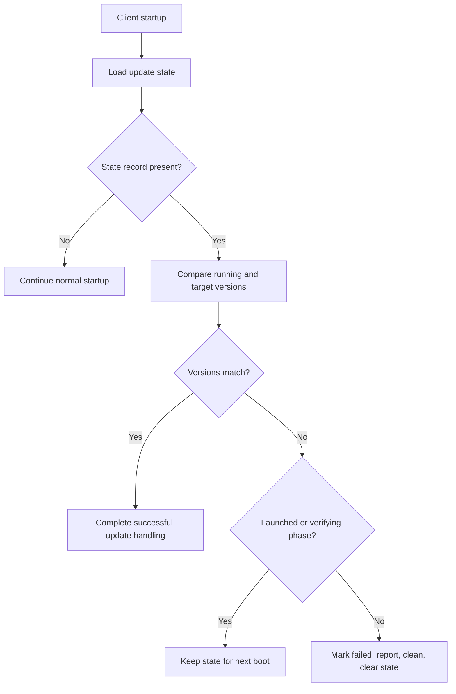

# Model Update State

Model Update State is the durable update-recovery record used by the OpenFrame endpoint client. It is supplied at runtime by the `openframe_agent_lib` crate from the OpenFrame OSS Library, which this repository consumes at version `v0.0.5`. The model records the version targeted by a client self-update, its lifecycle phase, boot-recovery attempts, when the attempt started, and any failure reason written by the updater.

The model is deliberately small: it represents update intent and recovery status, rather than downloading artifacts, replacing binaries, or publishing results. Those duties belong to the endpoint client's update services. Its persisted presence is itself meaningful: the state service treats any readable state record as an incomplete update requiring recovery.

**Source:** [OpenFrame OSS Library: `update_state.rs`](https://github.com/flamingo-stack/openframe-oss-lib/blob/7a766f00e4f58b5d89db007b878ac8d6e0c344f4/clients/openframe-client/src/models/update_state.rs)

## Purpose and Boundaries

An endpoint-client update crosses a process boundary: the running client prepares an updater, the updater replaces or launches the executable, and the next client process determines whether the target version actually started. Model Update State supplies the serializable contract that survives that boundary.

It provides:

- A canonical `target_version` identifying the requested client version.
- An `UpdatePhase` value that communicates lifecycle and recovery context.
- A `boot_attempts` counter used by restart recovery to detect an unresolved update loop.
- Optional `started_at` and `last_error` diagnostic fields.
- Serde serialization using snake-case enum names, allowing the state to be written as JSON.

It does not validate version strings, perform file I/O, launch the updater, decide whether to roll back, or publish an update result. The surrounding client services own those operations.

## Architecture

The model is part of the Rust endpoint client assembled from the OpenFrame OSS Library. The `UpdateStateService` persists it under the secured client directory as `update_state.json`; update orchestration creates and changes it; startup handling consumes it after a restart.

The relationships shown above are operational dependencies, not fields within `UpdateState`. The model has no reference to the service layer and remains independently serializable.

## Data Model

### Update State

`UpdateState` is a cloneable, serializable Rust structure with these persisted fields:

| Field | Type | Initialization and meaning |
|---|---|---|
| `target_version` | `String` | Required target version. The update service normalizes a validated semantic version before constructing the model. |
| `phase` | `UpdatePhase` | Current lifecycle marker. `new` initializes it to `Validating`. |
| `boot_attempts` | `u32` | Defaults to zero when absent, including when reading older JSON files. Startup recovery increments it only for unresolved launched or verifying updates. |
| `started_at` | `Option<String>` | Defaults when absent. New records set it to the current UTC time encoded as RFC 3339. |
| `last_error` | `Option<String>` | Defaults when absent. The updater script can stamp a human-readable failure reason here. |

The constructor requires the target version, initializes the phase to `Validating`, sets `boot_attempts` to zero, timestamps the attempt, and clears any error. `set_phase` changes only the in-memory phase. Persisting a changed model requires the separate update-state service to save it.

### Update Phase

`UpdatePhase` is serialized with snake-case names. It includes the following phases:

| Phase | Role |
|---|---|
| `Validating` | Initial state for a newly created update record. |
| `Downloading` | Compatibility value for an update that is acquiring the artifact. |
| `Extracting` | Compatibility value for unpacking an artifact. |
| `PreparingUpdater` | Compatibility value for staging the updater. |
| `UpdaterLaunched` | The external updater has been launched; restart verification is expected. |
| `Completed` | Completion marker available to the protocol. |
| `Verifying` | Verification is pending or in progress after a launch. |
| `RolledBack` | Rollback marker available to the protocol. |
| `Failed` | Failure marker available to the protocol. |

The current client no longer saves records during the phases before `UpdaterLaunched`; the earlier values remain in the enum so that older state files can still be deserialized and handled. A state file in an older pre-launch phase is therefore treated as a failed update during startup recovery when the running version does not match its target.

## Persistence and Compatibility

`UpdateStateService` owns the durable record. On construction, it ensures the secured directory exists and selects `update_state.json` within it. Saving serializes pretty JSON and uses an atomic write. Loading distinguishes a missing file from a parsed record. Malformed JSON is delegated to the shared JSON parsing helper, which may quarantine the bad file rather than treat it as a valid update state.

The service exposes the following behavioral contract:

- `load` returns an optional parsed `UpdateState`.
- `has_incomplete_update` returns true whenever a readable state record exists, regardless of its phase.
- `clear` removes the state file when present after terminal handling.
- `get_state_file_path` exposes the resolved path for diagnostics.

The default annotations on `boot_attempts`, `started_at`, and `last_error` protect compatibility with state files written before those fields were added. The enum's retained historic phases similarly protect decoding of records from earlier client versions.

## Update and Recovery Flow

The update service first reserves the operation to prevent overlapping deliveries and defers the request while tool or package-update work is active. It validates and canonicalizes the requested version, skips a version already running, and applies a last-known-good downgrade guard. It constructs the model, records a transient client status of Updating, and executes the remaining update workflow. The state is saved only immediately before the updater is launched.

At startup, recovery follows this decision flow:

Before this decision path, startup crash-loop accounting examines unresolved `UpdaterLaunched` and `Verifying` records. If the target is not the currently running version, it increments and saves `boot_attempts`. When the configured maximum has already been reached, the handler marks the update failed and starts recovery using the reserve rollback path. It does not count attempts when the target already equals the running build, preventing a successful update from being misclassified as a loop.

## Failure Semantics

Failure information may originate from either update execution or next-boot recovery:

1. If update execution fails before the updater completes, the client marks its client-information status as Failed and clears any state record, preventing a stale record from triggering crash-loop logic later.
2. If a state file survives restart and the running version differs from its target, older pre-launch phases and other non-verification phases are handled as failures.
3. When failure handling runs, it uses `last_error` when present; otherwise it creates a phase-specific explanation, publishes a failed delivery result, performs cleanup, prunes old updater transcripts, and clears the state file.
4. For a launched or verifying update with a different running version, the state is retained for later boots until success or the crash-loop guard resolves it.

This split makes the model a recovery checkpoint, rather than a complete audit history. Once success or failure cleanup is complete, the record is removed.

## Maintenance Guidance

- Treat enum names and serialized field names as a persisted compatibility contract. Existing endpoint installations can retain state files across client upgrades.
- Add a new phase only when startup recovery has a defined interpretation for it. A phase with no recovery rule falls into the failure path when the version does not match.
- Keep `set_phase` free of persistence behavior. Callers must explicitly save transitions so I/O errors are visible at the service boundary.
- Do not infer a completed update from a phase alone. Recovery verifies completion by comparing the running client version with `target_version`.
- Preserve the optional and defaulted fields when evolving the schema to avoid rejecting older state files.
- Avoid logging or placing secrets in `last_error`; it can be persisted and read during diagnostics.

## System Context

Model Update State is one component of the endpoint client delivered by this tenant repository. The repository builds and releases the client-facing services, while the Rust runtime behavior documented here is supplied by the OpenFrame OSS Library. The model coordinates only the local self-update lifecycle; management-side update dispatch, NATS delivery, client-info reporting, binary staging, updater scripts, and last-known-good recovery are separate concerns in the client and platform services.
