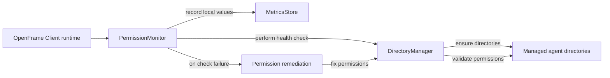
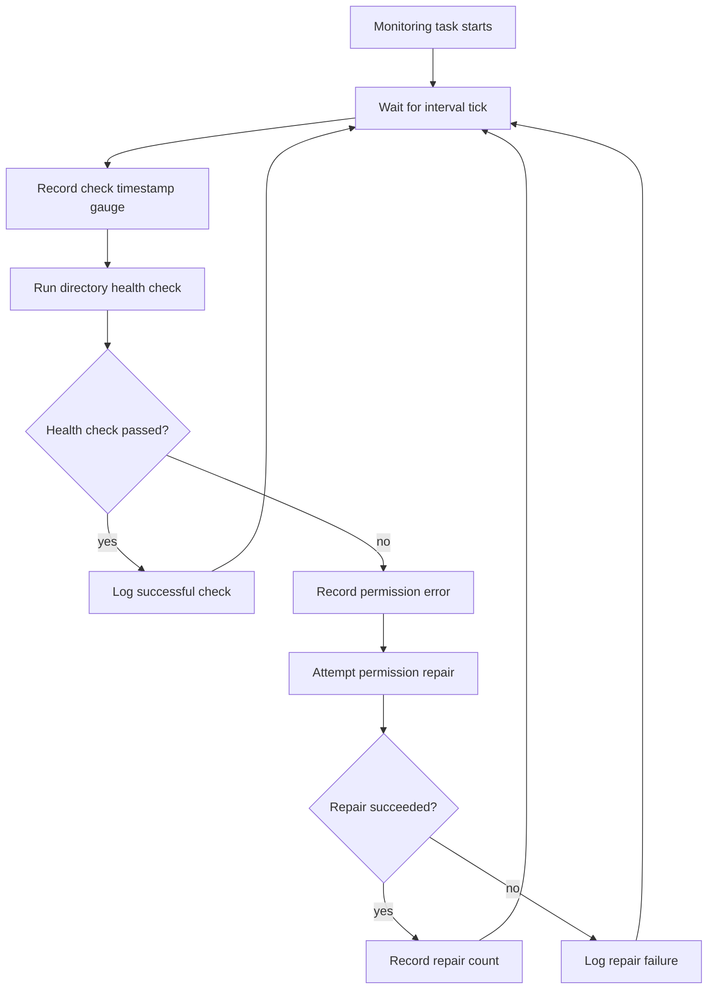
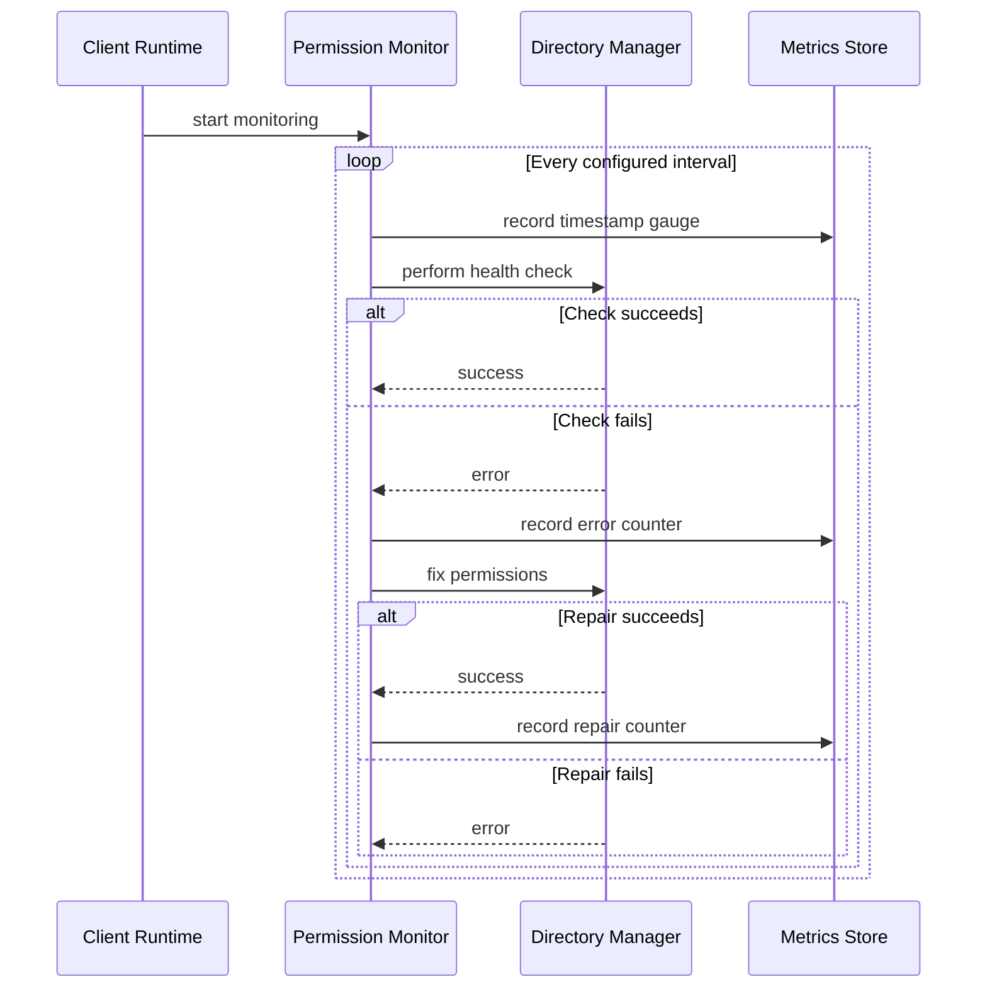

# Monitoring Permissions

Monitoring Permissions is a background resilience component in the Rust OpenFrame Client. It periodically verifies that the agent's managed directories exist and have usable permissions. When a check fails, it attempts corrective permission changes and records local monitoring values for the attempt.

The implementation is supplied by the `openframe_agent_lib` crate from the [OpenFrame OSS Library source](https://github.com/flamingo-stack/openframe-oss-lib/blob/16e7c1cbd9664e7d10ec5ebca7d53c9bd314decf/clients/openframe-client/src/monitoring/permissions.rs). This repository consumes that library as part of the OpenFrame Client runtime.

## Scope and Responsibilities

The `PermissionMonitor` owns three concerns:

- retaining a shared `DirectoryManager`, which is the platform abstraction for agent-managed paths;
- scheduling recurring directory health checks; and
- holding a local `MetricsStore` for check timestamps, failures, and successful remediation attempts.

It does not expose a network endpoint, publish its metrics itself, or determine operating-system-specific access-control rules. The directory layer owns those details, while the client application decides when to construct and run the monitor.

## Architecture

`DirectoryManager` is provided by the platform-directory layer of the same library. It tracks the logs directory, application-support directory, secured directory, and optionally per-user logs. Its health check ensures directories exist and validates their permissions. Its repair path reapplies standard directory permissions to normal directories and admin-only permissions to the secured directory.

## Core API

| Component | Responsibility |
|---|---|
| `PermissionMonitor::new` | Creates a monitor for a shared `DirectoryManager`, with a one-hour default interval and an empty local `MetricsStore`. |
| `PermissionMonitor::with_interval` | Overrides the interval before the monitor is started; useful for integration or accelerated verification scenarios. |
| `PermissionMonitor::start_monitoring` | Logs startup, creates a Tokio interval, and runs checks indefinitely. The first Tokio interval tick is awaited before the first check. |
| `PermissionMonitor::get_metrics` | Returns the three metric names that this module defines, each paired with `0.0`. This is a name catalog rather than a snapshot of values held by the internal store. |

The monitor takes ownership of itself in `start_monitoring`. Callers therefore configure the interval before starting it and normally run it in a long-lived asynchronous task.

## Check and Remediation Flow

For every scheduled execution, the monitor first writes `openframe_last_permission_check_timestamp` using Unix epoch seconds. It then calls `DirectoryManager::perform_health_check`, which creates missing managed directories and validates permissions.

When validation fails, the monitor logs the error and records `openframe_permission_errors_total`. It then calls `DirectoryManager::fix_permissions`. A successful repair is logged and records `openframe_permission_fixes_total`; a failed repair is only logged. The loop continues after either result, so a temporary or unrepaired condition can be retried on later ticks.

## Metrics Semantics and Concurrency

The internal `MetricsStore` is protected by an asynchronous reader-writer lock. The monitoring path uses non-blocking `try_write` calls. Consequently, a metric update can be skipped if another task holds the write lock; health checking and remediation still continue. Metric writes use no labels.

| Metric | Type recorded | Meaning |
|---|---|---|
| `openframe_last_permission_check_timestamp` | Gauge | Unix timestamp for the most recent check whose timestamp write acquired the lock. |
| `openframe_permission_errors_total` | Counter | A value of `1` recorded for a health-check failure when the lock is available. |
| `openframe_permission_fixes_total` | Counter | A value of `1` recorded after a successful repair when the lock is available. |

The underlying store's `record_counter` method inserts a metric by name. Based on the supplied implementation, repeated writes replace the stored metric entry rather than incrementing a previously stored value. Consumers must therefore not assume these local values are cumulative totals without reviewing the metric-export integration.

## Component Interaction

## Operational Considerations

- **Default cadence:** checks run hourly unless `with_interval` is used before startup.
- **Repair boundaries:** repair only targets paths already managed by `DirectoryManager`: logs, application support, secured storage, and configured user logs. It does not scan arbitrary filesystem paths.
- **Privileges:** remediation depends on the client process having sufficient operating-system privileges for the relevant paths. A failed repair is logged but does not stop the monitoring loop.
- **Observability:** startup, successful checks, check failures, successful repairs, and repair failures are written through the client's tracing configuration. The monitor itself does not export its local metric store.
- **Lifecycle:** there is no built-in cancellation or shutdown handle in this component. The task must be managed by the surrounding client runtime.

## Relationship to the OpenFrame Client

Monitoring Permissions is one subsystem within the `openframe_agent_lib` used by the OpenFrame Client. It complements platform-directory management by repeatedly enforcing the health expectations established during installation and runtime. In the broader tenant deployment, the OpenFrame Client service image is delivered by this repository and communicates with the configured platform services; permission monitoring remains local to each managed endpoint and does not alter gateway routing or server-side authorization.

For the source-level implementation, see [permissions.rs in the OpenFrame OSS Library](https://github.com/flamingo-stack/openframe-oss-lib/blob/16e7c1cbd9664e7d10ec5ebca7d53c9bd314decf/clients/openframe-client/src/monitoring/permissions.rs).