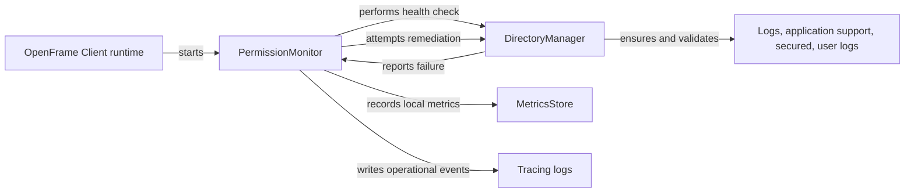
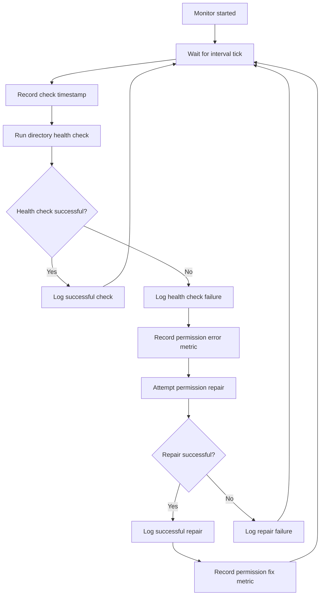
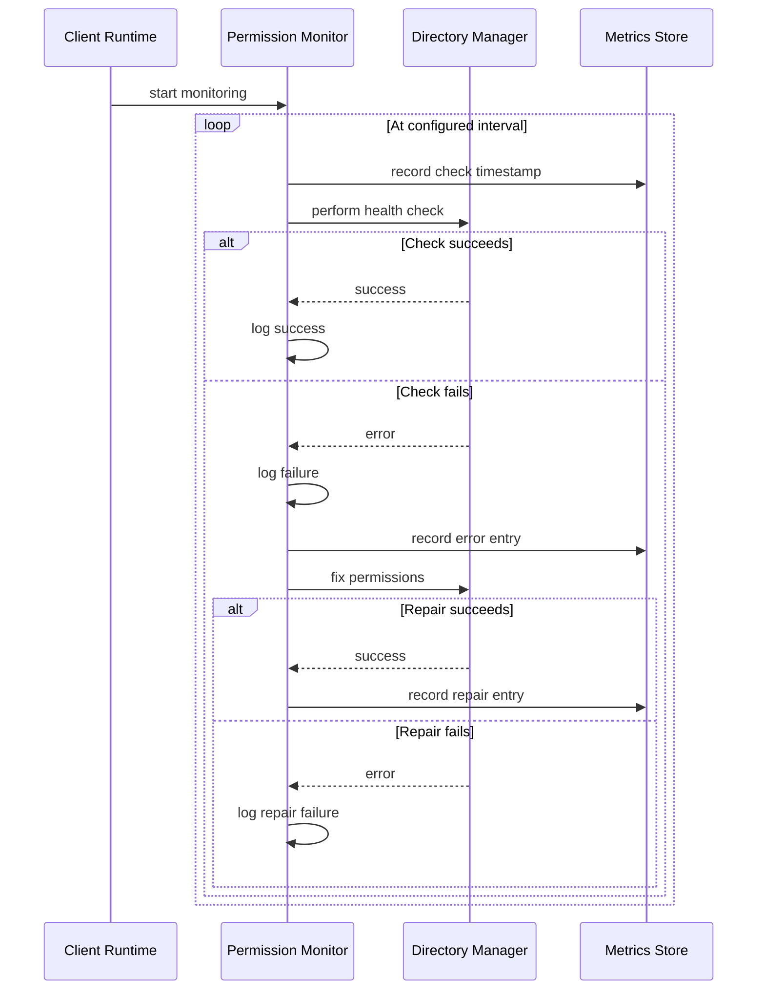

# Monitoring Permissions

Monitoring Permissions is a background reliability component in the OpenFrame Client. It periodically verifies that the agent's managed directories exist and remain accessible with the expected permissions, then attempts remediation when verification fails. The implementation is supplied by the `openframe_agent_lib` Cargo dependency from the OpenFrame OSS Library and runs within this repository's client deployment.

The module is implemented in [permissions.rs](https://github.com/flamingo-stack/openframe-oss-lib/blob/7a766f00e4f58b5d89db007b878ac8d6e0c344f4/clients/openframe-client/src/monitoring/permissions.rs).

## Responsibilities

- Construct a `PermissionMonitor` around a shared `DirectoryManager`.
- Run directory health checks on a configurable interval, defaulting to one hour.
- Record a timestamp for each permission-check attempt.
- Log successful checks, health-check failures, and remediation failures.
- Attempt permission repair after a failed health check.
- Maintain in-process metric entries for check errors and successful repairs.

This module monitors filesystem state only. It does not send metrics to a remote endpoint, decide agent privileges, or define the target directory policy. Directory validation and repair are delegated to the platform directory component.

## Architecture

`PermissionMonitor` owns an `Arc<DirectoryManager>`, allowing the same directory manager to be shared safely with the rest of the client. Its metrics store is independently protected by an asynchronous read-write lock.

## Components and Interfaces

| Component | Role |
|---|---|
| `PermissionMonitor` | Coordinates periodic validation, failure handling, repair, logging, and local metric recording. |
| `new` | Creates a monitor with a one-hour check interval and an empty `MetricsStore`. |
| `with_interval` | Builder-style override for the interval, useful when embedding the monitor or testing it. |
| `start_monitoring` | Asynchronous, non-terminating monitoring loop. It owns the monitor and awaits every interval tick before executing a check. |
| `get_metrics` | Returns the three supported metric names, but currently returns `0.0` for every value rather than reading the internal metric store. |
| `DirectoryManager.perform_health_check` | Creates missing managed directories and validates their permissions. |
| `DirectoryManager.fix_permissions` | Repairs permissions for logs and application-support directories, applies restricted permissions to the secured directory, and repairs optional user-log directories. |
| `MetricsStore` | In-memory map keyed by metric name. Recording a metric inserts or replaces the entry for that name. |

## Monitoring Cycle

The monitor performs no retry inside a single cycle. A failed repair is logged and the next scheduled cycle performs validation again. A successful repair is not followed by an immediate second health check; confirmation occurs during a later scheduled check.

## Directory Health and Repair Scope

The delegated health check first ensures managed directories exist, then validates their permissions. When remediation is needed, the directory manager repairs the following locations according to the platform policy:

- Logs directory.
- Application-support directory.
- Secured directory, with an administrative-only permission policy.
- Per-user logs directory when one is configured.

The monitor treats any error from the complete health check as a permission-monitoring failure. Consequently, its error metric indicates that the delegated health check failed; it is not a per-directory or per-capability breakdown.

## Metrics and Observability

The monitor records all metrics without labels.

| Metric | Type | Recorded when | Meaning |
|---|---|---|---|
| `openframe_last_permission_check_timestamp` | Gauge | Before every health check | Unix timestamp in seconds for the most recent check attempt. |
| `openframe_permission_errors_total` | Counter entry | A health check returns an error | Most recently recorded error value. |
| `openframe_permission_fixes_total` | Counter entry | A repair succeeds | Most recently recorded successful-repair value. |

### Important implementation details

`MetricsStore.record_counter` stores a metric entry by name; it does not add the supplied value to a previous value. The monitor always supplies `1`, so the internal entries act as last-recorded indicators rather than process-lifetime totals.

Metric writes use `try_write`. If the metrics lock is temporarily unavailable, the monitoring and remediation path continues and that metric update is skipped. This prevents metric contention from blocking filesystem repair.

Although the module exposes `get_metrics`, its current implementation returns the metric names with zero values and does not read the internal store. Consumers requiring live values must not treat that method as a metrics snapshot without a corresponding implementation change.

## Runtime and Failure Behavior

The loop has no built-in shutdown signal and `start_monitoring` consumes `self`. The caller should run it in a task whose lifecycle is managed by the broader client runtime. Because directory operations are synchronous calls inside an asynchronous method, their duration occupies the task while each check or repair runs.

## Configuration and Integration Guidance

- The default interval is `Duration::from_secs(3600)`.
- Call `with_interval` before `start_monitoring` to select a different cadence.
- Supply a fully configured `DirectoryManager`; it determines the directory locations, optional user-log directory, validation criteria, and repair policy.
- Treat tracing output as the primary operational evidence for individual failures and repair outcomes.
- If exported counters or a metrics endpoint are required, update metric retrieval or integrate the monitor with the client-wide metrics publication path. The current API does not expose the recorded store values.

## Maintenance Considerations

When changing this module, preserve the ordering of timestamp recording, validation, error recording, and remediation so operational signals remain interpretable. If counters are expected to be cumulative, change the metric-store update semantics or read-modify-write the stored value under the lock. If a repair must be verified immediately, explicitly add a post-repair health check and define its metric and logging behavior.
