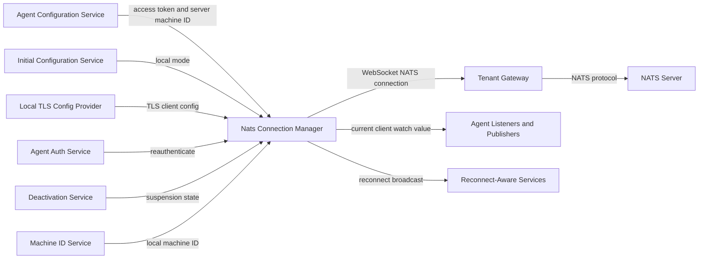
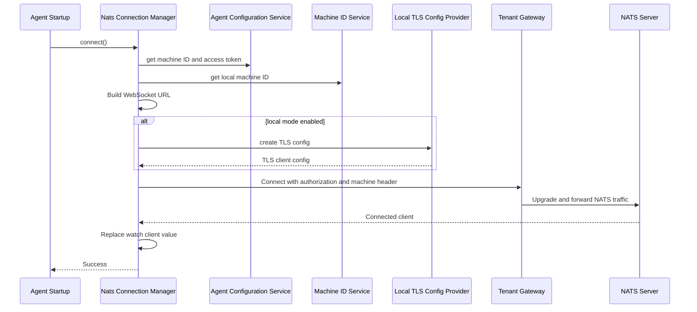
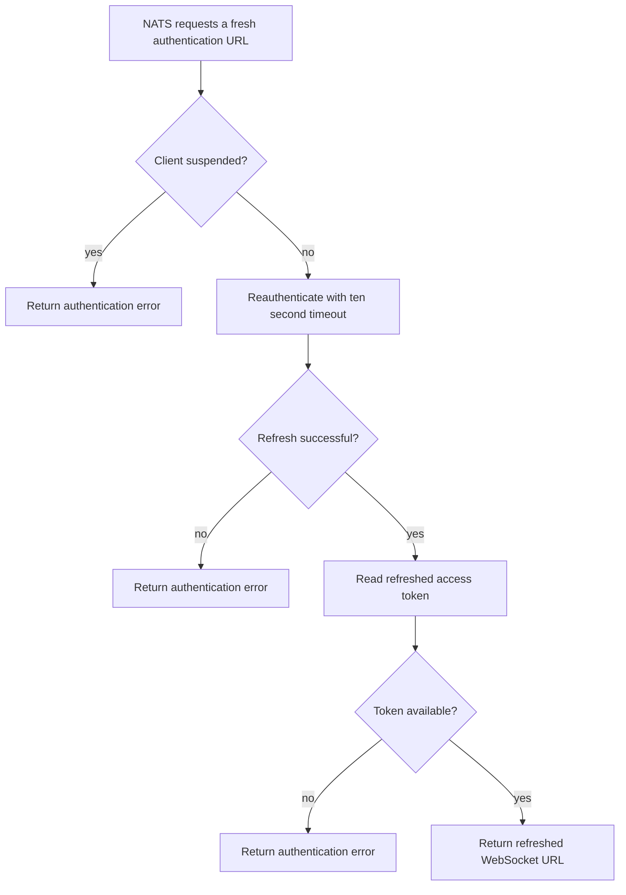
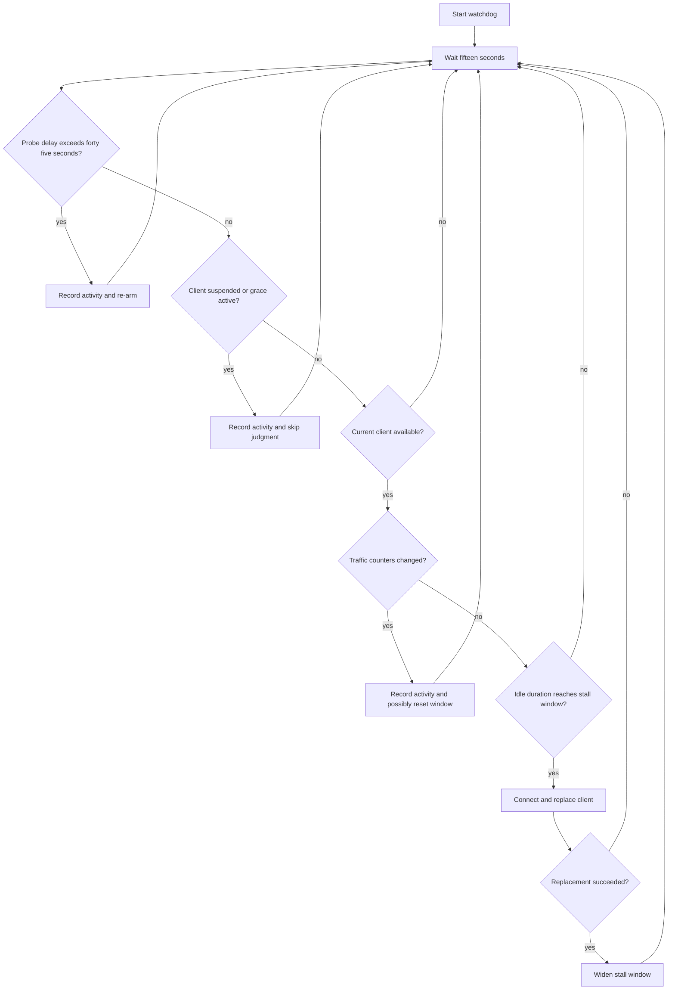

# Nats Connection Manager

Nats Connection Manager provides the OpenFrame client agent's long-lived, authenticated connection to NATS over the tenant gateway's WebSocket endpoint. It owns connection creation, exposes the current client to other agent services, notifies consumers after a reconnect, refreshes credentials when NATS requests them, and replaces a connection whose event loop appears stalled.

The implementation is supplied by the `openframe_agent_lib` Cargo dependency from [OpenFrame OSS Library](https://github.com/flamingo-stack/openframe-oss-lib/blob/16e7c1cbd9664e7d10ec5ebca7d53c9bd314decf/clients/openframe-client/src/services/nats_connection_manager.rs). This tenant repository runs that library through the OpenFrame client agent; the dependency is pinned to version `v0.0.5` in this repository's ecosystem.

## Responsibilities

- Build a WebSocket NATS URL from the configured gateway base URL and the current access token.
- Configure the NATS client identity and machine identifier header.
- Optionally install a locally trusted TLS configuration when the agent is in local mode.
- Retain the current `async_nats::Client` behind a Tokio watch channel so consumers always retrieve the most recently installed client.
- Publish a reconnect event only after an initial successful connection has already occurred.
- Perform bounded reauthentication when the NATS client invokes its authentication URL callback.
- Slow reconnection substantially while tenant deactivation suspends the client.
- Detect an apparently stalled client event loop and replace its client instance while avoiding false positives caused by scheduler delays or temporary suspension.

## Position in the Agent

The manager is a shared transport boundary. Command, execution, remote-access, telemetry, and publishing services obtain the active NATS client through `get_client()`. Services that need to rebuild subscriptions can observe client replacement through `on_client_replaced()`. Consumers that only need to react to a successful reconnect can use `subscribe_reconnect()`.

## Core API

| Component | Role |
| --- | --- |
| `NatsConnectionManager::new` | Initializes empty client state, the reconnect broadcast channel, activity tracking, connection URL dependencies, authentication, suspension, TLS, and machine identity services. |
| `connect` | Creates and stores an authenticated `async_nats::Client`. It is the initial connection path and the replacement path used by the watchdog. |
| `get_client` | Returns an `Arc<Client>` from the latest watch value. It fails if `connect` has not installed a client. |
| `on_client_replaced` | Returns a Tokio watch receiver that observes replacement of the optional client value. |
| `subscribe_reconnect` | Returns a broadcast receiver for a post-initial `Connected` event. |
| `start_connection_watchdog` | Starts the background probe loop that identifies inactivity and replaces a stalled client. |

The manager deliberately offers two distinct notifications:

- **Client replacement watch** signals that a client object was installed, including the initial successful connection. It suits code that must resubscribe using the new object.
- **Reconnect broadcast** signals a subsequent `Connected` event from the NATS client. The first connection is excluded with an atomic `connected_once` guard, so it represents recovery rather than application start-up.

## Connection Establishment

`connect()` first reads the server-assigned machine identifier from Agent Configuration Service and the local machine identifier from Machine ID Service. The server-assigned identifier becomes the NATS connection name. The local identifier is sent in the `MACHINE_ID_HEADER` custom header, preserving both identities where they have different roles.

The connection URL is formed as the configured NATS server URL plus the `/ws/nats` path and an `authorization` query parameter containing the current access token. NATS uses the fixed device username `machine` and an empty password. The client retries the initial connection, accepts an unlimited number of reconnect attempts, and pings every ten seconds.

### Development TLS behavior

The TLS provider is consulted only when Initial Configuration Service reports local mode. Failure to create this development TLS configuration fails the connection attempt with context. In non-local mode, the manager does not add a custom TLS client configuration.

## Authentication and Reconnection

The NATS client's authentication URL callback is the credential-refresh path. When invoked, it first checks whether the Deactivation Service has suspended the agent. A suspended client returns an authentication error immediately; it does not call the gateway to refresh credentials.

Otherwise, the manager calls `AgentAuthService::reauthenticate()` with a ten-second timeout. A successful refresh is followed by an asynchronous access-token read and reconstruction of the WebSocket URL. Authentication failure, token-read failure, and timeout are each converted into NATS authentication errors, allowing the NATS client to continue according to its reconnection policy.

### Suspension-aware reconnect delay

The reconnect-delay callback records activity for every attempt. Under normal conditions it logs the attempt and waits five seconds. When the Deactivation Service indicates that the tenant is gone or the agent is suspended, it waits five minutes instead. This avoids frequent WebSocket upgrade attempts against an unavailable tenant gateway, while automatically returning to the normal delay when suspension ends.

The event callback logs all NATS events. It broadcasts a reconnect signal only when `Event::Connected` occurs after the first connected event. A full watch notification is separate from this event callback and occurs whenever `connect()` successfully installs a client.

## Watchdog and Client Replacement

`start_connection_watchdog()` spawns a Tokio task that probes every 15 seconds. It uses the NATS client's inbound and outbound byte counters as the primary activity signal and maintains a separately updated last-activity timestamp. Activity is recorded at successful connection, reconnect attempts, observed byte-counter changes, and during intentional suspension grace.

The watchdog does not interpret every quiet interval as failure:

- If Tokio schedules a probe more than 45 seconds after the previous probe, it re-arms activity tracking rather than judging the connector.
- While suspended, it extends a grace deadline by five minutes and skips liveness judgment.
- A client must remain inactive for the current stall window before replacement.
- The initial stall window is 90 seconds.
- Following a successful replacement, the stall window is multiplied by three, capped at 30 minutes. After at least 90 seconds of observed healthy activity, it returns to 90 seconds.

When the inactivity threshold is crossed, the manager releases its local client reference, calls `connect()` to build a new instance, stores it in the watch channel on success, and resets the byte-counter baseline. Failures are logged; the watchdog continues probing so it can attempt a later recovery.

## State and Concurrency Model

The stored client is `Option<Arc<Client>>` carried by a Tokio `watch::Sender`. The option is empty until the first successful connection. Replacing the client with `send_replace` atomically publishes the new `Arc<Client>` to watch receivers. `get_client()` borrows and clones the latest value, so callers retain a stable reference even if a later watchdog cycle installs a newer client.

A Tokio broadcast channel with capacity 16 carries reconnect notifications. It is intentionally event-oriented rather than state-oriented: a slow receiver can lag and must handle the normal broadcast receiver behavior for missed messages. By contrast, watch receivers always observe the latest client state.

The last-activity timestamp is an `Arc<Mutex<Instant>>`. It is shared by connection callbacks and the watchdog. The first-connected marker is an `AtomicBool`, allowing the asynchronous NATS event callback to distinguish start-up from reconnection without a mutex.

## Operational Guidance

### Expected logs

The manager logs the NATS hostname when initiating a connection, logs each NATS event, reports normal reconnect attempts, and records errors for a stalled event loop or failed replacement. Reauthentication logs its start, success, and failure conditions. These messages are the primary evidence when diagnosing a client that repeatedly reconnects or cannot authenticate.

### Common failure modes

| Condition | Observable behavior | Manager response |
| --- | --- | --- |
| No initial connection | `get_client()` reports that the NATS client is not initialized. | Initial-connect retry remains enabled; callers must not assume a client exists before `connect()` succeeds. |
| Access token expires | NATS invokes the authentication URL callback. | Reauthenticates with a ten-second limit and returns a URL built with the refreshed token. |
| Reauthentication fails or times out | The NATS callback receives an authentication error. | Logs the condition and leaves reconnection handling to the NATS client. |
| Tenant is suspended or removed | Authentication is skipped and reconnect attempts are infrequent. | Uses a five-minute reconnect delay and watchdog grace window. |
| Client event loop stops making progress | Byte counters and recorded activity remain unchanged beyond the stall window. | Creates and publishes a replacement client, progressively widening the threshold after successful replacements. |
| Runtime scheduling pause | A watchdog iteration occurs after a large timing gap. | Re-arms activity rather than declaring a stall. |

## Integration Considerations

Code that publishes agent state or receives NATS commands should treat `get_client()` as fallible and should be prepared for connection replacement. Subscription-owning components should use `on_client_replaced()` to receive the latest client and recreate any client-bound subscriptions. Components that only need to resume work after network recovery can use `subscribe_reconnect()`.

The Nats Connection Manager does not define message subjects, payload serialization, delivery acknowledgement semantics, or durable result handling. Those belong to the surrounding agent publisher, listener, delivery, and result-store components. It concentrates transport identity, authentication continuity, suspension behavior, and liveness recovery in one place.

## Source and Scope

- **Library:** `openframe_agent_lib` from OpenFrame OSS Library, pinned by this repository at `v0.0.5`.
- **Implementation:** [nats_connection_manager.rs](https://github.com/flamingo-stack/openframe-oss-lib/blob/16e7c1cbd9664e7d10ec5ebca7d53c9bd314decf/clients/openframe-client/src/services/nats_connection_manager.rs).
- **Runtime role:** used by the OpenFrame client agent assembled and delivered by OpenFrame OSS Tenant.
