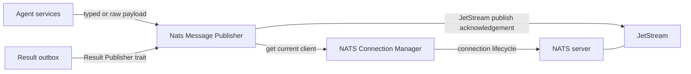
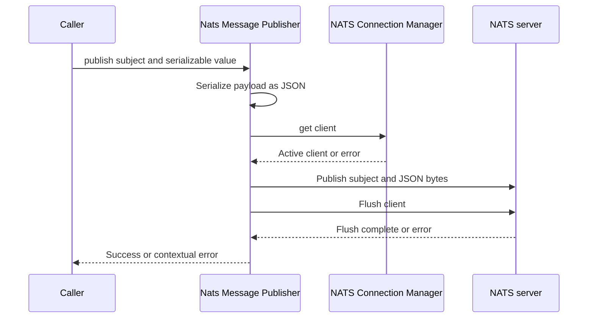
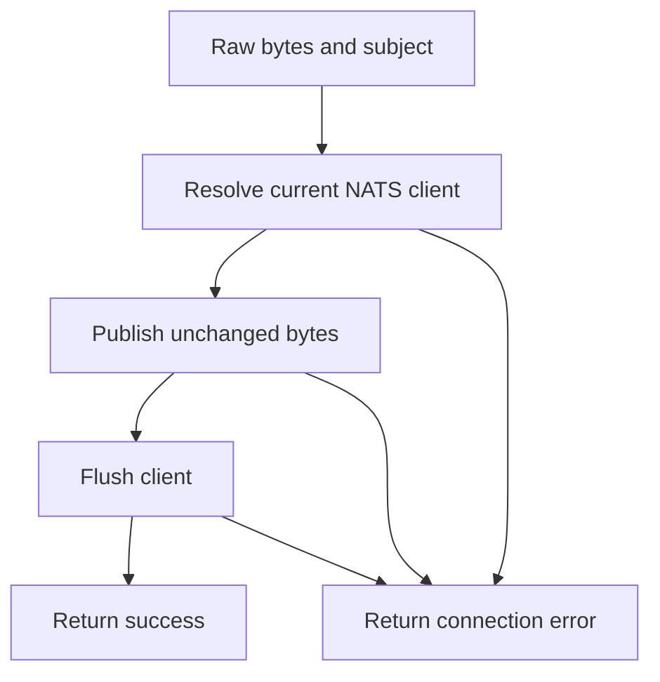
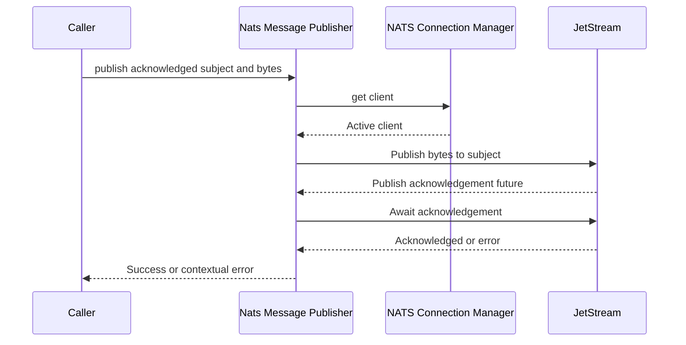
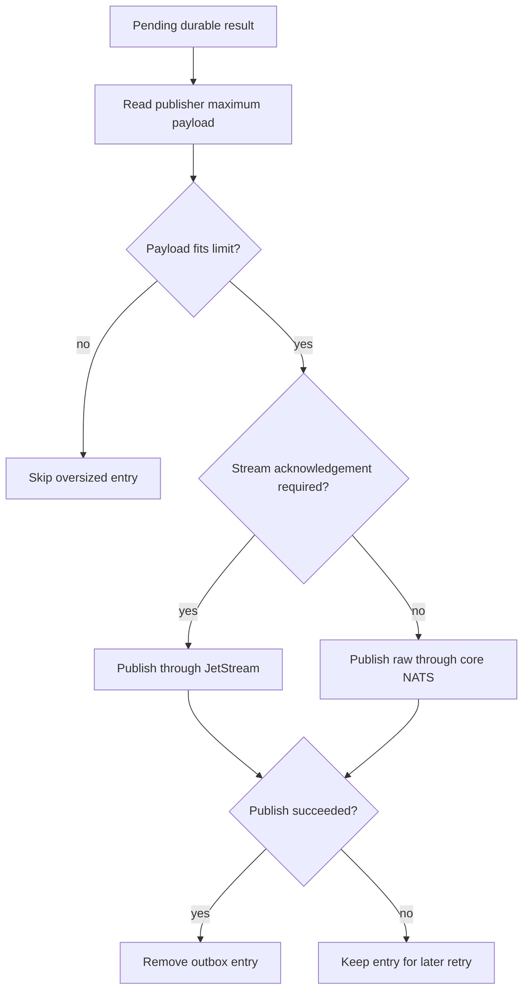

# Nats Message Publisher

The Nats Message Publisher is the OpenFrame Client agent's small transport adapter for outbound NATS traffic. It obtains the current connection from the NATS Connection Manager, publishes either serialized values or caller-provided bytes, and exposes a JetStream acknowledgement path for results that require broker confirmation.

The implementation is supplied by the `openframe_agent_lib` Cargo artifact from OpenFrame OSS Library and is run by this repository's OpenFrame Client deployment. Its source is [nats_message_publisher.rs](https://github.com/flamingo-stack/openframe-oss-lib/blob/16e7c1cbd9664e7d10ec5ebca7d53c9bd314decf/clients/openframe-client/src/services/nats_message_publisher.rs).

## Responsibilities

- Acquire the current asynchronous NATS client at the moment of each operation.
- Serialize typed payloads to JSON for ordinary publishing.
- Publish already-encoded byte payloads without changing their contents.
- Flush ordinary NATS publishes before reporting success to the caller.
- Use JetStream publish acknowledgements when delivery must be broker-confirmed.
- Report the server-advertised maximum payload size when a connection is available.
- Implement the Result Publisher abstraction used by the durable result outbox.

The module deliberately does **not** construct connections, select subjects, persist failed messages, retry messages, or transform caller-provided raw bytes. Those concerns belong to its collaborators and calling services.

## Position in the Client Agent

The connection manager owns the live client handle. `get_client()` returns an error when a client has not yet been initialized, so publishing before a successful connection is a failure rather than an implicit connection attempt. The manager can replace a stalled client through its watchdog; because the publisher resolves the client per call, later publishes use the replacement connection.

## Component Model

| Component | Role |
|---|---|
| `NatsMessagePublisher` | Cloneable wrapper around `NatsConnectionManager`. It is the only stateful type in this module. |
| `new` | Creates the wrapper from a connection manager. It does not establish a NATS connection. |
| `publish` | Serializes a `Serialize` payload to a JSON string, publishes it using core NATS, then flushes the client. |
| `publish_raw` | Publishes supplied bytes using core NATS, then flushes the client. |
| `publish_acked` | Publishes supplied bytes through a JetStream context and waits for the publish acknowledgement. |
| `max_payload` | Returns the active server's maximum payload size, or `None` if no client is currently available. |

## Publishing Paths

### Typed JSON Publishing

`publish` accepts any Rust value that implements `serde::Serialize`. It converts the supplied value with `serde_json::to_string`, sends the resulting UTF-8 JSON bytes to the requested subject, and calls `flush` before it succeeds.

This method owns JSON serialization. A caller that supplies a string receives a JSON string representation on the wire; callers that have already constructed their desired wire bytes should use `publish_raw` instead.

### Raw Core NATS Publishing

`publish_raw` keeps the input payload as bytes. It still obtains the current client, sends the message to the specified subject, and flushes before returning success. This is the appropriate path for payloads serialized by a caller or restored from durable storage.

### Acknowledged JetStream Publishing

`publish_acked` also accepts raw bytes, but creates an `async_nats` JetStream context from the resolved client. It waits first for the JetStream publish operation and then for the acknowledgement future. A successful return therefore means the module received the JetStream publish acknowledgement; unlike the core paths, it does not invoke a separate client flush.

## Durable Result Delivery Integration

The publisher implements the `ResultPublisher` trait from the client result store. This lets the Result Outbox Run Manager deliver persisted result bytes without being coupled to a specific NATS implementation.

The outbox periodically, or after notification, loads pending records and obtains `max_payload` from its publisher. It uses that value with its own payload headroom calculation to avoid attempting oversized deliveries. For a subject that requires a stream acknowledgement, the outbox calls `publish_acked`; otherwise it calls `publish_raw`. It removes the record only after a successful call. Failed or timed-out attempts remain pending for a later outbox cycle.

The outbox determines whether an acknowledgement is required from subject conventions defined in the execution model. The publisher itself is subject-agnostic: it performs the mode requested by its caller and does not infer delivery requirements.

## Payload Limits

`max_payload` reads `server_info().max_payload` from the active NATS client. It returns `None` rather than an error when the client cannot be acquired. The result store uses a fallback limit when the value is unavailable and reserves additional headroom before comparing stored message sizes.

This method is informational only. `publish`, `publish_raw`, and `publish_acked` do not preflight payload size. Callers that need durable, size-aware delivery should use the result-store and outbox workflow rather than relying on an individual publish call.

## Error Semantics

All public publishing operations return `anyhow::Result`. The module adds operation-specific context while retaining the underlying cause:

| Stage | Reported context |
|---|---|
| JSON encoding | `Failed to serialize payload` |
| Core NATS send | `Failed to publish message to NATS` |
| Core NATS flush | `Failed to flush NATS publish` |
| JetStream send | `Failed to publish to JetStream` |
| JetStream acknowledgement | `Failed to receive JetStream ack` |

Connection acquisition errors originate in the NATS Connection Manager, including the condition where no client has been initialized. The publisher propagates those errors to the caller unchanged.

## Callers and Operational Use

The client agent builds higher-level publishers on top of this transport adapter. Examples in the supplied client module include heartbeat, hostname, installed-agent, tool-connection, and timezone reporting. These services determine message models and subjects; Nats Message Publisher provides the shared transport behavior.

The timezone publisher illustrates an acknowledged workflow: it serializes its timezone model to bytes, chooses a machine-specific subject, then calls `publish_acked`. In contrast, services using the generic `publish` delegate JSON conversion to this module. All subject naming, scheduling, and retry policy remain outside this module.

## Maintenance Notes

- Keep the core NATS and JetStream paths distinct. Flush-based success and broker acknowledgement are different delivery signals.
- Preserve raw-byte semantics in `publish_raw` and `publish_acked`; callers and the result outbox rely on payloads not being re-serialized.
- Do not cache a client in this publisher. Resolving it from the connection manager per call ensures future operations use a connection replacement.
- Changes to the `ResultPublisher` implementation must remain compatible with the Result Outbox Run Manager's payload-limit and retry behavior.
- Any new typed publishing helper should make its serialization contract explicit to avoid accidental JSON encoding of an already serialized string.
