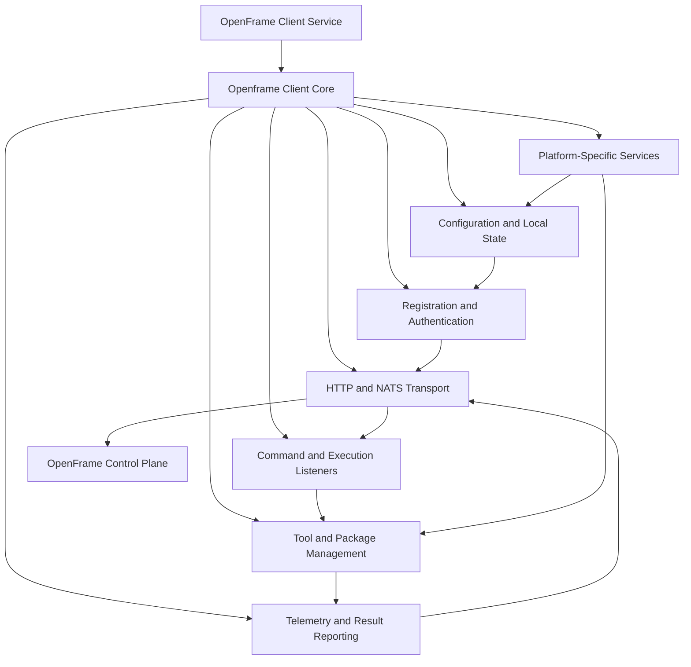
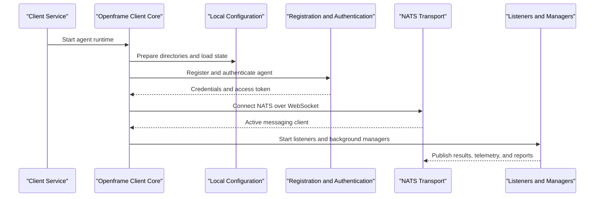
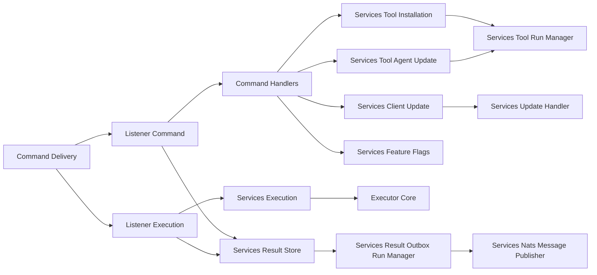

# Openframe Client Core

Openframe Client Core is the endpoint-agent runtime used by OpenFrame to enroll and authenticate managed devices, connect them to the tenant control plane, receive commands, execute work, manage integrated tools, publish device state, and recover safely from interruptions.

The module is supplied by the `openframe_agent_lib` Cargo dependency and is assembled by the OpenFrame Client workload. Its source layout is rooted at:

`openframe-oss-lib/clients/openframe-client/src`

## Purpose

Openframe Client Core provides the local agent capabilities required to manage an endpoint:

- Persist installation, registration, authentication, and update state.
- Register devices and maintain access and refresh tokens.
- Connect to platform services through HTTP and NATS over WebSocket.
- Receive commands, execution requests, feature flags, tool updates, package updates, and remote-access signals.
- Execute scripts on Windows and Unix hosts.
- Install, update, run, restart, and uninstall managed tools.
- Publish heartbeats, hostnames, time zones, logs, installed-agent versions, and command results.
- Coordinate safe restart, update, deactivation, and durable result recovery.

## Architecture

### Agent Startup Flow

## Core Areas

| Area | Responsibilities |
|---|---|
| Client runtime | Composes dependencies and starts the agent lifecycle. |
| CLI and service lifecycle | Installs, starts, diagnoses, restarts, and removes the endpoint agent. |
| Authentication | Registers the machine, obtains tokens, refreshes credentials, and handles tenant deactivation. |
| Messaging | Maintains NATS connectivity, receives machine-scoped messages, and publishes acknowledgements and results. |
| Execution | Runs commands and scripts with platform-appropriate privilege and timeout handling. |
| Tool management | Installs, updates, supervises, restarts, connects, and removes integrated tools. |
| Package management | Detects package-manager capability, queues update requests, protects running applications, and reports outcomes. |
| Logging and telemetry | Collects local logs, streams batches, publishes device status, and records metrics. |
| Platform integration | Handles directories, permissions, services, executable replacement, update scripts, and user-session behavior. |
| Recovery | Persists execution results, tracks delivery state, handles interrupted updates, and restores safe client operation. |

## Component Relationships

## Core Components Documentation

The following component documentation describes the primary Openframe Client Core boundaries:

- **Client Main Api** — Agent composition root, construction, startup ordering, listeners, managers, and platform integration.
- **Cli Entrypoint** — Command parsing and dispatch for installation, authentication, diagnostics, execution, and service control.
- **Service Core** — Native service installation, parameterless startup behavior, restart handling, and uninstall lifecycle.
- **Auth Client** — Client-credentials and refresh-token requests against the client token endpoint.
- **Registration Client** — Fresh registration, reinstall, and deregistration HTTP operations.
- **Listener Command** — Generic NATS command consumption, delivery tracking, restart-aware outcomes, and recovery.
- **Listener Execution** — Machine-scoped script execution intake, acknowledgement, durable results, and reconnection.
- **Services Nats Connection Manager** — Authenticated NATS-over-WebSocket connection lifecycle, reconnect events, and watchdog replacement.
- **Services Execution** — Privilege resolution, timeout handling, execution tracking, and normalized RMM results.
- **Executor Core** — Shared execution contract with Unix and Windows script implementations.
- **Services Tool Installation** — Reserved tool installation, assets, service verification, startup, and reporting.
- **Services Tool Agent Update** — Tool repair, version reconciliation, asset replacement, and installed-version publication.
- **Services Tool Run Manager** — Process supervision for standard and GUI tools, plus coordination during client updates and deactivation.
- **Services Client Update** — Client binary update reservation, staging, state persistence, and updater handoff.
- **Services Update Handler** — Post-restart update verification, rollback handling, cleanup, and delivery settlement.
- **Services Result Store** — Durable execution journal and outbox for results that must survive restarts or NATS outages.
- **Logging Core** — Process logging initialization, metrics integration, local files, and optional log shipping.
- **Doctor Main** — Pre-install, authentication, and health-check orchestration with optional remediation.
- **Platform Directories** — Managed endpoint filesystem paths, permission validation, secured storage, and tool paths.

## Operational Boundaries

Openframe Client Core is an outbound endpoint agent. It does not expose an inbound application API. Instead, it:

- Uses HTTP for registration, authentication, asset retrieval, and device configuration updates.
- Uses NATS over WebSocket for command delivery, execution work, device reports, results, and status messages.
- Persists critical local state for credentials, tool inventory, updates, command results, and delivery recovery.
- Relies on platform-specific adapters for service management, process control, file replacement, and interactive user sessions.