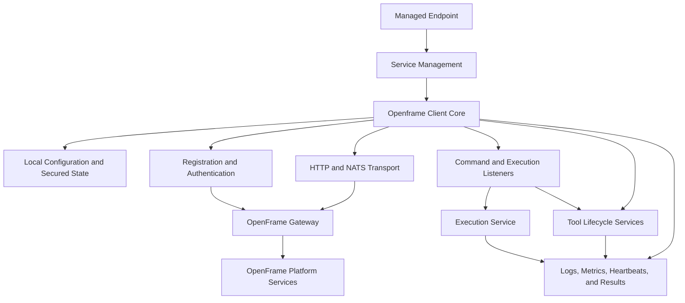
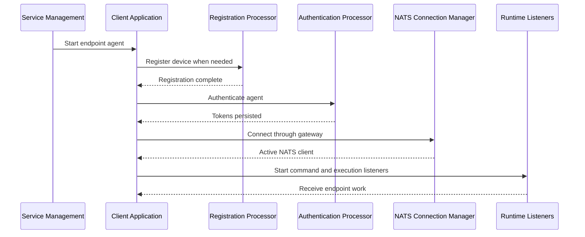
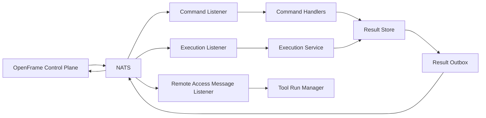

# Openframe Client Core

Openframe Client Core is the endpoint-agent runtime used by OpenFrame to enroll managed devices, maintain authenticated connectivity, receive control-plane work, manage integrated tools, execute scripts, and report device state back to the platform.

The module is supplied by the OpenFrame OSS Library through the `openframe_agent_lib` Cargo dependency and is assembled into the OpenFrame Client runtime. Its source tree is rooted at `openframe-oss-lib/clients/openframe-client/src`.

## Purpose

Openframe Client Core provides the device-side control plane for managed endpoints. It:

- Persists installation, registration, and authentication state.
- Registers devices and refreshes access tokens.
- Connects to NATS through the tenant gateway.
- Receives commands, scripts, tool updates, and remote-access events.
- Executes scripts with platform-specific privilege handling.
- Installs, updates, starts, stops, and removes integrated tools.
- Streams logs, publishes health data, and retains undelivered execution results.
- Coordinates safe service, client-binary, and tool update lifecycles.

## Architecture

### Startup and runtime flow

## Core component areas

| Area | Responsibilities | Core documentation |
| --- | --- | --- |
| Application lifecycle | Composes services, starts the endpoint runtime, and coordinates startup ordering. | Client Application |
| CLI and service lifecycle | Installs, authenticates, runs, restarts, diagnoses, and uninstalls the endpoint agent. | Cli Entrypoint, Service Management, Crossplatform Service Adapter |
| Registration and authentication | Registers devices, persists credentials, exchanges tokens, and refreshes authentication. | Registration Clients, Agent Registration Service, Agent Auth Service, Token Refresh Run Manager |
| Local configuration | Persists bootstrap configuration, agent credentials, tool records, update state, and local identity. | Installation Initial Config, Initial Configuration Service, Agent Configuration Service, Machine Id Service |
| NATS transport | Maintains authenticated NATS connectivity, reconnects after failures, and publishes outbound messages. | Nats Connection Manager, Nats Message Publisher |
| Command processing | Handles client updates, feature flags, tool installation, tool updates, uninstall commands, and package updates. | Command Listener Core, Command Listener Handlers, Command Listener Package Update |
| Script execution | Receives remote execution messages and runs scripts through Windows or Unix executors. | Execution Listener, Execution Service, Script Executor, Unix Script Executor, Windows Script Executor |
| Tool lifecycle | Installs, updates, runs, restarts, stops, connects, and uninstalls integrated endpoint tools. | Tool Installation Service, Tool Agent Update Service, Tool Run Manager, Tool Ops, Tool Restart Service, Tool Uninstall Service |
| Observability | Collects logs and metrics, streams logs, reports hostname, heartbeat, timezone, and installed-agent state. | Logging Setup, Logging Nats Streaming, Machine Heartbeat Publisher, Machine Timezone Publisher, Hostname Report Publisher |
| Durable delivery | Preserves execution and delivery outcomes across transient transport failures and restarts. | Result Store Core, Result Store Ledger, Result Outbox Run Manager |
| Platform operations | Manages directories, permissions, processes, services, executable replacement, updates, and uninstallation. | Platform Directories, Platform System Service, Platform Binary Version And Writer, Platform Uninstaller |
| Diagnostics and recovery | Checks local prerequisites, performs supported healing, and coordinates deactivation behavior. | Doctor Health Checks, Doctor Healing, Doctor Reporting, Deactivation Service |

## Control-plane message flow

## Design boundaries

Openframe Client Core separates concerns across focused modules:

- **Transport adapters** perform HTTP or NATS communication without owning lifecycle policy.
- **Services** coordinate endpoint state, persistence, retries, and platform operations.
- **Listeners** convert inbound NATS messages into typed command or execution workflows.
- **Models** define serialized contracts for registrations, commands, updates, results, and telemetry.
- **Platform modules** isolate Windows, macOS, and Unix filesystem, service, process, and privilege behavior.
- **Durable stores** preserve execution and delivery results until the agent can report them successfully.

This separation allows the endpoint agent to continue operating through network disruption, controlled restart, update, and local process-management scenarios while preserving its registration and result-delivery state.