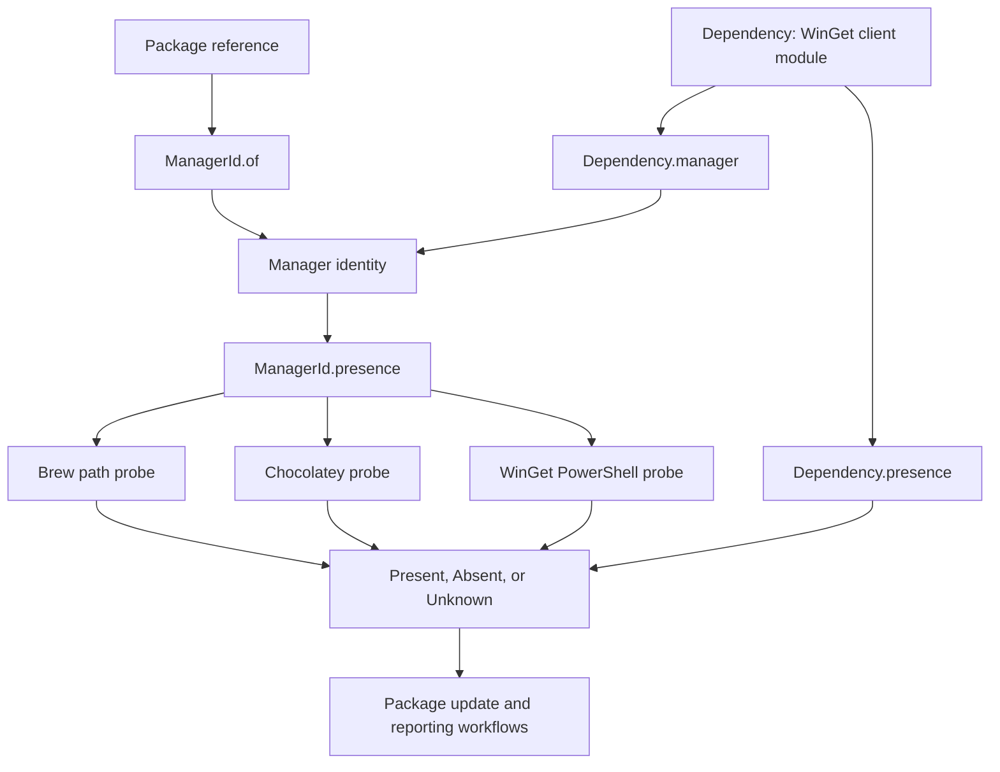
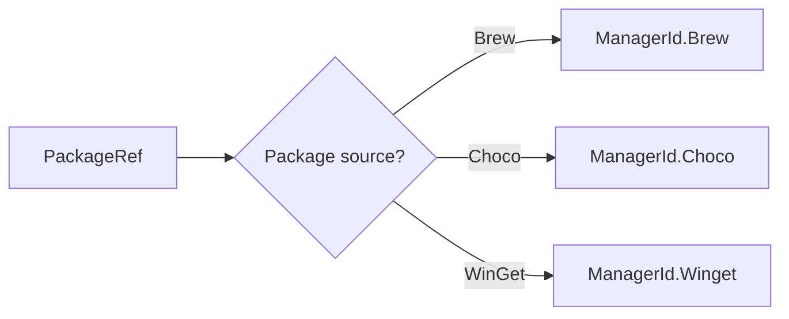
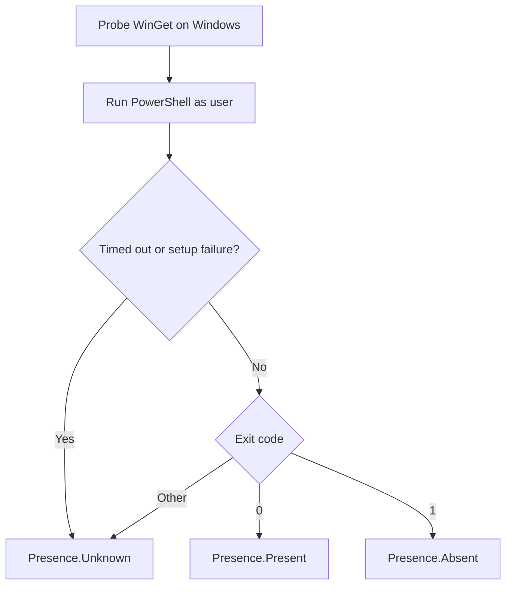
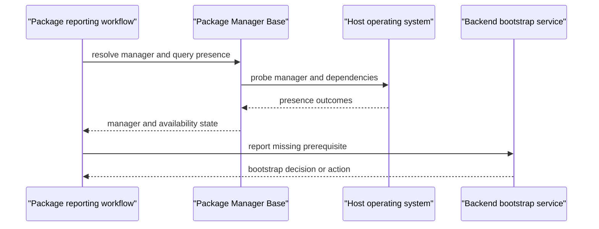

# Package Manager Base

Package Manager Base is the OpenFrame Client agent's small, platform-aware registry for supported operating-system package managers. It translates a package reference into the manager responsible for it, detects whether that manager is usable on the current machine, and identifies prerequisite components that must be bootstrapped before package work can proceed.

The implementation is supplied by the `openframe_agent_lib` artifact from [OpenFrame OSS Library](https://github.com/flamingo-stack/openframe-oss-lib/blob/16e7c1cbd9664e7d10ec5ebca7d53c9bd314decf/clients/openframe-client/src/services/package_manager/mod.rs). OpenFrame OSS Tenant runs this library through its `openframe-client` service. Package Manager Base does not install, update, or report on packages itself; those responsibilities are handled by the adjacent package-update, reporting, state/support, and update-gate facilities.

## Responsibilities

Package Manager Base establishes three shared concepts:

- **Manager identity** — `ManagerId` represents Brew, Chocolatey, and WinGet. Its `of` function selects the manager from a `PackageRef`.
- **Availability state** — `Presence` distinguishes a confirmed `Present` manager or prerequisite from `Absent` and an indeterminate `Unknown` result.
- **Bootstrap prerequisite** — `Dependency` currently models the all-users Microsoft WinGet PowerShell client module and associates it with WinGet.

This separation lets callers reason about the difference between a package manager that is missing and a probe that cannot safely determine availability on the current platform.

## Architecture



The module is a classification and discovery layer. `PackageRef` is an agent model that encodes a package's source format, while the returned `ManagerId` is the normalized identifier used by downstream workflows. Package Manager Base keeps OS-specific probing behind the `presence` functions so higher-level update logic can operate on common outcomes.

## Core Types and Operations

| Component | Role | Behavior |
|---|---|---|
| `ManagerId` | Supported-manager enum | Contains `Brew`, `Choco`, and `Winget`; serializes with uppercase names and exposes a fixed `ALL` collection. |
| `ManagerId.of` | Package-to-manager mapping | Maps a Brew package reference to Brew, a Chocolatey reference to Chocolatey, and a WinGet reference to WinGet. |
| `ManagerId.presence` | Manager discovery | Delegates to the probe appropriate to the selected manager and returns `Presence`. |
| `Presence` | Discovery result | Represents confirmed availability, confirmed absence, or an unsupported/failed/indeterminate probe. |
| `Dependency` | Required supporting component | Currently contains `WingetClientModule`; serializes using screaming-snake-case names and exposes `ALL`. |
| `Dependency.manager` | Dependency ownership | Associates `WingetClientModule` with the WinGet manager. |
| `Dependency.presence` | Prerequisite discovery | Verifies the machine-wide Microsoft WinGet client module installation on Windows. |

## Manager Resolution

The `ManagerId.of` function is deterministic and performs no I/O. It uses the variant of `PackageRef`, not package-name heuristics, so a package request retains its selected ecosystem throughout the update workflow.



`ManagerId::ALL` provides a canonical ordered list of the three known managers. Consumers that need to inspect the host's capabilities can iterate this list rather than maintaining a separate manager inventory.

## Presence Detection

### Brew

Brew presence is determined by checking configured paths from the private Brew implementation. A matching filesystem path produces `Present`; otherwise the result is `Absent`. This check is local and does not launch a process.

### Chocolatey

Chocolatey is only probed on Windows:

1. The probe reads `ChocolateyInstall` from the machine environment registry key.
2. If that registry value is unavailable or blank, it derives the standard location from `ProgramData`, defaulting to `C:\ProgramData`.
3. It verifies that `bin\choco.exe` exists below the resolved Chocolatey root.
4. The executable's presence produces `Present`; its absence produces `Absent`.

On non-Windows platforms, Chocolatey is not applicable and the module returns `Unknown`, rather than incorrectly declaring it absent.

### WinGet

WinGet is probed only on Windows by executing a PowerShell script as the user. The script queries the Microsoft Desktop App Installer package and checks for `winget.exe` beneath its installation location. The script has a 60-second timeout, defined by `PRESENCE_PROBE_TIMEOUT_SECS`.



An exit status of `0` means WinGet is present and `1` means it is absent. A timeout, setup-failure return code, or any other return code becomes `Unknown`. On non-Windows platforms the method immediately returns `Unknown` without attempting a PowerShell invocation.

## Dependency Detection and Bootstrap Boundary

A manager can be installed while one of its operational prerequisites is missing. Package Manager Base represents this explicitly with `Dependency` instead of folding it into manager presence. The current dependency, `WingetClientModule`, is checked only on Windows.

The dependency probe examines the machine-wide path below `ProgramFiles`:

```text
WindowsPowerShell\Modules\Microsoft.WinGet.Client
```

It reports `Present` only if at least one version directory contains `Microsoft.WinGet.Client.psd1`. A per-user copy is deliberately not sufficient because it would not make the module available to every user context. Missing directories or manifests produce `Absent`; non-Windows platforms produce `Unknown`.

The module does not bootstrap the dependency. Its source comment assigns that action to the backend. Callers must therefore use both the manager presence and dependency presence when deciding whether work can start or when reporting host capabilities.



## Integration with the Client Agent

The OpenFrame Client composes Package Manager Base with neighboring package-management modules:

- The package update runner receives update work and coordinates its execution.
- The update order store tracks submitted and in-progress package update orders.
- The update status reporter emits rejected and superseded outcomes.
- The package manager report publisher and run manager communicate manager capability information.
- The state/support modules determine whether a manager is supported and expose its state.
- The update gate assesses conditions that may block an update, such as an identified application holder.

Package Manager Base contributes only the reusable vocabulary and local discovery needed by these components. It intentionally does not own update ordering, status publication, manager-state reporting, or remediation.

## Decision Guidance for Callers

Treat `Presence` as a three-valued result:

| Result | Meaning | Appropriate caller behavior |
|---|---|---|
| `Present` | The expected local artifact was found. | Continue to manager-specific validation or execution. |
| `Absent` | The platform-specific probe completed and the expected artifact was not found. | Report the missing manager or dependency and allow bootstrap/remediation policy to decide next steps. |
| `Unknown` | The platform is not applicable or the probe could not reach a reliable conclusion. | Do not equate this with absence; preserve the uncertainty for state, gate, or reporting policy. |

This distinction is particularly important for WinGet because the probe can time out or return an unexpected status, and for managers that are intentionally unsupported by the current operating system.

## Operational Constraints

- Manager probes are platform-scoped: Chocolatey and WinGet have Windows-specific probes, while non-Windows builds return `Unknown` for them.
- The WinGet command runs with user privilege rather than an elevated privilege policy.
- WinGet probe execution is bounded to 60 seconds to avoid indefinitely blocking client-agent workflows.
- Chocolatey detection accepts an explicitly configured machine installation root and has a conventional fallback location.
- WinGet client module detection requires a machine-wide PowerShell module installation; user-profile modules do not satisfy the dependency.

## Maintenance Notes

When adding a package manager, update all of the following consistently:

1. Add a `ManagerId` variant and include it in `ManagerId::ALL`.
2. Extend `ManagerId.of` for the corresponding `PackageRef` variant.
3. Implement a platform-safe `presence` probe with clear `Present`, `Absent`, and `Unknown` semantics.
4. Add any required bootstrap items as `Dependency` variants, include them in `Dependency::ALL`, and map each dependency back to its owning manager.
5. Ensure package update, reporting, support, state, and update-gate workflows understand the new manager's identity and capabilities.

The source implementation is maintained in the OpenFrame OSS Library at [package manager module](https://github.com/flamingo-stack/openframe-oss-lib/blob/16e7c1cbd9664e7d10ec5ebca7d53c9bd314decf/clients/openframe-client/src/services/package_manager/mod.rs).