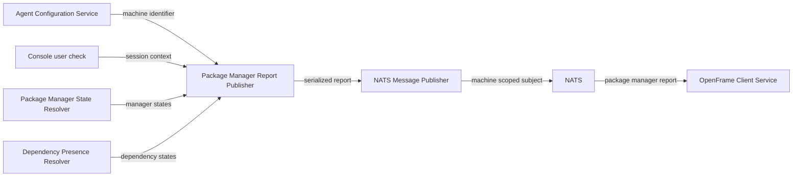
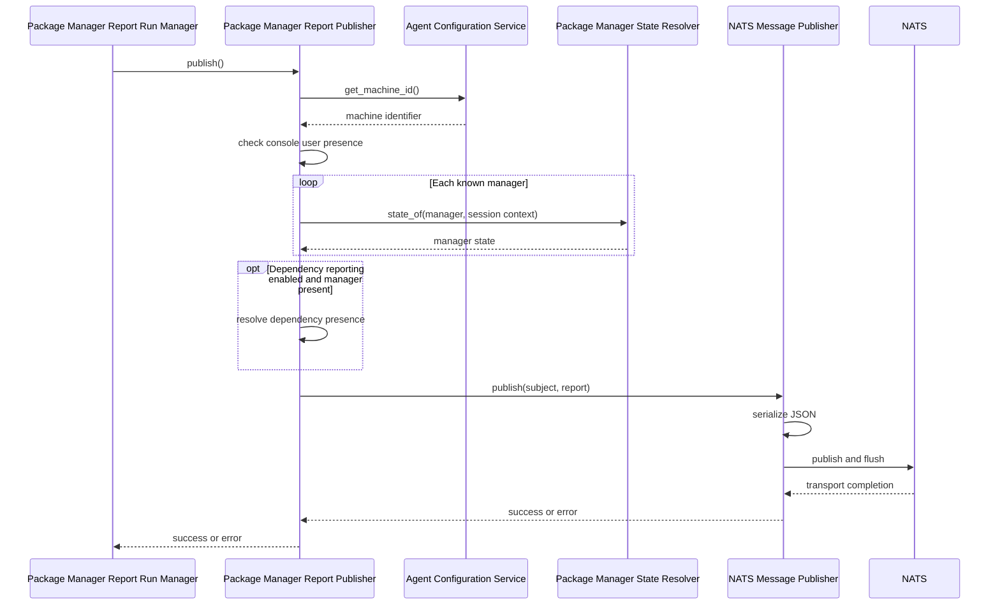
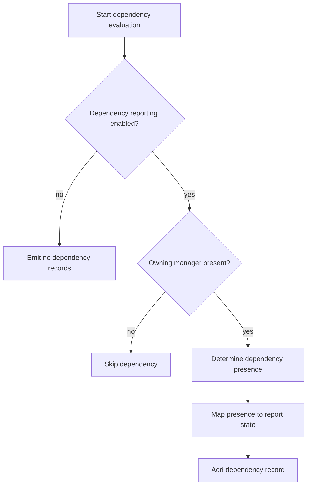
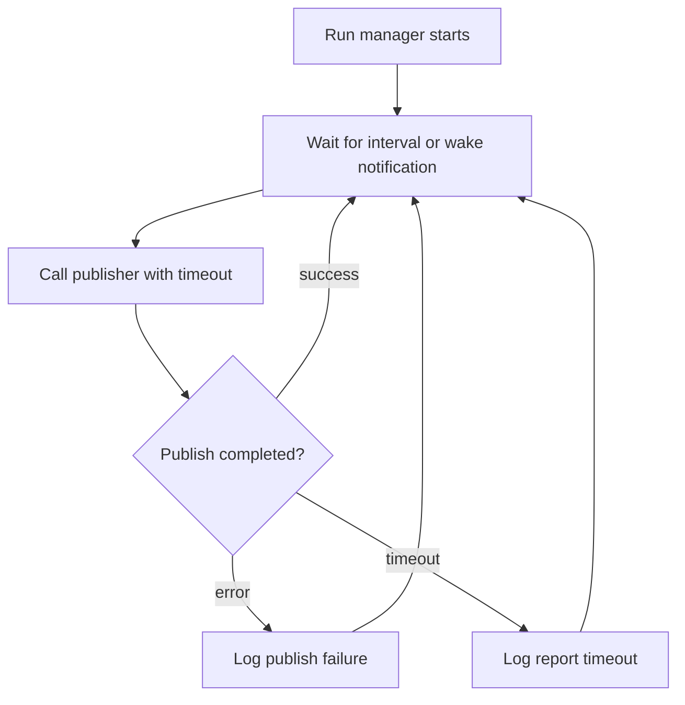

# Package Manager Report Publisher

Package Manager Report Publisher is the OpenFrame Client agent component that discovers local package-manager availability and publishes a machine-scoped report over NATS. It belongs to the `openframe_client` Rust artifact supplied by OpenFrame OSS Library and run by this repository's OpenFrame Client service. The implementation is in [report_publisher.rs](https://github.com/flamingo-stack/openframe-oss-lib/blob/16e7c1cbd9664e7d10ec5ebca7d53c9bd314decf/clients/openframe-client/src/services/package_manager/report_publisher.rs).

Its single publishing operation produces an inventory snapshot for Brew, Chocolatey, and Winget. When enabled, it also reports known dependencies, but only for package managers confirmed as present. The report lets server-side listeners associate package-management capability with a specific enrolled machine.

## Responsibilities

- Retrieve the persisted agent machine identifier.
- Detect whether a console user is present and use that context while determining each manager's state.
- Evaluate every member of `ManagerId::ALL`: Brew, Chocolatey, and Winget.
- Optionally include dependency state for managers that are present.
- Serialize the report as JSON and publish it to the machine-specific NATS subject.
- Surface configuration, serialization, connection, publish, and flush failures to its caller.

The component does not install, update, or remove packages. Package-update orchestration, order persistence, status reporting, and update gating are separate Package Manager modules.

## Position in the Client Architecture



The publisher receives its dependencies through its constructor:

| Dependency | Purpose |
|---|---|
| `NatsMessagePublisher` | Serializes and sends the completed report, then flushes the NATS client. |
| `AgentConfigurationService` | Provides the enrolled machine identifier used to address the report. |
| `report_dependencies` | Controls whether dependency records are emitted. |

The adjacent Package Manager Report Run Manager owns periodic and on-demand invocation. It retains a publisher instance, waits for either its reporting interval or a wake notification, bounds each `publish` call with a timeout, and logs failures without terminating its loop.

## Report Model

The publisher builds a private `PackageManagerReport` value with camel-case JSON field names:

| Field | Type | Meaning |
|---|---|---|
| `packageManagers` | map from manager identifier to state | The state recorded for every known package manager. A `BTreeMap` provides deterministic key ordering before serialization. |
| `dependencies` | list of dependency records | Optional details for known dependencies associated with present managers. |

Each dependency record includes its owning manager, dependency name, and normalized state. At present, the dependency enumeration includes the Winget client module. Its raw presence is mapped as follows:

| Presence result | Reported manager state |
|---|---|
| `Present` | `Present` |
| `Absent` | `Missing` |
| `Unknown` | `Unknown` |

Manager state has four values: `Present`, `Missing`, `Unsupported`, and `Unknown`. Manager detection combines a manager-specific presence check, operating-system support, and whether a console-user session is active. The publisher reports the resulting state without altering it.

## Publication Flow



### Subject Addressing

The report subject is constructed from the configured machine identifier and the fixed `package-managers` suffix:

```text
machine.<machine-id>.package-managers
```

The machine identifier is required. If it cannot be read from the agent configuration, no discovery or publish is attempted and `publish` returns that error.

### Dependency Inclusion Rules

Dependency reporting is intentionally narrower than manager reporting:

1. All package managers are placed in `packageManagers`, regardless of state.
2. Dependencies are omitted when `report_dependencies` is false.
3. When enabled, a dependency is included only when its owner is `Present` in the completed manager-state map.
4. The dependency presence result is converted to a report state and placed in `dependencies`.

This prevents dependency details from being reported for an unavailable, unsupported, missing, or unknown manager.



## Runtime Behavior and Failure Boundaries

The publisher logs the manager map, dependency list, and console-user status immediately before publication. It does not retain a local outbox or retry failed reports itself. The NATS publisher is responsible for JSON serialization, obtaining the current connection, publishing, and flushing; any failure from these steps propagates through `publish`.

The report run manager provides the operational boundary around that call:



A successful return means the NATS client accepted the JSON payload and completed its flush operation. It is not an application-level acknowledgment from a downstream report consumer.

## Maintenance Notes

- Add a manager by extending the package-manager identifiers and their state resolution; the publisher iterates the complete `ManagerId::ALL` set rather than maintaining a separate list.
- Add a dependency by extending `Dependency::ALL` and defining its manager and presence behavior. The existing inclusion gate will apply automatically.
- Preserve the machine-scoped subject suffix and the camel-case report fields unless coordinated with all NATS consumers.
- Keep report generation side-effect free. Installation and update behavior should remain in the dedicated Package Manager update modules.
- Treat `report_dependencies` as a payload-shaping setting, not as a switch that disables manager discovery.

## Source and Delivery Context

The tenant repository consumes OpenFrame OSS Library as the Rust artifact `openframe_agent_lib` at version `v0.0.5`. This module's source is owned by that library, while the tenant repository builds and deploys the OpenFrame Client runtime that executes it. NATS is configured as a tenant datasource for the OpenFrame Client deployment.
