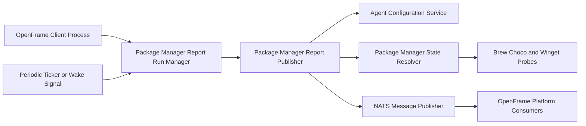
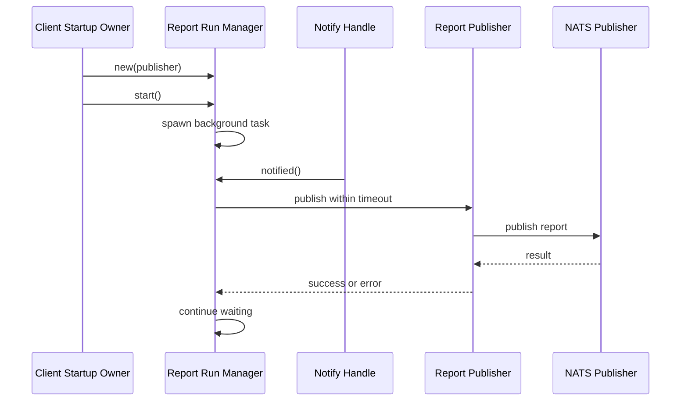
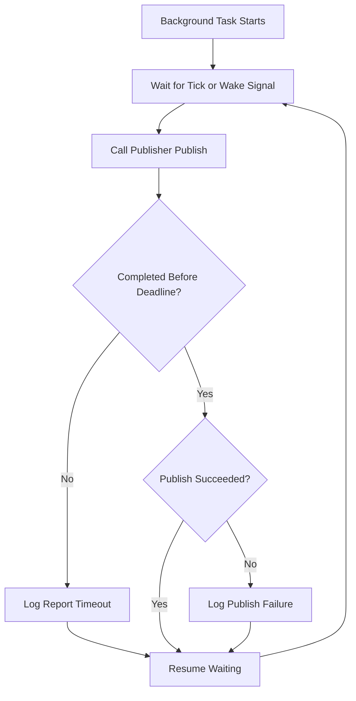
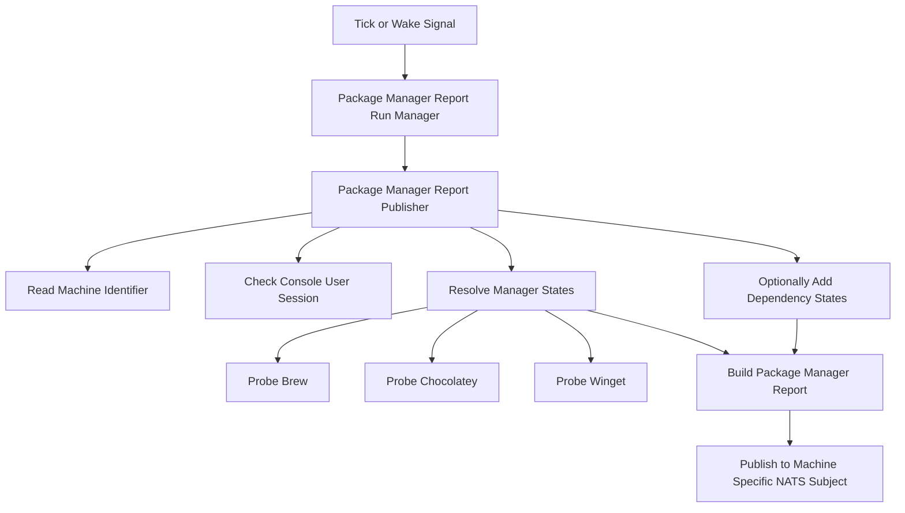

# Package Manager Report Run Manager

The Package Manager Report Run Manager is the OpenFrame client background scheduler that periodically, and on demand, publishes a device's package-manager availability to the platform. It is implemented by the `openframe_agent_lib` dependency from the OpenFrame OSS Library and runs inside this repository's OpenFrame client process.

Its public surface is intentionally small: construct it with a `PackageManagerReportPublisher`, call `start` once to launch its asynchronous loop, and retain the notification handle returned by `wake_handle` when another component needs an immediate report.

**Source:** [OpenFrame OSS Library implementation](https://github.com/flamingo-stack/openframe-oss-lib/blob/16e7c1cbd9664e7d10ec5ebca7d53c9bd314decf/clients/openframe-client/src/services/package_manager/report_run_manager.rs)

## Responsibilities

- Schedule package-manager reporting at a normal 15-minute cadence.
- Accept a Tokio `Notify` wake-up signal for an immediate reporting attempt.
- Bound each publication attempt with a calculated timeout.
- Log publishing failures and timeouts while keeping the background loop alive.
- Delegate all device inspection, report construction, and NATS publication to `PackageManagerReportPublisher`.

The manager does **not** install packages, process package-update orders, or persist report state. Those responsibilities remain outside this scheduler.

## Position in the Client

The module belongs to the Rust `openframe-client` supplied by the OpenFrame OSS Library, which this repository consumes as `openframe_agent_lib` version `v0.0.5`. The tenant repository supplies the service deployment and the NATS endpoint configuration; the library supplies the report scheduler and publisher implementation.



## Core Components

| Component | Role |
|---|---|
| `PackageManagerReportRunManager` | Holds a cloneable publisher and a shared `Arc<Notify>` wake signal. |
| `new` | Creates the manager and initializes its wake signal. |
| `start` | Spawns the long-lived Tokio task that waits for interval ticks or wake notifications, then publishes a report. |
| `wake_handle` | Returns a cloned wake signal so an owner can request a report without exposing the manager internals. |

### Construction and Lifecycle

`new` receives a fully configured `PackageManagerReportPublisher`. This keeps communication and configuration concerns out of the run manager. Calling `start` clones the publisher and notification handle into a detached Tokio task, then returns immediately to its caller.

The task is an infinite loop. A failure is observable through structured error logs, but is not terminal: the next interval tick or notification schedules another attempt. Calling `start` more than once would create independent loops because the method does not implement a start-once guard; lifecycle ownership must therefore ensure it is started once.



## Scheduling and Timeout Behavior

### Normal and Effective Interval

The nominal reporting interval is 900 seconds, or 15 minutes. Before starting the loop, the manager calculates a reporting timeout from the per-manager presence-probe timeout, the number of supported manager identifiers, and a 10-second publishing grace period.

The ticker interval is the greater of:

```text
max(900 seconds, report timeout + 10 seconds)
```

This ensures that the configured cycle cannot be shorter than the reporting budget plus an additional publishing grace window. As a result, a slow set of probes cannot cause periodic runs to pile up behind one another in this single task.

### Reporting Deadline

The per-attempt deadline is:

```text
presence probe timeout × number of manager identifiers + 10 seconds
```

At the current library boundary, the manager identifiers are Brew, Chocolatey, and Winget. The dynamic calculation uses the `ManagerId::ALL` collection and treats an empty list as one probe for arithmetic safety. This means the timeout follows future changes to the supported-manager set rather than hard-coding a manager count.

A timer tick or wake notification starts one publication attempt. The attempt completes in one of three ways:

1. The publisher returns successfully and the loop resumes silently.
2. The publisher returns an error and the manager logs a reporting failure.
3. The deadline elapses and the manager logs a timeout.



## Publication Data Flow

The run manager contains no package-manager probing logic. Its publisher performs the actual report assembly:

1. It obtains the device machine identifier from the agent configuration service.
2. It determines whether a console user is present.
3. It resolves the state of each manager in `ManagerId::ALL`.
4. State resolution combines manager presence, operating-system support, and user-session conditions into `Present`, `Missing`, `Unsupported`, or `Unknown`.
5. When dependency reporting is enabled, it includes dependencies only for managers currently reported as `Present`.
6. It publishes the resulting package-manager report through the NATS message publisher on a machine-specific subject.



## Wake-Up Semantics

`wake_handle` returns an `Arc<Notify>` shared with the background task. A caller can notify it to avoid waiting for the next scheduled interval. The signal requests a new attempt; it is not a queue carrying payload data, an acknowledgement mechanism, or a guarantee that a report has been accepted by downstream consumers.

Because the loop selects between a timer tick and a notification, both paths converge at the same bounded `publish` call. This gives scheduled and event-driven reports identical probing, dependency-selection, publication, timeout, and logging behavior.

## Operational Characteristics

| Concern | Behavior |
|---|---|
| Concurrency | One spawned loop performs each report attempt serially. The calculated ticker interval avoids periodic overlap within that loop. |
| Failure handling | Publisher errors and timeouts are logged with `tracing::error`; the loop continues. |
| Startup observability | The manager emits an informational log when it starts. |
| Report contents | Report generation is delegated to the publisher, including machine identity, supported manager states, and optionally dependency states. |
| Transport | NATS publication is delegated to the shared NATS message publisher. |
| Trigger sources | A periodic Tokio interval and an externally held Tokio notification handle. |

## Maintenance Guidance

- Preserve the timeout calculation when adding or removing package managers. It deliberately scales with `ManagerId::ALL` so a full report has time to complete every presence check.
- Keep the publisher as the only owner of report composition and transport. Adding probe logic to the scheduler would duplicate the reporting policy and make wake-triggered runs diverge from scheduled runs.
- Treat a wake as best-effort scheduling. Components requiring delivery confirmation need a separate acknowledgement or result-observation mechanism.
- Review timeout and interval changes together. An interval shorter than the report budget can lead to unbounded scheduling pressure; the current maximum calculation prevents that condition for timer-driven attempts.
- Ensure the application starts exactly one manager instance. The component does not prevent duplicate calls to `start` from spawning duplicate reporting tasks.

## Scope Boundaries

This module is the reporting scheduler for locally detected package-manager state. Package update execution, update ordering, restart coordination, status reporting, and policy gating are separate package-management responsibilities. The broader OpenFrame platform consumes the published report to maintain the device software-management view, while the manager itself remains focused on timely, bounded report production.
