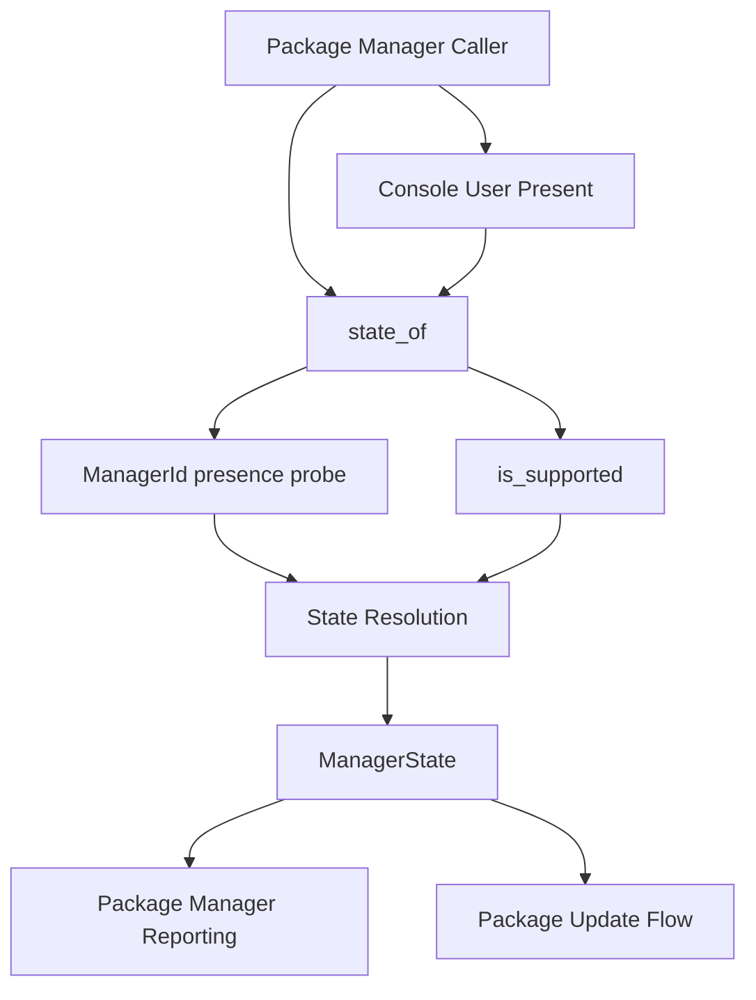
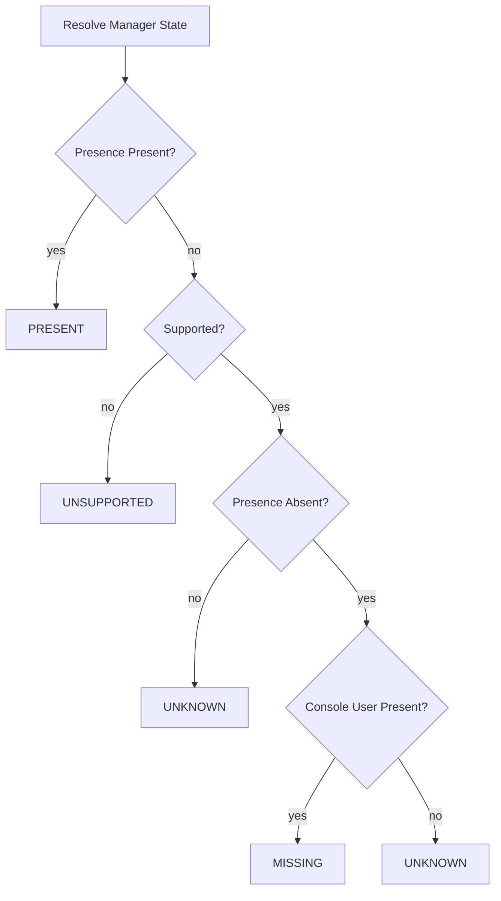
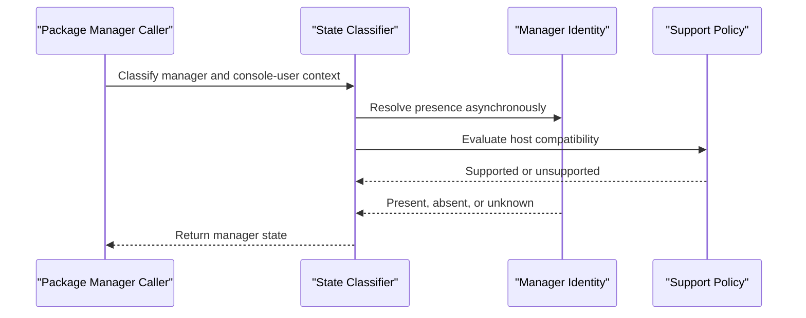

# Package Manager State Support

Package Manager State Support is the OpenFrame Client agent's compatibility and availability classifier for local software package managers. It is implemented by the `openframe_agent_lib` dependency from the OpenFrame OSS Library and runs in this repository's `openframe-client` workload. The module turns platform capability, executable detection, and interactive-session context into a compact state that package inventory reporting and package-update orchestration can consume.

The implementation is intentionally read-only: it neither installs a package manager nor starts an update. Its output distinguishes an unavailable manager from a manager that is unavailable only because the current session cannot safely establish whether it should be visible.

## Scope and Source

The module consists of two Rust source files in the OpenFrame OSS Library:

- [`state.rs`](https://github.com/flamingo-stack/openframe-oss-lib/blob/16e7c1cbd9664e7d10ec5ebca7d53c9bd314decf/clients/openframe-client/src/services/package_manager/state.rs) defines `ManagerState` and the asynchronous `state_of` classifier.
- [`support.rs`](https://github.com/flamingo-stack/openframe-oss-lib/blob/16e7c1cbd9664e7d10ec5ebca7d53c9bd314decf/clients/openframe-client/src/services/package_manager/support.rs) defines the platform support policy and platform-spec discovery used by the classifier.

The client package-manager base supplies the manager identities `Brew`, `Choco`, and `Winget`, plus the lower-level presence result `Present`, `Absent`, or `Unknown`. Adjacent client package-manager modules use this classification when reporting managers and when coordinating package updates, orders, statuses, and update gates.

## Architecture

`state_of` combines three inputs:

1. **Presence** is asynchronously obtained from the selected `ManagerId`. It indicates whether the manager is present, absent, or cannot be determined.
2. **Support** is evaluated synchronously against a cached operating-system specification. It answers whether the product intentionally supports that manager on the host.
3. **Session state** is derived from the caller's `console_user_present` boolean. It differentiates a conclusively missing manager from an indeterminate result when no interactive console user is available.

## State Model

`ManagerState` is serialized with uppercase names for wire-level reporting:

| State | Meaning | Primary condition |
|---|---|---|
| `PRESENT` | The manager was detected. | Presence is `Present`, regardless of the support-policy verdict. |
| `UNSUPPORTED` | The client does not support this manager on the detected host platform. | Presence is not `Present` and the manager is unsupported. |
| `MISSING` | A supported manager is absent while a console session is active. | Presence is `Absent`, support is enabled, and a console user is present. |
| `UNKNOWN` | The client cannot safely make a more precise claim. | Presence is unknown, or the manager is absent with no console session. |

The precedence is deliberate: a detected manager is reported as `PRESENT` before support is considered. This preserves an observation of the local machine even if the current product policy does not enable that manager. Conversely, support policy takes precedence over an absent result, preventing an unsupported platform from being represented as a remediable missing installation.

## Compatibility Policy

`is_supported` evaluates the selected manager against an `OsSpec` containing operating system, architecture, Windows product type, edition identifier, and build number. Detection is target-specific and is cached for the lifetime of the process with `OnceLock`; the resolved profile and the verdict for every known manager are logged once.

| Manager | Supported host criteria | Explicitly unsupported cases |
|---|---|---|
| Homebrew | macOS on Apple Silicon, including an indeterminate macOS architecture result | Non-macOS hosts and confirmed x86_64 macOS hosts |
| winget | Windows meeting build, edition, and server constraints | Non-Windows hosts, builds before Windows 10 version 1809, Store-less editions, and most Windows Server releases before Windows Server 2025 |
| Chocolatey | None | Disabled by product policy |

### Homebrew

Homebrew is macOS-only and is supported for Apple Silicon. On macOS, the detector queries `hw.optional.arm64` using `sysctl`. A confirmed non-Arm64 response is classified as x86_64 and rejected. If architecture cannot be established for a reason other than the known missing-key case, the policy permits Homebrew rather than incorrectly rejecting a potentially supported Arm64 device.

### winget

winget is Windows-only. The policy reads Windows registry values to identify processor architecture, workstation or server product type, edition, and build:

- Windows builds below `17763` are rejected.
- `EnterpriseS`, `EnterpriseSN`, `IoTEnterprise`, and `IoTEnterpriseS` are rejected because they lack the Microsoft Store required by winget.
- Server editions are rejected below build `26100`, except `ServerRdsh`, which is treated as a multi-session exception.

If optional registry values cannot be read, their values remain unknown. The policy only rejects values it can conclusively identify as unsupported, avoiding a false negative caused solely by incomplete platform metadata.

## Resolution Flow

The presence operation and support-policy evaluation form the decision inputs. `state_of` awaits presence and applies the support policy before invoking its internal resolution table. It does not expose its temporary session enum, so callers provide only a boolean representing whether a console user is present.

## Operational Implications

- Treat `PRESENT` as a detected local capability, not a guarantee that a package update is allowed. Update coordination applies its own safety gate.
- Treat `UNSUPPORTED` as a policy and platform outcome, not an installation failure. Remediation should not instruct the user to install the manager unless product policy changes.
- Treat `MISSING` as an actionable absence only when a console user is active. The session condition avoids misclassifying session-dependent discovery as a missing installation.
- Treat `UNKNOWN` as non-authoritative. It covers probe failures and absent managers when no console session is available; callers should retry during a suitable session or defer action rather than assume the manager is missing.
- The one-time compatibility log provides a diagnostic record of detected platform attributes and each manager's support verdict without repeatedly emitting environment data.

## Integration Boundaries

Package Manager State Support belongs to the Rust OpenFrame Client library consumed by this repository through the `openframe_agent_lib` Cargo dependency, version `v0.0.5`. The client workload uses the library's package-manager family to inventory package-manager availability and to coordinate remote package updates. The wider tenant deployment supplies the client service, NATS connectivity, and the backend services that receive management data; this module does not directly communicate with those services.

The module's contract is deliberately small:

- **Input:** a `ManagerId` and console-user availability.
- **Internal dependencies:** the manager presence probe and platform support policy.
- **Output:** a serializable `ManagerState`.
- **Side effect:** a once-per-process informational compatibility log when support is first evaluated.

## Maintenance Notes

When changing support rules, update the policy and its tests together. Preserve the resolution precedence unless downstream reporting semantics are intentionally changed: detected presence first, unsupported policy second, then the session-aware distinction between missing and unknown. New manager identities must be added to both the base manager set and the compatibility-policy dispatch so the one-time diagnostic log includes a complete verdict set.

Platform detection should remain conservative in the direction encoded by the current policy: reject known-incompatible configurations, but retain `UNKNOWN` or a supported verdict where host metadata is unavailable and a definitive rejection would be misleading.
