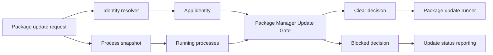
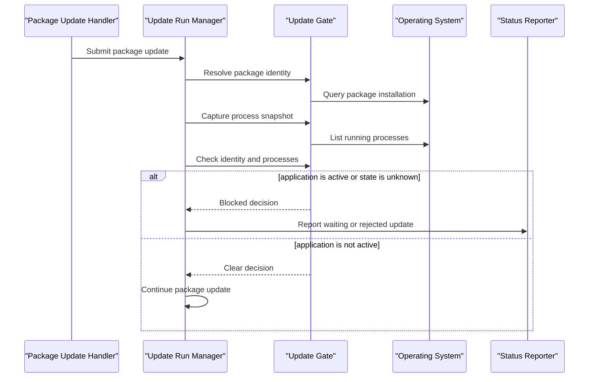

# Package Manager Update Gate

## Purpose

Package Manager Update Gate is a safety boundary in the Rust OpenFrame client. Before a package update starts, it determines whether the package's installed application is actively in use. It permits an update only when the package has no relevant running process; otherwise it returns a structured block decision that identifies the processes holding the application.

The implementation is supplied by the `openframe_agent_lib` Cargo artifact from [OpenFrame OSS Library](https://github.com/flamingo-stack/openframe-oss-lib), version `v0.0.5`, and runs in this repository's OpenFrame client deployment. Its source is split between the [gate model and resolution module](https://github.com/flamingo-stack/openframe-oss-lib/blob/16e7c1cbd9664e7d10ec5ebca7d53c9bd314decf/clients/openframe-client/src/services/package_manager/update_gate/mod.rs) and the [decision module](https://github.com/flamingo-stack/openframe-oss-lib/blob/16e7c1cbd9664e7d10ec5ebca7d53c9bd314decf/clients/openframe-client/src/services/package_manager/update_gate/decide.rs).

## Architecture Overview

The gate deliberately separates potentially slow system discovery from the deterministic process filter:

1. `resolve` identifies whether the package represents an application and, where supported, determines the installation directory and main executable names.
2. `snapshot` takes a fresh operating-system process snapshot without blocking the asynchronous caller.
3. `check` converts resolver and snapshot failures into a conservative block, or delegates successful inputs to `decide`.
4. `decide` selects qualifying running application instances and returns `Clear` or `Blocked`.

## Core Components

| Component | Responsibility |
| --- | --- |
| `AppIdentity` | Models whether a package has no runnable application (`NoApp`) or an application installation directory with known or unknown main image names. |
| `MainImages` | Controls process matching precision. `Derived` restricts matches to discovered main executable names, while `Unknown` conservatively accepts any qualifying process below the install directory. |
| `Holder` | Captures the process ID, executable image path, and optional session of an application instance that prevents an update. |
| `GateDecision` | Represents the final verdict: `Clear` or `Blocked`. |
| `BlockReason` | Distinguishes an active application from an indeterminate safety condition. |
| `Undetermined` | Enumerates fail-closed discovery failures, including unsupported managers, missing installation data, resolver errors, and snapshot errors. |
| `resolve` | Resolves supported package references. Brew formulas are classified as `NoApp`; macOS Brew casks and Windows Winget packages use platform-specific resolution. |
| `snapshot` | Runs the process snapshot operation on a blocking task and translates task-join failure into an indeterminate result. |
| `check` | Combines a resolved identity and process snapshot, blocking whenever either prerequisite is indeterminate. |
| `decide` | Filters process records and produces the final clear or running-process block decision. |

## Decision Rules

For an application identity, a process is considered a holder only when all of the following are true:

- Its executable path lies strictly below the resolved installation directory. Matching is case-insensitive and accepts either path separator.
- It is not marked as a service process.
- It is a root instance rather than a child process whose parent image is the same executable image.
- If main image names were derived, its executable filename matches one of them case-insensitively. If discovery could not derive names, the gate retains every process meeting the earlier conditions.

`NoApp` always produces `Clear`; this is used for Brew formulas. An empty holder set also produces `Clear`. Any qualifying holder yields `Blocked(Running)`, carrying every matched holder so the caller can report actionable state.

## Fail-Closed Behavior

The gate treats incomplete evidence as unsafe. A resolver failure, unavailable install location, unsupported package manager, process snapshot failure, or missing installation produces `Blocked(Undetermined)` rather than allowing the update. This prevents an update from replacing an application when the client cannot reliably determine whether it is active.

## Runtime Context

The gate is part of the OpenFrame client's package-update flow. The command listener accepts package-update work, the package update runner coordinates it, and the order store and status reporter manage sequencing and visible outcomes. The gate itself has no update side effect: it only observes package identity and current processes, then returns a verdict for the caller to enforce.

## Design Considerations

- **Fresh process state:** identity resolution may be reused by callers, but the gate checks it against a newly captured process snapshot.
- **Avoiding false holders:** service processes and same-image child processes do not independently block an update.
- **Conservative fallback:** when the system cannot identify main images, it prefers blocking a potentially active application over risking replacement.
- **Platform-scoped resolution:** only Windows Winget and macOS Brew casks use platform resolvers in this module; other managers are explicitly unsupported by the gate.

## Submodules

Detailed implementation notes are available for the generated submodules:

- [Decision Logic](package-manager-update-gate/decision_logic/decision_logic.md) explains the pure process-filtering algorithm, path-boundary rule, and holder construction.
- [Gate Orchestration](package-manager-update-gate/gate_orchestration/gate_orchestration.md) documents the identity model, platform-scoped resolution, asynchronous snapshot collection, and fail-closed prerequisite handling.
