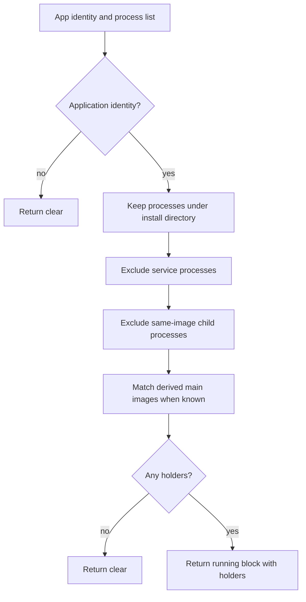

# Decision Logic

## Responsibility

Decision Logic evaluates a previously resolved application identity against a current list of operating-system processes. It is implemented by [`decide`](https://github.com/flamingo-stack/openframe-oss-lib/blob/16e7c1cbd9664e7d10ec5ebca7d53c9bd314decf/clients/openframe-client/src/services/package_manager/update_gate/decide.rs) in the `openframe_agent_lib` artifact from OpenFrame OSS Library.

The function is pure with respect to its inputs: it does not collect processes, resolve packages, or alter the machine. It returns `GateDecision::Clear` when no relevant application instance is active and `GateDecision::Blocked(BlockReason::Running)` with the matching holders otherwise.

## Filtering Pipeline

### Application identity

`AppIdentity::NoApp` immediately clears the gate. `AppIdentity::App` supplies the installation directory and a `MainImages` matching strategy.

### Installation-directory test

`is_under` compares normalized string forms case-insensitively, strips trailing separators from the directory, and requires the process path to have a separator immediately after that directory. The strict boundary prevents a directory prefix from matching an unrelated sibling path.

### Service and child exclusion

A process marked as a service never holds the gate. A process is also excluded when its parent image is the same executable path, case-insensitively; this retains root instances while avoiding duplicate holders for child processes of the same application image.

### Main image matching

With `MainImages::Derived`, the candidate executable basename must equal a derived filename without regard to case. With `MainImages::Unknown`, every remaining root, non-service process under the installation directory is retained. The unknown mode favors safety when package metadata cannot identify a primary executable.

## Holder Output

Each matching `RunningProcess` becomes a `Holder` containing:

- process ID;
- executable image path; and
- optional session identifier.

The caller can use these records to explain why a package update did not start and to correlate the decision with the active user session.

## Parent Module

Return to [Package Manager Update Gate](../../package-manager-update-gate.md).