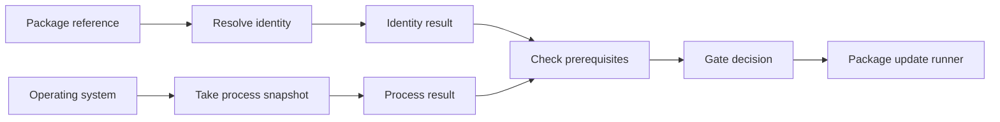

# Gate Orchestration

## Responsibility

Gate Orchestration defines the update-gate data model and connects package identity resolution, process sampling, and deterministic decision logic. It is implemented by the [update gate module](https://github.com/flamingo-stack/openframe-oss-lib/blob/16e7c1cbd9664e7d10ec5ebca7d53c9bd314decf/clients/openframe-client/src/services/package_manager/update_gate/mod.rs) in OpenFrame OSS Library's `openframe_agent_lib` artifact.

## Data Model

| Type | Meaning |
| --- | --- |
| `AppIdentity` | `NoApp` for packages that do not install a runnable app, or `App` with installation directory and main-image metadata. |
| `MainImages` | `Derived` holds discovered primary executable filenames; `Unknown` requests conservative matching. |
| `GateDecision` | Final result, either `Clear` or `Blocked`. |
| `BlockReason` | A running application holder set or an indeterminate prerequisite. |
| `Undetermined` | Specific cause for fail-closed behavior: not installed, unsupported manager, no location, resolver error, or snapshot error. |
| `Holder` | Identifies the process blocking a package update. |

## Resolution and Snapshot Lifecycle

### `resolve`

`resolve` maps the package reference to its application identity:

- Brew formulas resolve to `NoApp`, so they are not blocked by application-process checks.
- On Windows, Winget references delegate to the platform-specific Winget resolver.
- On macOS, Brew casks delegate to the platform-specific Brew resolver.
- Other package-manager references return `ManagerUnsupported`.

The resolver timeout constant is defined in this module for the platform resolver work. The platform-specific resolver sources are conditionally compiled and are not part of this documentation scope.

### `snapshot`

`snapshot` invokes the synchronous operating-system process snapshot function through `tokio::task::spawn_blocking`. If the blocking task cannot be joined, it returns `Undetermined::Snapshot` with the error text. This preserves responsiveness of the asynchronous update flow while retaining a typed failure path.

### `check`

`check` accepts results rather than performing discovery itself. When both identity and process results are successful, it invokes Decision Logic. If either is an error, it returns `Blocked(Undetermined)` and preserves the original reason. This is the module's central fail-closed policy.

## Integration Boundary

The package update runner should resolve an identity once for a package operation, obtain a fresh process snapshot immediately before the update decision, and call `check`. A clear decision is only an authorization to proceed; installation and status transitions remain the responsibility of the surrounding package-update flow.

The module depends on the client process-snapshot abstraction and package reference models. It does not send messages, persist update orders, or execute package-manager commands.

## Parent Module

Return to [Package Manager Update Gate](../../package-manager-update-gate.md).