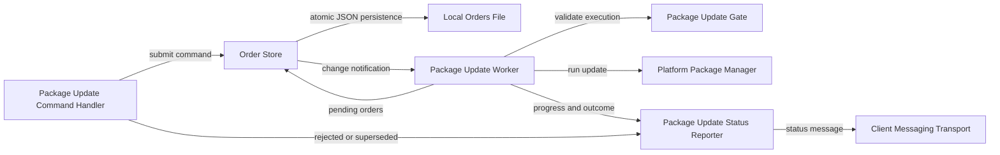
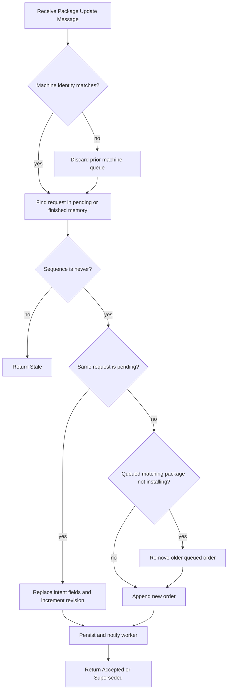
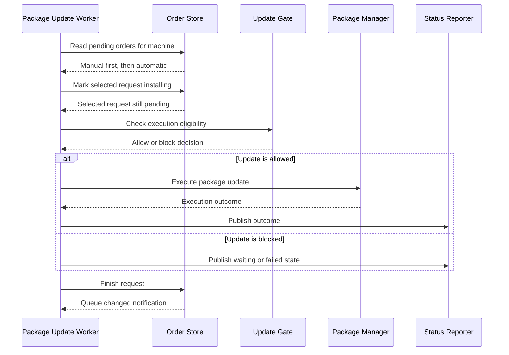

# Package Manager Update Orders

Package Manager Update Orders is the durable intake and scheduling boundary for package-update commands received by the OpenFrame endpoint client. It records accepted work locally, orders it for the package-update worker, prevents stale request replays, and preserves a bounded completion history across client restarts.

The implementation is supplied by the `openframe_agent_lib` Cargo dependency from the OpenFrame OSS Library. In this repository, that library is assembled into the OpenFrame client runtime; the module source is [orders.rs](https://github.com/flamingo-stack/openframe-oss-lib/blob/16e7c1cbd9664e7d10ec5ebca7d53c9bd314decf/clients/openframe-client/src/services/package_manager/package_update/orders.rs).

## Responsibilities

The module owns the lifecycle of an update *order* rather than the package-manager invocation itself:

- accepts `PackageUpdateMessage` data together with the receiving machine identity, delivery sequence, receive timestamp, and resolved force-countdown value;
- persists pending work as formatted JSON through an atomic replacement write;
- coalesces updates for the same request identifier and replaces queued work for the same package when no installation is active;
- returns pending work in a deterministic priority order: manual requests first, then automatic requests, then oldest received request, then request identifier;
- marks a selected request as installing so that a newly received update for that package waits rather than replacing active work;
- records recently finished request identifiers and sequences to reject late or duplicate deliveries; and
- notifies the asynchronous worker when accepted or finished work changes the queue.

It deliberately does not decide whether a package manager is supported, whether an update is safe to run, or how an update is executed. Those concerns belong to the package-manager support, update-gate, and package-update worker facilities in the client library.

## Architecture and Placement

The package-update command handler uses the order store as its durable command buffer. The package-update run manager starts a single worker; that worker observes the store, obtains prioritized pending orders, and performs the surrounding gate and execution flow. The status reporter publishes rejection and supersession outcomes for command-level decisions.

### Key Components

| Component | Role |
|---|---|
| `Order` | Persisted accepted-request record. It contains the request identifier, sequence, update source, package reference, update mode, resolved countdown, receive time, and revision. |
| `OrderStore` | Thread-safe in-memory state backed by a JSON file. It exposes loading, submission, lookup, prioritized retrieval, installation tracking, completion, and change notification. |
| `Submitted` | Submission result: `Accepted`, `Stale`, or `Superseded` with the displaced order. |
| Internal `Orders` | Persisted envelope containing the owning machine identifier, pending orders, and bounded completed-request memory. Its active-installation marker is intentionally excluded from persistence. |
| Internal `Finished` | Request identifier and last applied sequence retained after completion for stale-delivery detection. |

## Persisted State

The stored document contains three durable fields:

- **Machine identity** — associates the queue with the endpoint that created it.
- **Pending orders** — accepted work not yet finished.
- **Finished memory** — the most recent 100 completed request identifiers and their sequences.

The active installation marker is process-local. It is not written to disk, so a restarted client reloads pending work without treating a prior process's installation marker as still active.

Persistence uses the shared atomic-write utility: the client creates the parent directory when needed, writes and synchronizes a temporary file, then replaces the target file. On Unix, the replacement file permissions are set to readable by user processes. This reduces the risk of a partially written queue file during interruption.

If the state file is missing, unreadable, or invalid JSON, loading begins with an empty store and writes a warning. This makes queue recovery available after corruption, while avoiding a startup failure caused by a local state artifact.

## Submission and Coalescing Rules

`submit` is the only operation that changes queued intent. It first works on a cloned next state and persists it before replacing the live state, except where the completion path explicitly favors forward progress after a persistence failure.

### Machine Identity Isolation

A submission for a different machine identity resets the persisted pending and finished collections. This prevents orders issued to a prior endpoint identity from being executed after identity changes. The current in-memory installation marker is carried into that transition, but it is never persisted.

### Stale Sequence Detection

For a given request identifier, an incoming sequence is stale when it is less than or equal to the sequence retained in either pending work or finished memory. The store returns `Submitted::Stale` without writing state or notifying the worker.

The bounded finished memory is critical after completion: delayed redeliveries cannot recreate recently completed requests. Once the memory exceeds 100 records, the oldest completed records are removed.

### Same Request Identifier

A newer sequence for an already pending request updates the existing order in place. Its source, package, mode, and countdown are replaced, and `revision` increments. The original `received_at` value remains, preserving the order's original scheduling age while allowing a waiting worker to publish state again for the revised request.

### Same Package, Different Request Identifier

A new request can replace a pending order when both package references match and the existing order is not the one currently installing. The removed order is returned in `Submitted::Superseded`, allowing the command handler to report a failure with the `Superseded` reason and the detail that a newer request replaced it.

An order already marked as installing is protected from replacement. A newer request for that same package is queued and runs after the active request completes.

## Scheduling and Installation Coordination

`pending(machine_id)` produces a clone of the matching machine's pending orders and sorts it without modifying storage. The priority tuple is:

1. source class: manual before automatic;
2. receive time: oldest first; and
3. request identifier: lexical tie-breaker.

A machine identifier mismatch returns an empty list, so consumers cannot execute orders for a different endpoint identity.

`start_installing` returns `false` when the chosen request is no longer pending, which protects the worker from acting on a request replaced after it read the queue. `stop_installing` clears only the process-local marker. `finish` also clears that marker when it belongs to the finished request.

## Completion and Recovery Semantics

When `finish` finds the request in pending work, it removes the order, records its request identifier and sequence in finished memory, trims that memory to 100 entries, persists the next state, updates memory, and notifies the worker.

If the request is not pending, `finish` still clears an installation marker for that request and returns successfully. This makes completion safe when queue changes race with worker cleanup.

The completion path updates in-memory state even if the persistence attempt fails. The code documents the intent: after a failure, a restart may rerun the order once, but the active process must not loop indefinitely on it. Operators should therefore investigate persistence errors in client logs, because durability across a subsequent restart is no longer guaranteed for that completion.

## Concurrency Model

`OrderStore` protects its state with a standard mutex and recovers the inner state if the mutex has been poisoned. This favors continued endpoint operation after a panic in a lock holder.

The store emits a Tokio `Notify` signal after successful submission and after completion processing. The package-update worker uses `changed` to await a queue change. Tokio notification retention means a change recorded before the worker starts waiting remains observable by the next wait, avoiding a lost wake-up between queue inspection and waiting.

## Status Interaction

The status reporter is not a persistence dependency of the order store. Instead, callers interpret `Submitted` outcomes:

- `Accepted` means the order has been recorded or refreshed.
- `Stale` means the request sequence was already applied for that request identifier.
- `Superseded` includes the displaced order so the command handler can publish a `Superseded` failure status for that order.

The status-message contract includes request and machine identifiers, source, package, state, optional version data, and optional waiting, completion, or failure detail. Status messages are addressed using a machine-specific package-update status subject, which keeps device results scoped to the reporting endpoint.

## Operational Invariants

Maintainers should preserve these rules when changing Package Manager Update Orders:

- Persist intent before exposing a successful submission to the worker.
- Never replace an order that has been marked as installing.
- Keep finished-request retention bounded while retaining enough history to reject common delayed deliveries.
- Compare sequences only within the same request identifier.
- Clear queue data when machine identity changes.
- Do not persist the active-installation marker.
- Notify waiters whenever work is accepted or completion changes queue state.
- Treat an unreadable state file as recoverable startup input and surface the condition through logging.

## Scope in the OpenFrame Client

Package Manager Update Orders is a narrow coordination component in the Rust OpenFrame client library. It consumes package-update models, package references, source classifications, update modes, atomic file persistence, synchronization primitives, and tracing. It is consumed at runtime by the package-update command path and the worker started by the package-update run manager.

The module does not expose an HTTP endpoint and does not select package-manager binaries. Its durable queue and replacement semantics ensure that platform-specific update execution receives a stable, prioritized stream of current endpoint work.
