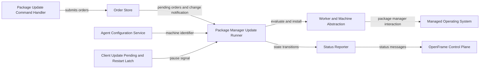
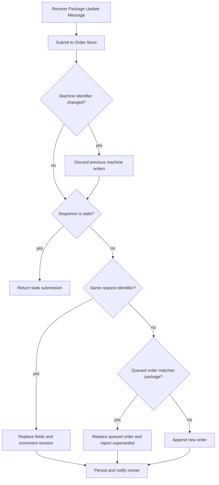
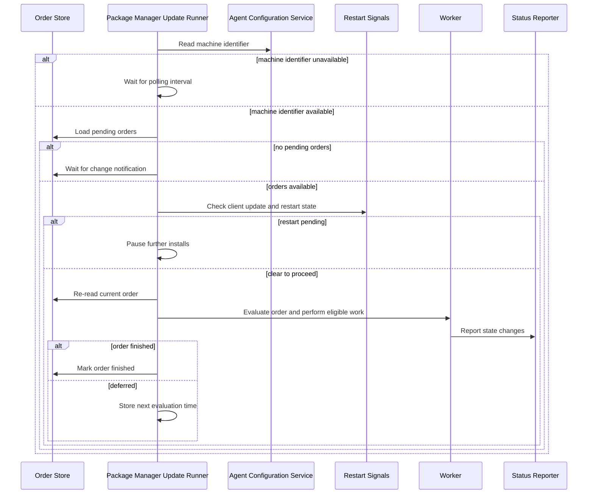
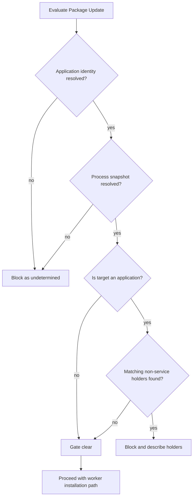

# Package Manager Update Runner

Package Manager Update Runner is the OpenFrame client-agent subsystem that continuously processes persisted package-update orders for one enrolled machine. It serializes work through a single asynchronous worker, pauses while the agent is being updated or restarted, and reacts to order-store changes as well as scheduled retry times.

The implementation is supplied by the `openframe_agent_lib` Cargo dependency from OpenFrame OSS Library version `v0.0.5`. The tenant repository runs this library as part of its OpenFrame client; the implementation source is [`package_update/mod.rs`](https://github.com/flamingo-stack/openframe-oss-lib/blob/16e7c1cbd9664e7d10ec5ebca7d53c9bd314decf/clients/openframe-client/src/services/package_manager/package_update/mod.rs).

## Responsibilities

- Construct a `PackageUpdateRunManager` around the persisted `OrderStore`, a `StatusReporter`, agent configuration, restart signals, and an in-progress marker for package upgrades.
- Start exactly one Tokio worker. Repeated calls to `start` are refused and logged rather than creating competing installers.
- Require a configured machine identifier before reading the local queue, preventing an order associated with another enrollment from being run.
- Read pending orders in store-defined priority order, process one order at a time, and record terminal orders as finished.
- Track per-request polling progress in memory so an unchanged order is revisited only when due; a changed revision is reconsidered immediately.
- Stop beginning further installs when a client update or agent restart is pending.
- Wake promptly for queue changes while also using a time-based wake-up for deferred work.

## Architecture

The runner itself is intentionally narrow. It owns lifecycle and scheduling; the internal worker owns per-order evaluation and installation through the `Machine` abstraction. Order persistence, status formatting, and update-safety decisions are delegated to neighboring package-management components in the same agent library.

## Core Types and Lifecycle

| Component | Role |
|---|---|
| `PackageUpdateRunManager` | Public lifecycle facade. Its `started` atomic flag makes `start` idempotent: the first successful call creates a Tokio task and later calls return no task. |
| `RestartSignals` | Aggregates `ClientUpdatePending` and a restart `LatchView`. Its internal pending check is true if either signal is set. |
| `Worker` | Private dependency bundle containing the machine adapter, order store, status reporter, configuration service, restart signals, and in-progress package-upgrade state. |
| `OrderStore` | Durable local queue. It retains the associated machine identifier, pending orders, current install marker, recently finished requests, and a change notification primitive. |
| `StatusReporter` | Emits package-update state changes, including rejection and supersession results. |

Construction installs the concrete `System` machine implementation behind a `Machine` trait object. This preserves a boundary between worker orchestration and operating-system package-manager behavior.

## Order Intake and Queue Semantics

The package-update command handler creates with an `OrderStore` and `StatusReporter`, then submits received package-update messages to the store. On submission, the store applies the following rules:

1. It associates the queue with the current machine identifier. If the identifier changes, it drops orders belonging to the previous machine while preserving the active-install marker.
2. It rejects stale sequence numbers when the same request identifier has already been queued or recorded as finished.
3. A message with the same request identifier updates the existing order, increments its revision, and replaces the source, package, mode, and countdown data.
4. A newly received request for the same package supersedes an older queued request unless that older request is already installing. The replacement is reported as a superseded failure.
5. The updated queue is persisted and the runner is notified.

Pending orders are returned only when the caller machine identifier matches the queue machine identifier. They are sorted by priority before the runner traverses them. Completing an order removes it from the pending queue, clears the install marker if applicable, and retains a bounded memory of finished request identifiers and sequences to reject replays.

## Worker Scheduling and Data Flow

The asynchronous loop obtains the machine identifier on every cycle. If configuration cannot supply it, the runner logs a warning, waits for the polling interval, and retries. It never evaluates the queue without that identity.

For a valid machine identifier, the runner loads pending orders and reconciles its in-memory progress map. Entries no longer present in the persisted queue are treated as abandoned and passed to the worker abandonment path. An empty queue causes the task to wait directly for an order-store notification.

For each pending order, the runner first checks restart signals. A pending client update or agent restart ends the current scan without launching additional package work. Otherwise, it skips unchanged orders until their stored `next_at` time, but does not delay a new revision of an existing request. Before evaluation, it reloads the individual order because a preceding installation may have taken long enough for queue state to change.

After a scan, the worker waits for whichever happens first: an order-store change notification or the next scheduled evaluation time. The computed delay is at least one second, avoiding a zero-delay loop when a scheduled time is reached.

## Restart and Update Coordination

Package updates must not start while the client binary is being replaced or the agent has been asked to restart. `RestartSignals` implements this gate through two inputs:

- `client_update`: indicates that the client update path is pending.
- `agent_restart`: a latch that indicates a requested agent restart.

The runner checks this gate before each queued order, not merely once per outer loop. If the state changes between orders, it leaves the remaining queue intact for a later pass. This avoids initiating an additional package-manager operation while agent lifecycle work takes precedence.

The internal worker also receives an `InProgress` value for package upgrades. This gives the installation path a shared activity marker without making the lifecycle facade responsible for package-manager commands.

## Safety Decisions During Installation

The package-update subsystem includes an update gate used by worker-side order evaluation. It derives an application identity and a process snapshot, then produces a `GateDecision`:

- A non-application installation is clear to proceed.
- For an application installation, the gate finds non-service processes running under the installation directory and matching the main application images when those images are known.
- If matching processes are found, the gate blocks and records their process identifier, image path, and session as holders.
- If application identity or process discovery is undetermined, the gate blocks rather than assuming it is safe to update.

This conservative behavior prevents a package update from modifying an application while a relevant user-facing process still holds it.

## Status and Completion Behavior

The status reporter separates queue decisions from transport details. In particular, it can publish:

- A rejected update message with a failure reason and explanatory text.
- A superseded order with the `Superseded` reason and a message explaining it was replaced by a newer request for the same package.

When worker evaluation returns `Finished`, the runner removes the request from its progress map and calls `OrderStore::finish`. If persisting that finished state fails, the runner logs a warning. The store still advances its in-memory state to prevent a tight retry loop; after an agent restart, an order could be evaluated once more if the disk state was not written.

## Operational Characteristics

- **Single worker:** The atomic start guard prevents duplicate runners in one agent process.
- **Serialized installation:** The runner processes orders sequentially, allowing a completed or deferred order to determine when later work is considered.
- **Durable queue:** Orders are persisted before the store publishes the change notification.
- **Identity isolation:** Queue reads are empty when the persisted machine identifier does not match the current enrollment.
- **Responsive scheduling:** New and revised requests notify the worker immediately, while deferred requests use a next-wake timestamp.
- **Recoverable disruption:** Orders removed from persistence are recognized as abandoned; restart and update signals defer, rather than discard, pending work.

## Source Boundaries

This documentation describes code delivered by OpenFrame OSS Library, not an implementation file stored in this tenant repository. The tenant pins the dependency as `openframe_agent_lib` version `v0.0.5`; the documented runner source is the linked library revision above. Package-management commands, package-manager discovery, durable-order storage, status publication, and process inspection are internal collaborators of that library component.
