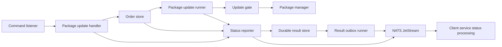
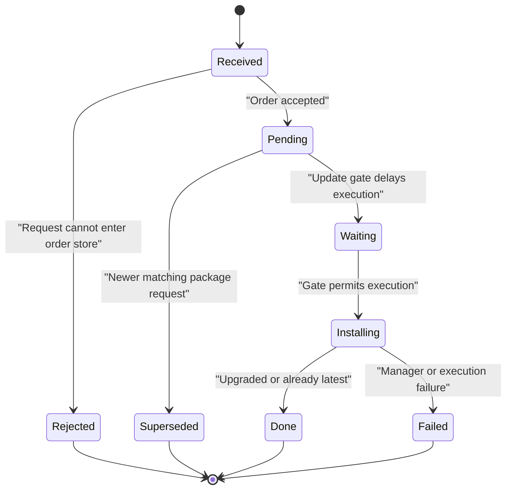
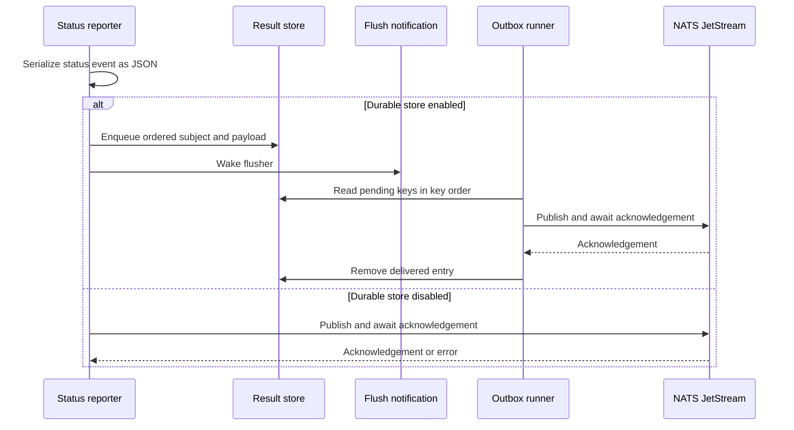
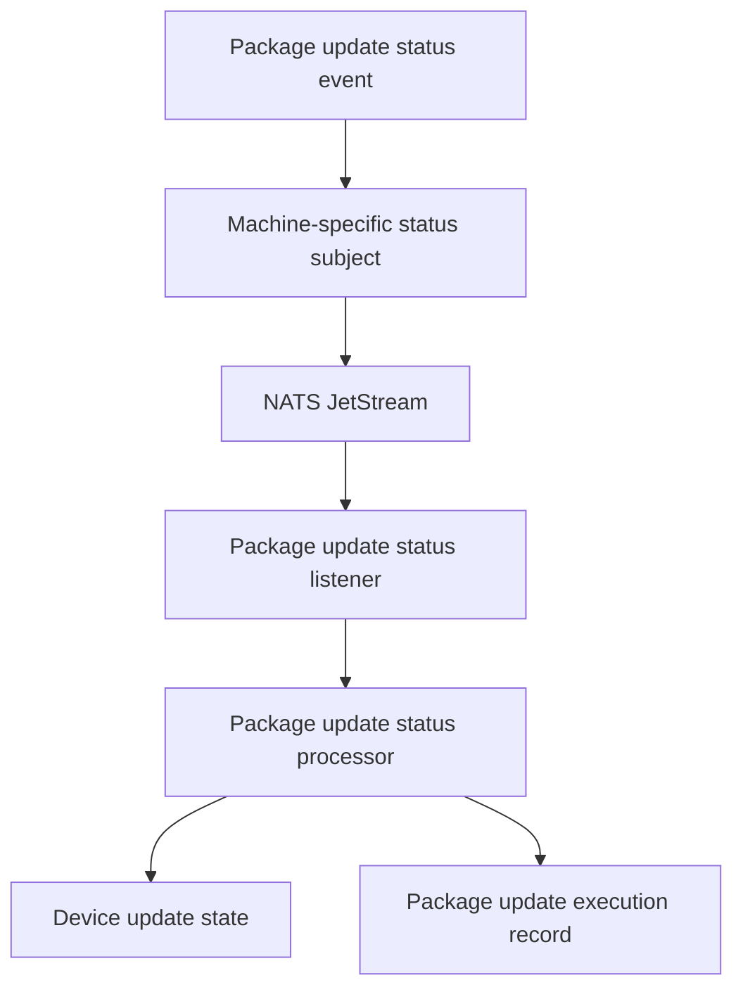

# Package Manager Update Status

Package Manager Update Status is the OpenFrame client agent’s terminal-status reporting boundary for package update orders. It converts an order rejected before acceptance, or displaced by a newer request for the same package, into a structured package-update status event and hands that event to a durable outbox when one is available. This gives the control plane an explicit outcome rather than leaving an order silently unresolved.

The implementation is supplied by the `openframe_agent_lib` Cargo dependency from OpenFrame OSS Library and is executed by this repository’s OpenFrame client service. The implementation source is [status.rs](https://github.com/flamingo-stack/openframe-oss-lib/blob/16e7c1cbd9664e7d10ec5ebca7d53c9bd314decf/clients/openframe-client/src/services/package_manager/package_update/status.rs).

## Responsibilities

- Construct `PackageUpdateStatusMessage` events with a unique event identifier and an RFC 3339 UTC timestamp.
- Preserve the request, machine, source, and package identity needed to correlate an outcome on the backend.
- Report a deterministic `Superseded` failure for a pending order replaced by a newer request for the same package.
- Report a supplied failure reason and detail when an incoming update request is refused before it enters the order queue.
- Serialize events as JSON and route them to the machine-specific package-update status subject.
- Persist delivery work to `ResultStore` when durable storage is enabled, then wake the outbox flusher.
- Fall back to a bounded, JetStream-acknowledged publish when durable storage is unavailable.

The module does not execute package managers, choose update eligibility, or maintain the update queue. Those responsibilities belong to the surrounding package-update runner, update gate, and order store.

## Position in the Package Update Workflow

`StatusReporter` is constructed with a `NatsMessagePublisher`, a shared `ResultStore`, and a shared `Notify` handle. The command-side package update handler holds both an `OrderStore` and a `StatusReporter`; it can therefore close the reporting loop for requests that cannot be accepted. The same reporter’s internal event builder is also available to the package-update workflow for waiting, completed, and failed events.

## Core Components

| Component | Role |
|---|---|
| `StatusReporter` | Cloneable façade that logs, serializes, and delivers package-update status events. Its production sink is an outbox; test builds can use an in-memory event vector. |
| `StatusReporter::new` | Creates the production reporter from the NATS publisher, durable result store, and outbox wake notification. |
| `StatusReporter::report_rejected` | Emits a failed status for an update message refused before it was admitted to the order store. It preserves the message request, source, and package fields and attaches the caller-provided failure reason and explanation. |
| `StatusReporter::report_superseded` | Emits a failed status for an existing order displaced by a newer request that matches the same package. It uses `FailReason::Superseded` and the fixed detail that a newer request replaced the order. |
| `build` | Internal event constructor used by the update workflow. It assigns identifiers and timestamps, carries optional installed and available versions, and maps waiting, done, or failure reports into the correct status fields. |
| `outbox_key` | Produces a time-first key with the event identifier as a tie breaker so persisted events are read in event order. |
| `rfc3339` | Converts a Unix timestamp to an RFC 3339 UTC string for status-related time values. |

## Event Contract

Each `PackageUpdateStatusMessage` contains:

| Field group | Contents |
|---|---|
| Identity | `event_id`, `request_id`, and `machine_id` identify the individual status event, requested operation, and target agent. |
| Time and target | `at` is generated as an RFC 3339 UTC timestamp with millisecond precision. `source` and `package` retain the dispatch origin and package reference. |
| Version context | `installed_version` and `available_version` are optional. Rejection and supersession reports intentionally leave both absent because no installation attempt is represented. |
| State | `state` is `Waiting`, `Done`, or `Failed`. Only the payload corresponding to the selected state is populated. |
| Waiting details | A waiting event may state why it waits, the prompt or countdown phase, process holders, and an optional closing deadline. |
| Completion details | A done event records whether the package was upgraded or was already current, plus reboot and relaunch indicators. |
| Failure details | A failed event records a reason, optional exit code, and optional human-readable message. |

The failure taxonomy includes manager errors or absence, application-close failure, timeout, unsupported packages, supersession, missing installation, and packages that are not upgradable. `report_rejected` accepts the applicable failure reason from its caller; `report_superseded` always uses the supersession reason.

## Status Lifecycle

The module is directly responsible for the two early terminal outcomes:

1. **Rejected**: The command handler rejects an incoming message before it is taken into the order queue. The reporter produces `Failed` with the reason and detail supplied by that handler.
2. **Superseded**: `OrderStore::submit` removes a pending, non-installing order when a newer message matches its package. The older order receives a `Failed` event with `Superseded`, while the new order becomes pending.

A currently installing order is not replaced by the order-store supersession path. It is allowed to finish, and the newer request follows it. This avoids reporting an in-flight installation as superseded when it has already begun.

## Delivery and Durability

### Durable Path

When `ResultStore::enabled` is true, the reporter serializes the event and enqueues it using a key shaped as `package-update-status:<nanosecond-time>:<event-id>`. The timestamp prefix preserves the order in which events are delivered by the outbox. After successful persistence, it signals the shared notification handle and returns; it does not send the event directly.

`ResultOutboxRunManager` wakes on that notification or its periodic interval, loads pending entries in key order, publishes them, and removes each entry only after successful delivery. It applies the configured publish timeout. A transient publishing failure leaves the entry in the store for a later retry.

### Non-Durable Path

If durable storage is disabled, the reporter immediately calls `publish_acked` for the machine-specific subject and limits the wait with `FLUSH_PUBLISH_TIMEOUT_SECS`. Failures, timeouts, and serialization errors are logged. Because no durable store exists in this mode, a failed immediate publish cannot be retried by this module and the event may be lost.

## Routing and Backend Integration

The subject is derived from the machine identifier using `package_update_status_subject`, yielding the package-update status channel for that machine. The message is published through NATS JetStream with an acknowledgement on the direct fallback path. On the service side, the client-core Java package-update status listener and processor consume these device status messages to record package-update execution state for the backend.

## Operational Behavior

- Each call to the reporter logs the request identifier, state, and optional waiting, completion, or failure data before delivery is attempted.
- A JSON serialization failure is logged and terminates that reporting attempt.
- A durable-store enqueue failure is logged as a lost event because the reporter has no alternate direct-publish path while storage is configured as enabled.
- The outbox runner skips oversized payloads to avoid blocking delivery of later healthy results; this status module itself emits compact status messages.
- The in-memory sink is compiled only for tests and captures fully built events without NATS or result-store dependencies.

## Maintenance Guidance

When evolving this module:

1. Keep `request_id`, `machine_id`, `source`, and `package` intact across every terminal report; backend correlation depends on them.
2. Treat `event_id` as an event identifier, not an order identifier. A single request can produce multiple lifecycle events.
3. Preserve time-first outbox keys unless the outbox reader and ordering guarantees are deliberately redesigned.
4. Add a failure reason only when both the agent model and backend status processor understand it.
5. Test both durable and non-durable delivery behavior, including timeout and serialization failures, as well as rejection and supersession paths.
6. Do not change the machine-specific subject derivation independently of the backend listener.
