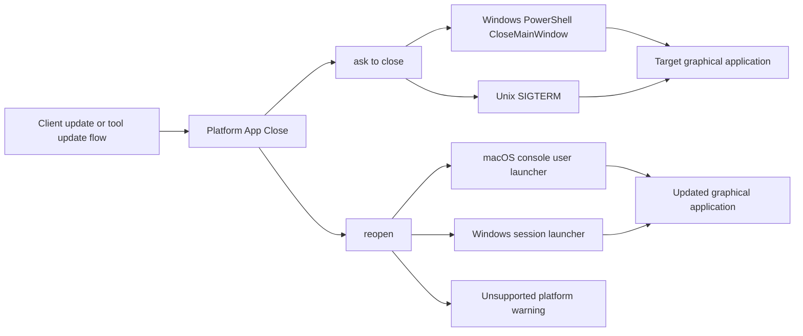
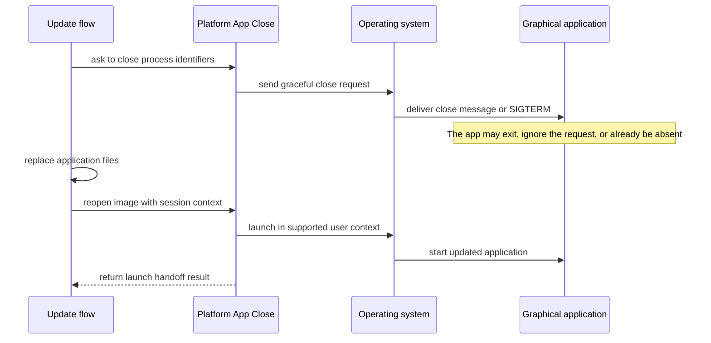
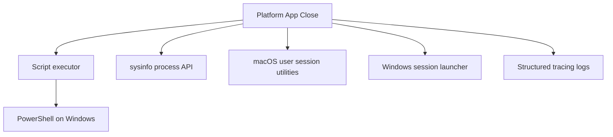

# Platform App Close

Platform App Close is the operating-system boundary used during a forced graphical-application upgrade by the OpenFrame client agent. It makes a best-effort request for selected applications to exit, then tries to launch the updated application again in the appropriate interactive user context. The implementation is supplied by the `openframe_agent_lib` crate from the OpenFrame OSS Library and is run by this repository's OpenFrame client deployment.

The module deliberately does not discover processes, replace binaries, or decide whether an update is permitted. Its narrow responsibility is the user-visible handoff around replacement: request a graceful close, report failures through structured logs, and reopen only on platforms with a supported session-launch mechanism.

**Implementation source:** [app close source](https://github.com/flamingo-stack/openframe-oss-lib/blob/7a766f00e4f58b5d89db007b878ac8d6e0c344f4/clients/openframe-client/src/platform/app_close.rs)

## Responsibilities and Boundaries

| Responsibility | Platform App Close behavior | Outside this module |
|---|---|---|
| Request application exit | Accepts a list of process identifiers and sends a platform-specific graceful close request. | Identifying upgrade candidates and owning their process metadata. |
| Preserve user context | Uses the console user on macOS and the recorded session and user on Windows when reopening. | Managing login sessions or authenticating users. |
| Relaunch outcome | Returns `true` once launch succeeds or is considered successfully handed to the platform launcher. | Verifying that the restarted application becomes healthy. |
| Failure visibility | Emits warning logs for unsuccessful close or relaunch attempts and info logs for successful relaunches. | Retrying, rollback, and update-state persistence. |

A close request is intentionally best effort. A Windows tray application can ignore a main-window close message, a process may already have exited, and Unix signal delivery does not guarantee that the application actually terminates. Callers must therefore retain their own upgrade-safety and failure-handling policy.

## Architecture

Platform App Close is compiled conditionally, so each target contains only its relevant behavior:

- **Windows:** sends a PowerShell `CloseMainWindow` request with user privilege, then uses the Windows session launcher to restore the application.
- **macOS:** sends `SIGTERM` through `sysinfo`; reopening resolves the active console user and launches on that user's behalf.
- **Other Unix targets:** sends `SIGTERM`; reopening is explicitly unsupported and returns `false`.

## Core API

### `ask_to_close`

`ask_to_close(pids)` is asynchronous and returns no value. It accepts process identifiers owned by a higher-level update flow and asks each application to quit gracefully.

| Target | Mechanism | Observed failure behavior |
|---|---|---|
| Windows | Executes a PowerShell loop that finds each process and invokes `CloseMainWindow`. The script has a 30-second timeout and runs with `Privilege::User`. | A nonzero script exit code generates a warning containing the return code and trimmed standard error. Missing processes are suppressed by the script. |
| Non-Windows | Refreshes process information with `sysinfo` and invokes `kill_with(Signal::Term)` for every process found. | A process that rejects the signal produces a per-process warning. Absent processes produce no warning. |

The Windows path asks applications with a conventional main window to close; it does not terminate them. The source explicitly notes that tray applications may ignore this message. The Unix path uses `SIGTERM`, which similarly gives applications an opportunity to handle termination rather than force-killing them.

### `reopen`

`reopen(image, session, user)` is asynchronous and returns a boolean. `image` identifies the application image or executable. The optional session and user values are meaningful on Windows; macOS instead obtains the current console user.

| Target | Relaunch behavior | `true` result | `false` result |
|---|---|---|---|
| macOS | Gets the console user and calls the user-session launcher. It waits up to 10 seconds for the launcher process. | The launcher remains active past the wait, exits successfully, or the implementation otherwise reaches the successful timeout branch. | No console user, launcher creation failure, unsuccessful launcher exit, or wait failure. |
| Windows | Calls `launch_app_in_session` with the image and optional session and user. | The launcher returns a process identifier. | The session launcher returns an error. |
| Other targets | Does not attempt launch. | Never. | Always, after logging an unsupported-platform warning. |

The result describes **launch handoff**, not application readiness. In particular, the macOS comment explains that the platform `open` behavior can return after Launch Services accepts the application, while a bare executable is itself the launched application. A successful result should not be treated as proof that the upgraded program completed initialization.

## Close and Relaunch Flow

This ordering is significant: the owner of the update must call the close request before it attempts replacement. Platform App Close does not wait for every process to disappear and has no file-lock or binary-swap logic. A caller that requires stronger replacement guarantees must coordinate process observation and executable replacement elsewhere.

## Dependencies

| Dependency | Used by | Purpose |
|---|---|---|
| Script executor and privilege model | Windows close path | Runs the bounded PowerShell close script as the user rather than an elevated process. |
| `sysinfo` process API | Non-Windows close path | Locates supplied process identifiers and sends `SIGTERM`. |
| macOS user-session utilities | macOS reopen path | Finds the console user and starts the image as that user. |
| Windows session launcher | Windows reopen path | Starts the image within the supplied or resolved interactive session. |
| `tracing` | All target paths | Records close and relaunch failures with process, image, session, status, or error context. |

The neighboring platform utilities that implement session management, process discovery, file replacement, and service lifecycle are separate concerns. Platform App Close should remain a small adapter over those capabilities rather than acquiring update-policy logic.

## Error Handling and Operational Semantics

The module favors continuity of the client update flow over strict failure propagation:

1. `ask_to_close` logs problems but does not return an error. A close request failure is diagnostic information for the caller's broader update workflow.
2. `reopen` converts expected launch failures into `false` and logs the reason. Its caller decides whether to mark the upgrade incomplete, retry, resume other tools, or report an update failure.
3. Unsupported reopen targets fail explicitly rather than silently attempting a generic process spawn that could run in the wrong user context.
4. No application termination is forced by this module. This avoids bypassing application cleanup, but it means callers must accommodate an application that does not exit in time.

## Maintainer Guidance

When changing Platform App Close:

- Preserve the best-effort nature of close requests unless the calling update protocol is changed at the same time.
- Keep user-session launches platform-specific. Starting a GUI application from a service account or the wrong session can succeed mechanically while making the application inaccessible to the interactive user.
- Treat `reopen` success as a launcher result, not a readiness probe. Add readiness validation in the higher-level update owner if needed.
- Maintain useful structured fields in log events, especially process identifiers for close failures and image and session information for relaunch failures.
- Test platform branches on their native operating systems. Conditional compilation means a Linux build does not exercise Windows or macOS behavior.

## Relationship to the OpenFrame Client

This repository publishes the `openframe_client` crate and deploys the OpenFrame client as part of the tenant platform. The client assembles the OpenFrame OSS Library at version `7.0.11`; Platform App Close is library code included in that agent runtime. Its role is limited to the desktop-application transition that can occur during managed tool or client upgrades, while server-side services coordinate broader device management and delivery workflows.
