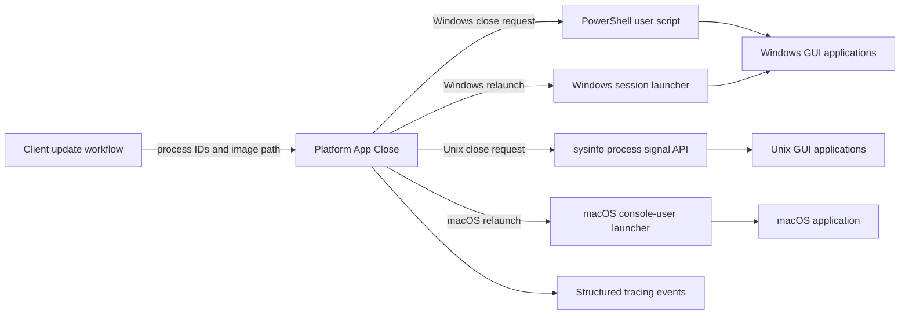
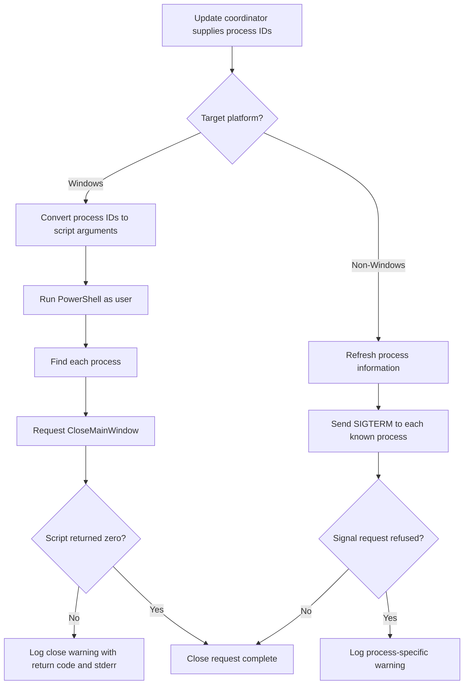
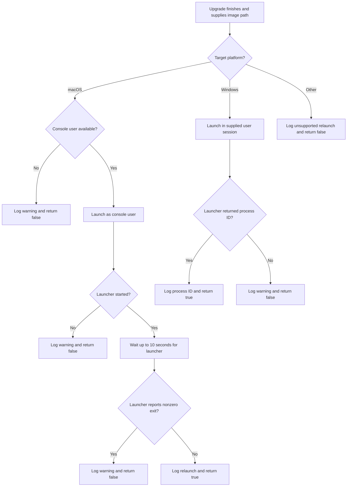
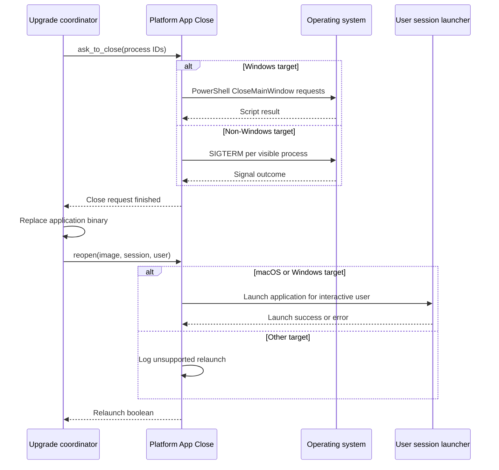

# Platform App Close

Platform App Close is a small, platform-specific lifecycle helper in the OpenFrame client agent. It asks selected GUI applications to exit before a forced upgrade and, where supported, starts the application again afterward. The implementation is supplied by the `openframe_agent_lib` Cargo dependency from OpenFrame OSS Library and is run by this repository's OpenFrame client deployment.

The module deliberately treats both operations as best effort. A failed close request is logged rather than escalated, and a relaunch reports success only when the operating-system launcher succeeds. It does not discover processes, decide which application requires an upgrade, persist update state, or terminate processes forcibly.

**Source:** [app_close.rs in OpenFrame OSS Library](https://github.com/flamingo-stack/openframe-oss-lib/blob/16e7c1cbd9664e7d10ec5ebca7d53c9bd314decf/clients/openframe-client/src/platform/app_close.rs)

## Responsibilities and Boundaries

| Responsibility | Mechanism | Boundary |
|---|---|---|
| Request a graceful application close | `ask_to_close` receives process IDs and sends an operating-system-appropriate close request. | The caller selects the processes and handles the upgrade itself. |
| Restore a user-facing application after an upgrade | `reopen` receives an application image path plus optional session and user context. | The module does not verify that a new process remains running after launch. |
| Preserve observability | Structured `info` events record successful relaunches; structured `warn` events record close and relaunch failures. | It does not return diagnostics to the caller beyond the relaunch boolean. |
| Maintain platform safety | Windows, macOS, and other Unix-like targets use separate implementations. | Unsupported platforms do not attempt a relaunch. |

## Architecture

Platform App Close sits at the operating-system boundary of the client agent's forced-upgrade workflow. Upstream update orchestration supplies the process IDs, executable or application image path, and user/session context. The module then delegates to a platform-specific mechanism.

### Public Operations

| Function | Inputs | Output | Platform behavior |
|---|---|---|---|
| `ask_to_close` | Slice of process IDs | No result value | Windows asks each process to close its main window. Non-Windows targets send `SIGTERM` through `sysinfo`. |
| `reopen` | Image path, optional session ID, optional user name | `true` when the launcher succeeds or the macOS launch remains active past the wait; otherwise `false` | macOS launches as the current console user; Windows launches into the supplied session and user context; other targets return `false`. |

## Close Request Flow

`ask_to_close` is asynchronous but intentionally non-failing at its API boundary. That design lets an update coordinator continue according to its own timeout and recovery policy while retaining warning logs for operations the module could not request.

### Windows Close Semantics

The Windows implementation constructs a PowerShell script, runs it with `Privilege::User`, and gives it a 30-second timeout. For every supplied process ID, the script obtains the process if it still exists and invokes `CloseMainWindow`. This is a request to the application's primary window rather than a forced process kill. As noted by the source, tray applications can ignore the message. A nonzero script return code produces a warning containing the return code and trimmed standard error.

### Non-Windows Close Semantics

The non-Windows implementation refreshes process details through `sysinfo`, then calls `kill_with(Signal::Term)` for each process currently visible by ID. A `false` result is logged as a warning. Missing processes and unavailable signal outcomes do not produce a close failure result, which is consistent with a process that exited while the upgrade workflow was preparing.

## Relaunch Flow

Relaunching is explicitly platform-dependent. The function accepts session and user values so the Windows implementation can restore the application to the originating interactive context. macOS instead finds the active console user and does not use the supplied session or user parameters.

### macOS Details

On macOS, `reopen` obtains the console user and invokes the platform user-session launcher with the image path and no additional arguments. The module waits for up to 10 seconds for the launcher child:

- A nonzero child exit status is treated as failure.
- An error while waiting is treated as failure.
- A successful exit, a still-running launcher after the timeout, or a wait result not matching either failure branch is treated as success.

This accommodates application launch mechanisms that hand work to Launch Services and either exit quickly or remain active while the application starts. The success condition means the launch request was accepted; it is not a health check of the relaunched application.

### Windows Details

On Windows, `reopen` calls the Windows user-session launcher with the image path and optional session and user inputs. A returned process ID is logged with the image and session and yields `true`. A launcher error is logged and yields `false`. Process exit status is not awaited by this module.

## Component Interaction

The module has two direct integration surfaces: the cross-platform script executor for Windows close requests and platform user-session launchers for reopening. It also relies on `sysinfo` for non-Windows signalling and `tracing` for structured logs.

## Operational Considerations

- **Use graceful semantics:** Do not interpret `ask_to_close` as confirmation that an application has exited. The caller should independently wait for file locks or processes as required before replacing a binary.
- **Expect races:** A supplied process can exit before it is signalled. The implementation treats that as non-fatal.
- **Preserve interactive context:** Windows callers should pass the process session and user when known, because relaunching must target the user session rather than the agent's service context.
- **Handle macOS login state:** Relaunch fails when no console user is available, such as when no user is interactively logged in.
- **Plan for Linux behavior:** Linux and other targets that are neither macOS nor Windows can receive a close request but cannot be reopened by this module.
- **Use logs for diagnosis:** Search the agent's structured logs for the image path, process ID, return code, standard error, session, or launcher error emitted by this module.

## Failure Model

| Scenario | Module response | Caller implication |
|---|---|---|
| Windows close script exits nonzero | Warning only | Determine whether to retry, wait, postpone, or use a separate recovery strategy. |
| Non-Windows process refuses `SIGTERM` | Warning for that process ID | Continue observing process exit before file replacement. |
| macOS has no console user | `reopen` returns `false` | Defer restoration until an interactive user is available, if required. |
| macOS launcher fails or exits unsuccessfully | `reopen` returns `false` | Report or retry according to the update policy. |
| Windows session launcher fails | `reopen` returns `false` | Preserve update outcome and surface a user-session launch failure. |
| Unsupported relaunch target | `reopen` returns `false` | The coordinator must not assume application restoration on that platform. |

## Maintenance Guidance

When changing Platform App Close, keep the module's role narrow: request a graceful exit, delegate launch to the platform session helpers, and provide precise structured telemetry. Do not add forced termination, update-state persistence, or process discovery here; those concerns belong to the surrounding client update, process-management, and platform modules. Changes should be validated on each conditional compilation target because both behavior and available dependencies differ across Windows, macOS, and other Unix-like systems.
