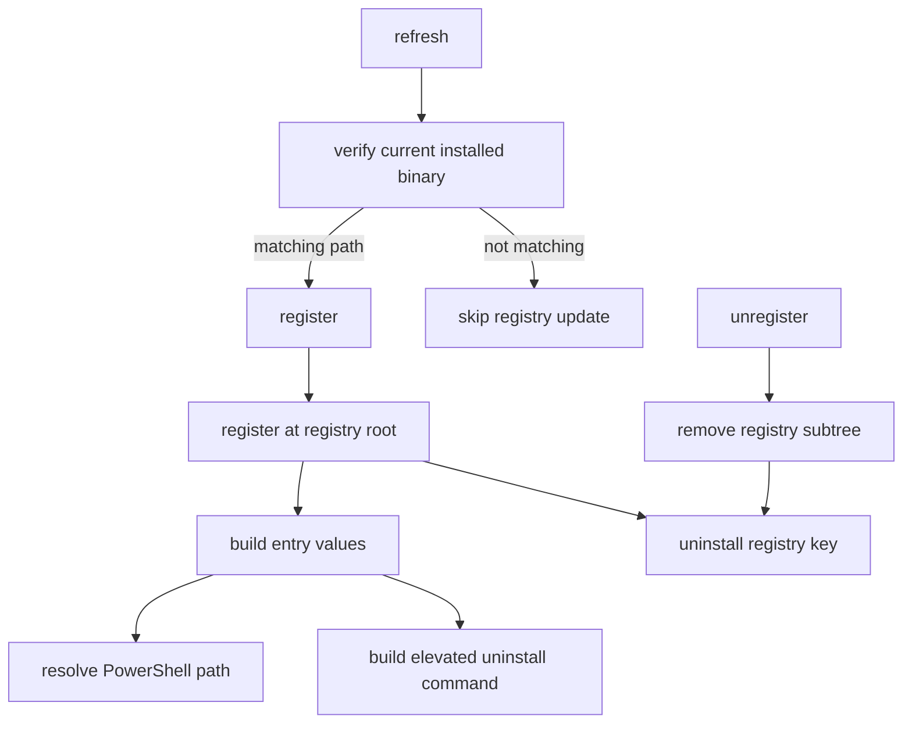
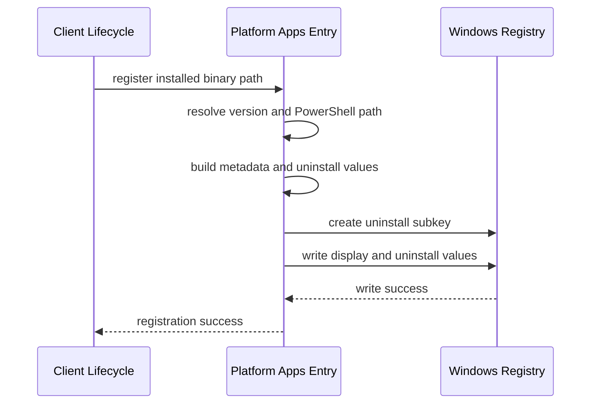
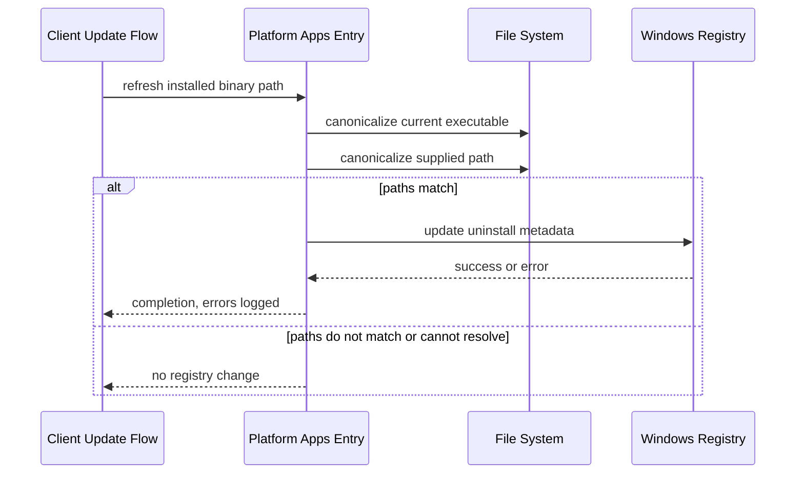
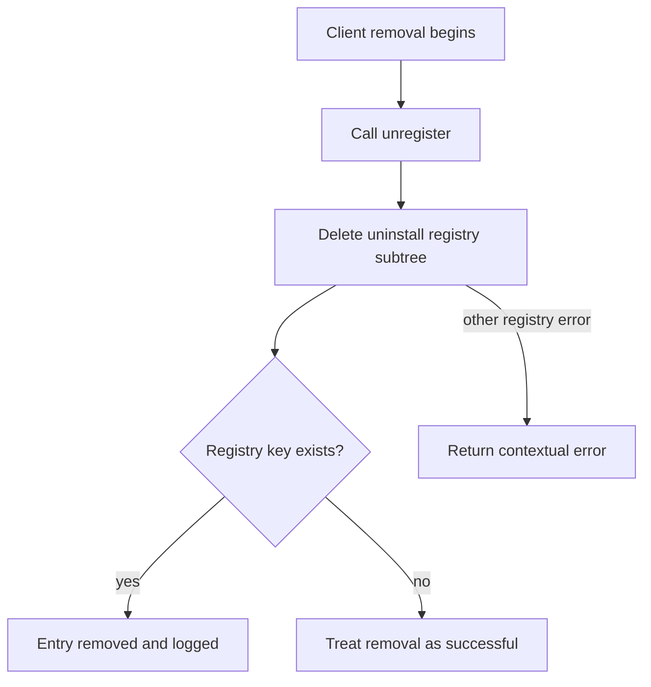

# Platform Apps Entry

Platform Apps Entry maintains the Windows **Apps & Features** record for an installed OpenFrame Client binary. It is a small Windows-specific integration layer in the `openframe_agent_lib` crate from OpenFrame OSS Library. The tenant repository runs that client as part of its deployed platform, while the implementation itself is supplied by the library dependency.

Its public operations are deliberately narrow:

- `register` creates or updates the system-wide uninstall record.
- `refresh` updates the record after a platform update only when the supplied path is the currently running installed binary.
- `unregister` removes the record and treats an already-absent record as a successful outcome.

The implementation is available in the [OpenFrame OSS Library source](https://github.com/flamingo-stack/openframe-oss-lib/blob/16e7c1cbd9664e7d10ec5ebca7d53c9bd314decf/clients/openframe-client/src/platform/apps_entry.rs).

## Scope and Responsibilities

Platform Apps Entry owns the registry data used by Windows to display OpenFrame Client in Add or Remove Programs. The entry is stored beneath the machine-wide uninstall branch at `SOFTWARE\\Microsoft\\Windows\\CurrentVersion\\Uninstall\\com.openframe.client`.

The module does not install the service, replace binaries, perform an uninstall, or manage application directories. Those responsibilities remain with the surrounding client platform and service-management code. Instead, this module makes the installed client discoverable to Windows and supplies Windows with the commands and metadata needed to present an uninstall action.

## Runtime Context

The module is compiled for the client agent and runs with access to the local machine registry. Registration targets `HKEY_LOCAL_MACHINE`, so creating, updating, and removing the entry require permissions sufficient to modify the machine-level uninstall registry branch.

```mermaid
flowchart LR
    ClientLifecycle["OpenFrame Client lifecycle"] -->|"register, refresh, or unregister"| AppsEntry["Platform Apps Entry"]
    AppsEntry -->|"create or remove values"| Registry["Windows machine registry"]
    Registry -->|"lists installed software"| WindowsUI["Apps and Features"]
    WindowsUI -->|"runs uninstall command"| ElevatedShell["Elevated PowerShell"]
    ElevatedShell -->|"invokes uninstall"| ClientBinary["OpenFrame Client binary"]
```

## Registry Contract

When registration succeeds, Platform Apps Entry writes a consistent group of values under its uninstall key.

| Registry value | Purpose | Source |
|---|---|---|
| `DisplayName` | Shows **OpenFrame Client** in the Windows application list. | Fixed module metadata |
| `DisplayVersion` | Shows the client version. | Compile-time `OPENFRAME_VERSION` value |
| `Publisher` | Identifies **Flamingo AI, Inc.** as publisher. | Fixed module metadata |
| `URLInfoAbout` | Provides the OpenFrame product URL. | Fixed module metadata |
| `InstallLocation` | Identifies the directory containing the installed binary. | Parent directory of the supplied path |
| `DisplayIcon` | Lets Windows use the client binary as the display icon source. | Supplied binary path |
| `UninstallString` | Starts an elevated, hidden PowerShell process which waits for the binary's `uninstall` command to finish. | Supplied binary path and resolved PowerShell path |
| `QuietUninstallString` | Provides a direct `uninstall` invocation for non-interactive callers. | Supplied binary path |
| `NoModify` | Tells Windows not to offer a modify action. | Enabled flag |
| `NoRepair` | Tells Windows not to offer a repair action. | Enabled flag |

The visible version comes from the version embedded while building the agent, rather than from a runtime lookup. Consequently, invoking `refresh` after a successful binary replacement is what synchronizes the displayed version with the updated executable.

## Component Design

The public API delegates work through a short sequence of private helpers. This isolates registry mutation, command construction, and installed-binary validation.

### Registration

`register` opens the local-machine registry root and creates the dedicated uninstall subkey if it is absent. It then writes every defined value. Errors while creating the key or writing an individual value are returned with context identifying the failed registry operation. On completion, it logs that the Apps and Features entry was registered.

The module derives the normal uninstall command from a PowerShell executable under the system root. If the `SystemRoot` environment variable is unavailable, it falls back to the conventional Windows directory. The command starts the installed client with the `uninstall` argument by using PowerShell elevation and waiting for the process to complete. Single quotes in the binary path are escaped before being included in the PowerShell command.

### Refresh

`refresh` is intentionally best-effort. Before changing the entry, it resolves both the path passed by the caller and the running executable to canonical paths. Registration proceeds only when those paths match. This avoids publishing an Apps and Features entry for a staging copy, helper process, or otherwise unrelated executable.

If the path check fails, refresh returns without side effects. If registration then fails, it logs a warning rather than returning an error to its caller. This behavior allows post-update bookkeeping to fail without converting a completed binary update into a failed client update.

### Unregistration

`unregister` deletes the complete uninstall subkey. A missing key is explicitly treated as success, making cleanup repeatable and safe after partial installs or previous removal. Other registry failures are returned with cleanup-specific context, and successful removal is logged.

## Operational Flows

### Install or Registration Flow

### Post-Update Refresh Flow

### Removal Flow

## Dependencies and Boundaries

Platform Apps Entry depends on:

- The Windows registry through the Rust `winreg` crate, for machine-wide uninstall registration.
- File-system canonicalization, for the refresh safety check.
- The running process path, to distinguish the actual installed client from staging or temporary copies.
- The compile-time `OPENFRAME_VERSION` value, for `DisplayVersion`.
- Structured tracing, for successful registration or removal and non-fatal refresh failures.

It interacts conceptually with adjacent client platform functions in the OpenFrame Client library:

- Installation and service management call lifecycle operations that can register or remove this metadata.
- Binary update handling should invoke refresh after the updated binary is active.
- Uninstall handling should invoke unregistration as part of cleanup.

These adjacent responsibilities are not implemented in Platform Apps Entry; this separation keeps Windows application-list metadata independent from service control, binary replacement, and deletion logic.

## Failure Semantics and Maintenance Notes

| Situation | Behavior | Maintainer implication |
|---|---|---|
| Registry key creation fails | `register` returns an error with context. | Confirm elevation and registry permissions. |
| Writing any value fails | `register` returns an error naming the failed value. | Inspect the affected value type and local registry policy. |
| Supplied refresh path is not the running installed binary | `refresh` performs no work. | Pass the final active binary path after replacement. |
| Refresh registration fails | `refresh` logs a warning and does not propagate the failure. | Check client logs and repair registration if Windows metadata is stale. |
| Uninstall key does not exist | `unregister` succeeds. | Cleanup may be retried safely. |
| Uninstall key removal has another error | `unregister` returns an error with context. | Investigate permissions, locks, or policy restrictions. |

When modifying this module, preserve the stable uninstall key name to avoid leaving obsolete Apps and Features entries behind. Any change to the uninstall command must continue to account for paths containing single quotes and must keep elevation explicit for a machine-level client installation. Changes to displayed metadata should be evaluated against both interactive Windows removal and quiet uninstall automation.

## Security Considerations

The module writes to a system-wide registry location and exposes an executable command to Windows. Its safeguards are therefore practical rather than cosmetic:

- The interactive uninstall command requests elevation through PowerShell instead of assuming the Apps and Features process already has administrative rights.
- The client path is escaped for its PowerShell single-quoted argument context.
- Refresh validates that it is registering the currently running installed executable before changing registry state.
- Modify and repair actions are disabled because Platform Apps Entry does not implement those workflows.

The quiet uninstall command launches the client executable directly, so callers of that command are responsible for supplying a context with the permissions needed by the client uninstall operation.

## Source and Ownership

Although this documentation is generated for the OpenFrame OSS Tenant runtime, Platform Apps Entry is implemented by the OpenFrame OSS Library's `openframe_agent_lib` dependency. The tenant repository consumes version `v0.0.5` of that Cargo artifact. Refer to the linked library source for implementation changes; deployment and orchestration remain responsibilities of the tenant service environment.
