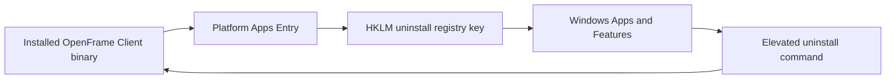
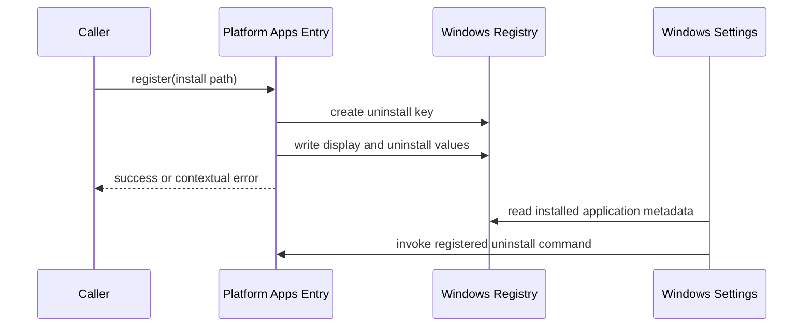
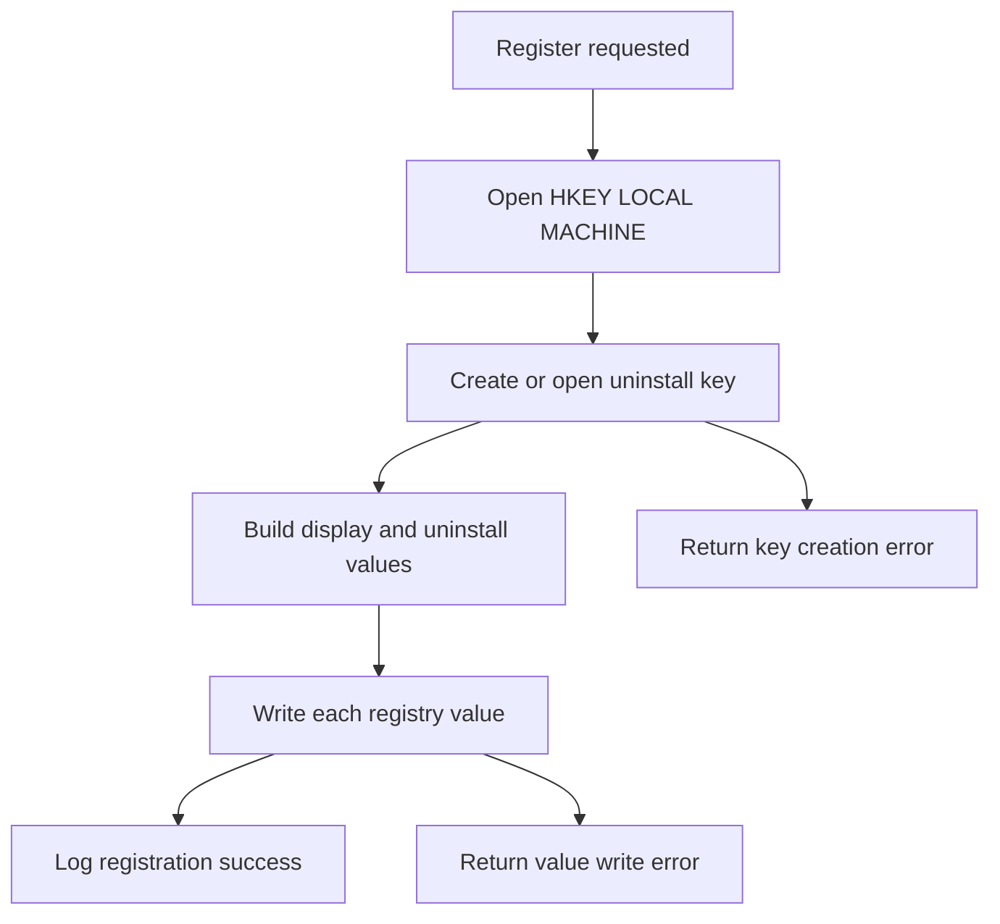
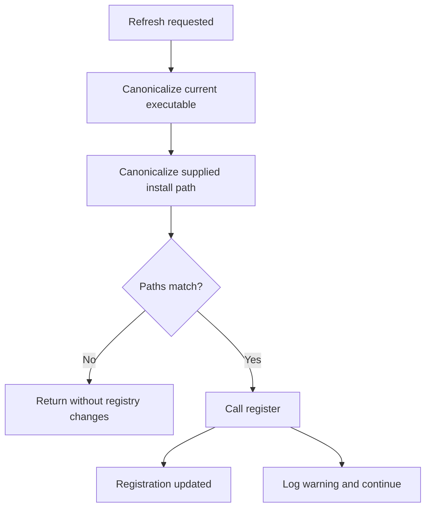
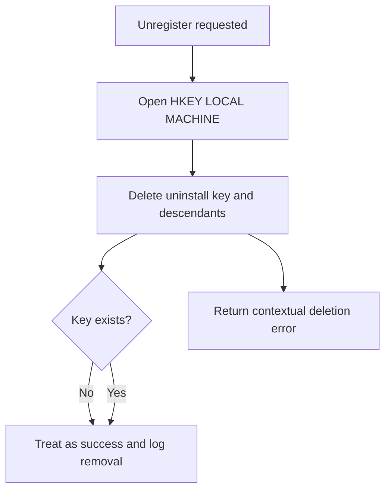

# Platform Apps Entry

Platform Apps Entry maintains the Windows **Apps & Features** registration for an installed OpenFrame Client binary. It creates or updates a machine-wide uninstall record, keeps its displayed version current after a platform update, and removes the record during uninstall. The implementation belongs to the `openframe_agent_lib` library supplied by OpenFrame OSS Library and is run by this repository's OpenFrame Client distribution.

The module is intentionally narrow: it does not install, replace, or remove the client binary. Instead, it publishes the metadata and uninstall commands that Windows Settings and other Add/Remove Programs consumers use to present the installed client.

**Source:** [apps_entry.rs in OpenFrame OSS Library](https://github.com/flamingo-stack/openframe-oss-lib/blob/7a766f00e4f58b5d89db007b878ac8d6e0c344f4/clients/openframe-client/src/platform/apps_entry.rs)

## Responsibilities

Platform Apps Entry owns one registry location:

`HKLM\SOFTWARE\Microsoft\Windows\CurrentVersion\Uninstall\com.openframe.client`

It provides three public operations:

| Operation | Purpose | Outcome |
|---|---|---|
| `register(install_path)` | Creates or rewrites the uninstall record for the supplied client executable. | Returns an error when creating the key or writing a value fails. |
| `refresh(install_path)` | Re-registers the entry after an update only when the supplied path resolves to the running installed executable. | Returns no error to its caller; it logs a warning if registration fails. |
| `unregister()` | Deletes the uninstall record. | Is idempotent: a missing registry key is treated as success. |

The module writes to `HKEY_LOCAL_MACHINE`, so callers must run in a context permitted to modify the machine-level uninstall registry tree.

## Architecture

The registry record is a projection of the installed executable. Windows reads the record to display the application and invoke the supplied uninstall command; the command starts the same installed executable with its `uninstall` argument.

## Registry Contract

`register` obtains the compile-time `OPENFRAME_VERSION` value and creates the registry key if necessary. It then rewrites the following values, ensuring that an existing entry is brought into line with the current installation path and binary version.

| Registry value | Value source | Role |
|---|---|---|
| `DisplayName` | Fixed value: `OpenFrame Client` | Name shown by Windows. |
| `DisplayVersion` | Compile-time `OPENFRAME_VERSION` | Version shown by Windows. |
| `Publisher` | Fixed value: `Flamingo AI, Inc.` | Publisher shown by Windows. |
| `URLInfoAbout` | Fixed OpenFrame site URL | Product-information target. |
| `InstallLocation` | Parent directory of `install_path` | Installation directory reported to Windows. |
| `DisplayIcon` | `install_path` | Executable used as the application icon source. |
| `UninstallString` | PowerShell command that starts the binary as administrator and waits | Interactive elevated uninstall path. |
| `QuietUninstallString` | Executable plus `uninstall` argument | Noninteractive command metadata. |
| `NoModify` | Numeric flag `1` | Suppresses Modify in Windows UI. |
| `NoRepair` | Numeric flag `1` | Suppresses Repair in Windows UI. |

If `install_path` has no parent, `InstallLocation` is written as an empty string. The entry is still constructed from the executable path for the icon and uninstall metadata.

## Component Interaction

The public registration method is deliberately fail-fast. Each registry creation or value-write failure is returned with context identifying the affected Apps & Features action or value. This makes installation and update failures diagnosable by the higher-level client lifecycle code.

## Registration Flow

### Elevated uninstall command

The interactive uninstall command uses the PowerShell executable beneath the system root. The system root is read from `SystemRoot` and defaults to `C:\Windows` if the environment value is unavailable. PowerShell is asked to start the installed client with the `uninstall` argument using the `RunAs` verb and to wait for completion.

Before embedding the executable path in the PowerShell single-quoted argument, the code doubles single quotes. This preserves the intended path representation inside the PowerShell command. The quiet uninstall value instead directly records the executable path followed by `uninstall`.

## Refresh Flow and Update Safety

A binary replacement should not allow an arbitrary path to create a machine-wide registration. `refresh` first checks that the caller-supplied `install_path` canonicalizes to the same location as the process's canonical current executable.

This guard makes refresh applicable only to the process executing from the installed location. It prevents refresh from acting when the current executable cannot be discovered, the supplied path cannot be canonicalized, or both paths refer to different files. Unlike direct registration, refresh is best-effort: errors are written to the tracing log and do not propagate.

## Unregistration Flow

`unregister` deletes the complete module-owned key tree rather than individual values. Deleting a missing key is explicitly accepted, allowing uninstallation cleanup to be safely retried and to run after partial installation states.

## Operational Behavior

### Logging

Successful calls to `register` and `unregister` emit informational tracing events. A failed refresh emits a warning with the formatted error chain. The refresh path otherwise remains silent when its installed-binary identity check does not pass, because no registry action was attempted.

### Error boundaries

| Boundary | Behavior |
|---|---|
| Registry key creation fails | `register` returns an error describing Apps & Features key creation failure. |
| A registry value write fails | `register` returns an error identifying the value that could not be written. |
| Registry deletion fails for a reason other than a missing key | `unregister` returns an error describing Apps & Features removal failure. |
| Path identity cannot be established during refresh | `refresh` exits without attempting registration. |
| Registration fails during refresh | `refresh` logs the failure and returns normally. |

## Maintenance Guidance

- Keep the uninstall key identifier stable unless a deliberate migration is introduced. Changing it leaves older Apps & Features entries behind unless cleanup handles the previous key.
- Treat `UninstallString` and `QuietUninstallString` as a compatibility contract with Windows management tooling. Changes must continue to execute the installed client rather than a transient updater or staging binary.
- Preserve the canonical-path check when evolving refresh behavior. It is the module's safeguard against writing registration metadata for an executable that is not the running installed client.
- Add new registry values through the centralized entry-value collection so every registration consistently writes the complete record.
- Retain idempotent unregistration so interrupted or repeated uninstall workflows converge on the desired state: no OpenFrame Client uninstall entry.

## System Context

Platform Apps Entry is a Windows-specific adapter within the OpenFrame Client's platform layer. It complements the client installation, service-management, binary-update, and uninstall facilities by making the installed client discoverable and removable through standard Windows application-management surfaces. The containing repository distributes the OpenFrame Client as part of the tenant platform, while the executable behavior documented here is implemented by the OpenFrame OSS Library artifact.
