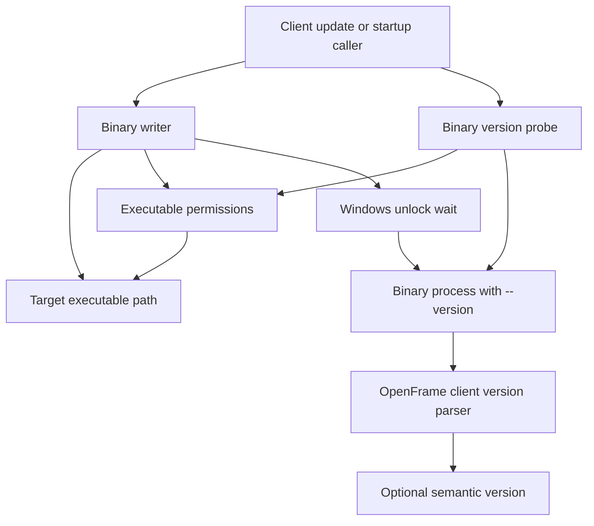
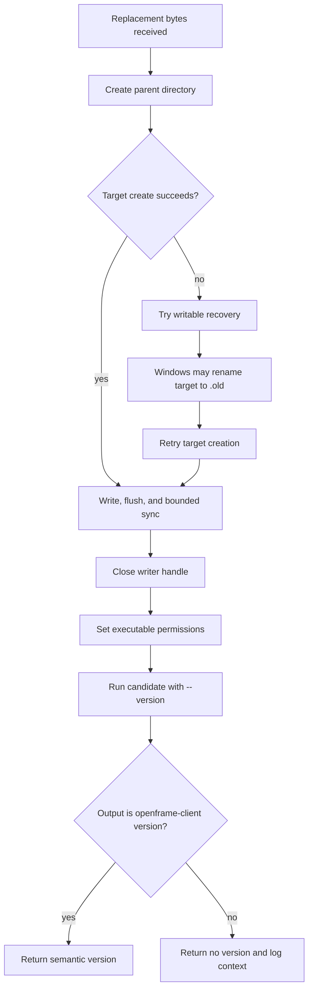

# Platform Binary Version And Writer

Platform Binary Version And Writer is the OpenFrame client platform utility responsible for two closely related update-time operations: identifying the version reported by an installed client executable and safely placing a replacement executable on disk. The implementation is supplied by the `openframe_agent_lib` Cargo artifact from the OpenFrame OSS Library and is run by this repository's OpenFrame client deployment.

The module is deliberately small and has no network protocol of its own. Its boundary is the local filesystem and process launcher: callers supply an executable path, replacement bytes, and—when inspecting a binary—a time limit.

## Responsibilities

| Area | Core component | Responsibility |
|---|---|---|
| Binary identity | `reported_version` | Executes an existing binary with `--version`, validates its output format, and returns a semantic version only when the result is trustworthy. |
| Durable write | `write_executable` | Creates the containing directory, writes the complete payload, flushes it, attempts a bounded disk sync, closes the writer handle, and applies executable permissions. |
| Replacement strategy | `replace_executable` | Uses a staged rename on macOS and delegates directly to the write path on other supported platforms. |
| Lock recovery | `aside_path`, `wait_until_executable_unlocked` | Provides the rename-aside location used for Windows recovery and waits for Windows file locks to clear before execution. |
| Unix permissions | `set_executable_permissions` | Sets mode `0755` after writes and before version probing, where Unix permissions apply. |

## Architecture

The module combines writer and reader safeguards so a freshly written binary can immediately participate in update validation. On Unix-family targets, the permissions step ensures that the executable can be launched. On Windows, version probing waits for an exclusive-open probe to succeed before starting the process, reducing failures caused by a writer or antivirus scanner temporarily holding the new executable.

## Component Details

### Binary Version Reporting

[`reported_version`](https://github.com/flamingo-stack/openframe-oss-lib/blob/16e7c1cbd9664e7d10ec5ebca7d53c9bd314decf/clients/openframe-client/src/platform/binary_version.rs) establishes whether a candidate binary identifies itself as an OpenFrame client.

1. It first calls `set_executable_permissions`. A permission failure is treated as an un-runnable binary and returns no version.
2. On Windows, it waits up to the configured executable-unlock interval before launch.
3. It runs the binary with `--version`, disconnects standard input, kills the child if the operation is dropped, and suppresses a console window on Windows.
4. A Tokio timeout bounds the process invocation. Launch errors, timeouts, unsuccessful exits, and malformed output are logged and produce `None`.
5. The parser accepts the first non-empty line only when its program name is exactly `openframe-client`; it then delegates semantic-version parsing to the shared version comparator.

The exact name check is significant. It rejects the older library-build banner `openframe-agent-lib 0.1.0`, preventing a library version from being reported as the client version.

### Executable Writing and Replacement

[`write_executable`](https://github.com/flamingo-stack/openframe-oss-lib/blob/16e7c1cbd9664e7d10ec5ebca7d53c9bd314decf/clients/openframe-client/src/platform/binary_writer.rs) is the common write primitive. It creates missing parent directories, writes all bytes asynchronously, flushes buffered data, and attempts `sync_all` subject to the configured binary-sync timeout. A sync failure or timeout is logged rather than promoted to a hard failure; the operation continues and the file handle is allowed to close.

After closing its own handle, the function applies executable permissions and logs the final path and byte count. Closing before a later launcher opens the file is especially important on platforms where open handles affect executable access.

If initial creation fails, the writer attempts a writable-file recovery through the platform ACL helper. On Windows, it also tries to rename the existing file to the path returned by `aside_path`, which appends `.old`. This allows a fresh target file to be created when a prior executable is locked or blocked by its attributes. Failures in the cleanup attempt are logged, while the subsequent create determines whether the overall write succeeds.

`replace_executable` selects the platform-specific replacement procedure:

- **macOS:** write the payload to a sibling staging file named with a leading dot and `.new` suffix, then rename the staged file over the target. A failed attempt removes the staging file on a best-effort basis.
- **Other platforms:** use `write_executable` directly at the target path.

## Write and Probe Flow

## Windows Lock Handling

`wait_until_executable_unlocked` is compiled only on Windows. It probes the file from a blocking task using an exclusive sharing mode. If the operating system reports that the file remains in use, it polls at the configured interval until the maximum wait elapses. A successful wait logs the observed delay when one occurred.

When the deadline is exceeded, the function records lock-holder context through the platform file-lock facilities and returns `false`; the caller intentionally proceeds with startup rather than blocking indefinitely. A probe error unrelated to file sharing is also logged and treated as non-blocking. This approach favors eventual progress while retaining diagnostics for endpoint protection or other lock sources.

## Failure Semantics and Operational Notes

- `write_executable` returns an error for failures to create directories, create the recovered target, write, flush, or apply executable permissions.
- Disk synchronization is best-effort after a successful write and flush. Its failure is observable in logs but does not by itself fail the write.
- Version detection is intentionally non-fatal: every launch, timeout, exit-status, identity, and parsing failure maps to an absent version rather than an error value.
- The timeout passed to `reported_version` bounds the spawned process output operation. Callers should select a finite duration suitable for their update workflow.
- The module logs paths, process outcomes, and lock diagnostics. Callers should treat those logs as the primary diagnostic record when an update cannot be verified.

## Relationship to the Client Update Lifecycle

Platform Binary Version And Writer is a low-level building block for the OpenFrame client’s update behavior. The broader client includes update-state, update-handler, cleanup, and updater-launcher capabilities, while this module owns only the local executable transition and version observation. It does not select releases, download payloads, persist update state, or decide rollback policy.

This separation keeps the critical filesystem behavior reusable: higher-level update orchestration can request a write or replacement, then independently ask the installed executable to report its semantic version before recording an update outcome.

## Source Files

- [Binary version implementation](https://github.com/flamingo-stack/openframe-oss-lib/blob/16e7c1cbd9664e7d10ec5ebca7d53c9bd314decf/clients/openframe-client/src/platform/binary_version.rs)
- [Binary writer implementation](https://github.com/flamingo-stack/openframe-oss-lib/blob/16e7c1cbd9664e7d10ec5ebca7d53c9bd314decf/clients/openframe-client/src/platform/binary_writer.rs)
