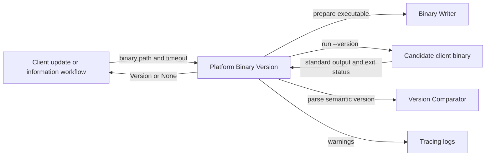
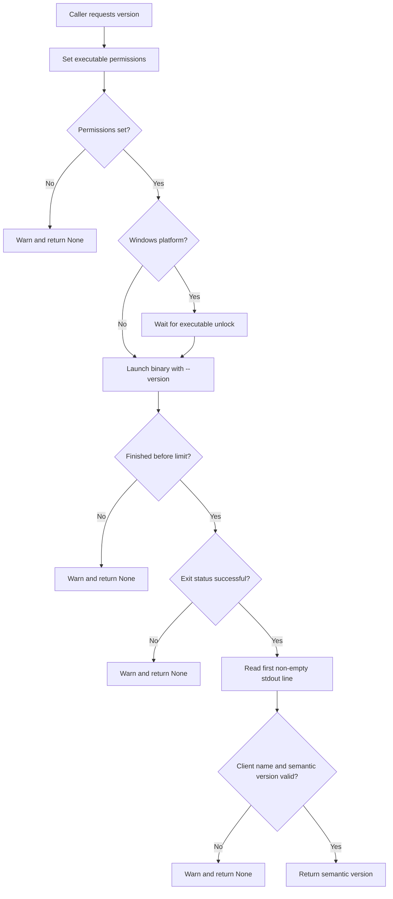
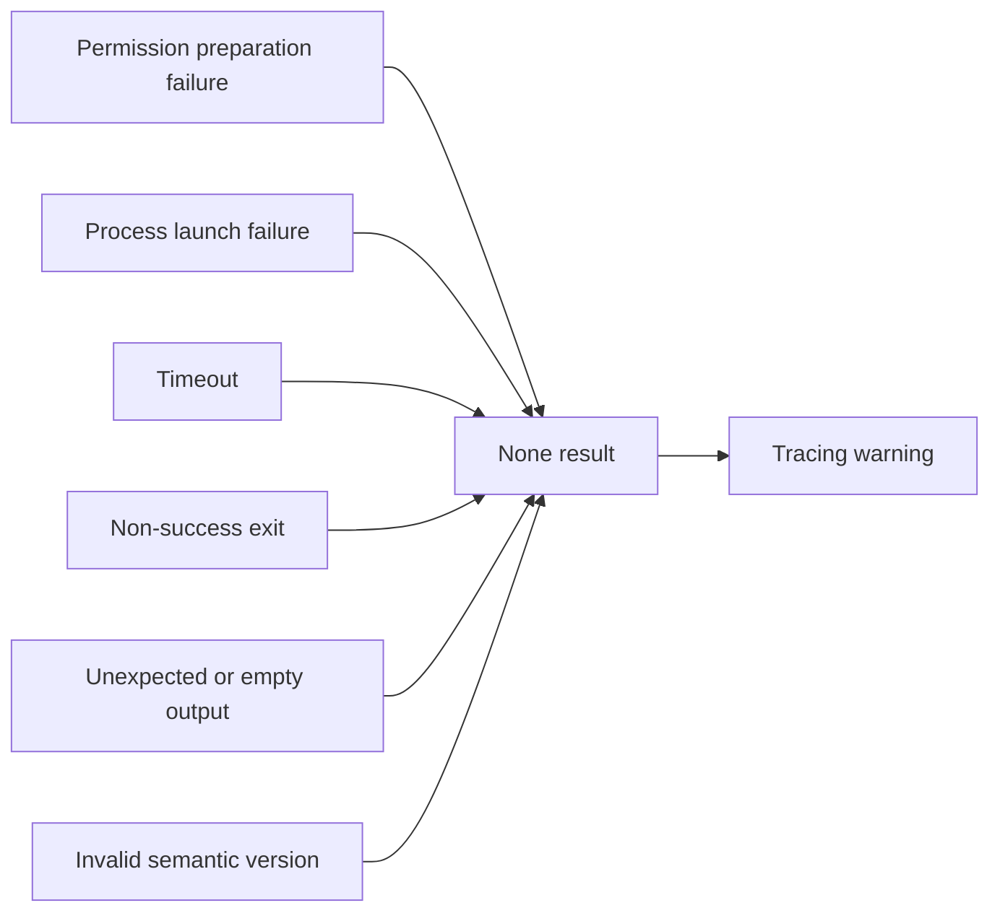
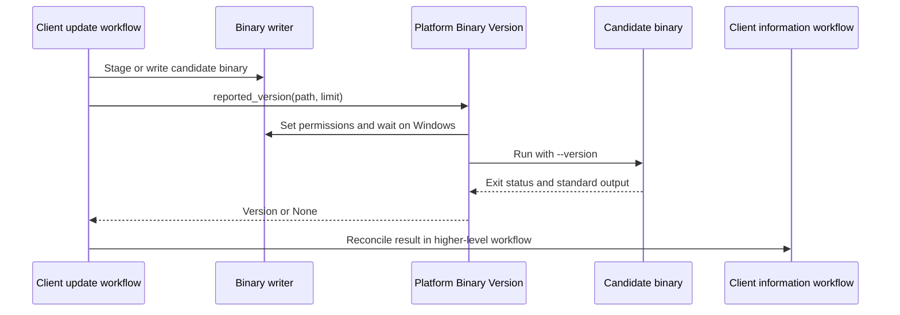

# Platform Binary Version

Platform Binary Version safely discovers the semantic version reported by an OpenFrame Client executable. It is a small, defensive boundary between the client update lifecycle and an executable that may be newly written, locked by another process, malformed, or unable to start.

The implementation is supplied by the `openframe_agent_lib` Cargo dependency from OpenFrame OSS Library. The tenant repository runs it as part of its OpenFrame Client workload. Its sole public operation, [`reported_version`](https://github.com/flamingo-stack/openframe-oss-lib/blob/7a766f00e4f58b5d89db007b878ac8d6e0c344f4/clients/openframe-client/src/platform/binary_version.rs), returns a parsed `semver::Version` only after the candidate binary successfully identifies itself as an OpenFrame Client.

## Responsibilities

Platform Binary Version:

- prepares a candidate executable so it can be launched;
- on Windows, waits for a freshly written executable to become unlocked before attempting execution;
- invokes the binary with `--version` with standard input disconnected;
- bounds the invocation with a caller-provided timeout and terminates the child if the operation is dropped;
- suppresses a console window for the Windows probe process;
- accepts only the first non-empty output line in the form `openframe-client <semantic-version>`;
- rejects legacy library banners, command failures, timeouts, empty output, invalid semantic versions, and unexpected program names; and
- returns `None` while logging a warning for every operational or validation failure.

It does not select a release, download artifacts, persist client metadata, or replace the running executable. Those responsibilities belong to the surrounding update, binary-writing, and client-information services.

## Public Interface

```rust
pub async fn reported_version(binary: &Path, limit: Duration) -> Option<Version>
```

| Input or result | Meaning |
| --- | --- |
| `binary` | Filesystem path of the executable to inspect. |
| `limit` | Maximum duration allowed for the `--version` subprocess to finish. |
| `Some(Version)` | The process exited successfully and its first non-empty standard-output line identifies `openframe-client` with a valid semantic version. |
| `None` | Preparation, launch, timeout, exit status, identity validation, or version parsing failed. The function emits a warning with available diagnostics. |

The module deliberately treats its result as optional rather than propagating an error. Callers can therefore use a missing version as a failed verification signal without accepting data from an arbitrary executable.

## Architecture and Dependencies



### Collaborating Components

| Component | Relationship to Platform Binary Version |
| --- | --- |
| Binary Writer | `set_executable_permissions` runs before launch. On Windows, the probe also uses the writer's unlock wait to reduce transient failures caused by a scanner holding a newly written executable. |
| Candidate client binary | Must implement `--version`, exit successfully, and write the supported client banner to standard output. Standard error is not used for version parsing. |
| Version Comparator | Parses the extracted version into `semver::Version`, enforcing the accepted version syntax. |
| Service stop configuration | On Windows, provides the configured executable-unlock wait duration. |
| Tokio process and time facilities | Start the child process asynchronously and enforce the caller's timeout. |
| Tracing | Records warnings for unavailable permissions, execution failures, timeout, non-zero status, and invalid output. |

## Validation Contract

The parser reads only the first non-empty line of standard output. That line must contain a program name followed by whitespace and a version value.

```text
Accepted: openframe-client 1.2.3
Rejected: openframe-agent-lib 0.1.0
Rejected: 1.2.3
Rejected: openframe-client not-a-version
```

The program-name check is significant: an older library build could report `openframe-agent-lib 0.1.0`. Even if the trailing value is parseable, it is not accepted as an OpenFrame Client version.

## Probe Flow



## Subprocess Behavior

The command is constructed with the candidate binary as its executable and `--version` as its only argument. Standard input is set to null so the probe cannot block while awaiting input. The child is configured to be killed if the future is dropped, including when the outer operation is cancelled.

On Windows, the child is created with the no-window creation flag. Before launching, the module waits for the candidate executable to become available using the configured unlock interval. This accounts for the case where a scan still has a newly written executable open.

The supplied timeout covers the asynchronous `output()` operation. A process that does not complete before the limit is not considered versioned, even if it could eventually produce valid output.

## Failure Semantics and Diagnostics



Warnings include the executable path and contextual details when available. For a non-successful exit, the diagnostic also includes the status and trimmed standard output. For unexpected output, it records the trimmed output. This makes probe failures diagnosable while keeping the function's caller-facing contract simple.

## Role in Client Updates

Platform Binary Version is a verification primitive rather than an update coordinator. A typical surrounding workflow writes or stages a candidate binary, uses this module to learn the version the executable actually reports, then uses higher-level state and update services to decide how to record or act on that result.



The module does not perform the final reconciliation itself. This separation ensures that an executable's self-reported version is validated before it is used by broader update-state logic.

## Maintenance Notes

- Preserve the strict `openframe-client` banner check when changing the CLI version output. Changing the CLI program name or output ordering will make probes return `None`.
- Preserve semantic-version parsing rather than accepting arbitrary labels; downstream update logic depends on a structured version value.
- Keep version output fast and non-interactive. Any delay beyond the caller's limit is treated as a failed verification.
- Treat Windows locking behavior as part of the update path. Removing the unlock wait can reintroduce transient probe failures immediately after a binary write.
- When adding diagnostic output to the client, ensure the first non-empty standard-output line remains the version banner, because that is the only line inspected.

## Source and Scope

The module source is maintained in OpenFrame OSS Library at [clients/openframe-client/src/platform/binary_version.rs](https://github.com/flamingo-stack/openframe-oss-lib/blob/7a766f00e4f58b5d89db007b878ac8d6e0c344f4/clients/openframe-client/src/platform/binary_version.rs). In this repository, the library is consumed as `openframe_agent_lib` version `v0.0.5` by the OpenFrame Client runtime.
