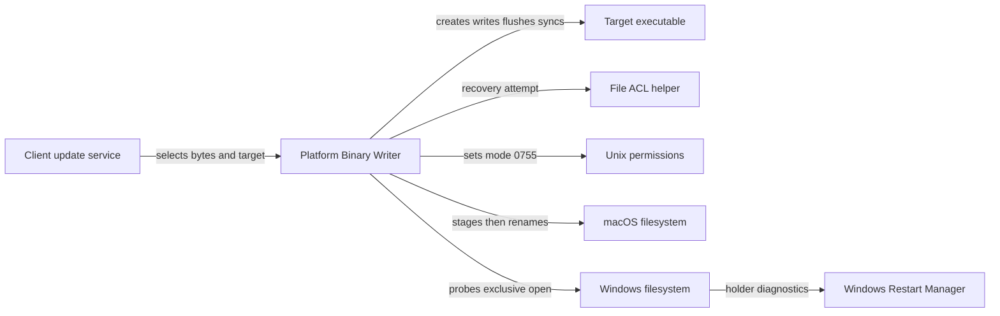
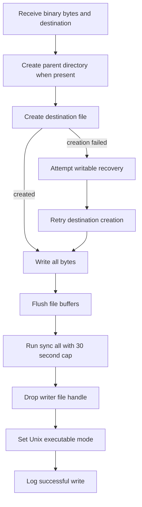
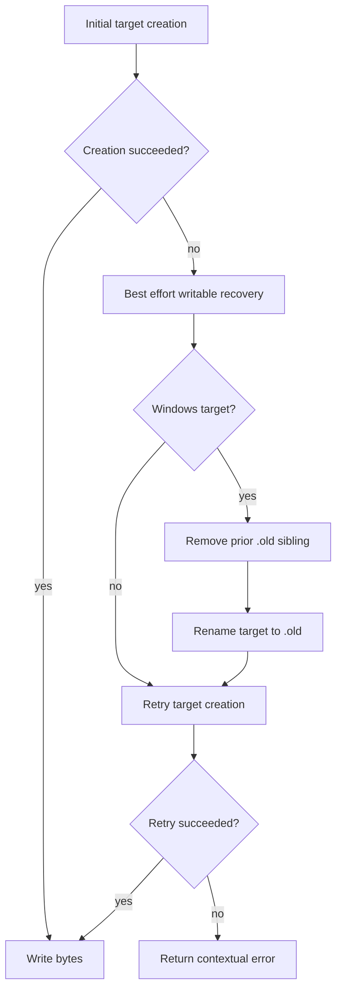
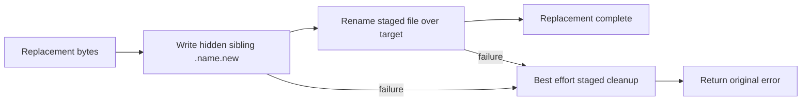
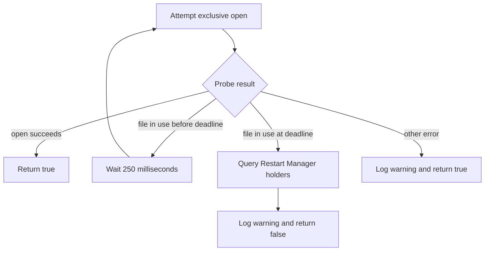

# Platform Binary Writer

Platform Binary Writer is the OpenFrame Client agent's low-level, asynchronous binary persistence utility. It receives already-obtained executable bytes and makes them usable at a target path: it creates missing parent directories, writes and flushes the file, makes a bounded attempt to synchronize it to storage, closes the writer handle, and applies executable permissions where the operating system supports them.

The implementation belongs to the `openframe_agent_lib` crate supplied by **OpenFrame OSS Library** and is assembled into this repository's client runtime. Its authoritative source is [binary_writer.rs](https://github.com/flamingo-stack/openframe-oss-lib/blob/7a766f00e4f58b5d89db007b878ac8d6e0c344f4/clients/openframe-client/src/platform/binary_writer.rs).

## Scope and Responsibilities

The module is deliberately focused on local file replacement rather than downloading, selecting versions, or starting services. In the wider agent update path, higher-level update services validate a requested version, prevent overlapping updates, track update state, coordinate running tools, and launch the updater. Platform Binary Writer is the final file-writing primitive used once replacement bytes and a destination have been selected.

| Capability | Responsibility | Platform behavior |
|---|---|---|
| Destination preparation | Creates the target's parent directory when it exists in the supplied path. | All platforms |
| Binary persistence | Creates the target file, writes all bytes, flushes buffered output, and attempts a bounded file synchronization. | All platforms |
| Recovery after creation failure | Attempts to make an existing target writable and retries creation. | All platforms invoke the recovery helper; its ACL actions are Windows-specific |
| Locked-file fallback | Renames a locked target to the matching `.old` path before retrying creation. | Windows only |
| Replacement semantics | Stages bytes in a sibling hidden `.new` file and renames it over the target. | macOS only |
| Executability | Sets mode `0755` after a successful write. | Unix family only |
| Startup readiness probe | Polls for an exclusive open after writing and reports potential holders when waiting expires. | Windows only |

## Architecture and Boundaries

The writer does not validate signatures, parse binary formats, download artifacts, manage service lifecycle, or harden Windows ACLs after a successful write. Those responsibilities remain with the update workflow and neighboring platform utilities. Notably, the file ACL helper exposes both recovery-oriented writability repair and a separate executable-hardening operation; the writer uses the former only when initial creation fails.

## Public Functions

| Function | Contract and outcome |
|---|---|
| `aside_path(path)` | Returns a sibling path formed by appending `.old` to the supplied path's OS string. It does not inspect, move, or delete any file. The Windows recovery path uses this naming convention. |
| `write_executable(bytes, path)` | Performs the base write sequence. It ensures the parent directory, writes all supplied bytes, flushes, bounds `sync_all`, drops its file handle, applies executable permissions where relevant, and logs success. Creation errors trigger recovery before one retry. |
| `replace_executable(bytes, path)` | Is the replacement entry point. On macOS, it writes to a hidden sibling whose name is formed as `.` plus the original filename plus `.new`, then renames that staged file over the target. On other platforms, it delegates directly to `write_executable`. |
| `set_executable_permissions(path)` | On Unix-family targets, reads current metadata and changes the mode to `0755`. It is a no-op on non-Unix targets. |
| `wait_until_executable_unlocked(path, max_wait)` | On Windows, repeatedly probes whether the executable can be opened without sharing. It returns `true` as soon as that succeeds or when probing encounters a non-lock error; it returns `false` only when a lock condition persists until the caller-provided deadline. |

## Write and Replacement Process

### Standard Write Path

`write_executable` treats directory creation, the final file creation attempt, `write_all`, `flush`, metadata retrieval, and permission changes as fallible operations that return contextual errors. A synchronization failure is different: if `sync_all` returns an error, or if it does not complete within the configured `BINARY_SYNC_TIMEOUT_SECS` value of 30 seconds, the module logs a warning and continues. This avoids indefinitely blocking an update on a slow or problematic storage synchronization while retaining the write and flush work already completed.

The explicit `drop(file)` occurs before permission changes and before any subsequent consumer opens or executes the target. If the bounded synchronization timed out, the future is allowed to continue owning the handle until it completes, as reflected in the warning; the normal writer handle is nevertheless dropped at that point.

### Creation Recovery and Windows Rename-Aside

When the first `File::create` fails, the writer logs the failure and calls the neighboring file ACL helper's `ensure_writable` operation on a best-effort basis. That helper invokes Windows commands intended to clear attributes, take ownership, and grant access to Administrators and Local System. Its result is intentionally ignored by Platform Binary Writer because the subsequent creation retry is the effective test of whether recovery succeeded.

On Windows, the recovery branch additionally removes any pre-existing `.old` sibling without failing the update if removal fails, then attempts to rename the current target aside. A successful move is logged; an unsuccessful move is logged as a warning. In either case, the module retries file creation and returns an error if that retry fails. This means rename-aside is a recovery attempt, not a guarantee that a locked executable can always be replaced.

### macOS Replacement Strategy

macOS uses `replace_executable` to avoid directly truncating the target during replacement. The function derives a staged filename in the same directory, writes the bytes through the normal write path, then renames the staged file over the target. Keeping the staging file beside the target enables a same-directory rename operation.

If either staging or rename fails, the function attempts to remove the staged file before propagating the original error. The cleanup attempt is best effort, so a failed cleanup does not replace or mask the update failure. Non-macOS targets use the normal direct-write implementation of `replace_executable`.

## Windows Unlock Waiting

A caller preparing to start a newly written executable can use `wait_until_executable_unlocked` to reduce races with the writer, antivirus scanning, or another process that temporarily holds the file. The function probes the file on a blocking worker thread with an exclusive sharing mode, keeping the asynchronous runtime free of the blocking operation.

- A successful probe returns `true`. If polling was required, the module logs how long the executable was held after the write.
- A file-in-use condition waits for the configured 250 millisecond poll interval and retries until `max_wait` has elapsed.
- When the deadline is reached, the function queries Windows Restart Manager for locking processes, logs the resulting process list or the possibility of a filter-driver or antivirus hold, then returns `false`. The caller may still choose to start the process.
- Any probe error that is not classified as a file-in-use error is logged and treated as permissive: the function returns `true` so an unexpected diagnostic failure does not prevent startup.

The service-stop configuration also defines a 30-second `EXEC_UNLOCK_WAIT_SECS` policy value for callers that need a standard update-start wait window. Platform Binary Writer accepts a duration parameter instead of imposing that value itself.

## Error Handling, Durability, and Security Considerations

### Error Model

The module returns `anyhow::Result`, attaching the destination path to failures for directory creation, file creation, writing, flushing, metadata inspection, permissions, and macOS rename. Warnings cover deliberately nonfatal conditions:

- failed best-effort ACL recovery;
- inability to remove or move the Windows rename-aside file;
- storage synchronization error or timeout;
- lock polling expiration; and
- diagnostic probe failures that are not lock-related.

This split is important to maintainers: a warning does not necessarily mean bytes were not written, while a returned error means the function could not complete a required operation in its contract.

### Filesystem Semantics

- The standard path writes directly to the requested destination. It does not provide a general cross-platform atomic replacement guarantee.
- The macOS replacement entry point stages and renames, but the module does not verify the newly installed binary after the rename.
- `.old` and `.new` names are transient recovery and staging artifacts. Cleanup of a failed macOS stage is attempted; Windows rename-aside artifacts can remain when later steps fail.
- Unix permissions are normalized to `0755`, which grants read and execute access broadly while preserving write access for the owner. This module does not apply the Windows hardening helper after a successful write.
- The module receives opaque bytes and does not perform checksum, signature, ownership, provenance, or version validation. These must be enforced by the artifact acquisition and update orchestration layers.

## Integration in the Client Update Lifecycle

The surrounding OpenFrame Client update service reserves an update guard to prevent duplicate concurrent work, rejects malformed versions, avoids an update when the target version is already running, applies a last-known-good downgrade guard, records status, and coordinates active tools. After the updater phase uses Platform Binary Writer to materialize the executable, startup and subsequent boot handling continue in the higher-level workflow.

The writer therefore has no network, API, message-bus, database, or service-manager dependency in its own implementation. Its direct dependencies are asynchronous filesystem APIs, the shared binary synchronization timeout, tracing, and platform-specific filesystem or lock diagnostics.

## Maintenance Guidance

1. Preserve the close-before-consumption ordering. Starting or replacing an executable while this module still owns the normal writer handle is especially problematic on Windows.
2. Keep bounded synchronization nonfatal unless the update durability contract is deliberately changed. The current design favors forward progress with a clear warning over an indefinitely stalled agent.
3. Treat the Windows `.old` flow as recovery only. Changes should retain the final creation retry and its error propagation.
4. Keep macOS staging in the target directory. Moving the stage to another filesystem can change rename behavior and invalidate the intended replacement semantics.
5. Test platform-specific behavior on the corresponding operating systems. Unix permission behavior, macOS rename replacement, and Windows sharing/Restart Manager diagnostics are compiled conditionally and cannot be fully exercised from one host.
6. Do not add artifact trust decisions here without coordinating the update workflow. This module's contract begins with bytes that the caller has already selected and accepted.

## Source and Runtime Provenance

Platform Binary Writer is implemented in OpenFrame OSS Library's Rust client source and consumed through the `openframe_agent_lib` dependency by this repository's OpenFrame Client runtime. The tenant repository records that dependency at version `v0.0.5`; the supplied source snapshot identifies the exact source revision used for this documentation. There are no separate child documentation files generated for this module.
