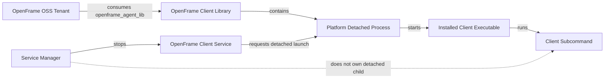
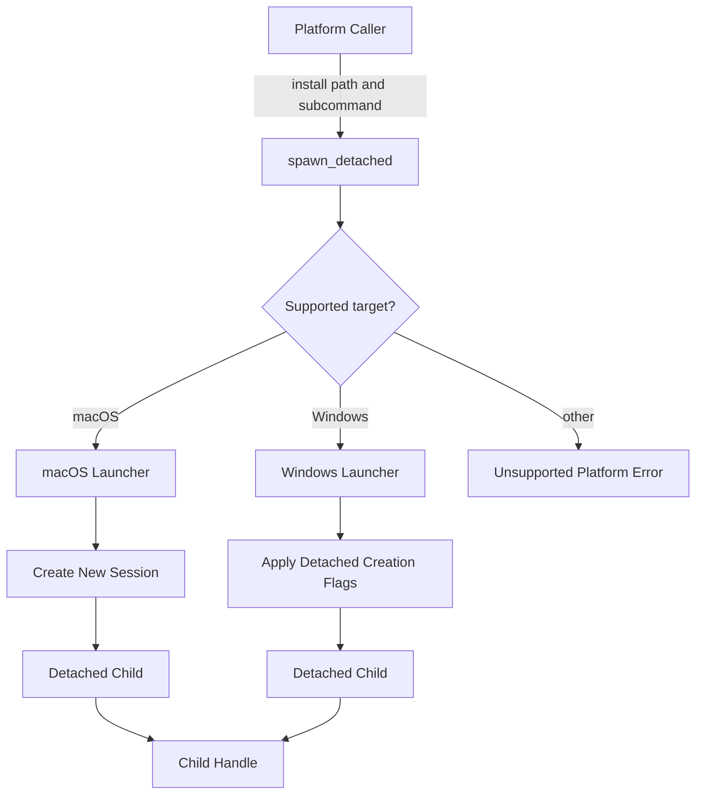
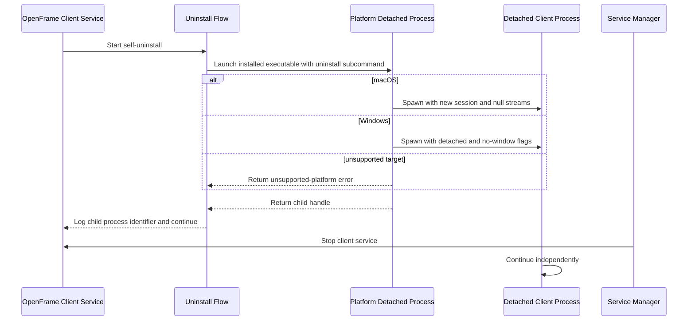

# Platform Detached Process

Platform Detached Process is a small, platform-specific process-launching boundary in the OpenFrame Client agent. It starts the installed client executable with a supplied subcommand in a form that can survive shutdown of the client service that launched it. The implementation is provided by the OpenFrame OSS Library `openframe_agent_lib` artifact and is consumed by this repository's OpenFrame Client deployment.

Its public entry point is [`spawn_detached`](https://github.com/flamingo-stack/openframe-oss-lib/blob/16e7c1cbd9664e7d10ec5ebca7d53c9bd314decf/clients/openframe-client/src/platform/detached_process.rs). The module is intentionally narrow: it does not validate a subcommand, wait for the child, manage updates, or remove files. Those responsibilities remain with its callers and adjacent platform services.

## Purpose and Scope

A normal child process can be terminated when the operating-system service manager stops the parent OpenFrame Client service. Platform Detached Process avoids that coupling for client subcommands that must continue after the service exits, notably the self-uninstall flow.

The API accepts:

- `install_path`: the executable to launch.
- `subcommand`: one argument passed to that executable.

It returns a `Child` process handle on success, allowing the caller to obtain the operating-system process identifier or otherwise manage the launched process. It returns an error if creation fails or if the build target is unsupported.

```rust
pub fn spawn_detached(install_path: &Path, subcommand: &str) -> Result<Child>
```

## System Placement

The function belongs to the Rust OpenFrame Client library rather than to one of the server-side Java services. The tenant repository packages and deploys the broader OpenFrame platform, while the agent library runs on managed endpoints. The dependency is pinned as `openframe_agent_lib` version `v0.0.5` in the repository's ecosystem metadata.



The library-level implementation has a direct wrapper in the uninstallation code: `spawn_detached_uninstall` invokes `spawn_detached` with the uninstall subcommand and records the spawned process identifier. The broader service uninstallation path first performs its platform-specific preparation, including the deregistration setup where applicable, then delegates to macOS or Windows uninstall logic. The detached helper supplies the process-lifetime guarantee needed when that logic stops the service.

## Platform Behavior

### macOS

On macOS, Platform Detached Process creates a child with the requested executable and subcommand, redirects standard input, output, and error to null devices, and calls `setsid()` in the child just before execution. Creating a new session separates the child from the launchd-managed service session so stopping `com.openframe.client` does not signal the child away mid-run.

The `pre_exec` callback is explicitly marked unsafe because it runs after the process fork and before execution. Its implementation performs only the async-signal-safe `setsid()` operation and propagates an operating-system error if that call fails.

### Windows

On Windows, the child inherits the LocalSystem context described by the implementation and is created with both `CREATE_NO_WINDOW` and `DETACHED_PROCESS` flags. These flags suppress a visible console window and detach the child from the service process so that the Service Control Manager stopping the parent does not terminate the follow-up process.

### Other Targets

For targets other than macOS and Windows, the function always returns an error stating that detached client subcommands are unsupported. It deliberately does not attempt a generic Unix or Linux fallback. Callers that might run on such a target must handle the error rather than assume a child was created.

| Target | Isolation mechanism | Standard streams | Result |
|---|---|---|---|
| macOS | New session via `setsid()` before execution | All redirected to null | Returns spawned child or launch error |
| Windows | `CREATE_NO_WINDOW` and `DETACHED_PROCESS` creation flags | Not changed by this helper | Returns spawned child or launch error |
| Other | None | Not applicable | Returns unsupported-platform error |

## Component Relationships

Platform Detached Process depends only on the Rust standard process and path types plus `anyhow` error handling. Compile-time target gates select exactly one supported implementation or the unsupported-target error path.



The module's principal integration is the uninstaller wrapper. It is a one-way handoff: the caller chooses the lifecycle operation, launches it detached, logs its identifier, and returns without waiting for that operation to complete.



## Execution Flow

1. A platform workflow resolves the path of the installed client executable and selects a subcommand.
2. The caller invokes `spawn_detached`.
3. Compile-time target selection dispatches to the macOS or Windows launcher, or returns an unsupported-platform error.
4. The platform launcher starts the same executable with precisely one subcommand argument and applies its isolation mechanism.
5. On success, the caller receives a `Child` handle. The helper does not wait for completion, inspect the child's exit status, or retry failures.
6. The caller may log the process identifier and allow the service manager to stop the original service while the detached client process continues.

## Error Handling and Operational Characteristics

### Errors

The module adds contextual error text when a supported-platform launch fails, identifying the requested detached subcommand. Underlying operating-system launch errors remain part of the error chain. The macOS path also returns the operating-system error from `setsid()` when session creation fails.

On an unsupported target, the parameters are intentionally consumed without use and a descriptive error is returned. This prevents compilation warnings while preserving the same public function signature across targets.

### Process Lifecycle Boundaries

- **Caller-owned inputs:** The caller is responsible for supplying a valid executable path and safe, expected subcommand.
- **Detached process:** The helper creates the process but performs no supervision after creation.
- **Service manager interaction:** Isolation is designed specifically to avoid parent-service shutdown terminating the child; it does not make the subcommand immune to every operating-system policy or administrator action.
- **Completion handling:** There is no join, exit-status collection, timeout, or retry in this module. A workflow requiring those behaviors must implement them above this boundary.

### Security Considerations

The helper executes the binary at `install_path` and forwards `subcommand` as an argument. Its safety therefore depends on trusted caller-controlled paths and subcommands. It does not perform authorization checks, path canonicalization, signature verification, or argument allowlisting. In the current usage model, those checks belong to the installation, update, and uninstallation workflows that decide whether a detached launch is appropriate.

The macOS implementation discards all standard streams to ensure the detached process has no dependency on the service's console or pipes. This improves detachment but means diagnostics must be obtained from the launched operation's own logging rather than inherited terminal output.

## Maintenance Guidance

When changing Platform Detached Process:

- Preserve the identical public signature across target builds so callers retain a consistent integration point.
- Keep the unsupported-target branch explicit unless a tested platform-specific lifecycle implementation is added.
- Treat changes to macOS `pre_exec` code as safety-critical. Only async-signal-safe work should occur between fork and execution.
- Keep Windows creation flags aligned with the requirement that a child outlive Service Control Manager shutdown of the service.
- Do not add waiting or cleanup semantics here without confirming that callers no longer rely on immediate return before service shutdown.
- Test success and failure paths on both supported operating systems, including a service-stop scenario rather than only launching from an interactive shell.

## Source and Verification Notes

The implementation is maintained in the OpenFrame OSS Library source file [`detached_process.rs`](https://github.com/flamingo-stack/openframe-oss-lib/blob/16e7c1cbd9664e7d10ec5ebca7d53c9bd314decf/clients/openframe-client/src/platform/detached_process.rs). The organization-wide code graph currently records no direct consumers of `spawn_detached` beyond the available indexed relationships; the adjacent uninstaller wrapper shown in the library source is the documented integration path for detached self-uninstall execution.
