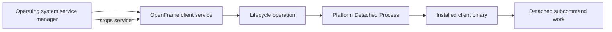
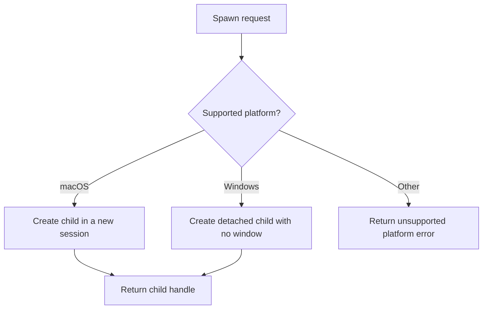
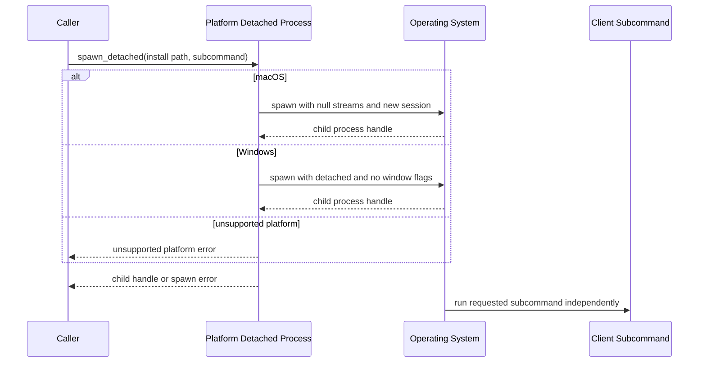

# Platform Detached Process

Platform Detached Process is the OpenFrame client platform utility that starts a second invocation of the installed client binary without keeping it attached to the running client service. It exists for work that must continue after the operating-system service manager stops `com.openframe.client`, such as an operation that deliberately transitions the client out of its current service lifetime.

This implementation is supplied at runtime by the `openframe_agent_lib` Cargo dependency from [OpenFrame OSS Library](https://github.com/flamingo-stack/openframe-oss-lib/blob/7a766f00e4f58b5d89db007b878ac8d6e0c344f4/clients/openframe-client/src/platform/detached_process.rs). OpenFrame OSS Tenant consumes that library as version `v0.0.5`; the utility is part of the OpenFrame client assembled by this repository.

## Responsibilities and Contract

The module exposes one function, `spawn_detached(install_path, subcommand)`, which:

- launches the executable at `install_path` with one `subcommand` argument;
- returns the spawned `Child` process handle when process creation succeeds;
- creates a process that is independent of the client service lifecycle on supported platforms; and
- fails explicitly on platforms other than macOS and Windows.

The module does not choose an executable, validate the requested subcommand, wait for the child to finish, collect child output, or implement update and uninstall logic. Callers own those decisions. In particular, a successful return establishes that the operating system accepted the spawn request, not that the detached subcommand later completed successfully.

## Position in the Client Architecture

The OpenFrame client is installed and supervised as a system service. Ordinarily, a child launched by that service can be terminated when its parent service is stopped. Platform Detached Process creates a separate process lifetime before the original client is stopped, allowing the child to run independently.

The library-level dependency boundary is intentional: OpenFrame OSS Tenant provides the client application and deployment assembly, while the upstream OpenFrame OSS Library owns this Rust platform behavior. The function operates only on a filesystem path and a subcommand string, so it is not coupled to NATS, HTTP, or the tenant's server-side services.

## Platform-Specific Detachment

### macOS

On macOS, the implementation builds a command for the installed client binary and configures all three standard streams to null devices. During child setup, it calls `setsid()` through `pre_exec`. The new session prevents signals associated with `launchd` stopping `com.openframe.client` from terminating the detached child mid-operation. No extra `launchd` job or plist is created.

The setup code is necessarily unsafe because it runs in the child between process creation and execution. Its safety rationale is narrow: `setsid()` is async-signal-safe, and an operating-system error from that call is returned to the spawn operation.

### Windows

On Windows, the child inherits the service account context, described by the implementation as LocalSystem. The command applies the `CREATE_NO_WINDOW` and `DETACHED_PROCESS` creation flags. Together, these avoid a visible console window and detach the child from the Service Control Manager-managed service process so the work can survive service shutdown.

### Other Platforms

The public function compiles on other targets but immediately returns an error stating that detached client subcommands are unsupported. This avoids silently launching a child with lifecycle semantics that the module cannot guarantee.

## Spawn Sequence

The error from either supported platform includes the requested subcommand as context. This helps operators distinguish a process-creation failure from an error reported later by the detached operation itself. Because standard output and standard error are discarded on macOS, diagnosis of post-spawn behavior must rely on the detached program's own logging or persisted state rather than a captured child stream.

## Inputs, Outputs, and Failure Boundaries

| Element | Meaning | Operational implication |
|---|---|---|
| `install_path` | Path to the installed OpenFrame client executable. | It must identify an executable the service context can start. |
| `subcommand` | Single argument passed to that executable. | The receiving client invocation defines its semantics. |
| `Child` | Handle for a successfully spawned operating-system process. | The caller may observe the process if it retains the handle, but detachment is intended to avoid dependency on the original service lifetime. |
| Spawn error | Failure to create the child or configure detachment. | The caller must treat the lifecycle operation as not launched and apply its own recovery policy. |
| Unsupported platform error | A target without macOS or Windows support. | Do not assume Linux or another target has equivalent detached behavior. |

## Lifecycle Considerations

Use this utility only where breaking the parent-service relationship is required. Detached processes have fewer direct supervision guarantees than ordinary service children:

- The caller should ensure the subcommand is safe to run as a separate client invocation before spawning it.
- Required state must be persisted before the service is stopped, because the detached child should not depend on in-memory state from the original process.
- The operation should provide independent logs or durable status because the spawning call reports only launch success or failure.
- Repeated launches should be prevented or made idempotent by the owning lifecycle workflow; this module does not deduplicate requests.
- On macOS, null standard streams mean the child cannot communicate outcome through inherited console output.

## Maintenance Notes

When changing Platform Detached Process, preserve the platform-specific lifetime guarantee rather than treating it as a general command wrapper. Changes should verify:

1. macOS children remain in a separate session before service shutdown can signal them.
2. Windows children retain the intended service-account context and detached creation behavior.
3. unsupported targets continue to fail clearly instead of receiving an unverified approximation.
4. spawn errors retain subcommand context without exposing sensitive argument data.
5. any new detached subcommand has its own completion reporting and recovery behavior.

The code-graph snapshot lists no direct callers or tests for `spawn_detached`; maintainers should therefore inspect the client lifecycle paths and exercise supported operating systems when modifying its contract.