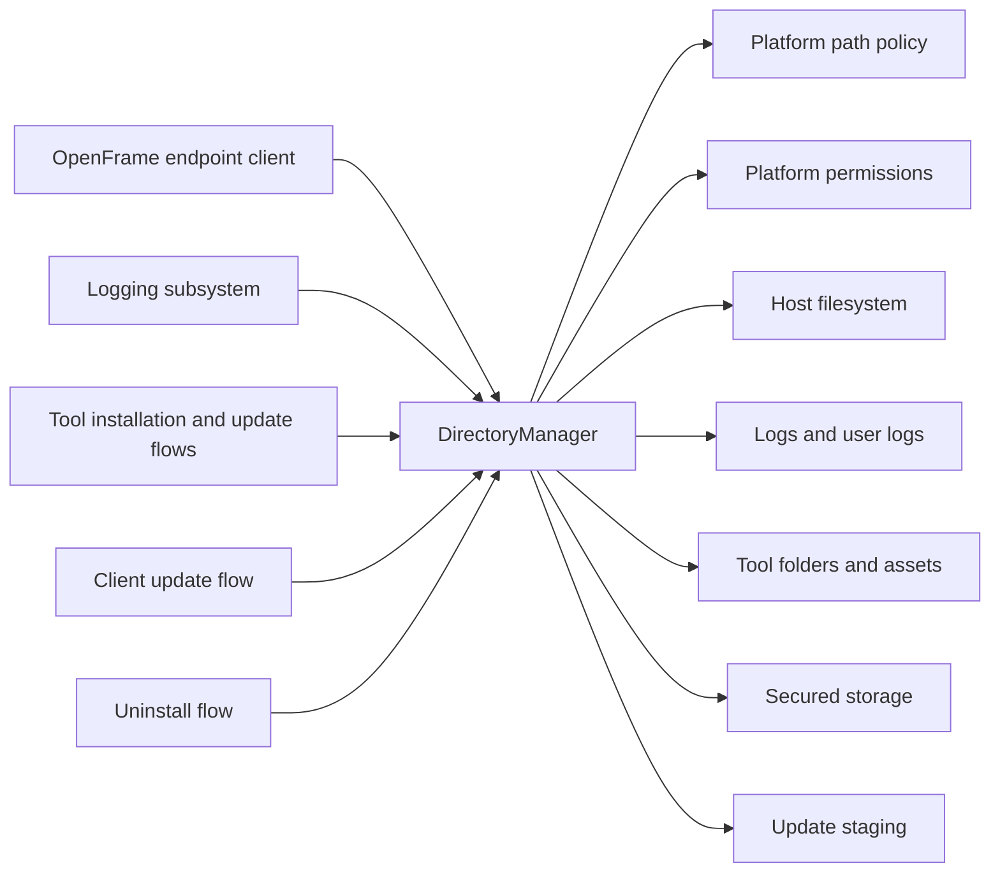
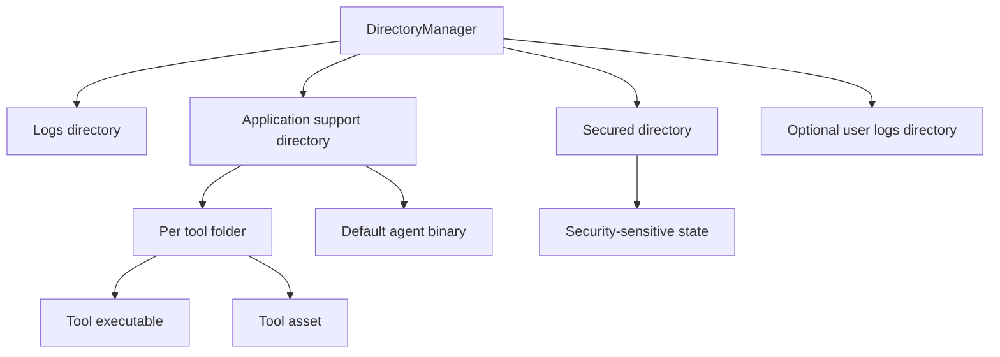
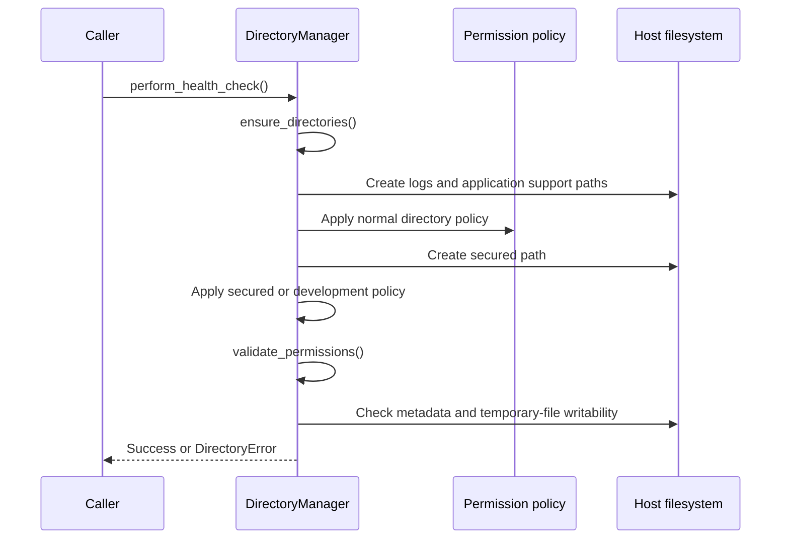
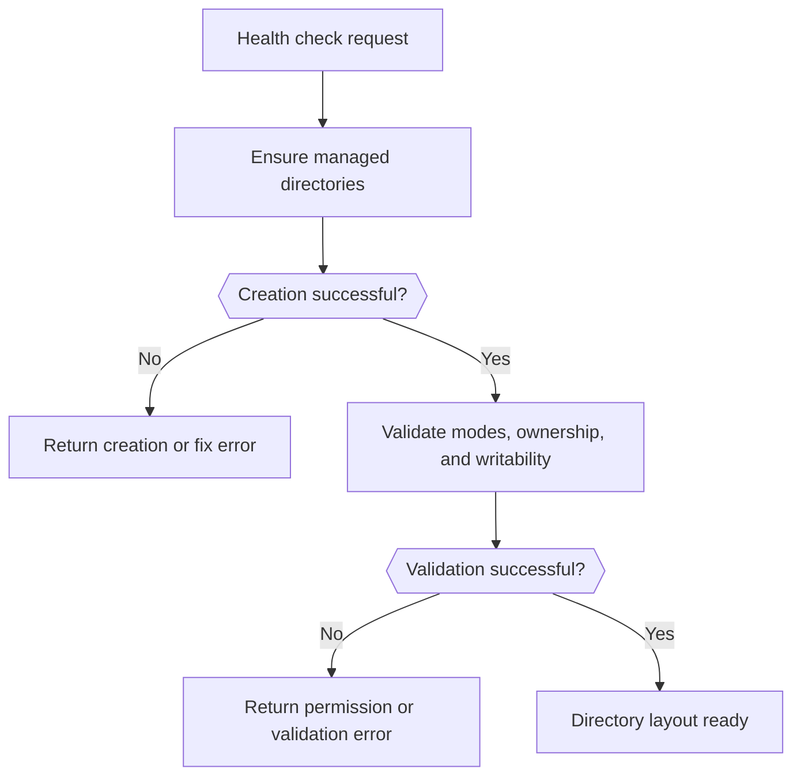
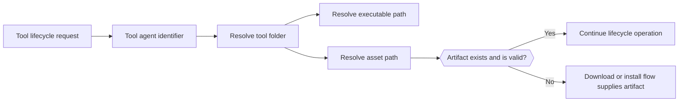

# Platform Directories

Platform Directories provides the OpenFrame endpoint client with one cross-platform authority for filesystem locations, directory preparation, permission handling, and path construction. The implementation is supplied by the upstream OpenFrame OSS Library as part of the `openframe_agent_lib` Rust artifact, which this repository consumes to run its endpoint client. Its source is [directories.rs](https://github.com/flamingo-stack/openframe-oss-lib/blob/7a766f00e4f58b5d89db007b878ac8d6e0c344f4/clients/openframe-client/src/platform/directories.rs).

The module prevents each client concern from independently selecting storage paths or applying its own permissions. It separates ordinary operational data, logs, tool content, and security-sensitive files, while supporting production, user-log, development, and injected-path configurations.

## Responsibilities

Platform Directories is responsible for:

- Resolving system application-support, log, secured-storage, installation, and update-staging locations for Windows, macOS, and Linux.
- Creating managed directories and applying normal directory permissions through the platform permissions abstraction.
- Creating and validating secured storage with stricter production rules.
- Performing writability and permission health checks, and attempting permission remediation.
- Returning deterministic per-tool paths for executables, assets, and folders.
- Supporting a log-location override and user-specific logging without changing the application-support location in normal operation.
- Providing development mode, in which all managed locations share a user-writable directory and secured-storage validation is intentionally relaxed.
- Recognizing and removing macOS application bundles when that platform-specific functionality is compiled.

It does not download assets, install tools, manage system services, or perform binary replacement. Those operations consume the paths it provides and are handled by the surrounding client platform and service modules.

## System Position

The OpenFrame endpoint client is assembled from the upstream Rust library. At startup and during tool or client lifecycle work, callers use `DirectoryManager` as the filesystem boundary. The module delegates permission-mode policy to the adjacent platform permissions implementation, then exposes paths to logging, tool lifecycle, update, and uninstall flows.

### Dependency Boundaries

| Dependency or consumer | Relationship | Platform Directories responsibility |
|---|---|---|
| Platform permissions | Supplies the standard directory permission mode, which is `0755`, and applies it to normal managed directories. | Calls the policy when creating, validating, and repairing normal directories. |
| Logging subsystem | Needs a stable log path, including a user-specific option. | Resolves system or user log paths and ensures them when managed by the directory manager. |
| Tool lifecycle | Installs, starts, updates, and checks integrated-tool artifacts. | Builds tool folder, executable, and asset paths; verifies whether an artifact exists. |
| Client update flow | Stages a replacement binary and updater material. | Selects the Windows installation update folder or the host temporary directory on non-Windows systems. |
| macOS uninstall and update handling | May operate on application bundles instead of standalone binaries. | Locates the enclosing `.app` bundle and removes it when the macOS-only functions are available. |

## Directory Model

The module uses three primary directory classes. The standard directory policy is applied to logs and application support; secured storage has a separate policy in production.

### Default Paths

| Purpose | Windows | macOS | Linux |
|---|---|---|---|
| Application support | `ProgramData` followed by `OpenFrame`; if unavailable, `C:\ProgramData\OpenFrame` | `/Library/Application Support/OpenFrame` | `/var/lib/openframe` |
| Logs | Application support followed by `logs` | `/Library/Logs/OpenFrame` | `/var/log/openframe` |
| Secured storage | Application support followed by `secured` | `/Library/Application Support/OpenFrame/secured` | `/var/lib/openframe/secured` |
| Installation root | `ProgramFiles` followed by `OpenFrame`; if unavailable, `C:\Program Files\OpenFrame` | Not defined by this module | Not defined by this module |
| Update staging | Installation root followed by `update` | Host temporary directory | Host temporary directory |

If `OPENFRAME_LOG_DIR` is set, it replaces the default log path. The module tries to create that override if it does not exist, writes an error to standard error if creation fails, and still returns the requested path. Downstream callers should therefore still surface later write failures.

### User and Development Layouts

`with_user_logs_dir` retains the system application-support and secured paths but adds a user-specific logging path:

| Platform | User log location |
|---|---|
| Windows | The local application-data directory, followed by `OpenFrame/Logs` |
| macOS | The user home directory, followed by `Library/Logs/OpenFrame` |
| Linux | The user home directory, followed by `.local/share/openframe/logs` |
| Fallback | The host temporary directory, followed by `OpenFrame/Logs` |

`for_development` points logs, application support, and secured storage at that same user-log path. This avoids elevation requirements during local development. It must not be treated as equivalent to production secured storage because its security validation only checks writability.

## Construction and Path APIs

`DirectoryManager::new` initializes the platform defaults. `with_custom_dirs` is intended for controlled path injection, such as testing or a specialized runtime. The getters return borrowed paths and do not create directories:

- `logs_dir`, `app_support_dir`, and `secured_dir` return their respective managed roots.
- `user_logs_dir` returns the configured user log path or falls back to the main log directory.
- `get_tool_folder` returns an application-support child named after the tool agent identifier.
- `get_agent_path` returns the default agent name within that tool folder: `agent.exe` on Windows and `agent` elsewhere.
- `get_tool_executable_path` preserves an absolute executable path. A relative executable path is resolved below the tool folder; absent configuration uses the default agent path.
- `get_asset_path` resolves an asset below the tool folder and adds `.exe` on Windows only when the caller marks an extensionless asset as executable.
- `tool_artifact_present` asynchronously accepts a non-empty regular file, or a directory when the caller identifies the artifact as a GUI application.

Callers must provide trusted tool identifiers and relative names. The module joins those values into paths but does not impose an identifier format or explicitly reject traversal components.

## Directory Lifecycle

A health check both establishes the directory layout and verifies that it remains usable. Normal directory checks require the path to exist, satisfy the expected Unix mode when applicable, and permit a temporary write probe. The probe creates a `.write_test` file and removes it afterwards.

### Creation

`ensure_directories` processes logs and application support with the normal permission policy, then processes secured storage with its distinct policy. It also creates an optional user-log directory. Before creating a missing path, it creates missing parents. After creation, normal paths receive platform-specific handling followed by the shared directory permission policy.

For an existing secured directory in production mode, creation is skipped but secured permissions are re-applied. This makes repeated initialization a reconciliation step rather than a no-op.

### Validation and Repair

`validate_permissions` checks all configured normal directories and then applies secured-directory validation. `fix_permissions` re-applies the corresponding policy to existing paths but does not create missing paths; callers should use the health check or `ensure_directories` first when a directory may not exist.

Failures use `DirectoryError` to distinguish creation failures, write denial, validation failures, permission-fix failures, and a home-directory resolution category. Errors originating from the platform permission abstraction are converted into creation or validation failures.

## Permission and Ownership Semantics

The module intentionally expresses different platform behavior rather than forcing POSIX behavior onto every host.

| Platform | Normal directories | Secured directories | Validation behavior |
|---|---|---|---|
| Windows | Relies on system-default inherited permissions after creation. | Relies on administrator-created defaults. | Existence and the temporary write probe are used; the secured check trusts an existing path. |
| macOS | Attempts recursive ownership change to `root:admin` and recursive mode `755`; command outcomes are not propagated. | Leaves default permissions in place. | Secured storage must be owned by root. |
| Linux | Applies mode `0755` and attempts recursive ownership change to `root:root`; ownership command outcomes are not propagated. | Applies mode `0700` and attempts recursive ownership change to `root:root`. | Normal directories are checked against the configured mode; secured storage must be root-owned with mode `0700`. |

The production secured-directory checks are deliberately stricter than normal directory checks. On Linux-like Unix hosts, the current user may need elevated privileges to create, own, or repair this path. On macOS, secured files are intended to remain readable by user processes while root ownership is the enforced invariant. Development mode bypasses these production ownership and mode expectations.

## Tool and Bundle Flows

Platform Directories provides the filesystem portion of the tool lifecycle without deciding what tool to install or how to execute it.

For macOS GUI applications, `find_app_bundle_path` walks executable ancestors until it finds a path with the `.app` extension. `is_app_bundle_path` provides a lightweight string-based containment check for paths containing `.app/`. The macOS-only removal helpers resolve the bundle, treat an absent bundle as already removed, and otherwise asynchronously remove the entire bundle directory. On other platforms those helpers are not compiled.

## Operational Guidance

### Startup

1. Construct the appropriate manager: default production paths, user-log mode, development mode, or explicitly injected paths.
2. Run `perform_health_check` before components depend on persistent paths.
3. Treat a failure as an installation, privilege, filesystem, or policy configuration problem rather than continuing with partially initialized storage.
4. Pass the manager or resolved paths to logging, persistence, tool, update, and uninstall operations.

### Diagnosing Failures

- **Creation failure:** Verify that parent paths are accessible and that the service account has required elevation for system locations.
- **Permission denied:** The temporary file probe could not write to the managed path. Inspect filesystem ACLs, ownership, mount state, and security tooling.
- **Normal validation failure on Unix:** Reconcile the directory mode with the `0755` standard policy.
- **Secured validation failure on Linux:** Ensure mode `0700` and root ownership in production.
- **Secured validation failure on macOS:** Ensure the secured directory is root-owned.
- **Unexpected log location:** Check whether `OPENFRAME_LOG_DIR` is set, then check whether the directory was successfully created.
- **Tool missing after an update:** Compare the resolved tool folder, executable path, and asset path with the tool metadata. GUI tools may validly be directories rather than files.

### Maintenance Constraints

Do not use development mode to work around production permission problems. It deliberately changes both the storage layout and secured-directory guarantees. Similarly, do not assume that a successful permission command guarantees that ownership changed: the platform-specific ownership commands are best-effort in this module, while later validation determines whether required production invariants hold.

## Relationship to the Tenant Repository

This repository publishes and deploys the OpenFrame services that support the endpoint platform, while the endpoint client directory implementation comes from the OpenFrame OSS Library dependency. Platform Directories is therefore an endpoint-runtime concern assembled into this repository's OpenFrame client deployment, not a server-side service directory manager. Its paths support local endpoint state, client logs, managed-tool files, and update staging; they do not select Kubernetes, service, or data-source paths used by the tenant deployment.
