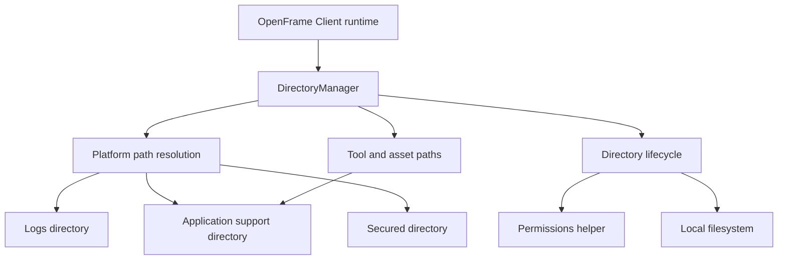
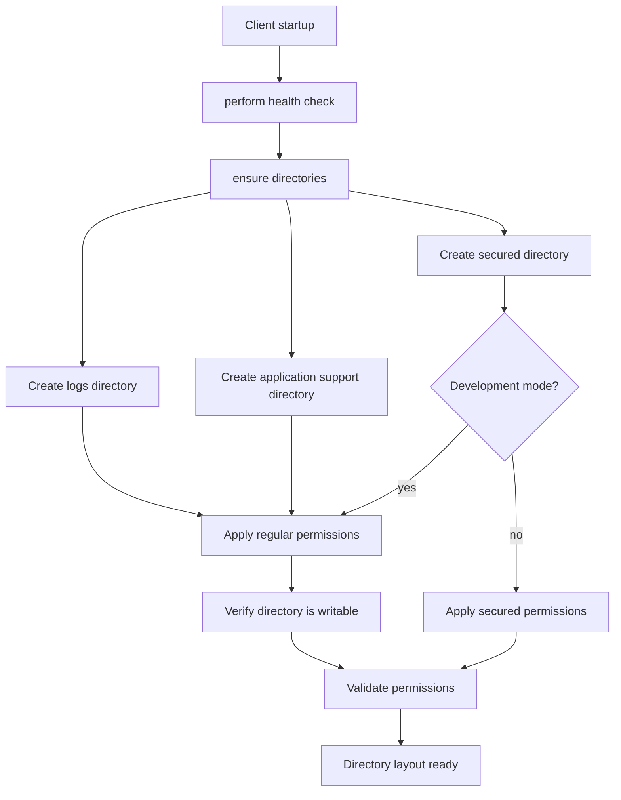
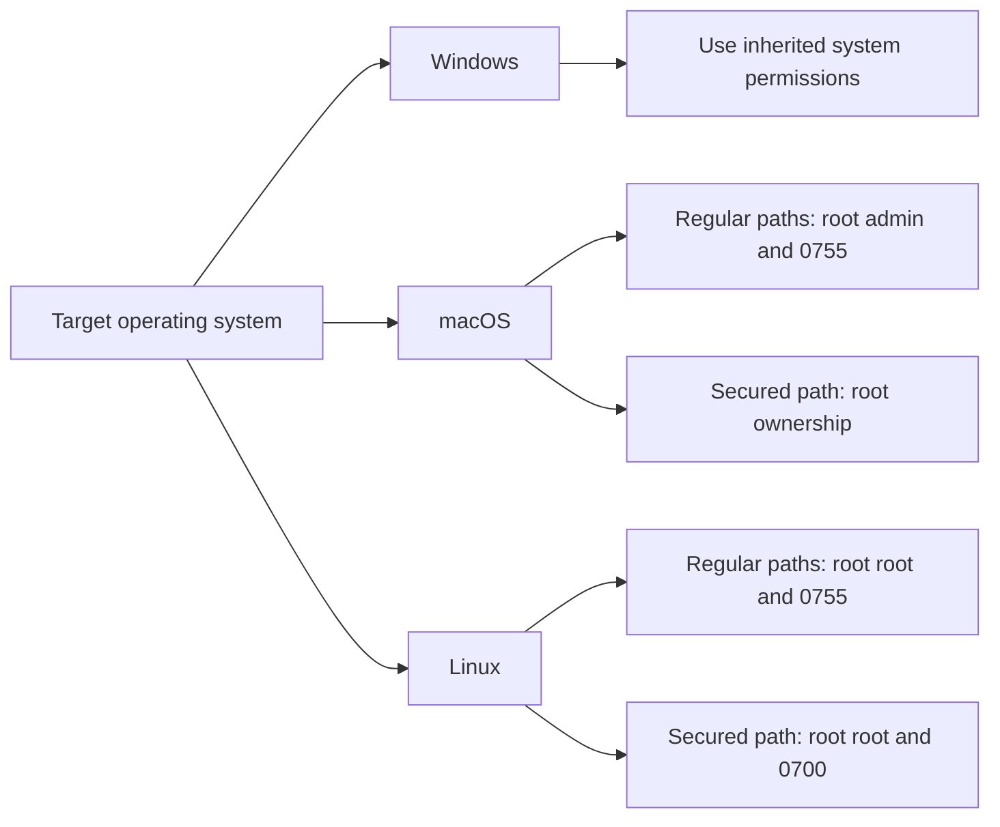
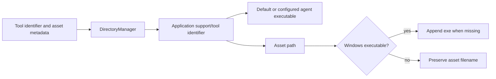

# Platform Directories

Platform Directories is the OpenFrame Client library component that establishes and protects the local filesystem layout used by an installed endpoint agent. It selects platform defaults, creates required locations, applies and validates permissions, resolves tool and asset paths, supports user-scoped development operation, and contains the macOS-specific cleanup logic for application bundles.

The implementation is supplied by the `openframe_agent_lib` Cargo dependency from OpenFrame OSS Library and is run by this repository's OpenFrame Client service. Its source is [`directories.rs`](https://github.com/flamingo-stack/openframe-oss-lib/blob/16e7c1cbd9664e7d10ec5ebca7d53c9bd314decf/clients/openframe-client/src/platform/directories.rs).

## Responsibilities

`DirectoryManager` owns three principal locations:

| Location | Purpose | Default locations |
| --- | --- | --- |
| Application support directory | Per-tool folders, agent executables, and downloaded assets. | Windows: `ProgramData/OpenFrame`; macOS: `/Library/Application Support/OpenFrame`; Linux: `/var/lib/openframe` |
| Logs directory | Agent and tool logs. The `OPENFRAME_LOG_DIR` environment variable overrides the default. | Windows: application support `logs` child; macOS: `/Library/Logs/OpenFrame`; Linux: `/var/log/openframe` |
| Secured directory | Data intended for administrative or root-only access in production mode. | Windows: application support `secured` child; macOS and Linux: `secured` child beneath application support |

On Windows, self-update artifacts are staged under the OpenFrame installation root's `update` directory. On non-Windows platforms, update staging uses the operating system temporary directory.

## Architecture

The module separates path selection from lifecycle enforcement. Free functions supply OS-specific defaults, while `DirectoryManager` stores the selected paths and performs creation, permission work, health checks, and path derivation. This keeps consumers independent of operating-system path conventions.

## Path Resolution

### Standard paths

`get_app_support_directory`, `get_logs_directory`, and `get_secured_directory` provide direct access to the standard paths. `get_install_directory` is Windows-only and resolves the installation root from `ProgramFiles`, falling back to the conventional Program Files location when absent.

`get_logs_directory` first checks `OPENFRAME_LOG_DIR`. When set, it returns that location and attempts to create it if it is missing. A creation failure is reported to standard error but does not change the selected path, allowing the later health check to surface a structured directory error.

### Runtime configurations

| Constructor | Intended use | Resulting layout |
| --- | --- | --- |
| `new` | Normal installed client operation | Uses system paths for logs, support data, and secured data. |
| `with_custom_dirs` | Tests or explicitly supplied layouts | Uses caller-provided paths. |
| `with_user_logs_dir` | Workloads needing an additional user-visible log location | Keeps system paths and adds a per-user logs directory. |
| `for_development` | Non-privileged local development | Uses the user log directory for logs, application support, and secured data. |

User log locations are derived with the `directories` crate: Local AppData on Windows, `Library/Logs/OpenFrame` below the user's home directory on macOS, and `.local/share/openframe/logs` below the user's home directory on Linux. If a home directory cannot be determined, a temporary OpenFrame logs directory is used.

## Directory Lifecycle and Permissions

The normal startup path is `perform_health_check`.

`ensure_directories` creates missing parent and target directories, applies the regular directory permissions, and confirms writability by creating then removing a `.write_test` file. It processes logs, application support, secured storage, and the optional user log location.

`validate_permissions` checks each ordinary directory exists, compares Unix modes with `Permissions::directory()` when that information is available, and repeats the writability probe. The `Permissions` helper from the platform permissions component supplies the expected regular directory mode and applies it after a directory is created.

The secured directory has stricter production validation:

- **Linux:** it must be owned by root and have mode `0700`.
- **macOS:** it must be owned by root; the implementation intentionally retains default permissions so user processes can read files where required.
- **Windows:** existence is trusted after creation because the implementation relies on the system's inherited administrator permissions.
- **Development mode:** validation only requires that the directory is writable, avoiding privileged setup for local development.

`fix_permissions` reapplies the appropriate regular or secured settings to existing locations. It does not create a missing location; callers should use `ensure_directories` or `perform_health_check` first.

## Platform Permission Policy

The module invokes platform tools to establish ownership where applicable. On macOS, regular directory setup attempts recursive ownership assignment to `root:admin` and mode `0755`. On Linux, it sets mode `0755` for ordinary directories and `0700` for secured storage, then attempts recursive `root:root` ownership. Errors from these ownership commands are intentionally not propagated directly; subsequent permission and writability validation determines whether the resulting directory is usable.

## Tool Files and Assets

DirectoryManager centralizes the on-disk convention for integrated tools:

- `get_tool_folder` returns the tool-specific folder below application support.
- `get_tool_executable_path` accepts an optional executable path. An absolute path is used unchanged; a relative path is resolved below the tool folder. Without an explicit path, the default is `agent.exe` on Windows and `agent` elsewhere.
- `get_agent_path` is the default-agent shortcut.
- `get_asset_path` resolves an asset below the tool folder and adds an `.exe` suffix for a Windows executable asset whose supplied name lacks that suffix.
- `tool_artifact_present` asynchronously accepts a nonempty file, or a directory when the tool is a GUI application.

This resolution policy prevents callers from reproducing platform-specific executable naming and tool-folder composition.

## macOS Application Bundle Handling

On macOS, a GUI tool executable can be nested inside an application bundle. `find_app_bundle_path` walks an executable path's ancestors and returns the first directory with an `app` extension. `is_app_bundle_path` performs a lightweight string check for a bundle path. `remove_app_bundle` and `remove_app_bundle_path` then remove the detected bundle asynchronously.

Bundle removal is deliberately idempotent: a path without a bundle, or a bundle that no longer exists, is logged and treated as successful. A filesystem removal failure is returned with contextual error information.

## Failure Model

Public lifecycle operations report `DirectoryError` rather than exposing raw filesystem errors alone.

| Error variant | Meaning |
| --- | --- |
| `CreateFailed` | A target directory or required parent could not be created. |
| `PermissionDenied` | The current process cannot write to a managed directory, or secured-access checks fail. |
| `ValidationFailed` | A directory is missing or does not satisfy expected mode, ownership, or permission requirements. |
| `FixFailed` | A permission update could not be applied. |
| `HomeDirectoryNotFound` | Reserved for callers that cannot determine a home directory. The current user-log resolver instead falls back to temporary storage. |

Errors from the platform permissions abstraction are translated into these directory-domain errors so callers receive a single error type for health and remediation workflows.

## Operational Guidance

1. Create a `DirectoryManager` during client initialization using `new` for installed operation or `for_development` for local development.
2. Run `perform_health_check` before writing logs, credentials, tool binaries, or assets.
3. Treat a health-check failure as an installation or privilege issue. Do not bypass the secured-directory checks in production.
4. Use accessors such as `logs_dir`, `app_support_dir`, `secured_dir`, and `user_logs_dir` rather than duplicating platform paths.
5. Use the tool-path methods for every managed tool file so Windows executable suffix handling remains consistent.
6. Call `fix_permissions` only for an existing layout that requires remediation; it cannot recover a missing directory by itself.

The client-wide service and update workflows consume this directory layout for persisted configuration, logging, downloaded tool artifacts, update staging, and cleanup. Platform Directories is therefore a foundational local-storage boundary: it standardizes where those workflows operate and ensures that the filesystem state is appropriate before they do.
