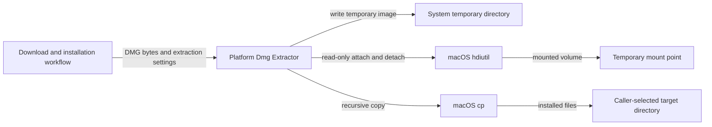
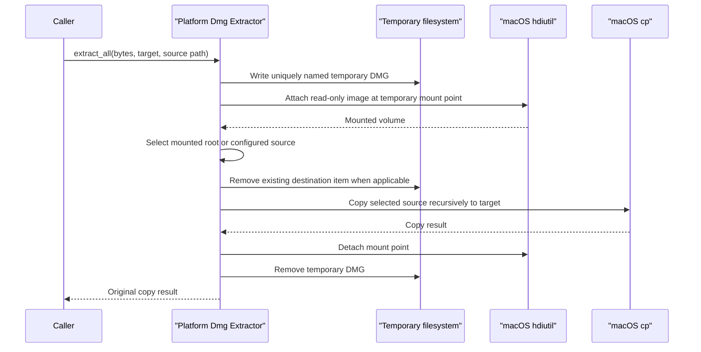
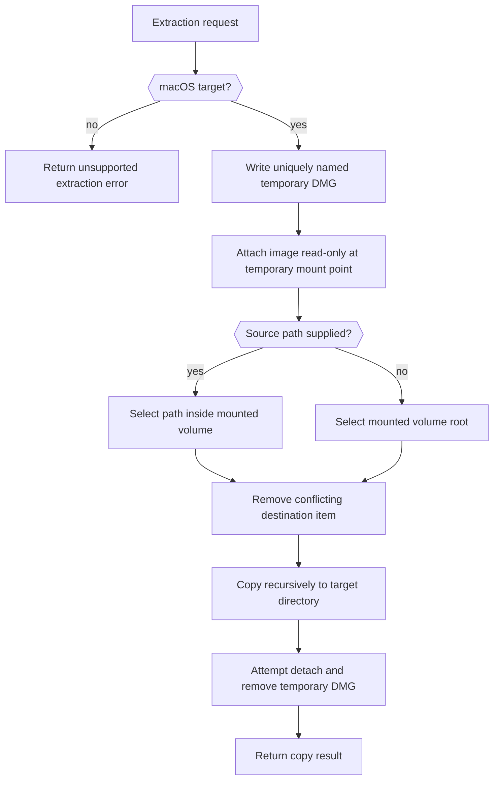
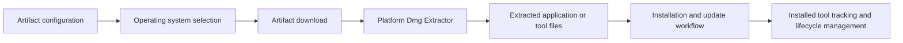

# Platform Dmg Extractor

Platform Dmg Extractor provides the OpenFrame client agent's macOS-specific path for expanding a downloaded disk image into a target directory. It accepts an in-memory DMG, writes a uniquely named temporary image, mounts that image read-only with `hdiutil`, copies either the complete mounted volume or a configured item within it, and then attempts to detach the volume and delete the temporary image.

The implementation is supplied by the **OpenFrame OSS Library** through the `openframe_agent_lib` Cargo artifact, version `v0.0.5`, which this repository consumes. Its source is [dmg_extractor.rs](https://github.com/flamingo-stack/openframe-oss-lib/blob/16e7c1cbd9664e7d10ec5ebca7d53c9bd314decf/clients/openframe-client/src/platform/dmg_extractor.rs). It is intended to be used by higher-level download and tool-installation workflows rather than as a standalone service.

## Responsibilities

- Construct a lightweight, clonable `DmgExtractor` using `new`; `Default` delegates to the same constructor.
- On macOS, safely stage a DMG from `Bytes` in the system temporary directory.
- Attach the staged image without browsing and in read-only mode.
- Select either the mounted root or the configured `source_path` inside the mounted volume.
- Replace a pre-existing destination item that has the selected source's filename, including a symbolic link.
- Copy the selected source recursively into the target directory with the platform `cp -R` command.
- Attempt cleanup after the copy path completes, retaining the original copy result if cleanup also fails.
- Refuse extraction on non-macOS targets with an explicit error rather than trying to interpret a DMG.

## Architecture and Boundaries

`DmgExtractor` is a platform adapter inside the Rust OpenFrame client. It owns only image staging, mounting, copy, and best-effort cleanup. Artifact acquisition, compatibility selection, installation bookkeeping, and post-copy execution remain outside this module.



### Public Surface

| Component | Role |
|---|---|
| `DmgExtractor::new` | Creates the stateless extractor value. |
| `DmgExtractor::extract_all` | Asynchronously stages, mounts, selects, replaces, copies, verifies, and cleans up an image on macOS. On other operating systems it returns an unsupported-operation error. |
| `Default` | Convenience construction equivalent to `DmgExtractor::new`. |

The mounting, unmounting, and recursive-copy helpers are internal implementation details and are compiled only for macOS.

## Extraction Flow



The following decision flow summarizes platform selection and source selection:



## Detailed Behavior

### Temporary Resources

Each macOS extraction uses a randomly generated UUID to derive both the staged DMG filename and mount-point directory in the system temporary directory. This avoids collisions between concurrent extraction requests. The module writes all supplied bytes before invoking the operating system mount utility.

The mount command is equivalent to the following conceptual operation:

```bash
hdiutil attach -nobrowse -readonly -mountpoint TEMPORARY_MOUNT_POINT TEMPORARY_DMG_PATH
```

Read-only mounting limits the extractor's interaction with the disk image. `-nobrowse` prevents the volume from being surfaced through Finder browsing behavior.

### Source and Destination Semantics

When `source_path` is present, Platform Dmg Extractor resolves it relative to the temporary mount point. When it is absent, it selects the mount point itself and copies the full mounted content.

Before copying a selected item with a filename, the module examines the corresponding item in the target directory:

1. An existing symbolic link is removed as a file.
2. Any other existing item is removed recursively as a directory.
3. The selected source is copied with `cp -R` into the target directory.

This makes the operation replacement-oriented for the selected item's destination name. Callers must therefore ensure that the target directory and any configured source path are appropriate for the artifact being installed.

### Result and Cleanup Semantics

The copy outcome is the operation's authoritative result. After the copy attempt, the extractor independently tries to detach the mounted image and delete the staged DMG. Failures during either cleanup action are logged as warnings and do not replace a successful or failed copy result.

If staging or mounting fails, execution stops at that failure through error propagation. In particular, cleanup after the copy is not reached when the mount operation itself fails. Logs include the target, optional source path, image size, temporary paths, command results, and copy verification details to help diagnose these cases.

## Error Handling and Observability

Platform Dmg Extractor adds contextual errors around the major operations:

| Stage | Failure reported to caller |
|---|---|
| Staging | Failure to write the temporary DMG, including its path. |
| Mounting | Failure to create the mount point, execute `hdiutil`, or attach the image successfully. |
| Copying | Failure to run `cp -R` or a nonzero copy exit status. |
| Unsupported platform | A message that DMG extraction is supported only on macOS, including the requested target directory. |

The module logs progress with `info` and cleanup or copy failures with `warn`. On a successful copy it also logs whether the expected copied item exists when the selected source has a filename. This check is informational; it does not add a separate failure condition.

## Operational Considerations

- **Platform requirement:** DMG extraction must execute in a macOS build and runtime environment. Other target operating systems return an error by design.
- **System tools:** The host must provide `hdiutil` and `cp`, and the process must have permission to write to the temporary directory and selected target directory.
- **Target lifecycle:** Existing destination content matching the selected source name can be deleted before copying. Use an installation-specific directory rather than a shared location.
- **Cleanup diagnostics:** A failed detach or temporary-file removal is logged but does not alter the returned copy status. Investigate recurring warnings because they can leave mounted volumes or temporary images behind.
- **Artifact trust:** This module operates on bytes passed to it; it does not validate download origin, checksums, signatures, or the existence of a configured source path. Those concerns belong to the artifact acquisition and installation layers.

## Relationship to the OpenFrame Client

Within the client agent, Platform Dmg Extractor is one of several operating-system adapters used during software delivery. Download configuration determines which artifacts apply to the current operating system, while download and installation services acquire the artifact and coordinate its installation. This module performs the narrow macOS disk-image expansion step and returns control to that workflow for subsequent installation, tracking, and process-management actions.



No standalone configuration keys, network endpoints, persistent records, or background workers are defined by Platform Dmg Extractor itself.