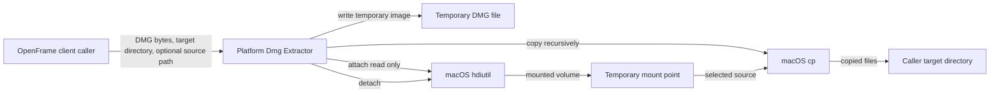
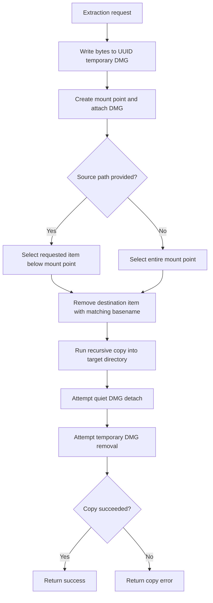
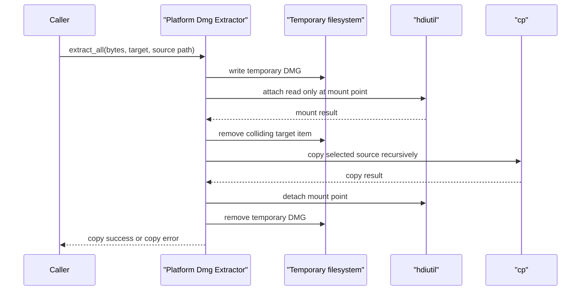

# Platform Dmg Extractor

Platform Dmg Extractor is the macOS-specific archive-extraction adapter used by the OpenFrame client runtime. It receives an in-memory DMG payload, mounts that payload read-only with the native `hdiutil` utility, copies either the mounted contents or a selected item into a caller-provided destination, and then attempts to detach the image and remove its temporary DMG file.

The implementation is supplied by the `openframe_agent_lib` Cargo dependency from OpenFrame OSS Library, version `v0.0.5`. Its source is [dmg_extractor.rs](https://github.com/flamingo-stack/openframe-oss-lib/blob/7a766f00e4f58b5d89db007b878ac8d6e0c344f4/clients/openframe-client/src/platform/dmg_extractor.rs). The tenant repository runs this library as part of its OpenFrame client distribution; it does not provide a network endpoint or persistent configuration for this module.

## Responsibilities and boundaries

Platform Dmg Extractor has a deliberately narrow responsibility:

- Materialize received DMG bytes as a uniquely named temporary file.
- Mount the image read-only and without browsing visibility.
- Select the entire mounted volume or the `source_path` item within it.
- Replace a pre-existing destination item with the same basename, then recursively copy the selected item with `cp -R`.
- Attempt unmounting and temporary-file removal after a copy attempt.
- Return detailed errors when the platform utility or copy operation fails.

It does **not** download assets, validate an image signature or checksum, create the destination directory, install the copied application, or manage an application lifecycle. Those decisions belong to the caller and to higher-level OpenFrame client services.

## Architecture

The public API is intentionally small. `DmgExtractor::new` constructs a stateless extractor, while `extract_all` performs the full asynchronous extraction operation. On macOS, mounting, unmounting, file writes, and process launches are asynchronous. On every other target OS, `extract_all` immediately returns an unsupported-platform error identifying the requested target directory.

## API behavior

| Component | Behavior |
| --- | --- |
| `DmgExtractor::new` | Returns a stateless extractor instance. `Default` delegates to this constructor. |
| `DmgExtractor::extract_all` on macOS | Writes the supplied `Bytes` payload to a UUID-named temporary DMG, mounts it, selects content, removes a colliding destination entry, copies recursively, and performs best-effort cleanup. |
| `DmgExtractor::extract_all` on non-macOS | Returns an error stating that DMG extraction is supported only on macOS. |
| `mount` | Private helper that creates the mount directory and runs `hdiutil attach -nobrowse -readonly -mountpoint`. |
| `copy_recursive` | Private helper that invokes `cp -R` from the selected source to the target directory. |
| `unmount` | Private helper that invokes `hdiutil detach -quiet` and removes the empty mount directory when detachment succeeds. |

## Extraction flow

The copy result is the operation result. Cleanup failures are logged as warnings rather than replacing a successful copy result or obscuring a copy error. When copying succeeds, the module logs whether the expected copied item exists in the target directory.

## Content selection and destination semantics

The optional `source_path` determines the input to the recursive copy:

- With no source path, the mounted volume itself is copied into the target directory.
- With a source path, the extractor selects that path under the temporary mount point and copies it into the target directory.

Before copying, the extractor derives the selected source basename. If an entry with that basename already exists directly beneath the target directory, it removes that entry first. A symbolic link is removed as a file; any other existing entry is removed recursively as a directory. The subsequent `cp -R` command therefore controls the final filesystem layout and metadata behavior.

The caller must provide a usable target directory. The extractor does not create it and does not verify that the requested source path exists before invoking `cp`.

## Component interaction

## Error handling and cleanup

Failures are annotated with contextual paths or command stages. Typical failure boundaries are:

| Stage | Returned failure condition |
| --- | --- |
| Temporary write | The DMG payload cannot be written to the generated temporary path. |
| Mount-point preparation | The mount-point directory cannot be created. |
| Mount | `hdiutil attach` cannot run or exits unsuccessfully. |
| Copy | `cp -R` cannot run or exits unsuccessfully. |
| Non-macOS invocation | The request is rejected before filesystem work begins. |

After the copy step is entered, detachment and temporary-DMG deletion are attempted even if copying fails. Their failures are warning-only, preserving the primary copy outcome. In contrast, an attach failure returns immediately, so the normal post-copy cleanup path is not reached. Operational monitoring should therefore use the emitted DMG logs to identify mount failures that can leave temporary artifacts behind.

## Operational and security considerations

- The image is mounted with `-readonly`, limiting mount-time writes to the image itself, and `-nobrowse`, preventing Finder-style browsing exposure.
- The temporary filename and mount-point suffix are UUID-based, reducing collision risk across concurrent extractions.
- Extraction executes operating-system commands, so macOS hosts must provide both `hdiutil` and `cp` and grant the client permission to access the temporary area and destination.
- DMG bytes are treated as trusted by this module. Integrity checks, provenance checks, and authorization need to happen before calling Platform Dmg Extractor.
- Treat `source_path` as trusted input. The implementation joins it to the mount point but does not explicitly validate containment or reject absolute and traversal-style paths. Callers should constrain it to an expected relative item inside the mounted image.
- Replacing an existing destination basename is destructive. The caller should choose an isolated target directory and coordinate concurrent installs or updates.

## Logging and diagnostics

The module emits structured tracing events prefixed with `[DMG]`. The logs identify the target directory, selected source, payload size, generated temporary paths, native command output for attachment, copy outcome, cleanup warnings, and final copied-item existence verification. These messages are the primary diagnostics because the extractor does not produce a separate report object or metrics payload.

## Maintenance checklist

When changing Platform Dmg Extractor, verify the following on a macOS test host:

1. A valid DMG can be mounted and copied with and without a source path.
2. A conflicting symbolic link and a conflicting directory at the destination are handled as intended.
3. A copy failure still triggers detach and temporary-file cleanup attempts.
4. An invalid image produces an actionable attach error with command output.
5. A non-macOS build continues to reject extraction without attempting to execute macOS utilities.
6. Path validation is added at the caller boundary before accepting untrusted source-path values.
