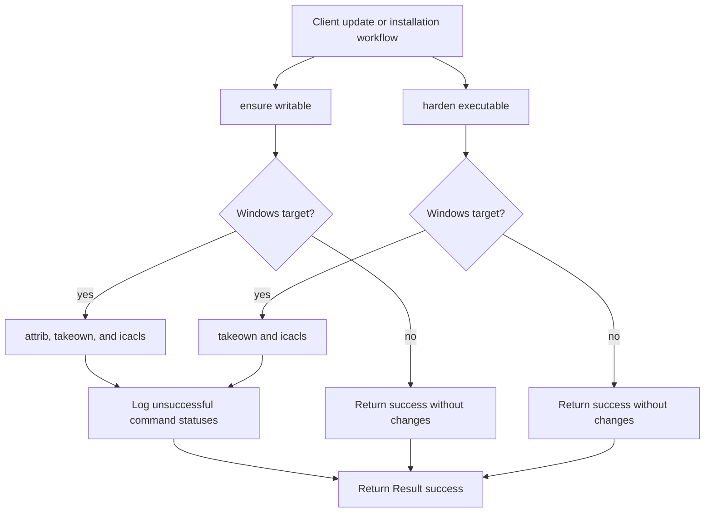
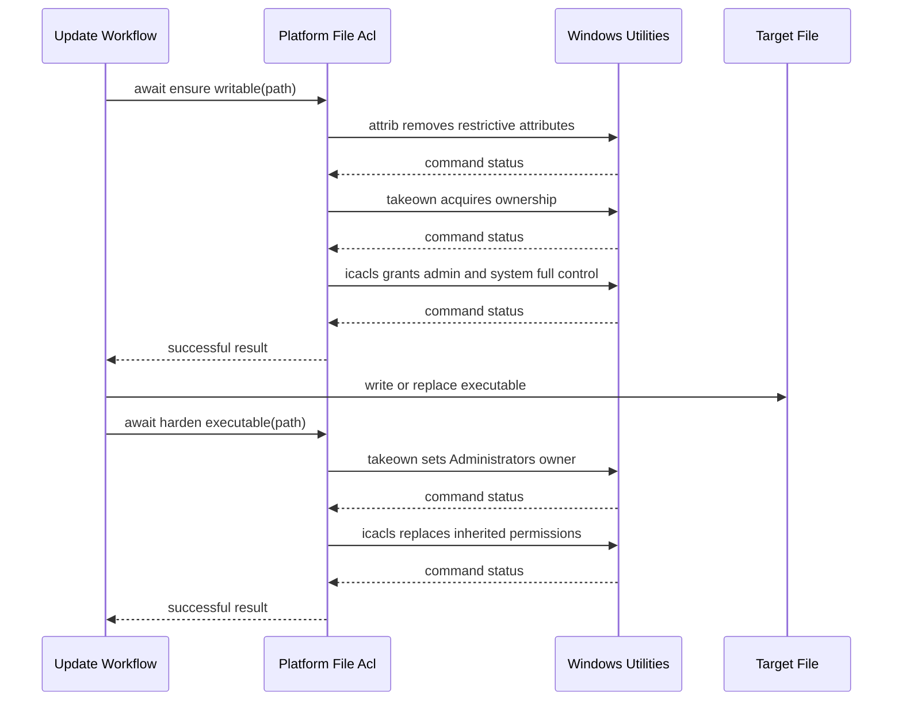

# Platform File Acl

Platform File Acl is a small, platform-specific security boundary in the OpenFrame client agent. It exposes two asynchronous operations: one prepares a filesystem target for administrative modification, and the other restricts an executable to the Windows system and Administrators principals while retaining read-and-execute access for Users.

The implementation is supplied by the `openframe_agent_lib` library from OpenFrame OSS Library and is executed by this repository's OpenFrame client runtime. Its source is [file_acl.rs](https://github.com/flamingo-stack/openframe-oss-lib/blob/7a766f00e4f58b5d89db007b878ac8d6e0c344f4/clients/openframe-client/src/platform/file_acl.rs).

## Scope and Responsibilities

Platform File Acl is intentionally narrow:

- **Prepare a target for mutation:** `ensure_writable` clears restrictive Windows attributes, attempts to take ownership recursively, and grants full control to the local Administrators and Local System security identifiers.
- **Harden a completed executable:** `harden_executable` attempts to make Administrators the owner, removes inherited access control entries, then replaces access with explicit system, administrator, and user permissions.
- **Preserve cross-platform call sites:** on non-Windows targets, both asynchronous functions return success without changing the filesystem.
- **Report partial operational failure:** unsuccessful command exit statuses are logged as warnings; they do not turn the operation into an error result.

It does not inspect authorization state, validate an executable's content or signature, create directories, or implement a transactional rollback of ACL changes.

## Architecture

The module delegates all operating-system changes to Windows command-line utilities through Tokio's asynchronous process API. It treats a command that cannot be launched differently from one that launches and exits unsuccessfully only in observability: both conditions allow the enclosing function to complete successfully, while only unsuccessful exit statuses produce warnings.

## Public Operations

| Operation | Windows behavior | Non-Windows behavior | Failure handling |
|---|---|---|---|
| `ensure_writable(path)` | Removes read-only, system, and hidden attributes recursively; attempts recursive ownership acquisition; grants Administrators and Local System full control recursively. | No operation. | Logs a warning if a launched command exits unsuccessfully, then returns success. Failure to spawn a utility is ignored. |
| `harden_executable(path)` | Attempts to set Administrators as owner; removes inherited ACL entries; replaces grants with full control for Local System and Administrators plus read-and-execute for Users. | No operation. | Logs a warning if a launched command exits unsuccessfully, then returns success. Failure to spawn a utility is ignored. |

Both APIs accept a `Path` reference and are asynchronous, so callers must await them. The `anyhow::Result` return type provides compatibility with asynchronous workflows, although the shown implementations do not propagate failures from the external commands.

## Windows Permission Semantics

### Preparing a Target for Writes

`ensure_writable` applies three best-effort stages in order:

1. **Clear file attributes.** It invokes `attrib` with options that remove read-only, system, and hidden attributes, including descendants and directories.
2. **Acquire ownership.** It invokes `takeown` for the supplied path, recursively, using the affirmative default response for prompts.
3. **Grant administrative write access.** It invokes `icacls` recursively, continuing on errors and operating quietly, to grant full control to:
   - `S-1-5-32-544`, the built-in Administrators group.
   - `S-1-5-18`, the Local System account.

This sequence is appropriate before an administrative update or replacement workflow needs to alter a protected file tree. It does not assert that every child was successfully changed; callers needing a hard guarantee must perform their own post-operation verification.

### Hardening an Executable

`harden_executable` applies a more restrictive final state:

1. `takeown /A` requests the Administrators group as the owner of the target.
2. `icacls` removes inherited ACL entries with `/inheritance:r`.
3. The same command replaces grants with the following explicit access rules:
   - Local System: full control.
   - Built-in Administrators: full control.
   - Built-in Users: read and execute.

The module therefore separates **mutable preparation** from **post-write hardening**. Calling the hardening operation before a replacement that requires ordinary writes can prevent that replacement from succeeding; a workflow that changes an executable should prepare or write the target before applying its final ACL.

## Permission Transition Flow

Warning logs are emitted after a launched command reports a non-success status. The sequence still proceeds to later stages, which means a later command can repair or override part of an earlier failed operation.

## Cross-Platform Contract

Conditional compilation selects the implementation at build time:

- On Windows, the functions use `tokio::process::Command` and `tracing` logging.
- On every other supported target, the parameters are deliberately unused and each function immediately returns `Ok(())`.

This gives higher-level agent code one API across operating systems without requiring Windows utilities to be present elsewhere. The no-operation behavior also means that platform-specific filesystem hardening must be provided by other modules if non-Windows enforcement is required.

## Operational Considerations

### Privileges and Environment

The Windows commands normally require sufficient privileges to change attributes, ownership, or ACLs. Platform File Acl does not elevate a process, prompt for credentials, or check whether the resulting permissions match the intended state. The caller is responsible for running in an appropriate administrative context and for deciding whether warnings are acceptable.

### Best-Effort Error Model

The functions succeed even when an invoked command returns a failing status. This makes cleanup and update flows resilient to partial filesystem problems, but it also means success from the Rust API does not prove that the ACL was changed. Operators should collect the warning logs and validate effective permissions when the security outcome is mandatory.

### Path Handling

The supplied path is converted with a lossy string conversion before being passed to Windows utilities and written to logs. Callers should supply a concrete path suitable for the local Windows command tools. The module does not canonicalize the path, verify that it exists, distinguish a file from a directory, or reject symbolic links.

## Maintainer Guidance

When evolving Platform File Acl:

1. Keep `ensure_writable` and `harden_executable` semantically distinct: the former enables administrative mutation, while the latter reduces the executable's write surface.
2. Preserve the non-Windows no-operation implementations unless the cross-platform contract is deliberately changed.
3. Treat command arguments and Windows security identifiers as security-sensitive implementation details. Changes can alter ownership and effective access across a recursive tree.
4. If a workflow requires an enforceable security boundary, add explicit verification or change the error policy at the caller or module level; warning-only behavior is not an assurance of compliance.
5. Test both command construction and behavior under access-denied, locked-file, and missing-utility conditions, because these conditions currently do not fail the API call.

## Relationship to the OpenFrame Client

Platform File Acl is part of the OpenFrame client platform layer within the OpenFrame OSS Library. In the broader tenant deployment, this repository publishes the OpenFrame client service and consumes the Rust `openframe_agent_lib` artifact. The module provides a local filesystem primitive for client maintenance workflows; it neither contacts OpenFrame services nor defines network routes.
