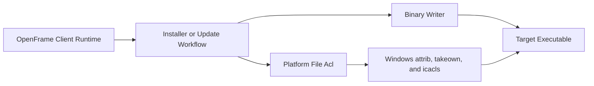
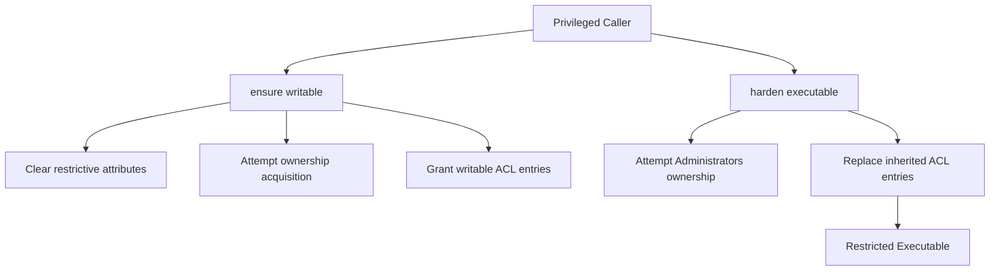
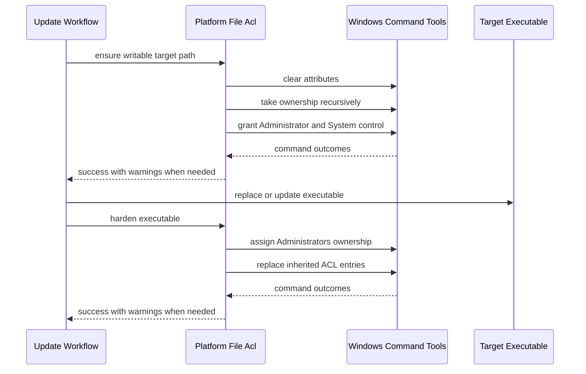
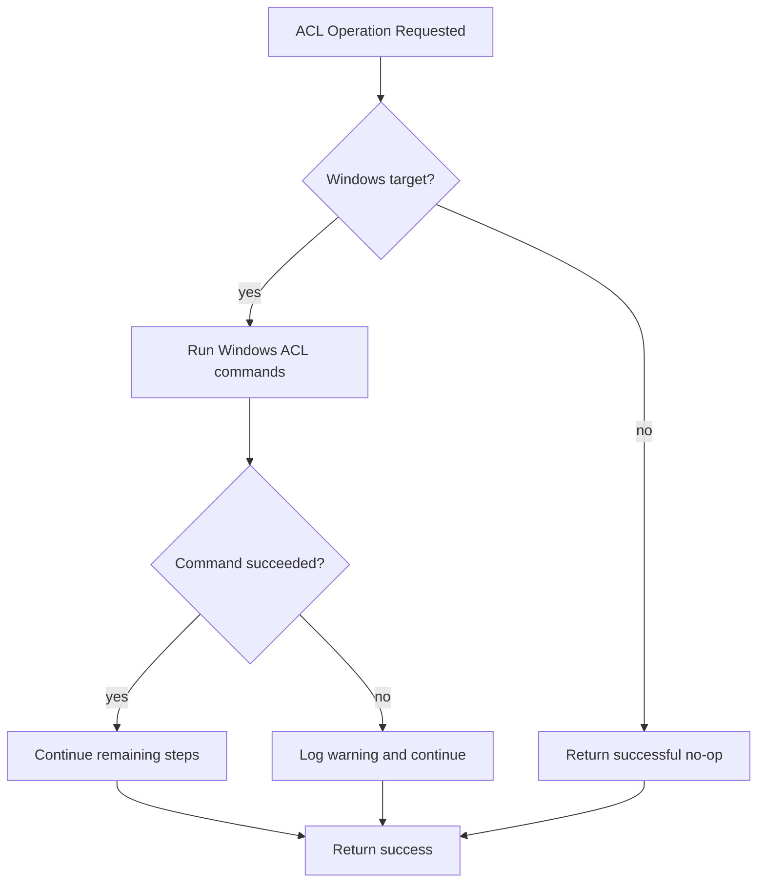

# Platform File Acl

Platform File Acl is a small, Windows-specific filesystem-permission boundary in the OpenFrame client agent. It makes a target path manageable before a privileged operation and then restricts an executable after it is placed. On non-Windows targets, both operations deliberately succeed as no-ops, allowing higher-level update and installation workflows to remain portable.

The implementation is supplied by the OpenFrame OSS Library's `openframe_agent_lib` artifact, which this repository consumes for the OpenFrame client runtime. Its source is [file_acl.rs](https://github.com/flamingo-stack/openframe-oss-lib/blob/16e7c1cbd9664e7d10ec5ebca7d53c9bd314decf/clients/openframe-client/src/platform/file_acl.rs).

## Responsibilities

| Operation | Windows behavior | Other operating systems |
| --- | --- | --- |
| `ensure_writable` | Clears restrictive file attributes, attempts ownership acquisition, and grants full control to Administrators and Local System across the target tree. | Returns success without modifying the path. |
| `harden_executable` | Attempts to make Administrators the owner, removes inherited ACL entries, and replaces permissions with explicit System, Administrators, and Users entries. | Returns success without modifying the path. |

The module does not create paths, write executable bytes, verify the final ACL, or decide which identity should execute the binary. Those concerns belong to its callers and adjacent platform services.

## Architecture and Placement

Platform File Acl is a platform utility within the Rust OpenFrame client. It is relevant wherever a Windows installer, updater, or tool-management operation must transition an executable between a writable maintenance state and a restricted runtime state.

The module has intentionally narrow dependencies:

- Rust standard library supplies `Path` for target-path input.
- `anyhow` supplies the fallible `Result` return type.
- Windows builds use Tokio's asynchronous process launcher to invoke operating-system tools and tracing to record progress or warnings.
- Non-Windows builds compile alternate implementations with the same asynchronous signatures and no Windows command dependency.

## Component Interaction

### `ensure_writable`

On Windows, `ensure_writable(path)` converts the supplied path to a lossy string for command-line use, emits an informational log entry, and runs the following best-effort steps:

1. `attrib -R -S -H /S /D` clears read-only, system, and hidden attributes for the target and its descendants.
2. `takeown /F <path> /R /D Y` attempts to take ownership recursively and automatically answers affirmative to ownership prompts.
3. `icacls <path> /grant *S-1-5-32-544:F *S-1-5-18:F /T /C /Q` grants full control recursively to the Administrators group and Local System.

The recursive flags mean this operation is appropriate only for a path tree intentionally managed by the client. It is not a general-purpose repair action for arbitrary user content.

### `harden_executable`

On Windows, `harden_executable(path)` logs its intent and applies a restrictive ACL to one executable path:

1. `takeown /F <path> /A` attempts to assign ownership to the built-in Administrators group.
2. `icacls <path> /inheritance:r /grant:r ...` removes inherited permissions and replaces explicit entries with:
   - Local System: full control.
   - Administrators: full control.
   - Built-in Users: read and execute access.

Using well-known SIDs avoids localization-dependent account names. The intended end state lets ordinary users run the executable but prevents them from modifying it, while service and administrative identities retain management access.

## Permission Transition Flow

The module is asynchronous because Windows commands are launched through Tokio. Callers should await each operation before proceeding to the dependent write or launch step; the module itself does not serialize or lock concurrent filesystem operations.

## Error Handling and Observability

Both functions return `Result<()>`, but Windows command failures are intentionally non-fatal in the current implementation:

- A command-launch failure is ignored because each invocation is evaluated only when an output is available.
- A command that exits unsuccessfully produces a warning identifying the target path.
- After attempting all relevant steps, the function returns success.

This makes Platform File Acl a best-effort compatibility and hardening layer rather than an enforcement point. A caller that requires a guaranteed permission state must independently validate access or the resulting ACL before treating an update as safe. Operational diagnosis relies on the informational start log and warnings from the `tracing` instrumentation.

## Platform Behavior

Compile-time conditional compilation selects the Windows implementation or the no-op implementation. Consequently, a non-Windows deployment neither invokes Windows tooling nor emulates Windows ACL semantics.

## Integration Guidance

Use Platform File Acl only around trusted agent-controlled installation locations and binaries:

- Call `ensure_writable` before replacing a protected executable or modifying a managed installation tree.
- Complete the write, replacement, or updater action before calling `harden_executable` on the final executable path.
- Ensure the invoking context has the necessary Windows privileges. The module logs unsuccessful attempts but does not elevate privileges or fail the workflow.
- Avoid treating a successful return as proof that permissions changed. Inspect the ACL when a workflow's security guarantee depends on hardening.
- Keep the writable window short. The first operation can grant broad management permissions recursively, while the second operation is the restrictive step.

Adjacent platform capabilities handle executable replacement, directory preparation, file-lock diagnostics, and general privilege management. Platform File Acl should remain focused on the narrow ACL transition and should not absorb those unrelated responsibilities.

## Security Considerations

The hardening policy is designed for a service-managed executable: System and Administrators can manage it, and Users can execute it. Removing inherited entries can also remove permissions that a custom installation location depended on, so callers must select an appropriate target and validate the application still starts under its intended service identity.

Conversely, the writable operation is broad and recursive. Passing an overly broad directory can change attributes, ownership, and access control on unrelated descendant files. Treat target-path selection as a privileged security boundary, normalize and validate paths before invoking the module, and never derive a managed path directly from untrusted input.
