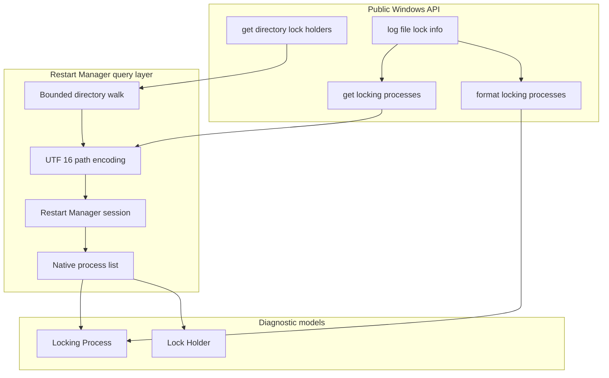
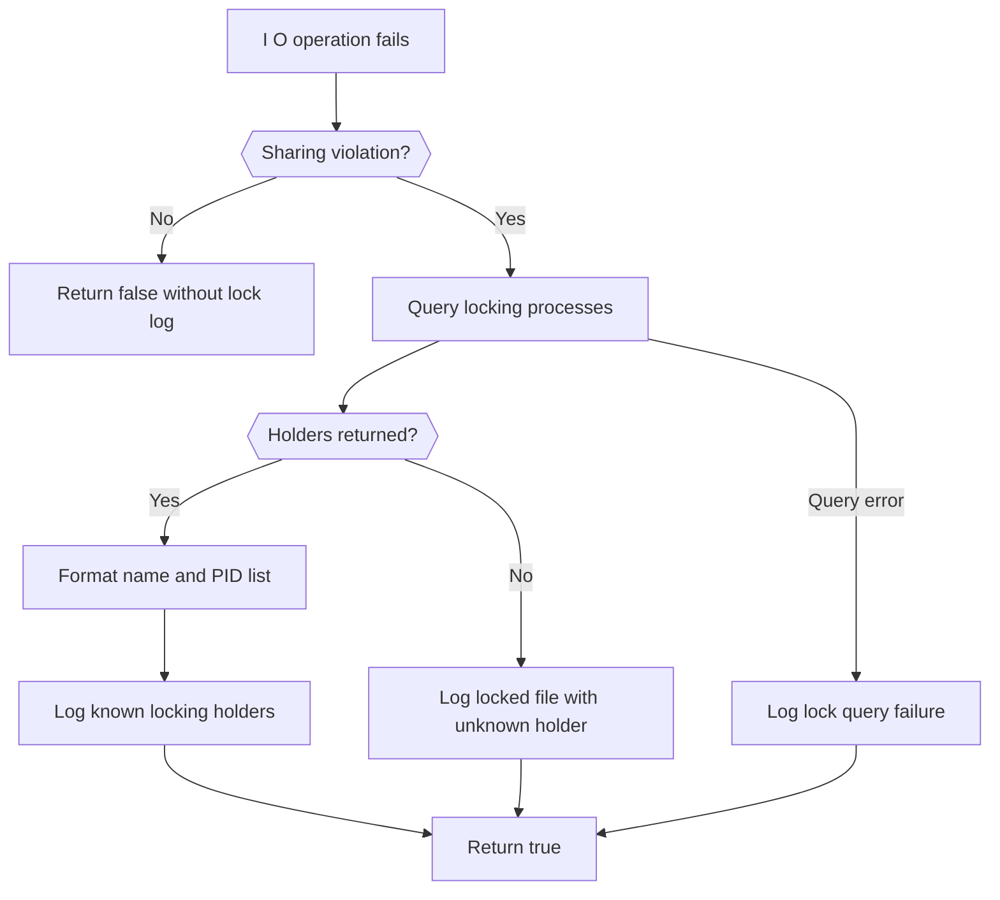
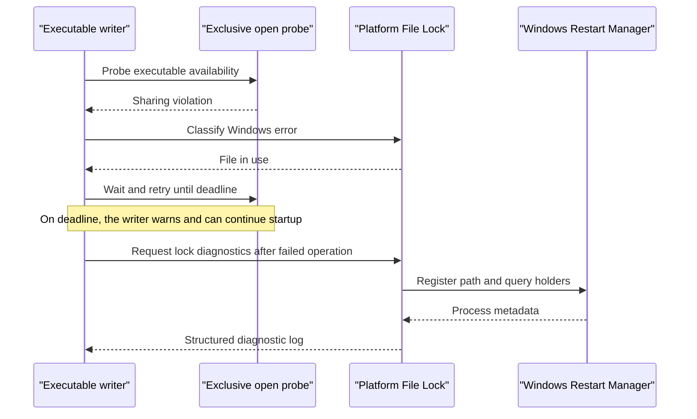

# Platform File Lock

Platform File Lock is the Windows-only diagnostic layer used by the OpenFrame client agent to explain sharing-violation failures. It asks the Windows Restart Manager which applications hold a target file or the contents of a directory, turns that data into compact diagnostic models, and writes actionable error logs. It identifies holders only; it does not stop, restart, or otherwise evict processes.

The implementation is supplied by the `openframe_agent_lib` Cargo dependency from OpenFrame OSS Library and runs in this repository's OpenFrame client distribution. Its source is [`file_lock.rs`](https://github.com/flamingo-stack/openframe-oss-lib/blob/7a766f00e4f58b5d89db007b878ac8d6e0c344f4/clients/openframe-client/src/platform/file_lock.rs).

## Scope and Platform Boundary

Every type and function in this module is compiled only when the Rust target OS is Windows. The code uses Windows Restart Manager APIs to open a session, register resources, and retrieve locking applications. Consequently, it is not a portable lock abstraction and it does not provide a fallback implementation on other targets.

The module recognizes a file-in-use error by the Windows sharing-violation code `32`. That narrow classification prevents ordinary I/O errors from triggering a Restart Manager query or being reported as lock contention.

## Architecture

The module has three layers:

| Layer | Components | Responsibility |
|---|---|---|
| Query infrastructure | `wide`, `decode_utf16`, `query_rm_holders` | Converts Rust paths to NUL-terminated UTF-16, owns the Restart Manager session lifecycle, registers resources, and maps native process records into Rust values. |
| Diagnostic models and queries | `LockingProcess`, `LockHolder`, `get_locking_processes`, `get_directory_lock_holders` | Presents either concise file-holder details or richer directory-holder metadata suitable for callers that need to make a safety decision. |
| Logging and presentation | `format_locking_processes`, `log_file_lock_info` | Formats known holders and emits a differentiated error message for identified, unidentified, or query-failure cases. |

### Restart Manager Session Handling

`query_rm_holders` is the internal shared query path. For a nonempty set of already encoded paths it:

1. Starts a Restart Manager session.
2. Installs a local drop guard so `RmEndSession` is attempted when the function leaves scope, including error paths.
3. Registers all paths in that one session.
4. Calls `RmGetList` once to determine capacity. The expected `ERROR_MORE_DATA` response is accepted at this stage.
5. Allocates `RM_PROCESS_INFO` records, retrieves the full list, and translates them to `LockHolder` values.

The translation preserves the process identifier, application name, raw application type, terminal-services session identifier, restartability flag, and optional service short name. The raw application type is intentionally retained; callers that need to judge whether a holder can safely be displaced can interpret Restart Manager classifications without a lossy conversion.

## Public Types and Functions

### Locking Process

`LockingProcess` is the concise result returned for a single file. It contains the holder's `pid` and `name`; its display representation is `name (PID: pid)`. `format_locking_processes` joins those representations with commas and returns `No processes detected` for an empty slice.

`get_locking_processes` accepts a file path string, runs the shared query for that one resource, and projects each rich native result down to `LockingProcess`.

### Lock Holder

`LockHolder` is the richer directory-query result. Its fields are:

| Field | Meaning |
|---|---|
| `pid` | Windows process identifier. |
| `app_name` | Restart Manager application name. |
| `app_type` | Raw Restart Manager application classification. The source notes that the critical classification value is `1000`. |
| `ts_session_id` | Terminal Services session identifier reported by Windows. |
| `restartable` | Whether Restart Manager reports that the application can be restarted. |
| `service_short_name` | Service name when Windows classifies the holder as a service; otherwise absent. |

`get_directory_lock_holders` recursively collects directory entries up to the internal cap of `1024` paths, registers the collected paths in one session, then sorts and deduplicates results by process identifier. A process holding several registered files therefore appears once in the returned collection. If no entries are collected, the directory path itself is registered as a fallback.

The path cap bounds a potentially expensive recursive scan and native registration request. It also means a directory query describes the discovered prefix of a large tree rather than guaranteeing coverage beyond `1024` entries.

## File Lock Diagnostic Flow

`log_file_lock_info` is intended to be called after an I/O operation fails. It first checks whether the error is the sharing violation that denotes a locked file. For a different error, it returns `false` and does nothing. For a sharing violation, it returns `true` after logging one of three outcomes: known holders, no holders returned, or a failed holder query.

This behavior keeps diagnosis best-effort. Failure to enumerate a holder does not replace the original I/O failure, and the module does not retry the underlying operation.

## Relationship to Client Update Handling

The module belongs to the Rust OpenFrame client runtime, not to a server endpoint or deployment service. Its primary responsibility is observability around Windows resource contention during local agent activity.

The adjacent executable-writing logic uses the same sharing-violation classifier when it probes whether an executable has become exclusively openable. It waits and polls while the error remains a sharing violation, warns if the configured wait limit expires, and otherwise proceeds. Platform File Lock provides the more detailed holder-enumeration and logging capability needed when an operation must explain a lock failure.

The module tree also includes process snapshots, update gating, tool updating, and binary writing. Those components address whether updates should run, how processes are managed, and how binaries are replaced. Platform File Lock deliberately does not make those policy decisions; it provides Windows holder evidence that such workflows can use for troubleshooting or safe-eviction decisions.

## Failure Semantics and Operational Notes

- Restart Manager failures are converted to descriptive `String` errors that identify the failed native step, such as session start, resource registration, list sizing, or list retrieval.
- Empty input to the internal query returns an empty holder collection without opening a native session.
- UTF-16 app and service buffers are decoded up to their first NUL terminator and converted lossily, so malformed native text cannot prevent diagnostics from being produced.
- Directory traversal ignores unreadable directories and entries whose file type cannot be obtained. This makes the query resilient but can reduce coverage when filesystem inspection is incomplete.
- The native session is cleaned up through the scoped guard even when a later step fails.
- The source includes tests only for Windows targets, matching the module's platform-specific API.

## Maintenance Guidance

When changing this module, preserve the distinction between detection, reporting, and remediation:

1. Keep Restart Manager session cleanup reliable on all return paths.
2. Do not broaden the error classifier without confirming that the additional Windows error represents lock contention.
3. Preserve the `1024` directory registration bound, or replace it with an explicitly bounded strategy, to avoid unbounded scans and oversized native calls.
4. Keep directory-result deduplication keyed by process identifier so one holder is not reported repeatedly for multiple files.
5. Treat holder metadata as diagnostic evidence. Any decision to close, restart, or terminate a process belongs to a higher-level update or tool-management workflow and must account for critical applications, services, restartability, and user sessions.
