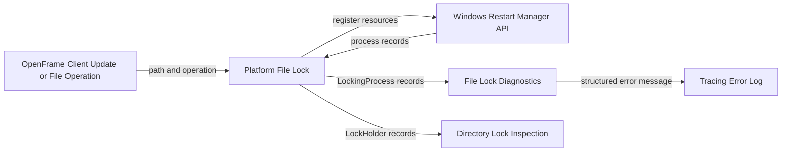
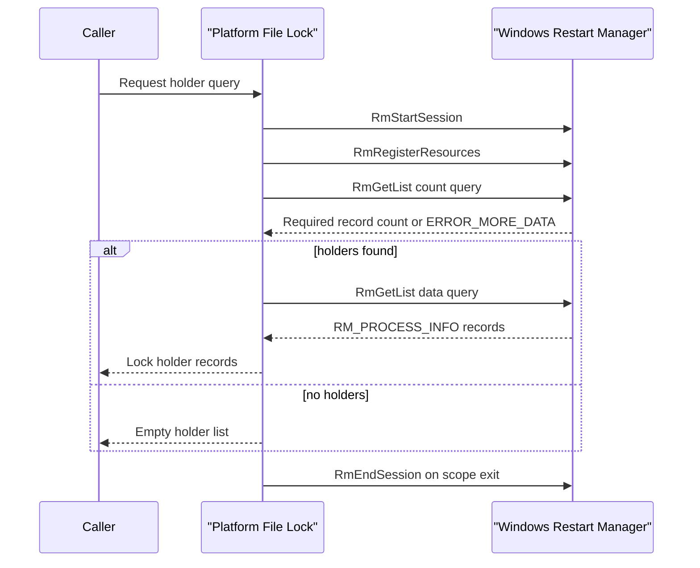
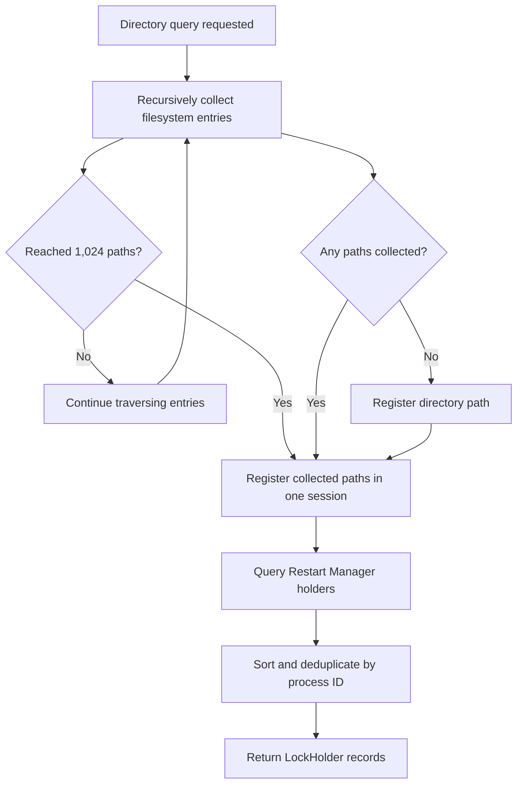
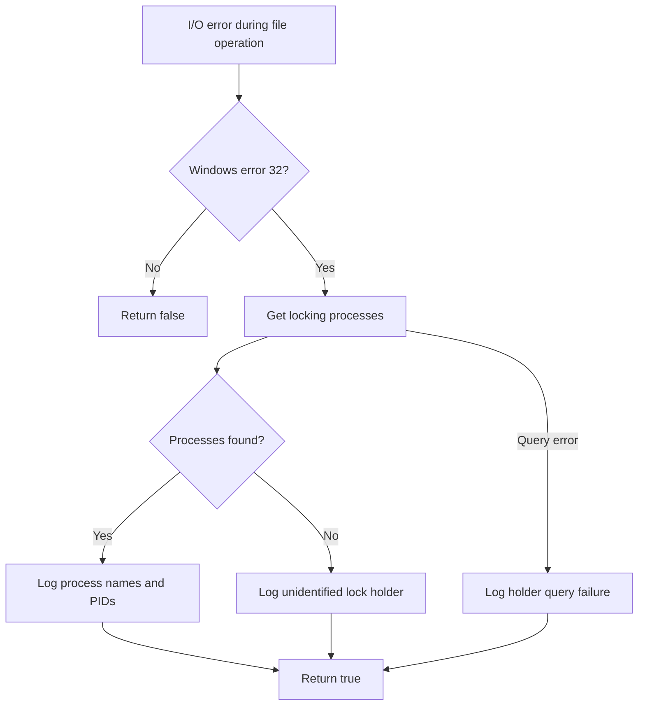

# Platform File Lock

Platform File Lock is the Windows-specific diagnostic layer used by the OpenFrame client agent to identify processes that prevent a file or installation directory from being changed. It wraps the Windows Restart Manager API, converts its process records into agent-friendly types, and emits actionable error logs for Windows sharing violations.

The implementation is supplied by the **OpenFrame OSS Library** through the `openframe_agent_lib` dependency used by this repository's client runtime. Its source is [file_lock.rs](https://github.com/flamingo-stack/openframe-oss-lib/blob/16e7c1cbd9664e7d10ec5ebca7d53c9bd314decf/clients/openframe-client/src/platform/file_lock.rs).

## Scope and Platform Boundary

Every public type and function in this module is compiled only when the Rust target OS is Windows. The module relies on the Windows Restart Manager functions `RmStartSession`, `RmRegisterResources`, `RmGetList`, and `RmEndSession`; it is therefore a diagnostic and holder-enumeration facility, not a cross-platform file-lock abstraction.

It has two complementary uses:

- **File-level diagnostics**: given a path that caused a sharing violation, identify the locking processes and log their names and process IDs.
- **Directory-level inspection**: enumerate regular files recursively under a directory, register them in one Restart Manager session, and return deduplicated holder records suitable for a caller that must decide how to proceed safely.

The module reports lock ownership only. It does not terminate processes, stop services, delete files, or perform an eviction. A caller must make any remediation decision from the returned `LockHolder` metadata.

## Architecture

### Internal Query Lifecycle

The shared internal query accepts NUL-terminated UTF-16 resource paths. It starts a Restart Manager session, registers all supplied paths, and obtains the holder list with the API's required two-call pattern:

1. The first `RmGetList` call determines the number of records. `ERROR_MORE_DATA` is expected at this stage; other errors fail the query.
2. If no records are required, the query returns an empty list.
3. The implementation allocates `RM_PROCESS_INFO` records and calls `RmGetList` again to retrieve holder data.
4. The fields are decoded into `LockHolder` values.
5. A local RAII guard calls `RmEndSession` as the query scope exits, including an error path after the session starts.

## Public Data Model

### Locking Process

`LockingProcess` is the compact representation returned by `get_locking_processes`. It contains:

| Field | Meaning |
|---|---|
| `pid` | Windows process identifier reported by Restart Manager. |
| `name` | Application name reported by Restart Manager. |

Its display representation is `name (PID: pid)`. `format_locking_processes` formats a slice of these records as a comma-separated list and returns `No processes detected` for an empty slice. This supports concise, human-readable error logging.

### Lock Holder

`LockHolder` preserves the additional data needed by higher-level code making a safety decision:

| Field | Meaning |
|---|---|
| `pid` | Holder process identifier. |
| `app_name` | Application name from Restart Manager. |
| `app_type` | Raw Windows Restart Manager application-type value. The implementation notes that `RmCritical` is `1000`. |
| `ts_session_id` | Terminal Services session identifier reported for the holder. |
| `restartable` | Whether Restart Manager reports the holder as restartable. |
| `service_short_name` | Service short name when Restart Manager classifies the holder as a service; otherwise absent. |

The presence of service and restartability information is intentional: directory queries provide richer context than the file-level diagnostic result and avoid forcing a caller to re-query the operating system before choosing a safe next step.

## Core Operations

### File Holder Lookup

`get_locking_processes(file_path)` converts one file path to Windows UTF-16, queries Restart Manager, and maps the resulting holders to `LockingProcess` values. This path deliberately discards the richer holder metadata because its consumer needs a concise lock-owner list for diagnostic output.

### Directory Holder Lookup

`get_directory_lock_holders(dir)` recursively collects paths beneath a target directory and registers the collected resources in a single Restart Manager session. Collection is bounded at **1,024** paths (`MAX_RM_FILES`) so a directory scan cannot produce an unbounded registration request. If no entries are collected, the directory path itself is registered, which preserves inspection for a directory containing only subdirectories or no readable files.

After querying, the results are sorted by process ID and deduplicated by process ID. A process that holds multiple registered files therefore appears once in the returned collection.

The recursive collector ignores directories that cannot be read and entries whose file type cannot be obtained. It stops descending once the file-registration cap is reached. Consequently, a directory query is a bounded diagnostic snapshot, not a proof that no lock exists outside the collected resource set.

### Sharing-Violation Logging

`log_file_lock_info(error, file_path, operation)` first checks whether the I/O error is Windows error `32` (`ERROR_SHARING_VIOLATION`). It returns `false` without logging for any other error. For a sharing violation, it queries holders and always returns `true` after issuing one of three error messages:

| Query outcome | Logged diagnostic |
|---|---|
| One or more holders | The operation, file path, and formatted application and PID list. |
| No holders reported | The file is locked but the locking process could not be identified. |
| Restart Manager query fails | The file is locked and the holder query error is included. |

## Integration and Operational Considerations

Platform File Lock runs inside the OpenFrame client agent supplied by the OpenFrame OSS Library. It is particularly relevant when an agent update, tool update, uninstall, or executable replacement encounters a Windows sharing violation. The module turns the opaque operating-system error into a diagnostic that names the locking application when Restart Manager can identify it.

The module depends on the following Windows behaviors and APIs:

- Path conversion through Windows UTF-16 encoding, including a terminating NUL code unit.
- Restart Manager session creation, resource registration, and holder enumeration.
- Windows I/O error code `32` to classify a file as being in use.
- `tracing::error` for structured error-level diagnostics.

Maintain these invariants when changing the implementation:

1. Keep all Windows-only code behind the appropriate target guard so non-Windows builds do not import Windows APIs.
2. End every successfully started Restart Manager session, including early returns and failures after startup.
3. Preserve the two-step `RmGetList` protocol and treat `ERROR_MORE_DATA` as expected only for the count query.
4. Retain bounded directory traversal and process-ID deduplication to keep directory checks predictable.
5. Treat holder information as diagnostic input. The module itself makes no claim that a process may safely be stopped or restarted.

## Error Semantics

The lookup functions return `Result` with a string error describing the failed Restart Manager operation, such as session creation, resource registration, count retrieval, or data retrieval. An empty successful list means the API did not report holders for the registered resources at query time; it does not change the original I/O error or guarantee that a subsequent file operation will succeed.

For support and troubleshooting discussions, use the OpenMSP Slack community rather than GitHub Issues or Discussions.