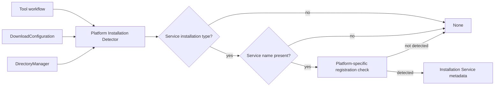
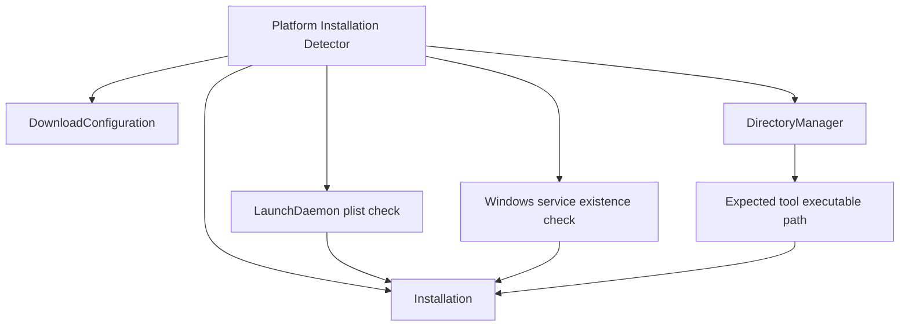
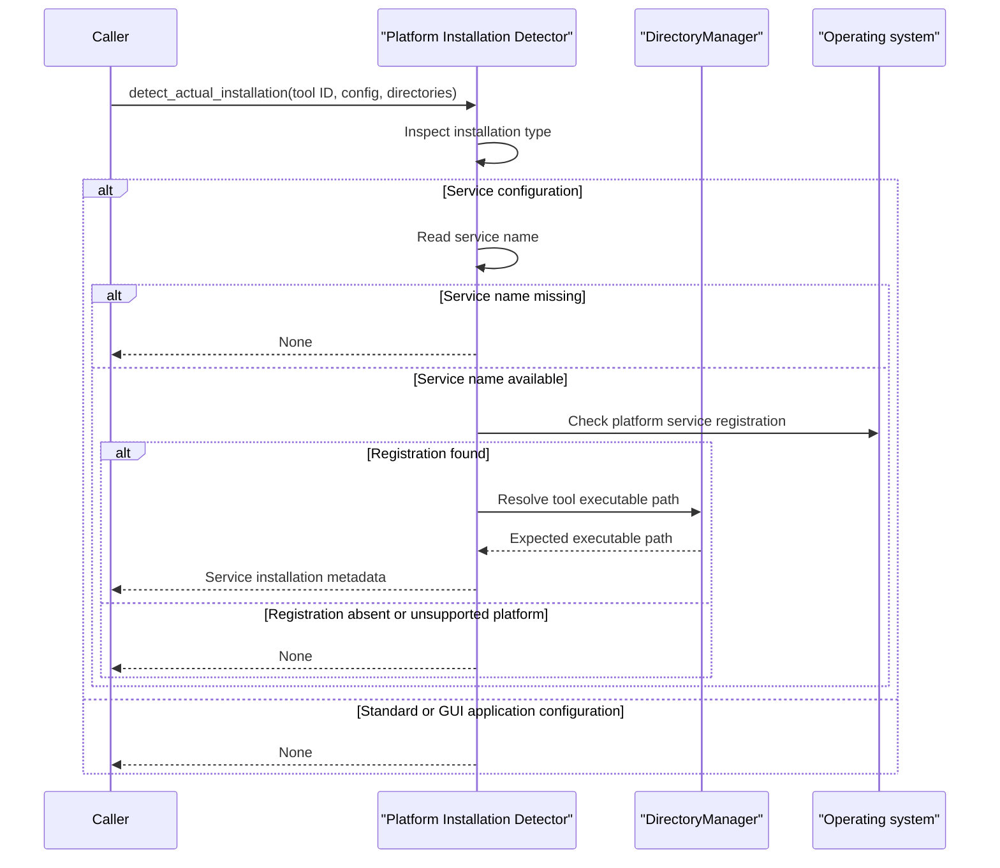

# Platform Installation Detector

Platform Installation Detector determines whether a requested integrated tool is already installed as a **service** on the current endpoint. It is a small, synchronous, platform-specific adapter in the Rust OpenFrame client runtime. Its single public function, `detect_actual_installation`, returns installation metadata only when the operating-system service registration can be positively identified; it does not install, start, stop, or modify software.

The implementation is supplied by the `openframe_agent_lib` Cargo dependency from the OpenFrame OSS Library, pinned by this repository at version `v0.0.5`. The OpenFrame client assembles and runs that library code. The implementation source is [installation_detector.rs](https://github.com/flamingo-stack/openframe-oss-lib/blob/16e7c1cbd9664e7d10ec5ebca7d53c9bd314decf/clients/openframe-client/src/platform/installation_detector.rs).

## Purpose and Contract

The module exposes this conceptual operation:

```rust
fn detect_actual_installation(
    tool_id: &str,
    config: &DownloadConfiguration,
    directory_manager: &DirectoryManager,
) -> Option<Installation>
```

Its inputs have distinct responsibilities:

| Input | Role in detection |
|---|---|
| `tool_id` | Identifies the tool for structured diagnostic logging and for resolving its managed executable path. |
| `DownloadConfiguration` | Supplies the installation classification, optional service name, and target file name. |
| `DirectoryManager` | Resolves the expected executable location in the client-managed tool directory. |

A successful result is `Some(Installation::Service { service_name, executable_path })`. Every unsupported installation type, absent service name, unsupported platform, or failed registration check results in `None`.

The detector recognizes only the `Service` installation variant. `Standard` and `GuiApp` are deliberate no-result paths, rather than generic filesystem scans. This keeps the function narrowly focused on validating service registration.

## Architectural Position

Platform Installation Detector sits between tool download metadata and host-specific service inspection. It reuses the platform directory abstraction to report a predictable executable path but does not alter the service manager or the filesystem.



### Collaborating Types

- **DownloadConfiguration** carries `installation_type`, `service_name`, and `target_file_name`, alongside download metadata such as the source file and target operating system. Platform Installation Detector uses the first three fields; it does not evaluate the configuration's operating-system field.
- **InstallationType** distinguishes `Standard`, `GuiApp`, and `Service`. Only `Service` is eligible for detection.
- **Installation** is the return model. The service variant preserves a service name and supports an optional executable path.
- **DirectoryManager** computes the expected per-tool executable path using the tool identifier and configured target filename.
- **System Service** supplies the Windows `service_exists` check. That helper treats a successful Windows service-status query as evidence that the named service exists.



## Detection Rules by Platform

| Build target | Service-registration evidence | Result when evidence exists | Result otherwise |
|---|---|---|---|
| macOS | A plist exists at `/Library/LaunchDaemons/{service name}.plist` | Service installation with the configured service name and computed executable path | `None` |
| Windows | The system-service helper can query the configured service successfully | Service installation with the configured service name and computed executable path | `None` |
| Unix other than macOS | No probe is implemented | `None` | `None` |
| Any platform for `Standard` or `GuiApp` | Not applicable | `None` | `None` |

The macOS implementation emits an informational tracing event that includes the tool identifier and plist path. Windows emits an analogous event with the service name. These logs record positive detection only.

## Detection Process

The decision sequence is intentionally short and has no side effects:



## Result Semantics and Limitations

A positive result establishes that a matching **service registration artifact** was found. It does not independently prove that the executable returned by `DirectoryManager` exists, is runnable, or is the binary registered with the service. The path is derived from client-managed directory conventions and `target_file_name` after registration is detected.

Likewise, a `None` result means only that this module did not establish a recognized service installation. It must not be treated as universal proof that the tool is absent, because:

- standard and GUI application installation types are intentionally not detected;
- non-macOS Unix builds intentionally have no service probe;
- macOS checks only the expected LaunchDaemon plist location; and
- Windows delegates to the service-status query through the system-service helper.

Callers that need process liveness, executable integrity, service state, or discovery of non-service applications should use the appropriate platform, process, directory, or tool-management capabilities rather than widening this detector's contract.

## Maintenance Guidance

When extending Platform Installation Detector, preserve the separation between **evidence collection** and **installation lifecycle management**:

1. Add an installation-type branch only when the returned `Installation` model can accurately describe its evidence.
2. Make each platform probe conditional at compile time so unsupported hosts retain a safe `None` result.
3. Require the minimum configuration needed by the probe before querying host state. For service detection, that is `service_name`.
4. Keep executable-path resolution delegated to `DirectoryManager`; avoid duplicating platform directory conventions in this module.
5. Document whether any new probe verifies a registration record, a file, a running process, or another distinct kind of evidence.

This approach lets higher-level tool installation and update workflows distinguish an observed service registration from an assumed or requested installation without performing destructive checks.
