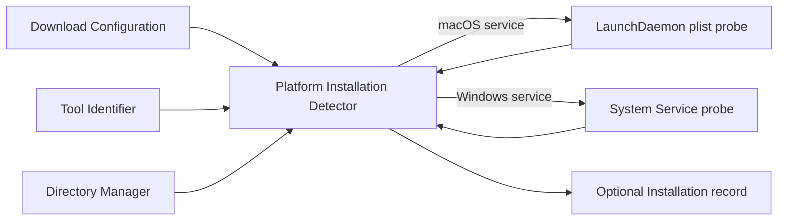
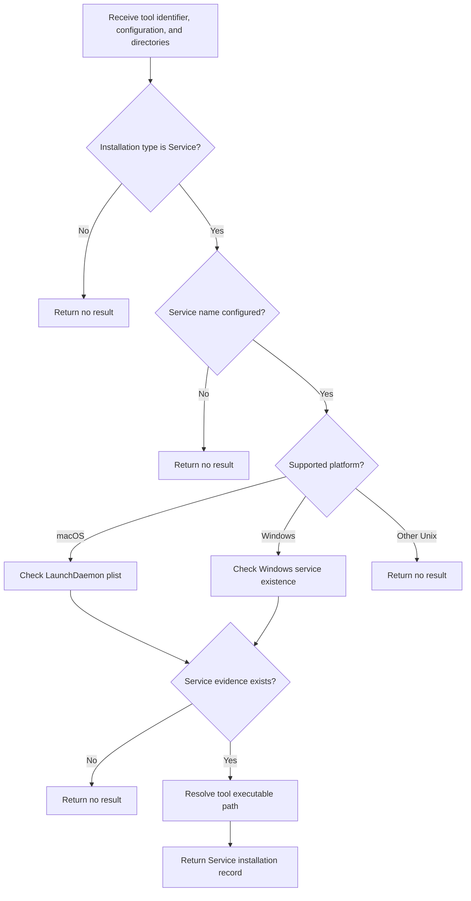
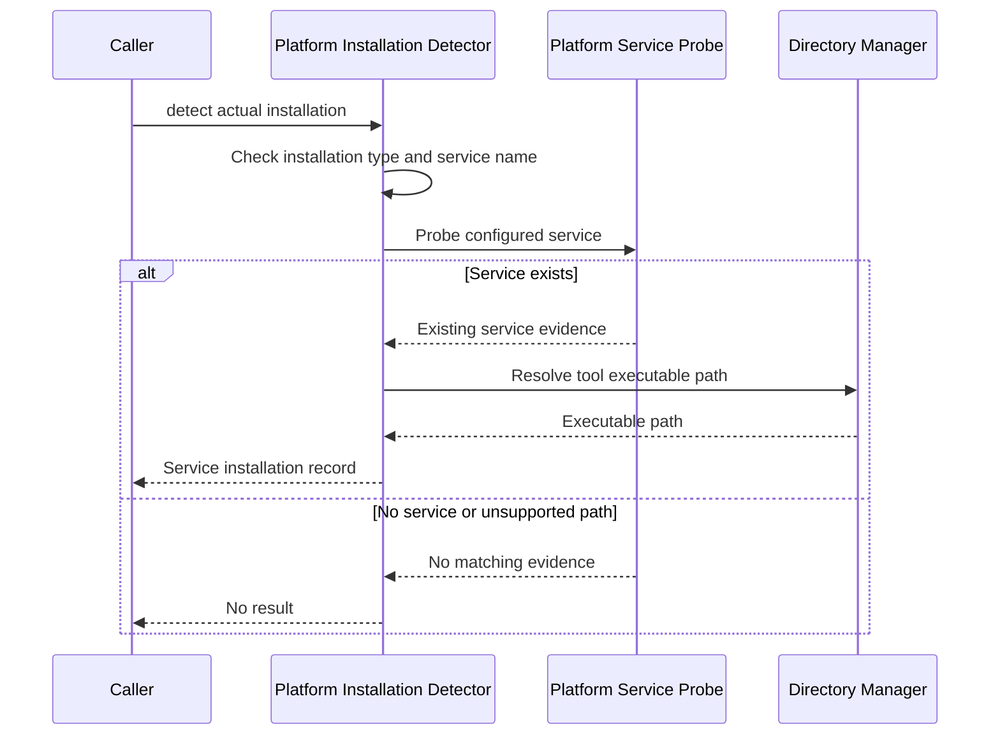

# Platform Installation Detector

Platform Installation Detector is a small, synchronous discovery component in the OpenFrame Client agent library. Before installation or update logic decides how to manage an integrated tool, it can use `detect_actual_installation` to recognize an already-installed **service** from operating-system evidence and represent that evidence as the shared `Installation` model.

The implementation is supplied by the `openframe_agent_lib` Cargo dependency from OpenFrame OSS Library, version `v0.0.5` in this repository. Its source is [installation_detector.rs](https://github.com/flamingo-stack/openframe-oss-lib/blob/7a766f00e4f58b5d89db007b878ac8d6e0c344f4/clients/openframe-client/src/platform/installation_detector.rs).

## Purpose and Scope

The module answers a deliberately narrow question: given a tool identifier, its selected download configuration, and the agent directory layout, is there evidence that the configured service is already installed on the local machine?

It does not install, start, stop, update, or remove services. It also does not inspect standard executable or GUI application installations. The supported detection behavior is platform-specific:

| Installation type | Result |
| --- | --- |
| Service on macOS | Detects a LaunchDaemon property-list file named from the configured service name. |
| Service on Windows | Asks the system-service layer whether the configured Windows service exists. |
| Service on other Unix platforms | Returns no detection result. |
| GUI application | Returns no detection result. |
| Standard installation | Returns no detection result. |

A missing `service_name` is treated as insufficient information, so service detection returns no result rather than guessing a service identity.

## Public Interface

`detect_actual_installation` accepts three inputs:

| Input | Role |
| --- | --- |
| `tool_id` | Identifies the tool for structured diagnostic logging and for resolving its managed executable location. |
| `DownloadConfiguration` | Supplies the declared installation type, target file name, and optional service name. |
| `DirectoryManager` | Resolves the executable path within the agent-managed directory layout. |

The function returns `Option<Installation>`:

- `Some(Installation::Service)` means platform evidence confirms the configured service exists.
- `None` means the configuration is unsupported by this detector, lacks a service name, or has no matching local evidence.

When detection succeeds, the `Installation::Service` record includes the configured service name and an executable path calculated from `DirectoryManager`. The path is metadata derived from the agent layout; it is not independently validated by this module.

## Architecture

Platform Installation Detector sits between declarative tool download metadata and platform-specific service probes. It normalizes a positive probe into the common installation representation used by the client agent.

### Model and Platform Dependencies

The detector uses these library components:

- `DownloadConfiguration` identifies the target operating system, desired installation type, target file name, source link, optional bundle identifier, and optional service name.
- `InstallationType` selects the detection branch. Its variants are `Standard`, `GuiApp`, and `Service`.
- `Installation` is the common result type. This module emits only the `Service` variant.
- `DirectoryManager::get_tool_executable_path` resolves an absolute target file name unchanged. For a relative target file name, it resolves beneath the per-tool application-support directory.
- On Windows, `system_service::service_exists` delegates to the Windows service-status query and interprets a successful query as existence.

## Detection Flow

### macOS Evidence

On macOS, the service name is used to construct a path under `/Library/LaunchDaemons` with a `.plist` suffix. If that file exists, the module logs the discovery at information level and returns an `Installation::Service` result.

This is a presence check only. The module does not parse the property-list contents, confirm that the service is loaded, or verify that its configured executable matches the resolved tool path.

### Windows Evidence

On Windows, the detector calls the platform system-service helper with the configured service name. A positive response logs the discovery at information level, resolves the managed executable path, and returns an `Installation::Service` result.

The detector relies on the platform helper for Windows service lookup details. It does not start a service or inspect its configuration.

## Result Construction and Data Flow

The resulting service record has two fields:

| Field | Source | Meaning |
| --- | --- | --- |
| `service_name` | `DownloadConfiguration.service_name` | The configured service identity that matched the platform probe. |
| `executable_path` | `DirectoryManager` and `target_file_name` | The expected managed executable location associated with the tool identifier. |

## Integration Boundaries

The detector belongs to the Rust OpenFrame Client runtime, while this repository packages the runtime as part of the tenant platform. It is relevant to tool lifecycle behavior because tools can be represented as service, GUI application, or standard installations.

The surrounding client library also contains platform service controls, directory management, tool update strategies, and installed-tool persistence. Those components are separate responsibilities:

- Platform service controls manage service lifecycle operations.
- Directory management owns filesystem layout and path calculation.
- Tool update code determines update and migration behavior.
- Installed-tool services retain lifecycle state.

Platform Installation Detector contributes only an observed installation classification. Callers must decide whether and how to persist the result or take a lifecycle action.

The code-graph snapshot used for this documentation reports no indexed direct callers or tests for `detect_actual_installation`. That means its behavior should be preserved and exercised with focused tests before expanding or changing its detection contract.

## Operational Characteristics

- **Synchronous and local:** Detection performs only local filesystem or operating-system service checks; it makes no network calls.
- **Conservative:** A result is produced only for an explicitly configured service on macOS or Windows with positive platform evidence.
- **Safe fallback:** Unsupported installation types and platforms return no result rather than attempting heuristics.
- **Observable success path:** Positive macOS and Windows detections create information-level log entries tagged with the tool identifier.
- **No state mutation:** The function does not write configuration, alter service state, or create directories.

## Maintenance Guidance

When extending Platform Installation Detector:

1. Keep `InstallationType` dispatch explicit so each installation mode has an intentional contract.
2. Require configuration data that is necessary for a trustworthy probe, especially service identity.
3. Ensure a positive probe produces a result compatible with the shared `Installation` model.
4. Preserve the distinction between discovered platform evidence and executable-path verification.
5. Add platform-gated tests for positive, absent, missing-service-name, and unsupported-type cases.
6. If support is added for standard or GUI applications, use platform evidence appropriate to that installation mode instead of inferring it from the managed directory alone.
