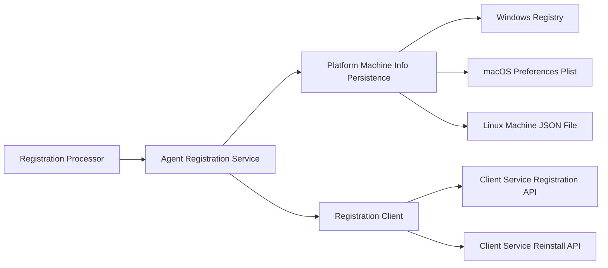
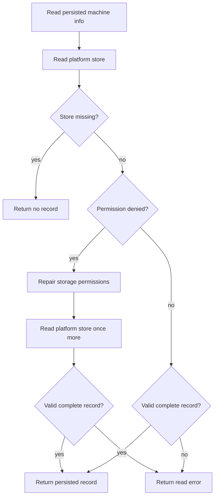
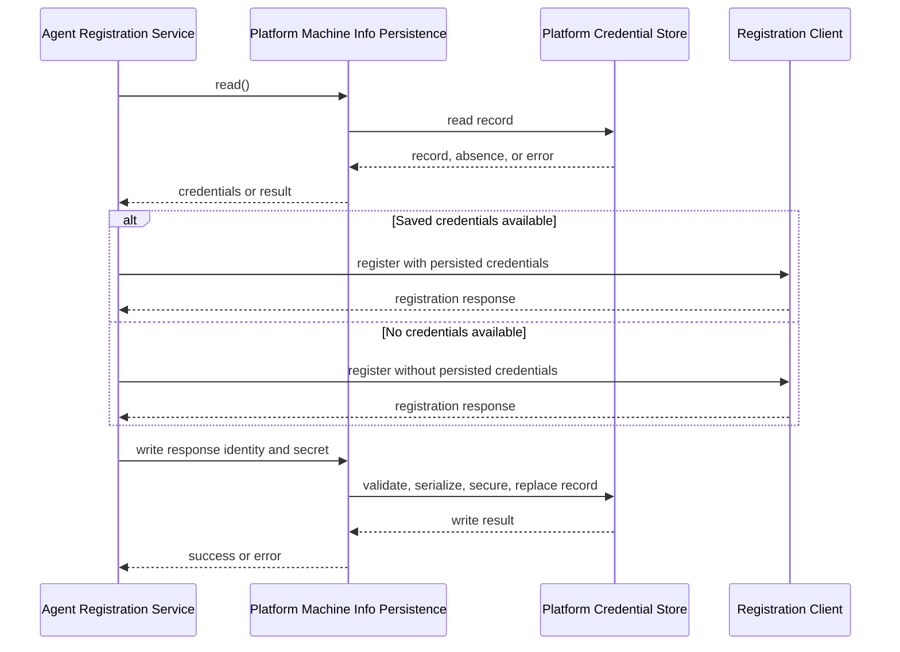

# Platform Machine Info Persistence

Platform Machine Info Persistence preserves an OpenFrame client registration identity across an uninstall and later reinstall. It is implemented by the `openframe_agent_lib` dependency from OpenFrame OSS Library and is run by the Rust client assembled in this repository. The module stores a single JSON record containing the machine identifier, client secret, and an optional user identifier; it is intentionally separate from ordinary runtime configuration.

The implementation is in [machine info persistence source](https://github.com/flamingo-stack/openframe-oss-lib/blob/16e7c1cbd9664e7d10ec5ebca7d53c9bd314decf/clients/openframe-client/src/platform/machine_info_persistence.rs).

## Responsibilities and boundaries

The module has a deliberately small API:

| Component | Responsibility |
| --- | --- |
| `PersistedMachineInfo` | Serializable registration record containing `machine_id`, `client_secret`, and optional `user_id`. Its custom debug implementation redacts the client secret. |
| `write` | Validates mandatory fields, then replaces the platform-specific stored record. |
| `read` | Returns a valid record, reports an absent store, or returns an error when an existing store cannot be trusted. It retries once after repairing recognized permission failures. |
| `is_permission_denied` | Searches an `anyhow` error chain for an underlying operating-system permission-denied error. |

This module does not register an agent, mint credentials, or publish machine data. Those behaviors belong to the client registration and configuration services. Its responsibility is local, durable custody of the credential pair needed to request the reinstall path.

## Stored data and validity rules

`machine_id` and `client_secret` are required and cannot be empty after trimming. `user_id` is optional; deserialization defaults it to absent so records created before that field was introduced remain readable. The record is JSON encoded, but its storage carrier is platform dependent.

| Platform | Location | Record carrier | Access protection |
| --- | --- | --- | --- |
| Windows | `HKLM\SOFTWARE\OpenFrame` | `MachineInfo` registry string value | A protected DACL grants full control only to Administrators and SYSTEM. |
| macOS | `/Library/Preferences/com.openframe.client.plist` | `MachineInfo` plist key | The plist is changed to mode `0600` and verified not to expose group or other permissions. |
| Linux | `/etc/openframe/machine.json` | One JSON file | Directory mode is `0700`; record file mode is `0600`. |

The client secret is credential material. It is redacted from debug output, protected by the platform-specific storage controls, and must not be copied into diagnostics or logs.

## Architecture and dependencies

Platform Machine Info Persistence sits between agent registration and operating-system storage. Registration consults the record before choosing a fresh registration or reinstall request; a successful registration refreshes the record with the returned identity and secret.

The verified registration integration has two important layers:

1. The registration processor skips registration when ordinary agent configuration already holds a machine identifier. Otherwise it invokes the registration service and retries failed registration attempts.
2. The registration service calls `read` through a bounded retry loop. A recovered record is supplied to the registration client, which selects the reinstall API and sends the stored machine identifier and client secret as request headers. If no record is available, the registration client selects the fresh registration API. After either successful response, the service attempts to persist the response identity for a future reinstall and saves registration data to normal agent configuration.

The persistence record is therefore a reinstall continuity mechanism, not a general source of truth for every client startup.

## Read and repair behavior

The read contract distinguishes an absent store from an unsafe store:

| Condition | `read` result | Registration implication |
| --- | --- | --- |
| Store location does not exist | `Ok(None)` | A fresh registration may proceed. |
| Store exists and contains a valid, complete record | `Ok(Some(...))` | Registration can use the reinstall flow. |
| Store exists but its record is missing, malformed, incomplete, locked, or otherwise unreadable | `Err(...)` | The condition is not treated as a clean absence by this module. |
| An underlying permission-denied error is detected | Repair permissions, then retry once | The second read result determines the outcome. |

The agent registration service adds resilience above this boundary: it retries persistence reads using configured delays, then logs the terminal error and falls back to fresh registration if the retries are exhausted. That fallback is a caller policy, not an assertion that the local store was absent or valid.

On macOS, the implementation probes direct file readability before invoking `defaults`. This preserves a concrete permission-denied error that can trigger the repair path, rather than relying on a generic subprocess failure.

## Write behavior and durability

Before any platform write, `write` rejects incomplete input so it cannot create a record that `read` would subsequently reject. It overwrites the existing record only after serialization succeeds.

Linux uses the strongest explicit durability sequence: create or secure the directory, write a `0600` temporary file, synchronize file data, rename the temporary file into place, then make a best-effort directory synchronization. This avoids presenting a partially written `machine.json` after a normal replacement interruption.

Windows writes a single registry string after securing the OpenFrame registry key. macOS writes the complete value with `defaults`, then immediately restricts and verifies plist permissions. If macOS security tightening fails, the implementation attempts to delete the plist instead of knowingly leaving a readable client secret.

A persistence failure after registration is logged by the registration service; registration data is still saved to the agent configuration service. The practical consequence is that the current installation can continue while a later uninstall and reinstall may not have the saved credentials needed for the reinstall route.

## Security and maintenance considerations

- Preserve the complete-record validation whenever the schema changes. New optional fields should remain backward compatible through serde defaults where appropriate.
- Do not derive or add a debug formatter that prints `client_secret`.
- Keep storage operations privileged and avoid broadening Windows registry ACLs, macOS plist modes, or Linux directory and file modes.
- Treat an existing but invalid record as an operational problem, not as harmless absence. This distinction prevents silent acceptance of partial writes or corrupted credentials.
- Maintain the read-repair-retry sequence for recognizable permission failures. The repair functions are platform-specific because the Windows ACL, macOS mode bits, and Linux directory and file modes differ.
- When changing Linux write logic, retain the temporary-file, synchronization, and rename pattern to preserve replacement safety.

## Operational outcomes

A healthy reinstall begins with a readable, complete persisted record and reaches the reinstall registration API. A first installation, or a confirmed missing store, reaches the fresh registration API. Corruption and access failures remain visible through errors and caller logs, while platform permission failures receive one local repair attempt before they are surfaced to the caller.
