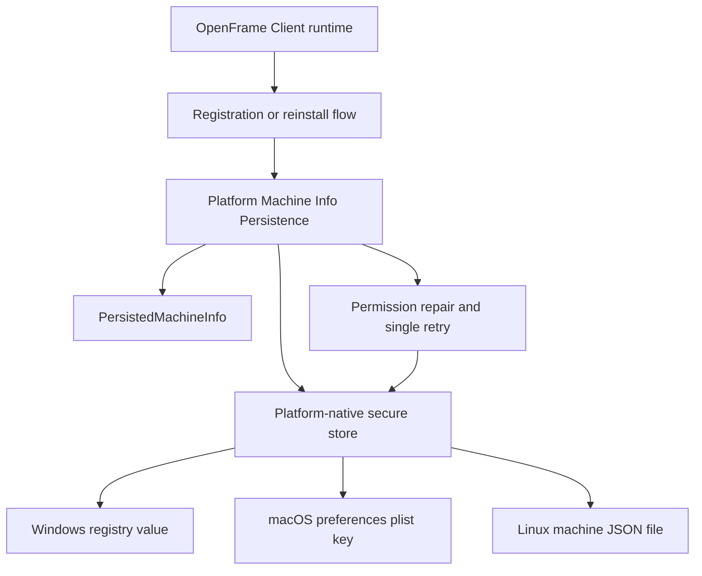
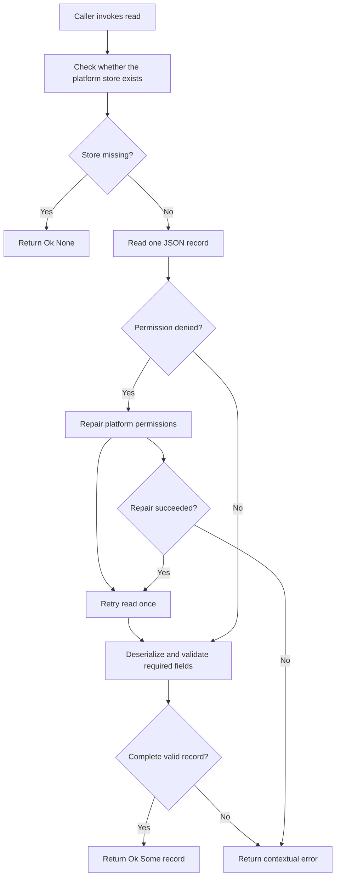
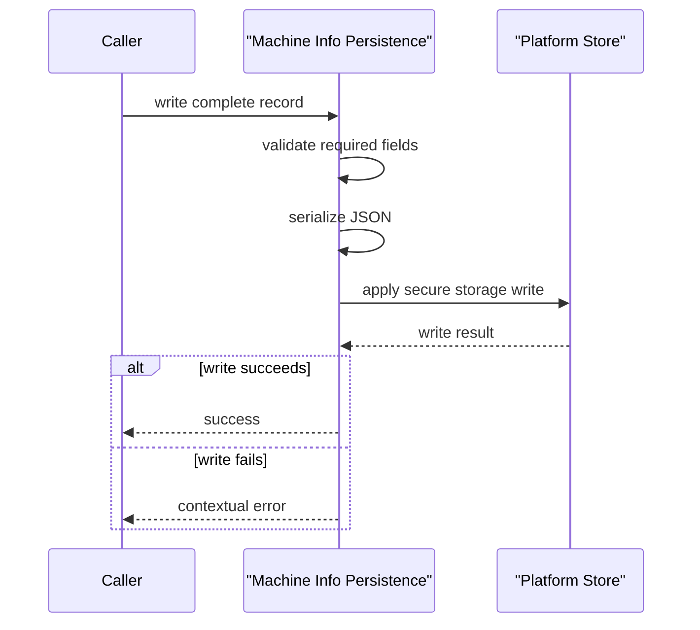

# Platform Machine Info Persistence

Platform Machine Info Persistence preserves an OpenFrame Client registration identity across uninstall and reinstall cycles. It is implemented by the `machine_info_persistence.rs` platform module in the OpenFrame OSS Library and is assembled into this repository's OpenFrame Client runtime through the `openframe_agent_lib` dependency.

The module stores only the information needed to recognize a previously enrolled endpoint: a machine identifier, the associated client secret, and an optional user identifier. It deliberately treats a missing store differently from an unreadable, incomplete, or corrupted store: only confirmed absence permits a caller to proceed as a fresh installation.

**Implementation source:** [OpenFrame OSS Library: Machine Info Persistence](https://github.com/flamingo-stack/openframe-oss-lib/blob/7a766f00e4f58b5d89db007b878ac8d6e0c344f4/clients/openframe-client/src/platform/machine_info_persistence.rs)

## Responsibilities and Boundaries

The module provides a small persistence boundary rather than registration or authentication behavior itself.

| Responsibility | Implementation |
|---|---|
| Represent reusable registration data | `PersistedMachineInfo` holds `machine_id`, `client_secret`, and optional `user_id`. |
| Validate persisted identity | `ensure_complete` rejects blank machine identifiers and client secrets on both write and read. |
| Store one platform-native record | The record is JSON, stored in a Windows registry value, macOS plist key, or Linux file. |
| Preserve confidentiality | Debug rendering redacts the client secret and each platform implementation applies restrictive access controls. |
| Recover from denied reads | `read` detects permission-denied errors in the error chain, repairs store permissions, and retries once. |
| Prevent unsafe fallback | Existing-but-empty, invalid, partial, locked, or unreadable storage returns an error instead of appearing as a new machine. |

The module does not generate a machine identifier, acquire credentials, enroll the client, or publish device state. Those concerns remain with the client registration, configuration, and authentication services. Its contract is local and synchronous: callers supply a complete record to `write` or receive an optional complete record from `read`.

## Data Model and Invariants

`PersistedMachineInfo` is cloneable and JSON serializable. Its three fields have different validity rules:

| Field | Required | Persistence behavior | Security consideration |
|---|---:|---|---|
| `machine_id` | Yes | Must contain non-whitespace text. | Identifies the device registration to reuse. |
| `client_secret` | Yes | Must contain non-whitespace text. | Never exposed by the manual `Debug` implementation. |
| `user_id` | No | Omitted from JSON when absent and defaults to absent when reading older JSON. | Supports compatibility with records written before this field existed. |

The required-field invariant is applied before any write and after JSON deserialization. Therefore, the module cannot create a persisted record that it would subsequently reject as incomplete. It accepts older valid records lacking `user_id`, but does not accept blank required fields.

## Architecture

The platform-specific implementations share the same public behavior but use operating-system-native locations and permission models:

| Platform | Store location | Record slot | Protection and write behavior |
|---|---|---|---|
| Windows | `HKLM\SOFTWARE\OpenFrame` | `MachineInfo` string value | The key DACL is restricted to Administrators and SYSTEM, then the JSON value is written in one registry operation. |
| macOS | `/Library/Preferences/com.openframe.client.plist` | `MachineInfo` plist key | `defaults write` records the JSON string; the file is then restricted to mode `0600` and verified. If securing it fails, the file is removed. |
| Linux | `/etc/openframe/machine.json` | Entire JSON file | The directory is set to mode `0700`; a mode `0600` temporary file is written, synchronized, and renamed into place. |

## Public API

### `PersistedMachineInfo`

The public record is the sole payload type for storage. Its manual debug implementation always displays `client_secret` as redacted, allowing diagnostic messages to safely include the record without revealing a live credential.

### `write`

`write` overwrites the prior persisted record. It first verifies both required strings, serializes the record to JSON, and delegates to the active platform implementation. Successful writes emit an informational log message without logging the data itself.

A write failure is returned with contextual error text. On macOS, a failure to make the created plist private is also a failure of the overall operation; the module removes the plist rather than leaving its secret readable by group or other users.

### `read`

`read` distinguishes three meaningful outcomes:

| Result | Meaning | Expected caller behavior |
|---|---|---|
| `Ok(Some(info))` | A complete, valid record was found. | Reuse its registration identity during reinstall. |
| `Ok(None)` | The backing store is confirmed absent. | A fresh registration is safe. |
| `Err(error)` | The store exists but is inaccessible, malformed, incomplete, locked, or otherwise unreadable. | Surface or handle the error; do not silently treat the endpoint as new. |

On the first permission-denied error, `read` repairs permissions for the applicable store and repeats the read once. A failure after repair is returned with context; it does not loop indefinitely or downgrade to `None`.

### `is_permission_denied`

`is_permission_denied` scans the full `anyhow` error chain for an underlying `std::io::Error` whose kind is `PermissionDenied`. This permits the recovery branch to work even when filesystem or registry failures have been wrapped with contextual messages. macOS first opens the plist directly so an access denial is represented as an I/O permission error rather than an opaque failed `defaults` subprocess result.

## Read Flow and Failure Semantics

The absence check is intentionally strict. A present directory, registry key, or plist that lacks the expected record is considered evidence of a partial or corrupt write, not an empty installation state. Invalid JSON and records with empty required values are likewise errors. This protects registration continuity by avoiding accidental duplicate enrollment when a previous identity may still exist but cannot be safely recovered.

## Write Flow and Durability

Platform handling adds important safeguards:

- **Windows:** The registry key is secured before the JSON value is written. The DACL is protected from inheriting broader parent permissions and grants full control only to Administrators and SYSTEM.
- **macOS:** The code writes a single plist key, then immediately applies and verifies owner-only permissions. It deletes the plist if this security step cannot be completed.
- **Linux:** The write path creates the configuration directory if needed, applies restrictive directory permissions, writes and synchronizes a temporary file, renames it over the record, and makes a best-effort directory synchronization after rename.

## Permission Recovery by Platform

| Platform | Repair action before retry | Notes |
|---|---|---|
| Windows | Opens the OpenFrame registry key with full access and reapplies the restrictive DACL. | Repair requires access sufficient to modify the registry key security descriptor. |
| macOS | Reapplies and verifies mode `0600` when the plist exists. | Direct readability probing enables detection of a permission-denied condition before calling `defaults`. |
| Linux | Restores `/etc/openframe` to mode `0700` and `machine.json` to mode `0600` when they exist. | Permission repair is attempted only after a detected denied read. |

Permission recovery is narrowly scoped to accessibility. It does not attempt to repair malformed JSON, restore missing records, or infer missing credentials.

## Security and Maintenance Considerations

1. Treat `client_secret` as a durable credential. Do not add logging, display formatting, telemetry, or error messages that expose its serialized value.
2. Preserve the distinction between absent storage and invalid storage when changing platform back ends. Returning `None` for a corrupt or partial store would allow an unsafe fresh registration path.
3. Keep validation compatible with old records: `user_id` is optional specifically so persisted JSON created before that field was added remains readable.
4. Preserve atomicity semantics on new platforms. The Linux implementation demonstrates the desired sequence of temporary write, data synchronization, and replacement; registry and plist implementations each use one logical record write.
5. When changing filesystem paths, registry locations, or plist domains, plan a migration that maintains access control and does not silently discard existing credentials.
6. Test error chains, not only direct I/O failures, when modifying permission handling because the public detector intentionally supports contextual wrapping.

## Operational Outcomes

During a reinstall, a valid persisted record allows the registration layer to identify the endpoint and reuse its stored credentials. If no platform store exists, the caller can register a new identity. If the store is present but unhealthy, this module fails closed: intervention is required rather than risking an unintended replacement identity or exposing a client secret through weak permissions.
