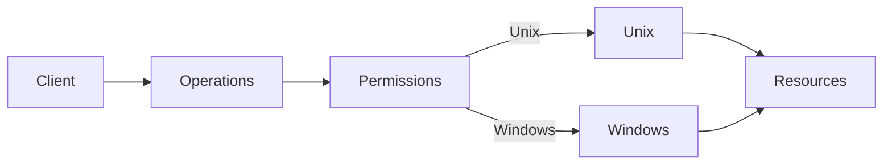
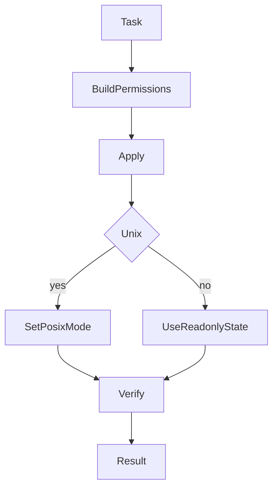
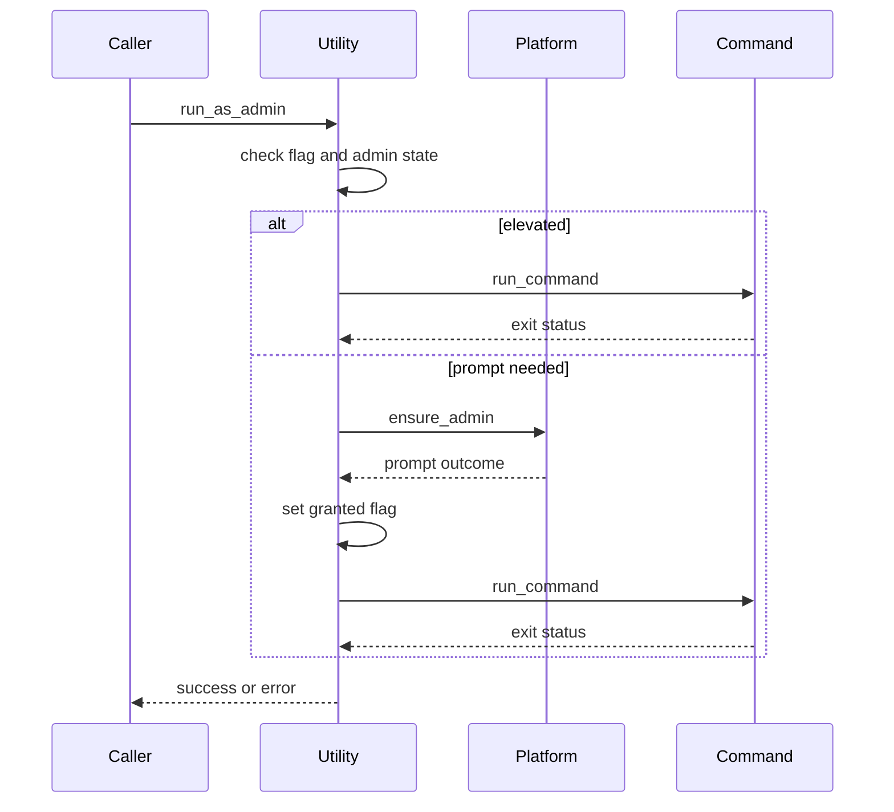
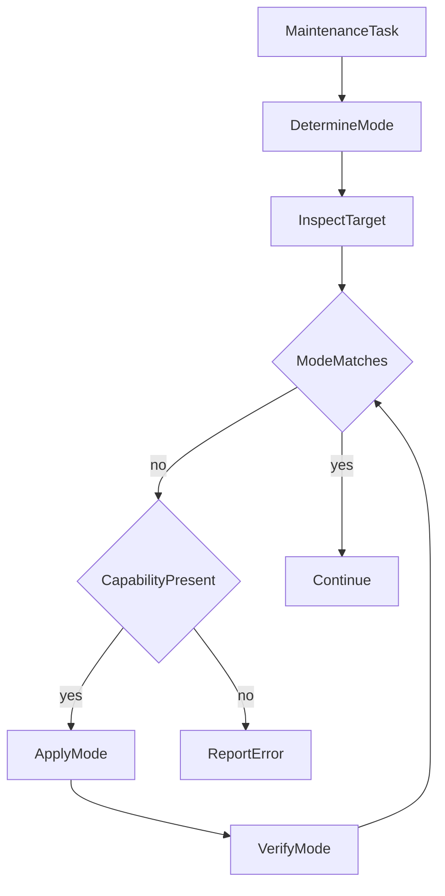

# Platform Permissions

Platform Permissions is the client agent boundary for local filesystem modes, privilege checks, elevation prompts, and command execution. The code is provided by the `openframe_agent_lib` dependency from OpenFrame OSS Library and is run by the OpenFrame client packaged through this repository. The authoritative source is [permissions.rs](https://github.com/flamingo-stack/openframe-oss-lib/blob/16e7c1cbd9664e7d10ec5ebca7d53c9bd314decf/clients/openframe-client/src/platform/permissions.rs).

It is an operating-system utility, not a tenant authorization layer. It does not authenticate users, decide whether a remote operation is allowed, manage access-control lists, or change file ownership. Consumers choose the operation and use this module to test or establish the local conditions it needs.

## Architecture

The client application and its installation, directory, service, update, diagnostic, and logging work are expected consumers. Platform Permissions contains the platform-specific mechanics; callers retain responsibility for target selection, retry policy, user messaging, and error handling.

## Core API

### Permission Values

`Permissions` contains a public numeric `mode` field. On Unix, this is the lower nine POSIX permission bits.

| API | Result | Intent |
|---|---:|---|
| `Permissions::directory()` | `0755` | Standard directory mode |
| `Permissions::file()` | `0644` | Standard file mode |
| `Permissions::from_path(path)` | Existing or approximated mode | Inspect a target |
| `Permissions::apply(path)` | Success or `PermissionError` | Apply the requested mode |
| `Permissions::verify(path)` | Boolean or `PermissionError` | Test the requested mode |

Although the source comments describe the standard modes with `root:admin`, this module changes only mode bits. It does not alter owner or group.

### Error Model

`PermissionError` makes filesystem and process failures recoverable:

- `Io` wraps metadata, permission, and process-launch errors.
- `InvalidMode` and `InvalidPath` support validation-oriented callers, though this file does not construct them.
- `AdminCheckFailed` signals unsupported privilege handling.
- `ElevationRequired` signals a platform without an elevation implementation.
- `CommandFailed` records the process exit code, or `-1` when no exit code is available.

### Capability Model

`Capability` represents local requirements checked by `PermissionUtils::has_capability`.

| Capability | Evaluation |
|---|---|
| `ManageServices` | Requires administrator or root status |
| `WriteSystemDirectories` | Requires administrator or root status |
| `ReadSystemLogs` | Uses platform-specific log-read checks |
| `WriteSystemLogs` | Requires administrator or root status |

`warn_missing_capabilities()` tests every capability and logs a warning for each unavailable one. This is a preflight diagnostic, not a complete operating-system authorization policy.

## Filesystem Flow

### Unix Behavior

On Unix, `apply` converts the stored mode into `std::fs::Permissions` and invokes `set_permissions`. `verify` compares `actual_mode & 0777` with the requested mode exactly. `from_path` returns the target mode masked with `0777`.

Special bits such as set-user-ID, set-group-ID, and sticky are excluded from both inspection and verification. No path creation, recursive traversal, ownership change, or ACL update occurs.

### Windows and Other Non-Unix Behavior

Windows cannot receive numeric POSIX modes through this implementation. If the requested mode includes owner-write permission and the target exists, `apply` clears its read-only attribute. Otherwise it performs no change. `verify` considers a writable request valid when the target is not read-only; a request that does not require write access succeeds after metadata can be read.

`from_path` reports `0444` for read-only Windows paths and `0644` otherwise. On non-Unix targets other than Windows, it returns `0644`, `apply` succeeds without a numeric mode change, and `verify` succeeds after metadata lookup. These are deliberate approximations and must not be interpreted as Windows ACL enforcement.

## Privilege Checks

`PermissionUtils::is_admin()` first evaluates the process-local `ADMIN_PRIVILEGES_GRANTED` atomic flag. If the flag is not set, Unix checks whether the effective user ID is zero and Windows invokes `is_elevated::is_elevated()`. Unsupported platforms return false.

`require_admin()` is the hard command-line guard. When the process is not considered elevated, it writes an instruction to standard error and exits with status `1`. Code needing recoverable control flow should use the result-returning APIs instead.

The `ReadSystemLogs` capability is distinct from the administrator-only capabilities:

- Unix root always passes.
- macOS accepts membership of the configured administrator group ID `80`.
- Linux inspects `/var/log` metadata for world readability, owner readability for the effective user, or group readability for a current group.
- Windows requires the Event Log directory to exist and the process to be elevated.

The Unix group helper begins with capacity for sixteen groups. This is relevant if the client must recognize membership in unusually large group sets.

## Elevation and Command Interaction

`ensure_admin()` uses a platform-specific proof command to request elevation:

| Platform | Elevation attempt |
|---|---|
| Windows | ShellExecute starts `cmd.exe` using the UAC `runas` verb |
| macOS | `osascript` runs a shell command with administrator privileges and a prompt |
| Linux | `pkexec` is tried before a `sudo` fallback |
| Other platforms | Returns `ElevationRequired` |

`run_as_admin(command, args)` runs directly if the atomic flag is set or `is_admin()` succeeds. Otherwise it calls `ensure_admin()` and then calls `run_command`. `run_command` captures standard output and standard error, logs non-empty streams, and returns `CommandFailed` for a nonzero exit status.

> **Elevation limitation:** a successful prompt runs only a small proof command and sets a process-local flag. It does not elevate the current process and does not wrap the requested command in an elevated launcher. A successful `ensure_admin()` therefore proves the prompt command succeeded, not that the subsequent direct command has inherited administrator or root authority. Operations that need guaranteed elevation must launch the intended command in the operating-system elevated context and verify its real effect.

## Permission Preflight Process

The module does not join these individual calls automatically. A consumer should determine the expected mode, inspect the target, check the required capability, apply a repair only when authorized, and verify the final state before relying on it.

## Security and Operational Considerations

1. Treat `Permissions` as a mode abstraction rather than an installer, recursive repair tool, or ACL manager.
2. Verify after `apply` whenever a task requires a particular final mode.
3. Re-check the authorization of the actual privileged action; the elevation flag is not a security boundary.
4. Do not pass secrets through `run_command`: the implementation logs non-empty standard output and standard error.
5. Use `require_admin` only at an intentional process boundary because it terminates the process.
6. Preserve the distinct Unix and Windows semantics when changing behavior. A successful Windows operation does not establish an equivalent POSIX mode or ACL.

## Maintenance Scope

Changes can affect agent installation, directory repair, service control, system-log collection, binary updates, and cleanup. Review changes for missing paths, declined prompts, already-elevated processes, unsupported platforms, exact Unix-mode comparisons, Windows read-only handling, and command-output logging.

Platform Permissions is implemented in the OpenFrame OSS Library, not directly in this repository. Update and review the linked library source first, then consume the appropriate dependency version in this tenant repository.
