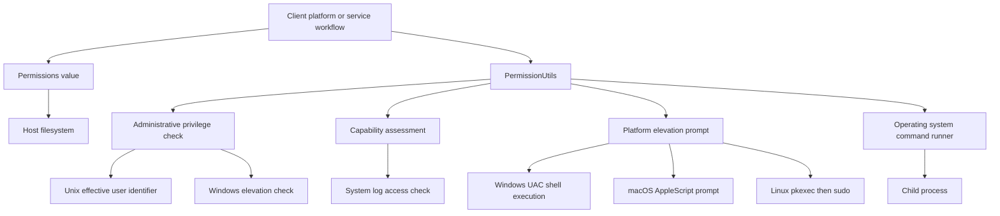
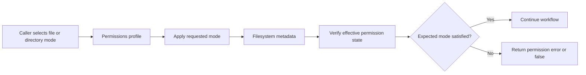
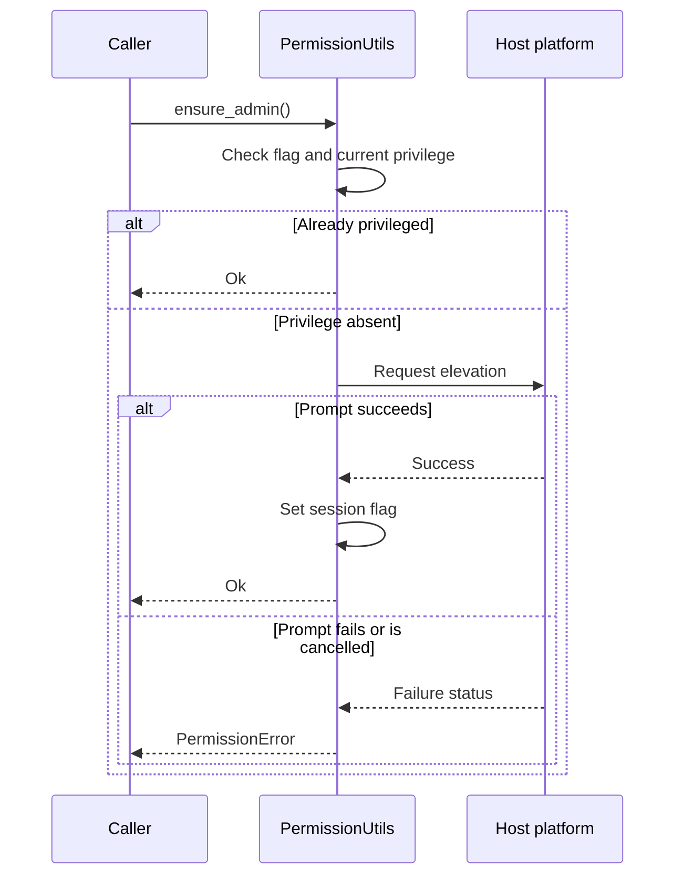
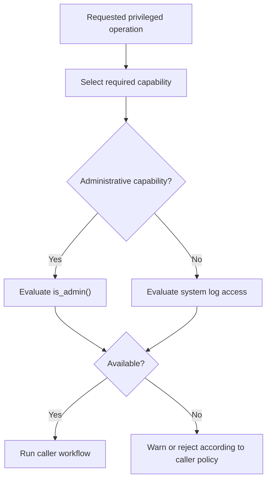

# Platform Permissions

Platform Permissions is the host-operating-system permission boundary used by the OpenFrame Client agent. It is implemented in the `openframe_agent_lib` Cargo dependency, supplied by OpenFrame OSS Library version `0.0.5` and executed by this repository's client runtime. The module provides two distinct concerns:

- A small `Permissions` value type that reads, applies, and verifies filesystem modes.
- `PermissionUtils`, which detects administrative privilege, assesses operation capabilities, requests elevation where supported, and runs commands while reporting their output.

The implementation is platform-aware: Unix targets use numeric mode bits and effective user identifiers, while Windows uses the read-only attribute for the available filesystem check. It is a local-machine utility; it does not call OpenFrame services or persist authorization decisions.

**Source:** [permissions.rs in OpenFrame OSS Library](https://github.com/flamingo-stack/openframe-oss-lib/blob/7a766f00e4f58b5d89db007b878ac8d6e0c344f4/clients/openframe-client/src/platform/permissions.rs)

## Responsibilities and Boundaries

The module centralizes permission-related behavior so installation, service control, logging, update, and tool-management paths can use a consistent platform abstraction.

| Area | Responsibility | Important boundary |
|---|---|---|
| Filesystem modes | Construct expected file or directory modes, read a path's mode, set a mode, and compare the actual mode with the requested mode. | POSIX modes are applied and compared only on Unix. Windows does not emulate ownership or ACL semantics. |
| Privilege status | Determine whether the process is already privileged. | Unix checks effective UID zero. Windows delegates to `is_elevated`. |
| Elevation request | Invoke the platform's prompt mechanism when elevation is needed. | A successful prompt sets an in-process flag; it does not replace or relaunch the current process as an elevated process. |
| Capability checks | Report whether a process may manage services, write protected locations, or read and write system logs. | Capabilities are computed locally and are not a policy or access-control system. |
| Command execution | Run commands and translate process failures into typed errors. | Arguments are supplied by callers. The utility does not validate commands, escape arguments, or constrain an allowlist. |

## Architecture

`Permissions` models desired filesystem state. `PermissionUtils` owns process-level administrative and capability decisions. Both expose `PermissionError` for operations that return recoverable errors, while `require_admin` deliberately terminates the process when the agent cannot continue without elevated rights.

## Filesystem Permission Model

`Permissions` contains one public field, `mode`, represented as a numeric Unix permission mask.

| Constructor or operation | Behavior |
|---|---|
| `Permissions::directory()` | Returns mode `0755`, the module's standard directory mode. |
| `Permissions::file()` | Returns mode `0644`, the module's standard file mode. |
| `Permissions::from_path(path)` | Reads metadata. Unix targets retain only the low `0777` permission bits. Windows maps read-only to `0444` and otherwise returns `0644`. |
| `apply(path)` | Unix constructs permissions from `mode` and updates the path. On non-Unix targets, a requested owner-write bit causes an existing read-only file to be made writable where supported. |
| `verify(path)` | Unix compares the path's low `0777` bits for exact equality with `mode`. Windows considers a writable request satisfied when the target is not read-only. |

The comments describe the standard modes as `root:admin`, but this implementation only changes mode bits. It does not call ownership-changing APIs, so ownership and group assignment remain the caller or installer responsibility.

### Filesystem Data Flow

On Unix, missing paths and permission-denied metadata operations become `PermissionError::Io`. Invalid mode and invalid path error variants exist in the public error type, but the provided implementation does not construct them directly.

## Administrative Privilege and Capabilities

`is_admin()` first observes the process-wide `ADMIN_PRIVILEGES_GRANTED` atomic flag. When the flag is unset, it evaluates platform state:

- **Unix:** returns true only when the effective UID is zero.
- **Windows:** uses the `is_elevated` crate.
- **Other targets:** returns false.

The available `Capability` variants deliberately map to concrete host requirements:

| Capability | Condition |
|---|---|
| `ManageServices` | Administrative privilege is required. |
| `WriteSystemDirectories` | Administrative privilege is required. |
| `WriteSystemLogs` | Administrative privilege is required. |
| `ReadSystemLogs` | Root succeeds on Unix. macOS accepts membership in group ID `80`; Linux inspects access to `/var/log`; Windows requires the event-log path and administrative privilege. |

`warn_missing_capabilities()` checks all four capabilities and emits a warning for each unavailable capability. This is diagnostic only: it does not grant access or stop a workflow. `require_admin()` is the hard-stop counterpart: it writes a message to standard error and exits with status `1` if `is_admin()` is false.

## Elevation and Command Interaction

`ensure_admin()` returns immediately when the administrative flag is set or the process is already privileged. Otherwise, it requests elevation using the native mechanism and records a successful request in the atomic flag:

The mechanisms are Windows `ShellExecuteW` with the `runas` verb, macOS `osascript` with administrator privileges, and Linux `pkexec` followed by a `sudo` fallback. Unsupported platforms return `ElevationRequired`.

A successful prompt is treated as a session-level grant by this module. Maintainers should not assume it changes the current process token or effective UID. In particular, `run_as_admin()` calls `ensure_admin()` and then invokes `run_command()` from the current process. Any caller that needs an actually elevated child process must validate the resulting operating-system behavior and not rely solely on the atomic flag.

`run_command(command, args)` captures a child process's output, logs standard output at info level and standard error at error level, and returns `CommandFailed` with the exit status when the command fails. Startup failure becomes `PermissionError::Io`.

## Capability Evaluation Process

## Error Handling and Operational Guidance

`PermissionError` distinguishes I/O failures, unsupported or failed elevation, an administrative-check failure, invalid-mode and invalid-path values, and nonzero command exits. Callers that use `apply`, `from_path`, command execution, or elevation should propagate or explicitly report the returned error. `verify` returns `Ok(false)` for a mismatch rather than treating the mismatch itself as an I/O failure.

When changing this module:

1. Preserve the distinction between checking existing privilege and requesting elevation.
2. Keep Unix mode operations behind their target guards; do not imply POSIX mode or ownership enforcement on Windows.
3. Treat the session flag as optimization and workflow state, not proof that an operating-system security context changed.
4. Add capability variants only with a platform-specific implementation and clear failure behavior for unsupported targets.
5. Avoid passing untrusted command names or arguments to `run_command` or `run_as_admin`; execution authority belongs to the invoking workflow.

## System Role

Platform Permissions supports the OpenFrame Client's host-side lifecycle rather than the tenant's server authorization model. Its consumers can use it before writing protected files, interacting with services, accessing system logs, or performing commands that require elevated rights. The module therefore provides the local prerequisite checks and diagnostics that higher-level installation, service, update, and monitoring components need, while leaving their business decisions and remote authorization outside this boundary.
